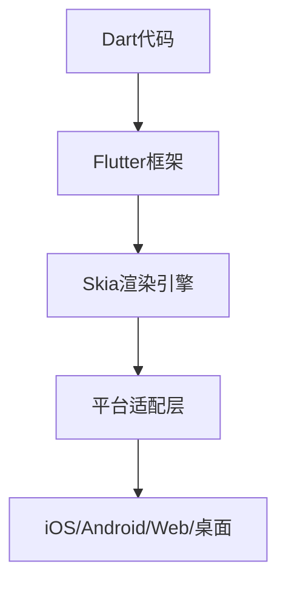

## 今日热点

今日GitHub热榜项目精彩纷呈。

---

## 热门项目一览

| 排名 | 项目 | 语言 | 今日 | 总计 | 简介 |
|:---:|------|:----:|------:|-----:|------|
| 1 | [morluto/rea](https://github.com/morluto/rea) | TypeScript | +25,793 | 75,114 | Reverse engineer anything w... |
| 2 | [boykopovar/AnyPS5](https://github.com/boykopovar/AnyPS5) | C++ | +5,805 | 27,124 | Tool for automatic PS5 exec... |
| 3 | [storytold/artcraft](https://github.com/storytold/artcraft) | Rust | +3,222 | 14,719 | ArtCraft is an intentional ... |
| 4 | [mattpocock/skills](https://github.com/mattpocock/skills) | Shell | +1,736 | 284,643 | Skills for Real Engineers. ... |
| 5 | [cathrynlavery/diagram-design](https://github.com/cathrynlavery/diagram-design) | HTML | +1,190 | 49,059 | Editorial diagram design fo... |
| 6 | [anthropics/knowledge-work-plugins](https://github.com/anthropics/knowledge-work-plugins) | Python | +625 | 28,857 | Open source repository of p... |
| 7 | [hugohe3/ppt-master](https://github.com/hugohe3/ppt-master) | Python | +461 | 59,569 | AI turns documents or topic... |
| 8 | [multica-ai/andrej-karpathy-skills](https://github.com/multica-ai/andrej-karpathy-skills) | Unknown | +278 | 218,345 | A single CLAUDE.md file to ... |
| 9 | [mksglu/context-mode](https://github.com/mksglu/context-mode) | TypeScript | +178 | 26,363 | Context window optimization... |
| 10 | [huggingface/transformers](https://github.com/huggingface/transformers) | Python | +96 | 167,306 | 🤗 Transformers: the model-d... |
| 11 | [flutter/flutter](https://github.com/flutter/flutter) | Dart | +88 | 179,564 | Flutter makes it easy and f... |
| 12 | [pytorch/pytorch](https://github.com/pytorch/pytorch) | Python | +84 | 104,163 | Tensors and Dynamic neural ... |

---

## 趋势洞察

```
┌─────────────────────────────────────────────────────────────────┐
│  AI/ML 工具         ████████████████████████  10 个项目        │
│  开发框架             ██                        1 个项目        │
│  开发工具             ██                        1 个项目        │
│  其他               ██                        1 个项目        │
└─────────────────────────────────────────────────────────────────┘
```

---

## 项目深度解读

### 1. morluto/rea — 逆向工程平台

> **一句话总结**：使用智能代理技术，从应用到原生二进制文件的全方位逆向工程解决方案。

#### 价值主张

| 维度 | 说明 |
|------|------|
| **解决痛点** | 自动化完成从应用程序行为到原生二进制文件的复杂逆向任务 |
| **目标用户** | 安全研究员、逆向工程师、恶意软件分析师、软件开发者 |
| **核心亮点** | 智能代理技术 + 自动化逆向流程 + 多层次分析能力 + 跨平台支持 |

#### 技术架构


**技术特色**：
- 基于TypeScript构建，提供类型安全和开发体验
- 智能代理技术实现自动化逆向分析
- 支持从应用到原生二进制文件的全方位逆向
- 高度模块化设计，易于扩展

#### 热度分析

- 项目Star数高达75,114，单日增长25,793，表明近期可能有重大更新或突破性功能发布
- Fork数15,961，社区参与度高，项目被广泛用于二次开发和定制

#### 快速上手

```bash
# 安装rea
npm install -g rea

# 初始化项目
rea init my-reverse-project

# 开始逆向分析
rea analyze --target /path/to/target
```

#### 注意事项

- 由于许可证未知，商业使用前需确认授权条款
- 逆向工程可能涉及法律风险，请确保在合法合规范围内使用
- 项目可能需要较高的系统权限才能正常运行


### 2. boykopovar/AnyPS5 — PS5游戏跨平台工具

> **一句话总结**：AnyPS5是一款自动将PS5游戏移植到Linux和Windows平台的强大工具，打破平台限制。

#### 价值主张

| 维度 | 说明 |
|------|------|
| **解决痛点** | 解决PS5游戏只能在PlayStation平台运行的限制，实现跨平台游戏体验 |
| **目标用户** | 希望在不购买PlayStation的情况下玩PS5游戏的PC玩家、游戏开发者和测试人员 |
| **核心亮点** | 自动化移植流程 + 无需修改原始游戏代码 + 支持多平台输出 + 保持游戏性能 |

#### 技术架构


**技术特色**：
- C++开发的高效逆向工程工具
- 自动处理游戏依赖和系统调用转换
- 保持游戏原始性能和兼容性

#### 热度分析

- 项目在短时间内获得超过2.7万星，单日增长近6000星，显示极高的社区关注度
- 作为游戏移植工具，处于游戏爱好者社区和技术开发者交叉的热点领域

#### 快速上手

```bash
# 克隆项目
git clone https://github.com/boykopovar/AnyPS5.git
cd AnyPS5

# 编译项目
mkdir build && cd build
cmake ..
make

# 使用工具移植游戏
./anyps5 /path/to/ps5/game
```

#### 注意事项

- 项目可能涉及版权和法律问题，请确保你有合法拥有游戏的权限
- 移植后的游戏可能存在兼容性问题，需要进一步调试和优化
- 项目尚处于开发阶段，可能存在不稳定因素


### 3. storytold/artcraft — 艺术创作引擎

> **一句话总结**：专为创意工作者打造的高性能跨媒体内容创作工具，整合设计与制作流程。

#### 价值主张

| 维度 | 说明 |
|------|------|
| **解决痛点** | 解决创意工作者跨媒体创作工具分散、工作流程割裂的问题 |
| **目标用户** | 艺术家、设计师和电影制作人等创意专业人士 |
| **核心亮点** | 跨媒体支持 + 直观界面 + Rust高性能引擎 + 创意流程整合 |

#### 技术架构


**技术特色**：
- 基于Rust构建的高性能创作核心
- 支持多种媒体类型的统一处理框架
- 跨平台的创意工作流解决方案

#### 热度分析

- 项目近期增长迅猛，单日新增3,222星标，显示社区高度关注
- 作为创意工具领域的开源项目，正填补专业软件与创意工具间的空白

#### 快速上手

```bash
# 克隆项目
git clone https://github.com/storytold/artcraft.git
# 编译项目
cargo build --release
```

#### 注意事项

- 项目许可证信息未知，商业使用前需确认授权方式
- 作为新兴项目，文档和社区支持可能还在完善阶段


### 4. mattpocock/skills — 工程师技能集

> **一句话总结**：真实工程师实用技能集合，直接来源于作者.agents目录的实战配置。

#### 价值主张

| 维度 | 说明 |
|------|------|
| **解决痛点** | 解决工程师缺乏实用技能配置和高效工作流程的问题 |
| **目标用户** | 软件开发工程师和技术专业人员 |
| **核心亮点** | 实用技能集合 + 直接来自实践 + 配置文件共享 |

#### 技术架构


**技术特色**：
- 基于Shell脚本，跨平台兼容性强
- 直接从实践出发，实用性强
- 结构化组织，易于查找和使用

#### 热度分析

- 项目获得超28万星，单日增长1700+，表明开发者社区高度认可其价值
- Fork数与Star数比例约为1:12，显示项目主要用于学习和参考

#### 快速上手

```bash
git clone https://github.com/mattpocock/skills.git
cd skills
ls
```

#### 注意事项

- 项目可能需要一定的Shell脚本知识才能有效使用
- 由于没有明确的许可证，使用时需注意版权问题


### 5. cathrynlavery/diagram-design — 专业图表设计库

> **一句话总结**：纯HTML/SVG实现的44种编辑式图表，专为AI编程工具打造的高质量可视化方案。

#### 价值主张

| 维度 | 说明 |
|------|------|
| **解决痛点** | 解决AI编程工具中专业图表设计需求，避免Mermaid等工具的质量限制 |
| **目标用户** | AI编程工具用户、技术文档编写者、追求高质量图表的开发者 |
| **核心亮点** | 44种专业图表类型 + 纯HTML/SVG实现 + 无依赖设计 + 专为AI工具优化 |

#### 技术架构


**技术特色**：
- 纯HTML/SVG实现，零外部依赖，可直接嵌入任何网页
- 44种专业图表类型，覆盖多种技术文档场景
- 简洁设计风格，无阴影效果，保持视觉一致性

#### 热度分析

- 项目获近5万星，单日增长近1200星，社区认可度极高且持续升温
- 零开放问题表明项目维护完善，用户需求已充分满足

#### 快速上手

```bash
# 访问项目主页
# 复制所需图表的HTML/SVG代码
# 粘贴到您的文档或网页中
```

#### 注意事项

- 项目明确不提供Mermaid支持，强调其"粗糙"效果
- 无阴影设计风格保持图表简洁专业
- 许可证信息不明确，商业使用前需确认授权细节


### 6. anthropics/knowledge-work-plugins — 知识工作插件库

> **一句话总结**：Anthropic官方开源的Claude Cowork插件库，提升知识工作者协作效率。

#### 价值主张

| 维度 | 说明 |
|------|------|
| **解决痛点** | 为知识工作者提供专业化工具，解决信息处理与协作效率问题 |
| **目标用户** | 研究人员、分析师、内容创作者、团队协作者 |
| **核心亮点** | 模块化插件设计 + Claude深度集成 + 知识工作流优化 + 开源可扩展 |

#### 技术架构


**技术特色**：
- 基于Python构建的轻量级插件架构
- 与Claude AI模型无缝协同处理知识任务
- 模块化设计支持按需加载与组合

#### 热度分析

- 超过2.8万Star且持续高增长，反映知识工作者对AI辅助工具的强烈需求
- 作为Anthropic官方开源项目，在AI辅助工作领域具有生态引领地位

#### 快速上手

```bash
# 克隆仓库
git clone https://github.com/anthropics/knowledge-work-plugins.git

# 安装依赖
cd knowledge-work-plugins
pip install -r requirements.txt
```

#### 注意事项

- 需要Anthropic账户和Claude Cowork访问权限
- 插件可能需要根据具体工作场景进行配置
- 项目许可证未知，商业使用前需确认授权条款


### 7. hugohe3/ppt-master — AI PPT生成器

> **一句话总结**：AI将文档或主题自动转换为专业PowerPoint，支持动画、图表、音频和自定义模板。

#### 价值主张

| 维度 | 说明 |
|------|------|
| **解决痛点** | 解决手动创建专业PPT耗时长、设计难度大的问题 |
| **目标用户** | 商务人士、教育工作者和需要快速制作演示文稿的内容创作者 |
| **核心亮点** | AI智能生成 + 原生PowerPoint支持 + 数据可视化 + 音频旁白 + 自定义模板 |

#### 技术架构


**技术特色**：
- 基于大模型的文档内容智能解析与结构化
- 原生PowerPoint元素精确生成技术
- 数据可视化自动嵌入与图表生成

#### 热度分析

- 项目Star数超5.9万，单日新增461星，处于快速增长期，用户认可度高
- Fork数近4700，社区参与活跃，Issues为0表明项目已相对成熟稳定

#### 快速上手

```bash
# 安装依赖
pip install -r requirements.txt

# 运行项目
python ppt_master.py --input document.txt --output presentation.pptx
```

#### 注意事项

- 项目许可证未知，使用前需确认授权条款
- 输入文档质量直接影响生成效果，建议提供结构化内容
- 可能需要配置OpenAI API或其他AI服务的访问权限


### 8. multica-ai/andrej-karpathy-skills — AI 编程指南

> **一句话总结**：基于 Karpathy 对 LLM 编程陷阱的观察，优化 Claude Code 行为的简洁指南。

#### 价值主张

| 维度 | 说明 |
|------|------|
| **解决痛点** | 解决 Claude Code 编程中常见的陷阱和效率问题 |
| **目标用户** | 使用 Claude Code 进行编程的开发者 |
| **核心亮点** | 源自顶尖 AI 专家经验 + 简洁实用的单文件指南 + 针对性改进 Code 行为 |

#### 技术架构

**技术特色**：
- 基于 Andrej Karpathy 的 LLM 编程经验
- 简洁明了的单一文件结构
- 针对性优化 Claude Code 行为

#### 热度分析

- 项目获得超21万星，日增近300星，热度持续攀升
- 零开放问题表明项目成熟度高，社区反馈积极

#### 快速上手

```bash
# 克隆仓库并查看 CLAUDE.md 文件
git clone https://github.com/multica-ai/andrej-karpathy-skills.git
cat andrej-karpathy-skills/CLAUDE.md
```

#### 注意事项
- 项目仅包含一个 CLAUDE.md 文件，没有其他代码或资源
- 内容基于 Andrej Karpathy 的经验，可能需要根据个人需求调整
- 使用前建议先了解 Claude Code 的基本用法


### 9. mksglu/context-mode — AI 编程优化

> **一句话总结**：优化AI编程助手上下文窗口，沙箱工具输出并跨17平台路由

#### 价值主张

| 维度 | 说明 |
|------|------|
| **解决痛点** | 解决AI编程助手上下文窗口有限和工具输出混乱问题 |
| **目标用户** | AI编程助手开发者和使用者 |
| **核心亮点** | 沙箱工具输出 + 持久化会话记忆 + MCP多平台路由 |

#### 技术架构


**技术特色**：
- 沙箱工具输出减少98%资源消耗
- 会话记忆持久化保持上下文连续性
- 通过MCP+hooks实现17平台统一路由

#### 热度分析

- 高星项目(26k+)持续增长，今日新增178星，热度攀升明显
- 社区活跃度高，零开放问题表明项目维护良好

#### 快速上手

```bash
# 安装依赖
npm install

# 配置MCP
npx context-mode init

# 启动服务
npx context-mode start
```

#### 注意事项

- 项目许可证未知，商业使用前需确认授权条款
- 依赖MCP协议，确保目标平台兼容性
- 沙箱功能可能限制某些工具的完整功能


### 10. huggingface/transformers — AI模型框架

> **一句话总结**：提供最先进的文本、视觉、音频等多模态机器学习模型的统一框架，支持推理与训练。

#### 价值主张

| 维度 | 说明 |
|------|------|
| **解决痛点** | 统一访问和部署各种最先进的预训练模型，简化AI应用开发流程 |
| **目标用户** | AI研究人员、开发者、数据科学家和需要快速部署ML模型的团队 |
| **核心亮点** | 统一API接口 + 丰富预训练模型库 + 多模态支持 + 易于微调 |

#### 技术架构


**技术特色**：
- 统一的API设计，支持1000+预训练模型
- 自动优化推理性能，支持多种硬件后端
- 模型中心化存储与管理，简化模型发现与使用

#### 热度分析

- 拥有16万+星标，日均增长约100星，处于AI工具生态的核心位置
- 作为NLP和AI领域的标杆项目，社区活跃度极高，贡献者遍布全球

#### 快速上手

```bash
# 安装库
pip install transformers torch

# 使用示例
from transformers import pipeline
classifier = pipeline("sentiment-analysis")
result = classifier("I love using transformers!")
print(result)
```

#### 注意事项
- 某些大型模型需要大量计算资源，建议在GPU环境下运行
- 使用商业模型时需注意许可证限制，尤其是OpenAI等闭源模型
- 频繁更新可能导致API变化，建议锁定版本号用于生产环境


### 11. flutter/flutter — 跨平台UI框架

> **一句话总结**：Google开发的跨平台UI工具包，通过单一代码库构建高性能美观的移动、Web和桌面应用。

#### 价值主张

| 维度 | 说明 |
|------|------|
| **解决痛点** | 跨平台开发中UI一致性与原生性能难以兼顾的问题 |
| **目标用户** | 移动应用开发者、全栈开发者、企业移动团队 |
| **核心亮点** | 热重载功能 + 丰富UI组件 + 高性能Skia渲染 + 响应式编程 + 跨平台支持 |

#### 技术架构



**技术特色**：
- 基于Dart语言，支持JIT开发与AOT生产编译
- 响应式UI编程模型，状态驱动界面更新
- 自定义高性能渲染管道，避免跨平台性能损失

#### 热度分析

- 项目拥有17.9万星，日增88星，呈现稳定增长趋势，开发者社区活跃度高
- 作为Google主推的跨平台解决方案，已成为移动开发主流选择之一

#### 快速上手

```bash
# 安装Flutter SDK
git clone https://github.com/flutter/flutter.git
export PATH="$PATH:`pwd`/flutter/bin"

# 创建并运行项目
flutter create my_app
cd my_app && flutter run
```

#### 注意事项

- 应用首次安装包体积较大，需考虑用户下载体验
- 对于需要深度原生功能的项目，可能需要编写平台特定代码
- 项目更新频繁，开发时需注意版本兼容性


### 12. pytorch/pytorch — 深度学习框架

> **一句话总结**：基于Python的动态神经网络框架，提供强大GPU加速和灵活的模型构建能力。

#### 价值主张

| 维度 | 说明 |
|------|------|
| **解决痛点** | 解决深度学习模型开发中计算效率低、调试困难的问题 |
| **目标用户** | 研究人员、数据科学家、深度学习工程师和AI开发者 |
| **核心亮点** | 动态计算图 + Python原生支持 + 强大的GPU加速 + 丰富的预训练模型 + 活跃的社区生态 |

#### 技术架构


**技术特色**：
- 基于动态计算图，支持灵活的模型构建和调试
- 提供丰富的API和工具链，简化深度学习开发流程
- 与Python生态系统无缝集成，支持NumPy转换和科学计算库

#### 热度分析

- 拥有超10万颗星，日增约84颗星，表明其持续受到开发者关注和认可
- 作为深度学习领域顶级框架，在学术界和工业界应用广泛，社区活跃度极高

#### 快速上手

```bash
# 安装PyTorch
pip install torch torchvision

# 创建一个简单的神经网络
import torch
import torch.nn as nn

# 定义一个简单的网络
class Net(nn.Module):
    def __init__(self):
        super(Net, self).__init__()
        self.fc = nn.Linear(10, 2)

    def forward(self, x):
        return self.fc(x)

# 创建网络实例并测试
net = Net()
input = torch.randn(1, 10)
output = net(input)
print(output)
```

#### 注意事项

- PyTorch版本更新较快，API可能有变化，需要注意版本兼容性
- 大规模训练时需要合理使用GPU内存，避免显存溢出
- 生产环境部署时可以考虑使用TorchScript进行优化


### 13. tensorflow/tensorflow — AI计算框架

> **一句话总结**：端到端开源机器学习平台，支持从研究到生产的全流程AI应用开发。

#### 价值主张

| 维度 | 说明 |
|------|------|
| **解决痛点** | 简化机器学习模型开发、训练和部署流程，降低AI应用门槛 |
| **目标用户** | 机器学习研究人员、数据科学家、AI工程师和开发者 |
| **核心亮点** | 跨平台支持 + 自动微分机制 + 丰富预训练模型 + 生产级部署能力 |

#### 技术架构


**技术特色**：
- 计算图优化机制，提高训练效率
- Eager Execution与Graph Execution双模式支持
- 广泛的硬件加速支持(GPU/TPU)

#### 热度分析

- 作为最流行的开源AI框架，持续保持高星标增长，社区活跃度极高
- 在工业界和研究领域均有广泛应用，形成了完整的生态系统

#### 快速上手

```bash
# 安装TensorFlow
pip install tensorflow

# 创建简单的神经网络模型
import tensorflow as tf
model = tf.keras.Sequential([tf.keras.layers.Dense(10, activation='relu', input_shape=(32,))])
model.compile(optimizer='adam', loss='mse')
```

#### 注意事项

- TensorFlow 2.x与1.x存在较大差异，迁移代码时需注意API变化
- 对于大规模模型训练，建议使用分布式训练和多GPU加速
- 模型部署时需考虑不同平台的兼容性和性能优化


## 今日推荐

| 主题 | 推荐项目 | 亮点 |
|------|----------|------|
| 今日最热 | [morluto/rea](https://github.com/morluto/rea) | Reverse engineer ... |
| 值得关注 | [boykopovar/AnyPS5](https://github.com/boykopovar/AnyPS5) | Tool for automati... |
| 快速上手 | [storytold/artcraft](https://github.com/storytold/artcraft) | ArtCraft is an in... |
| 长期潜力 | [mattpocock/skills](https://github.com/mattpocock/skills) | Skills for Real E... |

---

<div align="center">

*Generated on 2026-10-11 | Powered by GitHub Trending Reporter*

</div>