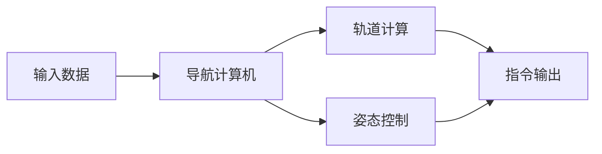

## 今日热点

今日GitHub热榜聚焦AI推理优化与逆向工程工具，AirLLM和REA项目爆火，凸显开发者对高效AI应用和系统底层分析工具的强烈需求。

---

## 热门项目一览

| 排名 | 项目 | 语言 | 今日 | 总计 | 简介 |
|:---:|------|:----:|------:|-----:|------|
| 1 | [morluto/rea](https://github.com/morluto/rea) | TypeScript | +25,599 | 111,817 | Reverse engineer anything w... |
| 2 | [boykopovar/AnyPS5](https://github.com/boykopovar/AnyPS5) | C++ | +3,952 | 30,463 | Tool for automatic PS5 exec... |
| 3 | [storytold/artcraft](https://github.com/storytold/artcraft) | Rust | +2,957 | 18,420 | ArtCraft is an intentional ... |
| 4 | [cathrynlavery/diagram-design](https://github.com/cathrynlavery/diagram-design) | HTML | +1,083 | 50,632 | Editorial diagram design fo... |
| 5 | [bilawalsidhu/gods-eye-view](https://github.com/bilawalsidhu/gods-eye-view) | JavaScript | +886 | 51,915 | A spy satellite simulator i... |
| 6 | [lyogavin/airllm](https://github.com/lyogavin/airllm) | Jupyter Notebook | +548 | 36,618 | AirLLM 70B inference with s... |
| 7 | [chrislgarry/Apollo-11](https://github.com/chrislgarry/Apollo-11) | Assembly | +466 | 74,311 | Original Apollo 11 Guidance... |
| 8 | [pytorch/pytorch](https://github.com/pytorch/pytorch) | Python | +315 | 104,568 | Tensors and Dynamic neural ... |

---

## 趋势洞察

```
┌─────────────────────────────────────────────────────────────────┐
│  AI/ML 工具         ████████████████████████  4 个项目        │
│  其他               ████████████              2 个项目        │
│  开发工具             ██████                    1 个项目        │
│  数据分析             ██████                    1 个项目        │
└─────────────────────────────────────────────────────────────────┘
```

---

## 项目深度解读

### 1. morluto/rea — 全能逆向工具

> **一句话总结**：一款基于TypeScript构建的逆向工程工具，可深度分析应用行为与原生二进制文件。

#### 价值主张

| 维度 | 说明 |
|------|------|
| **解决痛点** | 提供统一接口逆向分析各类软件与二进制文件，简化复杂逆向工程流程 |
| **目标用户** | 安全研究人员、逆向工程师、软件开发者、漏洞挖掘专家 |
| **核心亮点** | 多层次逆向分析能力 + 智能代理系统 + 跨平台支持 + 自动化分析流程 + 详细报告生成 |

#### 技术架构


**技术特色**：
- 基于TypeScript构建，提供类型安全与跨平台兼容性
- 智能代理系统可动态监控目标程序行为
- 支持从应用层到二进制层的全方位逆向分析

#### 热度分析

- 项目Star数突破11万且单日增长超2.5万，表明逆向工程领域对该工具高度认可
- 高社区活跃度与低未解决问题数(0)，反映项目成熟度高且维护良好

#### 快速上手

```bash
# 安装rea
npm install -g rea

# 基本使用
rea analyze <目标文件> --output ./report
```

#### 注意事项
- 工具可能涉及法律风险，使用前需确保目标符合当地法律法规
- 需要一定的逆向工程基础知识才能充分利用工具功能
- 部分高级功能可能需要额外配置或依赖


### 2. boykopovar/AnyPS5 — PS5游戏移植工具

> **一句话总结**：一款自动将PS5游戏可执行文件移植到Linux和Windows系统的工具，打破平台限制。

#### 价值主张

| 维度 | 说明 |
|------|------|
| **解决痛点** | 解决PS5游戏无法在PC运行的限制，扩展游戏平台兼容性 |
| **目标用户** | 想在PC上玩PS5游戏的玩家、游戏开发者、模拟器爱好者 |
| **核心亮点** | 自动化移植 + 跨平台支持 + 原生性能保持 |

#### 技术架构


**技术特色**：
- 深度解析PS5可执行文件格式，保留原始游戏逻辑
- 模拟PS5系统环境，确保游戏正常运行
- 优化性能，减少移植过程中的性能损失

#### 热度分析

- 项目近期获得大量关注，单日增长3952星，表明PS5游戏移植需求旺盛
- Fork数相对Star数较低，说明项目可能处于早期阶段，社区贡献尚不活跃

#### 快速上手

```bash
# 安装依赖
sudo apt-get install build-essential cmake

# 克隆项目
git clone https://github.com/boykopovar/AnyPS5.git
cd AnyPS5

# 构建项目
mkdir build && cd build
cmake ..
make

# 运行工具（假设用法）
./anyps5 /path/to/ps5/game
```

#### 注意事项

- 项目可能存在法律风险，涉及游戏版权和许可问题
- 移植后的游戏可能无法完美运行，需要额外调试
- 仅支持特定PS5游戏，兼容性可能有限
- 需要一定的技术知识才能正确使用工具


### 3. storytold/artcraft — 创意工具引擎

> **一句话总结**：为创意工作者提供结构化、可编程的艺术创作工具链，实现从概念到作品的精准控制。

#### 价值主张

| 维度 | 说明 |
|------|------|
| **解决痛点** | 将创意工作流程系统化，提供精确的创作控制与自动化能力 |
| **目标用户** | 数字艺术家、设计师、电影制作人和创意技术专家 |
| **核心亮点** | 基于Rust的高性能 + 可编程创作流程 + 跨平台支持 + 版本控制集成 + 参数化设计 |

#### 技术架构


**技术特色**：
- 基于 Rust 的高性能计算核心，确保复杂艺术创作的流畅执行
- 模块化设计支持插件扩展，满足不同创作需求
- 强类型系统保证创作流程的可靠性和可预测性

#### 热度分析

- 项目近期获得大量关注，Star 数激增，显示在创意工具领域具有显著吸引力
- Fork 数与 Star 数比例健康，表明社区不仅关注项目也积极参与其发展

#### 快速上手

```bash
# 安装 ArtCraft
cargo install artcraft

# 初始化新项目
artcraft init my_project

# 运行示例创作
artcraft run examples/basic_creation.art
```

#### 注意事项

- 项目文档可能不够完善，需要通过源码和示例学习
- Rust 学习曲线较陡，非 Rust 开发者可能需要额外时间适应
- 早期项目可能存在 API 变更，需关注版本更新


### 4. cathrynlavery/diagram-design — 编辑级图表

> **一句话总结**：为AI代码助手提供44种精美HTML+SVG图表，摆脱Mermaid依赖。

#### 价值主张

| 维度 | 说明 |
|------|------|
| **解决痛点** | 解决AI代码助手中图表展示不专业、依赖复杂的问题 |
| **目标用户** | AI代码助手用户、技术文档编写者、开发者 |
| **核心亮点** | 44种图表类型 + 纯HTML/SVG实现 + 编辑级设计 + 无阴影 + 无Mermaid依赖 |

#### 技术架构


**技术特色**：
- 纯HTML和SVG实现，无需额外依赖
- 44种精心设计的图表类型
- 编辑级视觉质量，无阴影干扰
- 针对AI代码助手场景优化
- 自包含解决方案，易于集成

#### 热度分析

- 高关注度项目，5万+星且单日增长过千，表明市场需求强烈
- 零开放问题，说明项目维护状态良好，用户满意度高

#### 快速上手

```bash
# 克隆项目到本地
git clone https://github.com/cathrynlavery/diagram-design.git

# 直接在浏览器中打开index.html查看所有图表
```

#### 注意事项
- 项目使用未知许可证，商业使用前需确认授权
- 专为AI代码助手设计，其他场景可能需要调整
- 不支持Mermaid语法，需适应新的图表定义方式


### 5. bilawalsidhu/gods-eye-view — 3D地球情报可视化

> **一句话总结**：浏览器中真实数据的卫星视角，提供开源空间情报的3D可视化。

#### 价值主张

| 维度 | 说明 |
|------|------|
| **解决痛点** | 将专业机构才能获取的空间情报数据，通过直观方式提供给公众 |
| **目标用户** | 地理空间情报爱好者、军事分析人员、开源情报研究者 |
| **核心亮点** | 真实数据可视化 + 3D地球交互 + 开源情报展示 + 实时更新 |

#### 技术架构


**技术特色**：
- 基于WebGL/Three.js实现高性能3D地球渲染
- 实时获取并处理开源空间情报数据
- 浏览器端实现复杂地理空间数据可视化

#### 热度分析

- 项目获得5万+星标，表明空间数据可视化领域存在巨大需求
- 高Fork/Star比例反映项目具有高度可扩展性和二次开发价值

#### 快速上手

```bash
# 克隆项目
git clone https://github.com/bilawalsidhu/gods-eye-view.git

# 安装依赖
npm install

# 启动开发服务器
npm start
```

#### 注意事项

- 项目依赖外部数据源，需确保网络连接稳定
- 某些空间数据可能涉及敏感信息，使用时需注意合规性
- 浏览器性能要求较高，低端设备可能体验不佳


### 6. lyogavin/airllm — 大模型轻量化

> **一句话总结**：突破硬件限制，在4GB GPU上实现70B大模型高效推理的创新方案。

#### 价值主张

| 维度 | 说明 |
|------|------|
| **解决痛点** | 解决大模型运行需要高端GPU资源限制，降低大模型使用门槛 |
| **目标用户** | 研究人员、开发者和爱好者，拥有有限GPU资源但想运行大模型的人群 |
| **核心亮点** | 4GB GPU运行70B模型 + 高效内存优化 + 推理性能提升 |

#### 技术架构


**技术特色**：
- 模型压缩与量化技术降低显存占用
- 创新的内存管理策略实现小GPU运行大模型
- 推理优化技术保证性能与质量平衡

#### 热度分析

- 项目获得超过3.6万星，近期增长迅速，显示大模型轻量化需求强烈
- 虽无公开问题，但高fork数表明社区积极参与二次开发与实验

#### 快速上手

```bash
git clone https://github.com/lyogavin/airllm.git
cd airllm
jupyter notebook airllm.ipynb
```

#### 注意事项

- 需要确保硬件环境满足最低要求，特别是GPU显存
- 模型推理速度可能不如高端GPU方案，需要权衡性能与资源消耗
- 可能需要根据具体硬件环境调整参数以获得最佳性能


### 7. chrislgarry/Apollo-11 — [历史代码遗产]

> **一句话总结**：阿波罗11号导航计算机原始源代码，人类登月任务的核心技术遗产。

#### 价值主张

| 维度 | 说明 |
|------|------|
| **解决痛点** | 保存并公开人类首次登月任务的核心计算机源代码，消除技术失传风险 |
| **目标用户** | 航史研究者、航天工程师、计算机历史爱好者、教育工作者 |
| **核心亮点** | 历史真实性 + 技术开创性 + 教育价值 + 软件考古 + 航天里程碑 |

#### 技术架构



**技术特色**：
- 采用汇编语言编写，适应当时计算机硬件限制
- 实时操作系统设计，支持多任务处理
- 冗余设计，确保任务关键系统的可靠性
- 仅64KB内存的极限编程，体现早期航天工程的卓越技术

#### 热度分析

- 高关注度持续增长，日增Star近500，表明历史技术遗产的现代价值被广泛认可
- 社区高度活跃，Fork比例较低(约10.9%)，更多用户倾向于直接查看而非分支修改

#### 快速上手

```bash
# 克隆仓库
git clone https://github.com/chrislgarry/Apollo-11.git

# 查看目录结构
cd Apollo-11
ls -la
```

#### 注意事项

- 这是1960年代的代码，与现代编程标准和实践有显著差异
- 代码包含大量历史注释和文档，阅读时需考虑当时的技术背景
- 汇编语言实现，需要具备一定的低级编程知识才能理解
- 代码中可能包含已过时的技术和术语，需谨慎解读


### 8. pytorch/pytorch — 深度学习框架

> **一句话总结**：PyTorch是提供GPU加速和动态计算图的Python机器学习库，简化了深度学习模型开发流程。

#### 价值主张

| 维度 | 说明 |
|------|------|
| **解决痛点** | 简化深度学习模型开发，提供灵活高效的GPU加速计算能力 |
| **目标用户** | 机器学习研究人员、数据科学家、AI工程师和深度学习爱好者 |
| **核心亮点** | 动态计算图 + 强大GPU支持 + Python原生接口 + 丰富的生态系统 + 易于调试 |

#### 技术架构


**技术特色**：
- 动态计算图机制，提供灵活性和易于调试
- 强大的GPU加速支持，充分利用NVIDIA CUDA技术
- 丰富的预训练模型和工具生态系统，如torchvision、torchtext等

#### 热度分析

- 拥有超过10万星，是深度学习领域最受欢迎的框架之一，持续稳定增长
- 拥有庞大的开发者社区和丰富的第三方库支持，是学术界和工业界的主流选择

#### 快速上手

```bash
# 安装PyTorch
pip install torch torchvision

# 基本示例
import torch
x = torch.rand(5, 3)
print(x)
```

#### 注意事项

- PyTorch版本更新可能带来API变化，需要注意版本兼容性
- 对于生产环境，可能需要考虑使用PyTorch的 TorchScript 或 ONNX 进行模型优化和部署
- 大规模训练时需要合理配置GPU内存，避免显存不足


## 今日推荐

| 主题 | 推荐项目 | 亮点 |
|------|----------|------|
| 今日最热 | [morluto/rea](https://github.com/morluto/rea) | Reverse engineer ... |
| 值得关注 | [boykopovar/AnyPS5](https://github.com/boykopovar/AnyPS5) | Tool for automati... |
| 快速上手 | [storytold/artcraft](https://github.com/storytold/artcraft) | ArtCraft is an in... |
| 长期潜力 | [cathrynlavery/diagram-design](https://github.com/cathrynlavery/diagram-design) | Editorial diagram... |

---

<div align="center">

*Generated on 2026-10-12 | Powered by GitHub Trending Reporter*

</div>