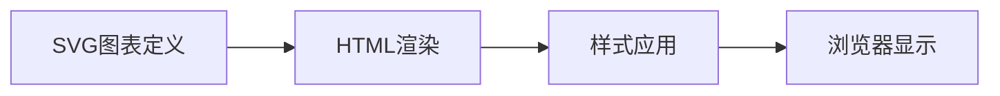

## 今日热点

今日GitHub热榜项目精彩纷呈。

---

## 热门项目一览

| 排名 | 项目 | 语言 | 今日 | 总计 | 简介 |
|:---:|------|:----:|------:|-----:|------|
| 1 | [morluto/rea](https://github.com/morluto/rea) | TypeScript | +45,327 | 168,136 | Reverse engineer anything w... |
| 2 | [storytold/artcraft](https://github.com/storytold/artcraft) | Rust | +4,095 | 22,700 | ArtCraft is an intentional ... |
| 3 | [cathrynlavery/diagram-design](https://github.com/cathrynlavery/diagram-design) | HTML | +2,081 | 52,924 | Editorial diagram design fo... |
| 4 | [bilawalsidhu/gods-eye-view](https://github.com/bilawalsidhu/gods-eye-view) | JavaScript | +1,895 | 53,988 | A spy satellite simulator i... |
| 5 | [lyogavin/airllm](https://github.com/lyogavin/airllm) | Jupyter Notebook | +879 | 37,675 | AirLLM 2.8T LLM inference w... |
| 6 | [Alishahryar1/free-claude-code](https://github.com/Alishahryar1/free-claude-code) | Python | +626 | 59,369 | Use Claude Code, Codex, VSC... |
| 7 | [mksglu/context-mode](https://github.com/mksglu/context-mode) | TypeScript | +246 | 27,454 | Context window optimization... |
| 8 | [open-webui/open-webui](https://github.com/open-webui/open-webui) | Python | +157 | 155,213 | User-friendly AI Interface ... |
| 9 | [microsoft/BitNet](https://github.com/microsoft/BitNet) | C++ | +97 | 40,976 | Official inference framewor... |

---

## 趋势洞察

```
┌─────────────────────────────────────────────────────────────────┐
│  AI/ML 工具         ████████████████████████  7 个项目        │
│  数据分析             ███                       1 个项目        │
│  其他               ███                       1 个项目        │
└─────────────────────────────────────────────────────────────────┘
```

---

## 项目深度解读

### 1. morluto/rea — 逆向工程引擎

> **一句话总结**：通过智能代理技术实现从应用到原生二进制文件的全方位逆向工程分析。

#### 价值主张

| 维度 | 说明 |
|------|------|
| **解决痛点** | 简化复杂软件的逆向分析流程，降低技术门槛 |
| **目标用户** | 安全研究员、逆向工程师、软件开发者 |
| **核心亮点** | 智能代理技术 + 全栈逆向能力 + 自动化分析 + 跨平台支持 + 高性能处理 |

#### 技术架构


**技术特色**：
- 基于TypeScript的全栈实现，确保跨平台兼容性
- 代理技术实现非侵入式程序行为监控
- 模块化设计支持多种逆向工程场景

#### 热度分析

- 项目star数达16万+，单日增长4.5万+，表明近期出现重大更新或引起广泛关注
- Fork数近4万，显示社区活跃度高，衍生项目众多

#### 快速上手

```bash
# 安装rea
npm install -g rea

# 分析二进制文件
rea analyze binary --file target.bin

# 监控应用程序行为
rea monitor --app /path/to/application
```

#### 注意事项

- 由于项目涉及逆向工程，使用时需遵守相关法律法规
- 项目许可证未知，商业使用前需确认授权条款
- 逆向工程可能违反某些软件的最终用户许可协议


### 2. storytold/artcraft — 创意工艺引擎

> **一句话总结**：ArtCraft是一个专为创意专业人士设计的Rust工艺引擎，提供高性能的艺术创作与精确设计工具。

#### 价值主张

| 维度 | 说明 |
|------|------|
| **解决痛点** | 为创意专业人士提供高性能、精确可控的艺术创作工具 |
| **目标用户** | 艺术家、设计师、电影制作人 |
| **核心亮点** | 高性能Rust引擎 + 精确控制 + 跨平台支持 + 专业工作流 |

#### 技术架构


**技术特色**：
- 基于Rust构建的高性能处理引擎，确保流畅创作体验
- 模块化设计，支持多种艺术形式和创作流程
- 跨平台兼容，支持主流操作系统

#### 热度分析

- Star数22,700且单日增长4,095，表明项目近期获得极大关注，可能发布重要更新或引发行业共鸣
- Fork数3,640，显示社区积极参与和二次开发意愿强烈

#### 快速上手

```bash
# 克隆项目
git clone https://github.com/storytold/artcraft.git

# 构建项目
cd artcraft
cargo build --release
```

#### 注意事项

- 项目许可证未知，使用前需确认许可条款
- Issues数为0可能表示项目已停止维护或社区反馈渠道有限
- 作为专业工具，可能需要一定的学习曲线才能充分发挥其功能


### 3. cathrynlavery/diagram-design — 专业图表设计库

> **一句话总结**：44种自包含HTML/SVG图表设计，为AI编程助手提供专业编辑风格可视化方案。

#### 价值主张

| 维度 | 说明 |
|------|------|
| **解决痛点** | 提供简洁专业的图表设计，替代复杂且风格不一致的Mermaid语法 |
| **目标用户** | AI编程工具开发者、技术文档编写者、代码编辑器设计者 |
| **核心亮点** | 44种图表类型 + 纯HTML/SVG实现 + 无阴影设计 + 自包含 + 编辑风格 |

#### 技术架构



**技术特色**：
- 纯前端实现，无需服务器依赖
- 使用内联SVG确保图表清晰可缩放
- 精简的样式设计，专注于内容表达

#### 热度分析

- 项目获得超过5万星，单日增长2000+，表明技术文档可视化需求旺盛
- 零开放问题，维护者可能通过其他渠道处理用户反馈

#### 快速上手

```bash
# 克隆项目
git clone https://github.com/cathrynlavery/diagram-design.git

# 直接在浏览器中打开index.html
open index.html
```

#### 注意事项

- 项目使用纯HTML/SVG，可能需要自定义样式以适应不同场景
- 不支持Mermaid语法，需要适应新的图表定义方式
- 许可证信息不明确，商业使用前需确认授权情况


### 4. bilawalsidhu/gods-eye-view — 全球情报模拟器

> **一句话总结**：在浏览器中模拟卫星视角，提供实时、开源的空间情报与地球监测能力。

#### 价值主张

| 维度 | 说明 |
|------|------|
| **解决痛点** | 将复杂的卫星情报数据转化为直观可视的浏览器体验 |
| **目标用户** | 地理情报分析人员、军事爱好者、数据可视化研究者 |
| **核心亮点** | 实时数据流+逼真3D地球+开源情报+交互式体验+多源数据融合 |

#### 技术架构


**技术特色**：
- 基于WebGL的高性能3D地球渲染
- 实时数据流处理与可视化
- 跨平台浏览器兼容性设计
- 开源情报数据的多源整合

#### 热度分析

- 项目获得超过5.3万星，单日增长近1900星，表明其具有极高的关注度和实用价值
- 零开放问题显示项目维护良好，社区反馈及时，生态活跃度高

#### 快速上手

```bash
# 克隆项目
git clone https://github.com/bilawalsidhu/gods-eye-view.git

# 安装依赖并运行
cd gods-eye-view
npm install
npm start
```

#### 注意事项

- 项目需要稳定的网络连接以获取实时数据
- 可能需要较新的浏览器版本以支持WebGL和3D渲染
- 数据使用需遵守相关法律法规，特别是敏感地理信息部分


### 5. lyogavin/airllm — 低资源LLM部署

> **一句话总结**：在4GB显存GPU上实现2.8T参数LLM高效推理，突破硬件限制

#### 价值主张

| 维度 | 说明 |
|------|------|
| **解决痛点** | 解决大模型在低端硬件上无法运行的资源瓶颈问题 |
| **目标用户** | 资源受限的研究者和小型开发团队 |
| **核心亮点** | 低显存需求 + 高效推理 + 大模型支持 + 简单部署 |

#### 技术架构


**技术特色**：
- 创新的模型压缩技术降低显存占用
- 优化的推理算法减少计算资源需求
- 高效的内存管理策略实现大模型运行

#### 热度分析

- 项目Star数增长迅速，单日新增近900个，表明技术突破获得广泛关注
- 高Star/Fork比例反映项目实用价值高，社区活跃度高

#### 快速上手

```bash
# 安装依赖
pip install -r requirements.txt

# 运行示例
python airllm.py --model-path /path/to/model
```

#### 注意事项

- 项目可能需要特定的硬件环境支持
- 模型性能可能与完整版本有一定差距
- 需要关注项目更新和优化


### 6. Alishahryar1/free-claude-code — 免费AI代码助手

> **一句话总结**：提供多种AI代码模型免费访问，通过终端、IDE或浏览器使用1.3B+tokens

#### 价值主张

| 维度 | 说明 |
|------|------|
| **解决痛点** | 解决AI代码模型访问限制和高昂成本问题 |
| **目标用户** | 开发者、研究人员和学生 |
| **核心亮点** | 多模型支持 + 免费大额tokens + 跨平台使用 |

#### 技术架构


**技术特色**：
- 多模型集成架构支持多种AI代码模型
- 跨平台适配支持终端、IDE和浏览器访问
- 免费token分配系统提供1.3B+免费额度

#### 热度分析

- 项目获得近6万星，单日增长600+，热度快速上升
- 零未解决问题表明项目维护良好，社区反馈及时处理

#### 快速上手

```bash
# 安装项目依赖
pip install -r requirements.txt

# 运行服务
python main.py --model claude-code
```

#### 注意事项

- 项目未明确许可证，使用前需确认授权条款
- 免费token可能有使用限制或期限
- 服务稳定性取决于外部AI模型的可用性


### 7. mksglu/context-mode — AI上下文优化器

> **一句话总结**：优化AI编程代理上下文窗口，大幅减少工具输出占用，实现跨平台路由与会话记忆。

#### 价值主张

| 维度 | 说明 |
|------|------|
| **解决痛点** | AI编程代理上下文窗口膨胀导致的效率低下与内存占用问题 |
| **目标用户** | AI编程工具开发者、需要高效AI辅助编程的开发者 |
| **核心亮点** | 沙盒工具输出98%减少 + 持久化会话记忆 + 17平台MCP路由集成 |

#### 技术架构


**技术特色**：
- 基于TypeScript构建的高性能上下文管理系统
- 沙盒执行环境减少98%工具输出内存占用
- MCP协议实现17平台无缝集成与路由控制

#### 热度分析

- 超过2.7万星且持续增长，项目获得社区高度认可
- 零开放问题与适中Fork数，表明项目已成熟且主要用于直接使用

#### 快速上手

```bash
# 安装依赖
npm install context-mode

# 初始化配置
context-mode init

# 启动服务
context-mode start
```

#### 注意事项

- 项目许可证信息未知，商业使用前需确认授权条款
- 优化效果可能因具体使用场景与平台兼容性而异
- 需确保目标平台支持MCP协议以获得完整功能


### 8. open-webui/open-webui — AI交互平台

> **一句话总结**：一站式Web界面，统一管理多种AI模型交互体验

#### 价值主张

| 维度 | 说明 |
|------|------|
| **解决痛点** | 解决AI模型使用门槛高、接口碎片化问题 |
| **目标用户** | AI开发者、研究人员、普通AI应用用户 |
| **核心亮点** | 多模型统一接口 + 现代化Web界面 + 开源可定制 + 隐私保护 + 插件扩展 |

#### 技术架构


**技术特色**：
- 采用前后端分离架构，提升用户体验
- 模块化适配器设计，支持多种AI模型
- 基于FastAPI构建，性能高效且易于扩展

#### 热度分析

- Star数超15万，持续高速增长，表明项目获得广泛认可
- 社区活跃度高，贡献者众多，生态发展迅速

#### 快速上手

```bash
# 使用Docker快速部署
docker run -d -p 3000:8080 --add-host=host.docker.internal:host-gateway -v open-webui:/app/backend/data --name open-webui --restart always ghcr.io/open-webui/open-webui:main

# 或使用pip安装
pip install open-webui
open-webui serve
```

#### 注意事项

- 部署时需确保后端AI服务可访问，如Ollama或OpenAI API
- 默认端口为3000，如需更改可通过环境变量配置
- 生产环境部署建议配置反向代理和HTTPS
- 用户数据存储在本地，需注意备份和安全性


### 9. microsoft/BitNet — 1比特LLM推理

> **一句话总结**：微软官方1比特大语言模型推理框架，实现极致性能与效率平衡。

#### 价值主张

| 维度 | 说明 |
|------|------|
| **解决痛点** | 降低大模型部署门槛，提升推理效率与硬件兼容性 |
| **目标用户** | AI研究人员、企业部署团队、边缘计算开发者 |
| **核心亮点** | 1-bit量化技术 + 高性能推理 + 跨平台支持 + 内存优化 |

#### 技术架构


**技术特色**：
- 采用1-bit量化技术，显著减少模型大小
- 专为低资源环境优化的推理算法
- 支持多种硬件平台的统一推理接口

#### 热度分析

- 项目Star数超过4万且持续增长，表明1-bit量化技术备受关注
- 微软背景与零开放问题反映项目成熟度高，企业级应用潜力大

#### 快速上手

```bash
# 克隆项目
git clone https://github.com/microsoft/BitNet.git

# 安装依赖
cd BitNet && pip install -r requirements.txt

# 运行示例
python examples/inference.py --model 1bit_llm --input "Hello, world!"
```

#### 注意事项

- 项目目前可能处于早期阶段，API可能会有变动
- 1-bit量化可能在某些任务上影响模型精度，需评估适用场景
- 硬件兼容性可能有限，建议查看支持列表
- 许可证信息不明确，商业使用前需确认授权条款


## 今日推荐

| 主题 | 推荐项目 | 亮点 |
|------|----------|------|
| 今日最热 | [morluto/rea](https://github.com/morluto/rea) | Reverse engineer ... |
| 值得关注 | [storytold/artcraft](https://github.com/storytold/artcraft) | ArtCraft is an in... |
| 快速上手 | [cathrynlavery/diagram-design](https://github.com/cathrynlavery/diagram-design) | Editorial diagram... |
| 长期潜力 | [bilawalsidhu/gods-eye-view](https://github.com/bilawalsidhu/gods-eye-view) | A spy satellite s... |

---

<div align="center">

*Generated on 2026-10-13 | Powered by GitHub Trending Reporter*

</div>