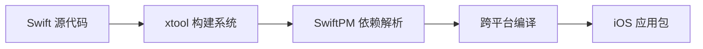
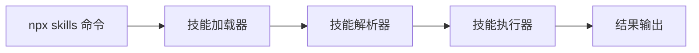

## 今日热点

今日GitHub热榜聚焦AI代理工具链的快速发展和AI模型轻量化突破，同时创意工具与开发工具的AI增强成为明显趋势。

---

## 热门项目一览

| 排名 | 项目 | 语言 | 今日 | 总计 | 简介 |
|:---:|------|:----:|------:|-----:|------|
| 1 | [morluto/rea](https://github.com/morluto/rea) | TypeScript | +54,679 | 211,476 | Reverse engineer anything w... |
| 2 | [storytold/artcraft](https://github.com/storytold/artcraft) | Rust | +4,081 | 25,930 | ArtCraft is an intentional ... |
| 3 | [bilawalsidhu/gods-eye-view](https://github.com/bilawalsidhu/gods-eye-view) | JavaScript | +1,961 | 55,556 | A spy satellite simulator i... |
| 4 | [cathrynlavery/diagram-design](https://github.com/cathrynlavery/diagram-design) | HTML | +1,815 | 54,311 | Editorial diagram design fo... |
| 5 | [debpalash/VoiceStudio](https://github.com/debpalash/VoiceStudio) | Python | +1,748 | 63,620 | VoiceStudio is the open-sou... |
| 6 | [xtool-org/xtool](https://github.com/xtool-org/xtool) | Swift | +1,198 | 9,520 | Cross-platform Xcode replac... |
| 7 | [lyogavin/airllm](https://github.com/lyogavin/airllm) | Jupyter Notebook | +1,001 | 38,392 | AirLLM 2.8T LLM inference w... |
| 8 | [mksglu/context-mode](https://github.com/mksglu/context-mode) | TypeScript | +969 | 28,335 | Context window optimization... |
| 9 | [vercel-labs/skills](https://github.com/vercel-labs/skills) | TypeScript | +190 | 34,589 | The open agent skills tool ... |

---

## 趋势洞察

```
┌─────────────────────────────────────────────────────────────────┐
│  AI/ML 工具         ████████████████████████  5 个项目        │
│  多媒体应用            ████                      1 个项目        │
│  开发工具             ████                      1 个项目        │
│  数据分析             ████                      1 个项目        │
│  其他               ████                      1 个项目        │
└─────────────────────────────────────────────────────────────────┘
```

---

## 项目深度解读

### 1. morluto/rea — 逆向工程平台

> **一句话总结**：使用智能代理技术逆向分析任何软件，从应用到原生二进制文件的全方位工程工具。

#### 价值主张

| 维度 | 说明 |
|------|------|
| **解决痛点** | 统一逆向工程框架，简化复杂软件分析流程 |
| **目标用户** | 安全研究员、逆向工程师、恶意软件分析师 |
| **核心亮点** | 多层级逆向能力 + 代理技术驱动 + 自动化分析流程 + 跨平台支持 |

#### 技术架构


**技术特色**：
- 基于TypeScript实现，提供类型安全和高性能
- 采用代理模式实现灵活的逆向分析
- 支持从应用到原生二进制的多层级逆向

#### 热度分析

- 项目Star数突破21万，单日增长5万多，表明近期获得极大关注，可能发布了重大更新
- Fork数与Star数比例约为1:4，表明项目不仅被广泛使用，也有较多活跃贡献者

#### 快速上手

```bash
# 安装rea
npm install -g rea

# 初始化逆向项目
rea init my-analysis

# 开始逆向分析
rea analyze target-app
```

#### 注意事项

- 项目许可证未知，使用前需确认授权条款
- 逆向工程可能涉及法律风险，需确保在合法合规范围内使用
- 项目可能需要较高的技术背景才能充分利用其功能


### 2. storytold/artcraft — 创意工艺引擎

> **一句话总结**：为创意专业人士提供强大且直观的创作工具，将创意想法转化为高质量作品。

#### 价值主张

| 维度 | 说明 |
|------|------|
| **解决痛点** | 创意专业人士缺乏将创意高效转化为专业作品的工具 |
| **目标用户** | 艺术家、设计师和电影制作者 |
| **核心亮点** | 高性能引擎 + 跨平台支持 + 直观界面 + 专业工作流 + 可扩展性 |

#### 技术架构


**技术特色**：
- 基于Rust构建的高性能艺术处理引擎
- 模块化设计支持多种艺术形式
- 跨平台兼容性确保广泛可用性

#### 热度分析

- 项目在短时间内获得大量关注，Star数量增长迅速，表明创意工具市场对高质量解决方案的强烈需求。
- 高Fork数量反映社区对项目的高度参与和贡献意愿。

#### 快速上手

```bash
# 克隆项目
git clone https://github.com/storytold/artcraft.git
# 构建项目
cd artcraft && cargo build --release
```

#### 注意事项

- 项目目前没有明确的许可证信息，使用前需确认授权条款
- 作为创意工具，可能需要一定的学习曲线才能充分利用其功能
- 由于项目热度高，建议关注官方更新以获取最新功能


### 3. bilawalsidhu/gods-eye-view — 实时地球监视

> **一句话总结**：浏览器中的卫星模拟器，提供真实数据的实时地球空间情报可视化。

#### 价值主张

| 维度 | 说明 |
|------|------|
| **解决痛点** | 打破专业地理情报获取壁垒，提供直观的全球实时空间数据 |
| **目标用户** | 地理数据爱好者、开源情报分析师、军事观察员、教育工作者 |
| **核心亮点** | 实时数据可视化 + 3D地球模型 + 浏览器可访问 + 开源情报 + 无需专业设备 |

#### 技术架构


**技术特色**：
- 使用WebGL技术实现高性能3D地球渲染
- 实时数据流处理与可视化技术
- 轻量级浏览器端架构设计

#### 热度分析

- 项目获得超5.5万星，近期增长迅猛（日增近2千星），表明项目具有极高关注度
- 作为开源情报工具，在当前地缘政治背景下社区活跃度极高

#### 快速上手

```bash
git clone https://github.com/bilawalsidhu/gods-eye-view.git
cd gods-eye-view
npm install
npm start
```

#### 注意事项

- 项目许可证未知，商业使用前需确认授权情况
- 数据源和隐私政策需要进一步了解
- 可能需要较新的浏览器支持以获得最佳体验


### 4. cathrynlavery/diagram-design — 专业图表设计

> **一句话总结**：为AI编程工具提供44种专业图表设计，纯HTML+SVG实现，无需依赖。

#### 价值主张

| 维度 | 说明 |
|------|------|
| **解决痛点** | 为AI编程工具提供专业、美观的图表设计方案，替代Mermaid等工具 |
| **目标用户** | AI编程工具开发者、技术文档撰写者、UI/UX设计师 |
| **核心亮点** | 44种图表类型 + 纯HTML+SVG实现 + 编辑级设计质量 + 无阴影简洁风格 |

#### 技术架构


**技术特色**：
- 纯HTML+SVG实现，无需额外依赖
- 44种精心设计的图表类型
- 编辑级设计质量，适合专业场景
- 简洁无阴影风格，突出内容本身

#### 热度分析

- 项目Star数超过5.4万，近期单日增长1800+，热度极高
- 作为AI工具生态中的专业图表解决方案，社区活跃度极高

#### 快速上手

```bash
# 克隆仓库
git clone https://github.com/cathrynlavery/diagram-design.git

# 直接在浏览器中打开index.html查看所有图表
```

#### 注意事项

- 项目未明确说明许可证，使用时需注意版权问题
- 虽然项目描述提到"没有Mermaid的混乱"，但可能需要一定的HTML/SVG知识来定制图表
- 项目依赖纯前端技术，服务器端需要额外配置才能使用某些功能


### 5. debpalash/VoiceStudio — 语音处理平台

> **一句话总结**：开源本地化语音处理工具，支持克隆、配音、转录等多功能，覆盖646种语言。

#### 价值主张

| 维度 | 说明 |
|------|------|
| **解决痛点** | 解决云端语音服务依赖、隐私问题和高成本痛点 |
| **目标用户** | 内容创作者、视频制作者、有声书开发者、语音研究人员 |
| **核心亮点** | 开源免费 + 本地部署 + 多语言支持 + 全功能集成 + 无API调用 |

#### 技术架构


**技术特色**：
- 基于本地模型的离线语音处理技术
- 支持646种语言的广泛语言覆盖能力
- 多功能语音处理集成于单一平台

#### 热度分析

- 项目Star数6.3万+，单日增长1700+，增长势头迅猛
- 7000+ Fork表明开发者社区积极参与和二次开发热情高

#### 快速上手

```bash
# 克隆仓库
git clone https://github.com/debpalash/VoiceStudio.git
# 安装依赖
cd VoiceStudio && pip install -r requirements.txt
# 运行项目
python main.py
```

#### 注意事项

- 项目未明确指定许可证，使用时需注意版权问题
- 本地运行需要较强的计算资源，特别是处理大量音频时
- 模型文件可能较大，需要足够的存储空间
- 不同功能可能需要额外下载特定模型


### 6. xtool-org/xtool — 跨平台 iOS 开发工具

> **一句话总结**：跨平台 Xcode 替代品，支持在 Linux/Windows/macOS 上使用 SwiftPM 构建 iOS 应用。

#### 价值主张

| 维度 | 说明 |
|------|------|
| **解决痛点** | 打破苹果生态限制，在非 macOS 系统上开发 iOS 应用 |
| **目标用户** | 跨平台开发者、开源贡献者、非 macOS 环境的 iOS 开发者 |
| **核心亮点** | 跨平台支持 + SwiftPM 集成 + 命令行工具 + 开源免费 |

#### 技术架构



**技术特色**：
- 使用 Swift 编写的跨平台构建工具
- 集成 SwiftPM 包管理系统
- 支持在非 macOS 系统上构建 iOS 应用
- 提供命令行界面，易于自动化

#### 热度分析

- 项目 Star 数达 9,520 且单日增长 1,198，表明项目近期获得极大关注
- Fork 数相对较少(406)，说明更多用户倾向于直接使用而非贡献代码
- 无开放 Issue，可能表示项目成熟度较高或社区通过其他渠道沟通

#### 快速上手

```bash
# 安装 xtool
brew install xtool

# 使用 SwiftPM 创建新项目
xtool create MyProject

# 构建 iOS 应用
xtool build --platform iOS
```

#### 注意事项

- 项目可能不支持所有 Xcode 的功能特性
- 跨平台兼容性可能存在限制
- 需要确保系统满足 Swift 和相关依赖的要求
- 由于是替代方案，某些 Apple 特定功能可能无法完全模拟


### 7. lyogavin/airllm — 轻量级LLM推理

> **一句话总结**：AirLLM突破硬件限制，实现单4GB GPU运行2.8T参数大模型。

#### 价值主张

| 维度 | 说明 |
|------|------|
| **解决痛点** | 解决大模型推理需高端GPU的高成本门槛问题 |
| **目标用户** | 研究人员、开发者和爱好者，拥有有限GPU资源 |
| **核心亮点** | + 内存优化技术 + 单卡运行2.8T模型 + 低成本部署 |

#### 技术架构


**技术特色**：
- 模型分块与动态加载技术
- 显存优化算法
- 单卡高效推理机制

#### 热度分析

- 项目Star数达38,392且单日增长超1000，显示社区高度关注
- Fork数3,927表明项目被广泛尝试和应用，生态活跃

#### 快速上手

```bash
git clone https://github.com/lyogavin/airllm.git
cd airllm && pip install -r requirements.txt
jupyter notebook airllm.ipynb
```

#### 注意事项

- 项目许可证未知，商业应用需谨慎
- 可能需要特定版本的CUDA和Python环境
- 推理速度可能不如高端GPU上的实现


### 8. mksglu/context-mode — AI上下文优化

> **一句话总结**：AI编码代理上下文窗口优化工具，通过沙箱化和持久化大幅提升效率。

#### 价值主张

| 维度 | 说明 |
|------|------|
| **解决痛点** | AI编码代理上下文窗口资源消耗大，工具输出冗余度高 |
| **目标用户** | AI开发者、编码助手用户、多平台集成开发者 |
| **核心亮点** | 上下文窗口优化 + 沙箱工具输出98%减少 + 会话内存持久化 + 跨17平台路由 |

#### 技术架构


**技术特色**：
- 基于TypeScript构建，类型安全性能高
- 实现工具输出98%减少的资源优化
- 通过MCP协议实现跨平台统一路由

#### 热度分析

- Star数超28k且日增近千，项目受关注度高且增长迅猛
- Fork数近2000，社区活跃度高，生态扩展性强

#### 快速上手

```bash
# 安装依赖
npm install context-mode

# 初始化配置
npx context-mode init

# 启动优化服务
context-mode serve --platforms=github,gitlab,slack
```

#### 注意事项

- 项目License未知，商业使用前需确认授权协议
- 需要与支持MCP协议的AI编码工具配合使用才能发挥最大效能
- 多平台路由功能可能需要额外配置各平台的API密钥


### 9. vercel-labs/skills — AI 代理技能集

> **一句话总结**：一款开放式的 AI 代理技能工具，通过 npx 命令即可使用，增强 AI 代理的执行能力。

#### 价值主张

| 维度 | 说明 |
|------|------|
| **解决痛点** | 解决 AI 代理能力有限、扩展性差的问题，提供丰富的技能集 |
| **目标用户** | AI 开发者、智能代理构建者和自动化工具使用者 |
| **核心亮点** | 模块化技能设计 + 命令行简单调用 + 可扩展技能生态 + TypeScript 强类型支持 |

#### 技术架构



**技术特色**：
- 基于 TypeScript 开发，提供类型安全和良好的开发体验
- 采用模块化设计，支持技能的动态加载和扩展
- 使用 npx 无需安装即可运行，降低使用门槛

#### 热度分析

- 项目获得超3.4万星标，近190星/日，呈现快速增长态势，显示市场对AI代理技能工具有强烈需求
- 作为Vercel实验室项目，继承了Vercel在开发工具领域的社区影响力和技术声誉

#### 快速上手

```bash
# 安装和使用
npx skills

# 查看帮助
npx skills --help

# 初始化技能配置
npx skills init
```

#### 注意事项

- 项目许可证未知，商业使用前需确认授权条款
- 作为Vercel实验室项目，可能处于实验阶段，API可能会有变更
- 依赖Node.js环境，确保系统兼容性


## 今日推荐

| 主题 | 推荐项目 | 亮点 |
|------|----------|------|
| 今日最热 | [morluto/rea](https://github.com/morluto/rea) | Reverse engineer ... |
| 值得关注 | [storytold/artcraft](https://github.com/storytold/artcraft) | ArtCraft is an in... |
| 快速上手 | [bilawalsidhu/gods-eye-view](https://github.com/bilawalsidhu/gods-eye-view) | A spy satellite s... |
| 长期潜力 | [cathrynlavery/diagram-design](https://github.com/cathrynlavery/diagram-design) | Editorial diagram... |

---

<div align="center">

*Generated on 2026-10-14 | Powered by GitHub Trending Reporter*

</div>