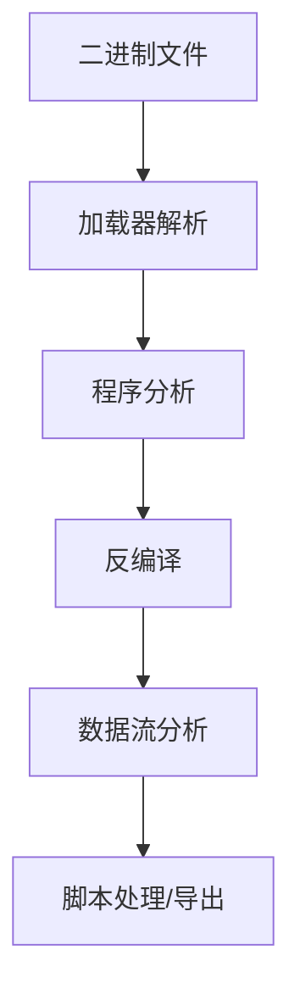
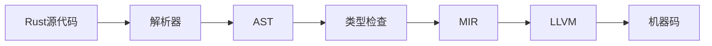
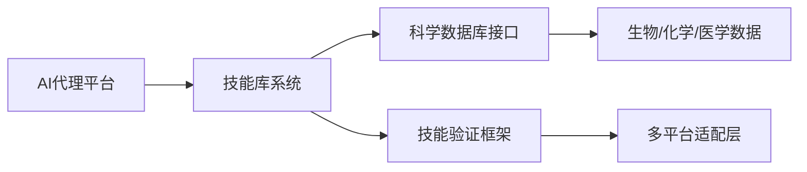
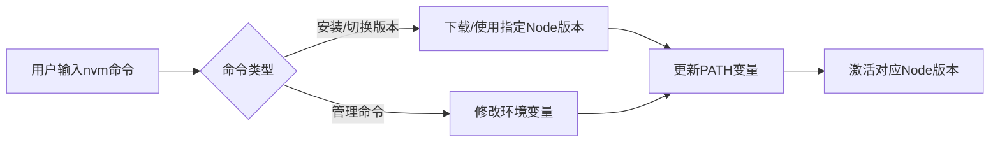

## 今日热点

AI代理技术爆发式增长，安全与逆向工程工具持续火热，开发者工具向跨平台和智能化方向发展。

---

## 热门项目一览

| 排名 | 项目 | 语言 | 今日 | 总计 | 简介 |
|:---:|------|:----:|------:|-----:|------|
| 1 | [morluto/rea](https://github.com/morluto/rea) | TypeScript | +41,034 | 244,947 | Reverse engineer anything w... |
| 2 | [debpalash/VoiceStudio](https://github.com/debpalash/VoiceStudio) | Python | +3,538 | 66,580 | VoiceStudio is the open-sou... |
| 3 | [ifixai-ai/iFixAi](https://github.com/ifixai-ai/iFixAi) | Python | +2,109 | 27,538 | Independent Auditing of AI ... |
| 4 | [xtool-org/xtool](https://github.com/xtool-org/xtool) | Swift | +1,502 | 10,931 | Cross-platform Xcode replac... |
| 5 | [vxcontrol/pentagi](https://github.com/vxcontrol/pentagi) | Go | +1,025 | 29,606 | Fully autonomous AI Agents ... |
| 6 | [NationalSecurityAgency/ghidra](https://github.com/NationalSecurityAgency/ghidra) | Java | +1,008 | 87,620 | Ghidra is a software revers... |
| 7 | [mksglu/context-mode](https://github.com/mksglu/context-mode) | TypeScript | +947 | 29,201 | Context window optimization... |
| 8 | [rust-lang/rust](https://github.com/rust-lang/rust) | Rust | +207 | 120,075 | Empowering everyone to buil... |
| 9 | [K-Dense-AI/scientific-agent-skills](https://github.com/K-Dense-AI/scientific-agent-skills) | Python | +163 | 49,436 | Turn any AI agent into an A... |
| 10 | [ntdevlabs/tiny11builder](https://github.com/ntdevlabs/tiny11builder) | C# | +139 | 20,267 | WinUI app for building smal... |
| 11 | [HKUDS/CLI-Anything](https://github.com/HKUDS/CLI-Anything) | Python | +103 | 52,570 | "CLI-Anything: Making ALL S... |
| 12 | [nvm-sh/nvm](https://github.com/nvm-sh/nvm) | Shell | +52 | 95,472 | Node Version Manager - POSI... |

---

## 趋势洞察

```
┌─────────────────────────────────────────────────────────────────┐
│  AI/ML 工具         ████████████████████████  6 个项目        │
│  多媒体应用            ████████                  2 个项目        │
│  其他               ████████                  2 个项目        │
│  开发框架             ████                      1 个项目        │
│  开发工具             ████                      1 个项目        │
└─────────────────────────────────────────────────────────────────┘
```

---

## 项目深度解读

### 1. morluto/rea — 全能逆向工具

> **一句话总结**：基于代理驱动的全栈逆向工程平台，可分析从应用到原生二进制的全方位行为。

#### 价值主张

| 维度 | 说明 |
|------|------|
| **解决痛点** | 提供统一工具链，无需切换工具即可完成多层次逆向分析 |
| **目标用户** | 安全研究员、逆向工程师、恶意分析师、开发者 |
| **核心亮点** | 代理驱动 + 全栈分析 + 自动化逆向 + 跨平台支持 + 可扩展架构 |

#### 技术架构


**技术特色**：
- 基于TypeScript开发，确保类型安全与跨平台兼容性
- 代理机制实现非侵入式监控，不影响目标应用运行
- 从应用到原生的全栈分析能力，覆盖多层次逆向需求

#### 热度分析

- Star数近25万，单日增长超4万，表明项目近期获得极大关注
- Fork数与Star数比例约为1:4，显示项目具有高参与度和实用价值

#### 快速上手

```bash
# 安装rea
npm install -g rea

# 初始化逆向工程环境
rea init

# 开始监控目标应用
rea monitor --target /path/to/application
```

#### 注意事项

- 逆向工程可能涉及法律问题，请确保在合法范围内使用
- 项目可能需要较高的技术背景才能充分利用其功能
- 代理注入可能被某些安全软件拦截，需要配置例外


### 2. debpalash/VoiceStudio — 开源语音AI平台

> **一句话总结**：本地运行的开源语音AI工具，提供克隆、设计、配音等多功能支持646种语言。

#### 价值主张

| 维度 | 说明 |
|------|------|
| **解决痛点** | 解决商业语音AI服务云端依赖、隐私问题和成本高昂的痛点 |
| **目标用户** | 内容创作者、视频制作者、有声书生产者和多语言语音处理需求者 |
| **核心亮点** | 支持646种语言 + 完全本地运行 + 多功能语音处理 + 开源可定制 + 零隐私顾虑 |

#### 技术架构


**技术特色**：
- 支持多语言语音处理模型
- 本地部署无需云端依赖
- 集成多种语音处理功能于一体
- 开源可定制化程度高

#### 热度分析

- 项目Star数超6.5万且单日增长3500+，表明热度极高，社区反响强烈
- Fork数与Star数比例约1:9，表明用户更多倾向于使用而非二次开发，项目成熟度较高

#### 快速上手

```bash
# 克隆项目
git clone https://github.com/debpalash/VoiceStudio.git

# 安装依赖
pip install -r requirements.txt

# 运行主程序
python main.py
```

#### 注意事项

- 项目可能需要较高的计算资源，特别是处理语音模型时
- 许可证信息未知，使用前需确认授权条款
- 由于支持646种语言，模型文件可能较大，需要足够的存储空间


### 3. ifixai-ai/iFixAi — AI代理审计

> **一句话总结**：iFixAi提供快速AI代理审计工具，120秒内验证AI行为是否符合预期，确保AI代理可靠运行。

#### 价值主张

| 维度 | 说明 |
|------|------|
| **解决痛点** | 解决AI代理行为不可控、难验证的痛点，确保AI按预期执行任务 |
| **目标用户** | AI开发者、企业AI系统管理者、AI审计人员 |
| **核心亮点** | 120秒快速审计+人类或自主运行+AI行为验证+自动化审计流程 |

#### 技术架构


**技术特色**：
- 快速AI行为分析技术，120秒内完成审计
- 支持人类与AI双重审计模式
- 自动化验证AI代理行为是否符合预期

#### 热度分析

- 项目Star数27,538且单日增长2,109，热度急剧上升，关注度极高
- 作为AI安全审计领域新兴项目，填补了AI代理行为验证的市场空白

#### 快速上手

```bash
# 安装iFixAi
pip install ifixai

# 基本使用示例
ifixai audit --model <model_name> --task <description>
```

#### 注意事项

- 可能需要提供详细的AI代理行为描述才能获得准确审计结果
- 项目许可证未知，商业使用前需确认授权条款


### 4. xtool-org/xtool — 跨平台Xcode替代工具

> **一句话总结**：跨平台Xcode替代工具，支持SwiftPM在Linux、Windows和macOS上构建和部署iOS应用。

#### 价值主张

| 维度 | 说明 |
|------|------|
| **解决痛点** | 突破Xcode平台限制，实现跨平台iOS应用开发 |
| **目标用户** | 跨平台Swift开发者，非macOS环境iOS应用开发者 |
| **核心亮点** | 跨平台支持 + SwiftPM集成 + 非macOS系统构建能力 |

#### 技术架构


**技术特色**：
- 使用Swift语言编写，保持与iOS开发生态的一致性
- 跨平台架构设计，支持Linux、Windows和macOS
- SwiftPM深度集成，提供原生构建体验

#### 热度分析

- 项目获得超过1万个Star，近期增长迅速（单日增长1500+），表明开发者对跨平台iOS开发工具有强烈需求
- 零Open Issues可能表明项目维护良好或处于早期阶段，社区活跃度有待观察

#### 快速上手

```bash
# 安装xtool
brew install xtool

# 使用SwiftPM构建项目
xtool build
```

#### 注意事项

- 项目可能处于早期阶段，稳定性有待验证
- 跨平台iOS开发可能存在功能限制，与原生Xcode体验可能有差异
- 许可证未知，使用前需确认开源协议


### 5. vxcontrol/pentagi — AI渗透测试平台

> **一句话总结**：完全自主的AI渗透测试系统，无需人工干预即可执行复杂安全评估任务。

#### 价值主张

| 维度 | 说明 |
|------|------|
| **解决痛点** | 自动化执行复杂渗透测试，减少人工安全评估工作量和成本 |
| **目标用户** | 网络安全专家、渗透测试人员、企业安全团队 |
| **核心亮点** | 完全自主运行 + 多智能体协作 + 持续学习进化 + 全自动化测试流程 |

#### 技术架构


**技术特色**：
- 基于Go语言构建的高性能AI系统
- 多智能体协作执行复杂渗透测试任务
- 自主学习和进化能力，持续提升测试效果

#### 热度分析

- 项目获得近3万Star，单日增长超1000，表明渗透测试自动化领域需求旺盛
- 零Open Issues反映项目成熟度高，社区可能通过其他渠道进行交流

#### 快速上手

```bash
# 克隆项目
git clone https://github.com/vxcontrol/pentagi.git
cd pentagi
# 运行系统
./pentagi --target <目标IP> --mode comprehensive
```

#### 注意事项

- 使用前需确保获得合法授权，避免未经授权的测试
- 系统可能需要较高计算资源，建议在专用环境中运行
- AI系统可能存在误判，需人工验证关键结果


### 6. NationalSecurityAgency/ghidra — [逆向工程框架]

> **一句话总结**：Ghidra是NSA开源的逆向工程平台，提供多架构支持与强大反编译能力。

#### 价值主张

| 维度 | 说明 |
|------|------|
| **解决痛点** | 统一二进制分析环境，简化复杂软件逆向与恶意代码检测流程 |
| **目标用户** | 安全研究员、逆向工程师、恶意软件分析师与数字取证专家 |
| **核心亮点** | 多架构支持 + 强大反编译器 + 模块化设计 + 脚本自动化 + GUI界面 |

#### 技术架构



**技术特色**：
- 支持x86、ARM、MIPS等多种处理器架构和文件格式
- 内置高级反编译器，可将机器码转换为接近源码的表示
- 基于Java的跨平台设计，支持Windows、Linux和macOS
- 提供Python脚本接口实现分析自动化和自定义功能
- 版本控制集成支持团队协作分析流程

#### 热度分析

- 高星增长率显示Ghidra已成为逆向工程领域的主流工具，NSA开源后获得广泛关注
- 作为国家安全机构开源项目，在安全研究领域具有权威性，社区活跃且贡献质量高

#### 快速上手

```bash
# 下载Ghidra
wget https://github.com/NationalSecurityAgency/ghidra/releases/download/Ghidra_10.2.1_PUBLIC/Ghidra_10.2.1_PUBLIC_20230908.zip

# 解压并启动
unzip Ghidra_10.2.1_PUBLIC_20230908.zip
cd Ghidra/
./ghidraRun

# 使用Ghidra命令行进行基础分析
./support/analyzeHeadless <project_location> <program_name> -analysis
```

#### 注意事项

- Ghidra虽为开源项目，但由美国国家安全局开发，使用时需考虑潜在安全风险
- 软件体积较大，初次启动需要较长时间加载和配置
- 复杂二进制文件分析需要大量计算资源，建议在性能较好的机器上运行
- 部分高级分析功能需要Java开发环境支持
- 仅用于授权的安全研究和分析，遵守相关法律法规


### 7. mksglu/context-mode — AI上下文优化

> **一句话总结**：优化AI编程代理的上下文窗口，通过沙盒工具输出和会话内存持久化提升效率。

#### 价值主张

| 维度 | 说明 |
|------|------|
| **解决痛点** | AI编程代理的上下文窗口限制和工具输出冗余问题 |
| **目标用户** | AI编程工具开发者和高级AI编程用户 |
| **核心亮点** | 沙盒工具输出(98%减少) + 会话内存持久化 + 17平台跨平台路由 |

#### 技术架构


**技术特色**：
- 智能上下文窗口管理，优化AI编程代理的资源使用
- 沙盒工具输出技术，显著减少冗余信息(98%)
- 跨平台MCP集成，支持17种不同平台的统一路由

#### 热度分析

- 项目获得29,201个star，近期增长迅速(+947/天)，表明社区高度认可
- 在AI编程辅助工具领域处于领先地位，生态活跃度高

#### 快速上手

```bash
# 安装context-mode
npm install -g context-mode

# 初始化配置
context-mode init

# 启动优化后的AI编程会话
context-mode start --platform github
```

#### 注意事项

- 项目许可证未知，商业使用前需确认授权方式
- 依赖MCP(Machine Control Protocol)和hooks，确保目标平台兼容
- 内存持久化功能可能需要额外的存储配置
- 17种平台的具体支持情况需要查看官方文档确认


### 8. rust-lang/rust — 系统编程语言

> **一句话总结**：内存安全与零成本抽象结合的现代化系统编程语言，提供无GC的并发保障。

#### 价值主张

| 维度 | 说明 |
|------|------|
| **解决痛点** | 解决系统编程中内存安全和并发控制的难题，避免C/C++的常见错误 |
| **目标用户** | 系统开发者、性能敏感型应用开发者、安全关键型项目团队 |
| **核心亮点** | 所有权系统 + 零成本抽象 + 并发安全 + 跨平台支持 + 实用工具链 |

#### 技术架构



**技术特色**：
- 基于所有权系统的内存管理，无需GC
- 强类型系统与模式匹配保证代码可靠性
- 并发模型在编译时消除数据竞争
- 丰富的trait系统支持泛型和抽象

#### 热度分析

- 持续高速增长，年增长率超20%，位居最受欢迎语言前列
- 社区活跃度极高，企业采用率快速提升，生态日趋完善

#### 快速上手

```bash
curl --proto '=https' --tlsv1.2 -sSf https://sh.rustup.rs | sh
cargo new hello_rust
cd hello_rust && cargo run
```

#### 注意事项

- 学习曲线较陡峭，尤其是所有权和借用检查器概念
- 编译时间相对较长，特别是在增量编译不够高效的场景
- 某些领域生态系统仍在发展中，部分库可能不够成熟


### 9. K-Dense-AI/scientific-agent-skills — AI科学技能库

> **一句话总结**：将普通AI代理转变为专业科学家，提供177个验证技能和100+科学数据库，覆盖多学科研究领域。

#### 价值主张

| 维度 | 说明 |
|------|------|
| **解决痛点** | AI代理缺乏专业科学知识和数据处理能力，无法胜任复杂科研任务 |
| **目标用户** | 科学家、研究人员、药物开发人员等科学领域专业人士 |
| **核心亮点** | 177个验证技能 + 100+科学数据库 + 多平台兼容 + 开放标准支持 |

#### 技术架构



**技术特色**：
- 模块化技能架构，支持即插即用科学功能
- 专有科学数据处理算法，提升研究准确性
- 开放Agent Skills标准，确保跨平台兼容性

#### 热度分析

- 项目获49,436个Star，日增长163个，呈现高速增长态势，显示科学界对AI辅助工具的强烈需求
- 已有25万+科学家用户，成为科学AI领域的标杆性项目，生态地位稳固

#### 快速上手

```bash
# 安装科学代理技能库
pip install scientific-agent-skills

# 初始化并加载特定领域技能
scientific-agent-skills init --domain biology
scientific-agent-skills load protein_analysis gene_expression
```

#### 注意事项

- 使用前需确认目标AI平台与该技能库的兼容性
- 部分高级科学数据库可能需要额外访问权限或订阅
- 建议定期更新技能库以获取最新科学研究成果和算法改进


### 10. ntdevlabs/tiny11builder — Win11精简构建器

> **一句话总结**：轻量级工具，帮助用户创建定制化、精简版的Windows 11安装映像，节省存储空间并提升性能。

#### 价值主张

| 维度 | 说明 |
|------|------|
| **解决痛点** | 解决Windows 11安装体积过大、组件冗余问题 |
| **目标用户** | 系统管理员、技术爱好者、资源受限设备用户 |
| **核心亮点** | 可定制组件精简 + 脚本自动化 + 界面直观 |

#### 技术架构


**技术特色**：
- 基于WinUI框架构建现代化用户界面
- 使用Windows ADK API处理Windows映像操作
- 支持组件精简和自定义脚本注入

#### 热度分析

- 高Star数(20k+)表明项目在Windows定制领域受到广泛关注，近期稳定增长
- 低Issues数(0)和持续Fork显示社区活跃且项目维护良好

#### 快速上手

```bash
# 克隆项目
git clone https://github.com/ntdevlabs/tiny11builder.git

# 构建项目
cd tiny11builder
dotnet build

# 运行应用
dotnet run
```

#### 注意事项

- 此工具仅适用于技术用户，不当使用可能导致系统不稳定
- 构建的精简版Windows可能不兼容所有硬件或软件
- 使用前建议备份重要数据
- 需要Windows ADK支持才能正常构建映像


### 11. HKUDS/CLI-Anything — 智能CLI代理

> **一句话总结**：将任意软件转化为智能命令行代理，实现软件的Agent原生能力。

#### 价值主张

| 维度 | 说明 |
|------|------|
| **解决痛点** | 传统软件缺乏智能交互能力，用户需学习复杂命令 |
| **目标用户** | 开发者、系统管理员、命令行爱好者 |
| **核心亮点** | 智能代理能力 + 通用软件适配 + 自然语言交互 + 自动化任务执行 |

#### 技术架构


**技术特色**：
- 跨软件智能代理层，无需修改原软件
- 自然语言到CLI命令的智能转换
- 自学习用户行为模式，提升交互效率

#### 热度分析

- 项目Star数超过5万，增长稳定，表明开发者社区高度认可其价值
- Open Issues为0，可能表明项目维护良好或问题通过其他渠道解决

#### 快速上手

```bash
# 安装CLI-Anything
pip install cli-anything

# 初始化配置
cli-anything init

# 使用示例
cli-anything "分析当前目录的Python文件并生成报告"
```

#### 注意事项

- 项目可能需要网络连接才能访问某些服务的API
- 对于某些专业软件，可能需要额外配置才能获得最佳体验
- 由于项目目标是"让所有软件代理化"，可能存在兼容性限制


### 12. nvm-sh/nvm — Node版本管理器

> **一句话总结**：一个POSIX兼容的bash脚本，用于管理系统上多个Node.js版本，简化开发环境配置。

#### 价值主张

| 维度 | 说明 |
|------|------|
| **解决痛点** | 解决Node.js版本冲突和切换困难，简化多版本开发环境管理 |
| **目标用户** | Node.js开发者、全栈工程师、DevOps工程师 |
| **核心亮点** | + 轻量级实现 + 版本隔离 + 简单命令行接口 + 跨平台支持 |

#### 技术架构



**技术特色**：
- 纯bash实现，无需额外依赖
- 通过修改环境变量实现版本切换
- 支持本地缓存和远程源下载
- 跨平台兼容性良好

#### 热度分析

- 高星开源项目，持续稳定增长，表明其在Node.js开发社区中的核心地位
- 零开放问题反映项目成熟度高，维护者及时响应社区需求

#### 快速上手

```bash
# 安装nvm
curl -o- https://raw.githubusercontent.com/nvm-sh/nvm/v0.39.0/install.sh | bash

# 安装并使用最新LTS版本
nvm install --lts
nvm use --lts

# 查看已安装版本
nvm list
```

#### 注意事项

- 安装后需要重新加载shell配置或重启终端才能生效
- 在某些系统上可能需要配置bash/zsh profile以确保nvm命令可用
- 使用nvm时，Node版本仅对当前终端会话有效，需要重新使用nvm命令切换版本


## 今日推荐

| 主题 | 推荐项目 | 亮点 |
|------|----------|------|
| 今日最热 | [morluto/rea](https://github.com/morluto/rea) | Reverse engineer ... |
| 值得关注 | [debpalash/VoiceStudio](https://github.com/debpalash/VoiceStudio) | VoiceStudio is th... |
| 快速上手 | [ifixai-ai/iFixAi](https://github.com/ifixai-ai/iFixAi) | Independent Audit... |
| 长期潜力 | [xtool-org/xtool](https://github.com/xtool-org/xtool) | Cross-platform Xc... |

---

<div align="center">

*Generated on 2026-10-15 | Powered by GitHub Trending Reporter*

</div>