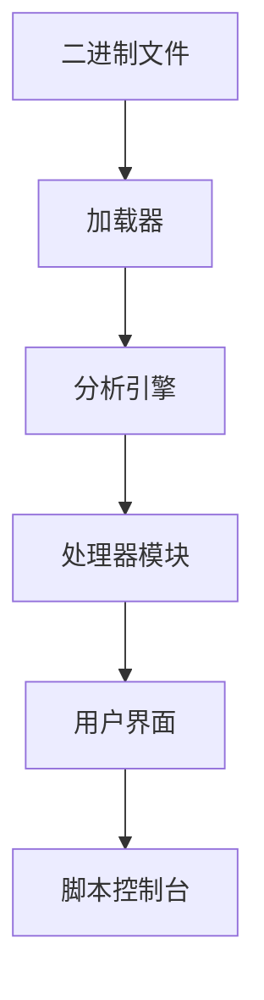

## 今日热点

AI代理生态系统爆发式增长，各类代理框架、技能库和优化工具占据榜单前列，同时效率优化技术成为焦点，特别是减少token使用和提升推理速度的创新方案。

---

## 热门项目一览

| 排名 | 项目 | 语言 | 今日 | 总计 | 简介 |
|:---:|------|:----:|------:|-----:|------|
| 1 | [morluto/rea](https://github.com/morluto/rea) | TypeScript | +32,314 | 272,521 | Reverse engineer anything w... |
| 2 | [debpalash/VoiceStudio](https://github.com/debpalash/VoiceStudio) | Python | +3,024 | 69,232 | VoiceStudio is the open-sou... |
| 3 | [NationalSecurityAgency/ghidra](https://github.com/NationalSecurityAgency/ghidra) | Java | +1,369 | 88,853 | Ghidra is a software revers... |
| 4 | [K-Dense-AI/scientific-agent-skills](https://github.com/K-Dense-AI/scientific-agent-skills) | Python | +1,091 | 50,562 | Turn any AI agent into an A... |
| 5 | [affaan-m/ECC](https://github.com/affaan-m/ECC) | JavaScript | +1,013 | 280,462 | The agent harness performan... |
| 6 | [mksglu/context-mode](https://github.com/mksglu/context-mode) | TypeScript | +904 | 29,822 | Context window optimization... |
| 7 | [xerj-org/xerj](https://github.com/xerj-org/xerj) | Rust | +715 | 5,746 | XERJ is the new way for AI ... |
| 8 | [obra/superpowers](https://github.com/obra/superpowers) | Shell | +582 | 299,961 | An agentic skills framework... |
| 9 | [JuliusBrussee/caveman](https://github.com/JuliusBrussee/caveman) | Go | +433 | 112,617 | 🪨 why use many token when f... |
| 10 | [anthropics/claude-plugins-official](https://github.com/anthropics/claude-plugins-official) | Python | +307 | 39,194 | Official, Anthropic-managed... |
| 11 | [ruvnet/ruflo](https://github.com/ruvnet/ruflo) | TypeScript | +147 | 75,171 | 🌊 The original agent harnes... |
| 12 | [lightseekorg/tokenspeed](https://github.com/lightseekorg/tokenspeed) | Python | +30 | 2,515 | TokenSpeed is a speed-of-li... |

---

## 趋势洞察

```
┌─────────────────────────────────────────────────────────────────┐
│  AI/ML 工具         ████████████████████████  10 个项目        │
│  开发框架             ██                        1 个项目        │
│  多媒体应用            ██                        1 个项目        │
└─────────────────────────────────────────────────────────────────┘
```

---

## 项目深度解读

### 1. morluto/rea — 智能逆向框架

> **一句话总结**：通过智能代理技术实现从应用到原生二进制的全方位自动化逆向工程。

#### 价值主张

| 维度 | 说明 |
|------|------|
| **解决痛点** | 降低逆向工程门槛，实现自动化深度分析 |
| **目标用户** | 安全研究员、逆向工程师、恶意分析师 |
| **核心亮点** | 智能代理技术 + 自动化流程 + 多层次逆向支持 |

#### 技术架构


**技术特色**：
- 基于TypeScript构建，提供类型安全和现代化开发体验
- 使用智能代理技术进行动态分析和行为监控
- 支持从应用到原生二进制的多层次逆向分析

#### 热度分析

- 项目Star数高达27万，近期增长迅速(+3.2万/天)，表明项目热度极高
- Fork数接近7万，显示社区活跃度高，有大量二次开发和使用

#### 快速上手

```bash
# 安装rea
npm install -g rea

# 分析目标二进制文件
rea analyze binary -f /path/to/binary

# 监控应用程序行为
rea monitor app -n "Application Name"
```

#### 注意事项

- 逆向工程可能涉及法律问题，请确保在合法合规的范围内使用
- 项目License未知，使用前需确认授权条款
- 高度复杂的二进制文件可能需要额外的配置和优化


### 2. debpalash/VoiceStudio — 开源语音工作室

> **一句话总结**：开源全栈语音处理工具，支持646种语言，实现本地化语音克隆与视频配音。

#### 价值主张

| 维度 | 说明 |
|------|------|
| **解决痛点** | 提供开源本地化替代方案，解决 ElevenLabs 云依赖与隐私问题 |
| **目标用户** | 内容创作者、开发者、语音设计师及多媒体制作团队 |
| **核心亮点** | 646语言支持 + 完全本地化 + 多功能语音处理 + 开源可定制 |

#### 技术架构


**技术特色**：
- 基于 Python 的端到端语音处理框架
- 本地化模型运行，确保数据隐私与低延迟
- 多语言支持架构，适应全球语音需求

#### 热度分析

- 项目Star数近7万，日增3千，呈爆发式增长，表明市场需求强烈
- 作为 ElevenLabs 的开源替代品，正在填补本地化语音处理的空白

#### 快速上手

```bash
# 克隆仓库
git clone https://github.com/debpalash/VoiceStudio.git
# 安装依赖
cd VoiceStudio && pip install -r requirements.txt
# 运行示例
python voice_studio.py --input sample.wav --clone target_voice.wav
```

#### 注意事项

- 项目依赖可能较大，需确保硬件配置满足要求
- 某些高级功能可能需要额外模型下载
- 许可证信息不明确，使用前需确认开源协议


### 3. NationalSecurityAgency/ghidra — [逆向工程框架]

> **一句话总结**：NSA开源的企业级逆向工程平台，提供全面的二进制代码分析能力。

#### 价值主张

| 维度 | 说明 |
|------|------|
| **解决痛点** | 提供专业级逆向分析工具，填补商业工具空白 |
| **目标用户** | 安全研究员、逆向工程师、军事分析师 |
| **核心亮点** | 多平台支持 + 跨架构分析 + 插件扩展性 + 自动化脚本 |

#### 技术架构



**技术特色**：
- Java架构实现跨平台兼容性，支持Windows/Linux/MacOS
- 模块化设计允许动态加载处理器和插件
- 内置Python脚本接口实现自动化分析流程

#### 热度分析

- 作为NSA开源项目，获得极高关注度，近一个月增长显著
- 成为逆向工程领域标准工具之一，社区贡献活跃

#### 快速上手

```bash
# 下载Ghidra
wget https://github.com/NationalSecurityAgency/ghidra/releases/latest/download/ghidra.zip
# 解压并启动
unzip ghidra.zip && ./ghidraRun
```

#### 注意事项

- 初次使用需要学习Ghidra特有的数据结构和分析流程
- 某些高级功能可能需要Java开发知识进行插件定制
- 处理大型二进制文件时可能需要较高配置的机器资源


### 4. K-Dense-AI/scientific-agent-skills — 科学AI技能库

> **一句话总结**：将AI代理转变为科学家，提供177个验证技能和100+科学数据库，服务全球25万+科学家。

#### 价值主张

| 维度 | 说明 |
|------|------|
| **解决痛点** | AI代理在专业科学领域应用局限，缺乏专业科学知识和工作流 |
| **目标用户** | 科学家、研究人员、药物开发人员等科学领域专业人士 |
| **核心亮点** | 177个现成验证技能 + 100+科学数据库 + 跨领域兼容性 + 开放标准支持 |

#### 技术架构


**技术特色**：
- 多学科科学知识整合能力
- 大规模科学数据库连接
- 验证过的科学工作流自动化

#### 热度分析

- 项目获得50,562个Star，近期增长1,091，表明科学AI领域需求旺盛
- 作为Agent Skills库，已成为科学AI开发的重要基础设施，拥有4,498个Fork

#### 快速上手

```bash
# 安装scientific-agent-skills
pip install scientific-agent-skills

# 基本使用示例
from scientific_agent_skills import ScientificAgent
agent = ScientificAgent()
result = agent.execute_skill("protein_folding", input_data="protein_sequence.fasta")
```

#### 注意事项

- 需确保使用时遵守相关科学数据库的访问权限和许可协议
- 项目可能与特定AI平台兼容，使用前需确认与您的开发环境兼容
- 由于涉及专业科学知识，使用结果可能需要专家验证


### 5. affaan-m/ECC — AI编程优化系统

> **一句话总结**：一个针对主流AI编程工具的性能优化系统，提升代码生成效率和安全性。

#### 价值主张

| 维度 | 说明 |
|------|------|
| **解决痛点** | 提升AI编程工具的代码生成效率、安全性和性能 |
| **目标用户** | 使用Claude、Codex、Cursor等AI编程工具的开发者 |
| **核心亮点** | 技能优化 + 本能增强 + 记忆管理 + 安全强化 + 研究优先开发 |

#### 技术架构


**技术特色**：
- 基于JavaScript实现跨平台兼容性
- 采用研究优先的开发方法确保技术先进性
- 集成多种AI编程工具的通用优化方案

#### 热度分析

- 项目获得28万+星标，近期增长迅速，日均增长超1000星，表明社区高度认可
- Fork数与Star数比例约1:6.7，表明项目以使用为主，二次开发相对较少

#### 快速上手

```bash
# 克隆项目
git clone https://github.com/affaan-m/ECC.git

# 安装依赖
npm install

# 启动优化系统
npm start
```

#### 注意事项

- 项目许可证未知，商业使用前需确认授权方式
- 项目Open Issues为0，可能表示问题管理方式特殊或社区反馈渠道不明确
- 项目描述较为抽象，具体功能和使用方法需进一步探索源码


### 6. mksglu/context-mode — AI上下文优化工具

> **一句话总结**：优化AI编程代理的上下文窗口，通过沙箱和持久化技术显著提升性能和跨平台能力。

#### 价值主张

| 维度 | 说明 |
|------|------|
| **解决痛点** | AI编程代理面临上下文窗口限制、工具输出冗余和跨平台集成困难 |
| **目标用户** | AI编程工具开发者、多平台自动化系统集成者 |
| **核心亮点** | 上下文窗口优化 + 沙箱工具输出 + 持久化会话内存 + 跨平台路由支持 |

#### 技术架构


**技术特色**：
- 通过沙箱技术减少98%工具输出
- 会话内存持久化机制保持状态
- 支持MCP协议实现17个平台集成

#### 热度分析

- 项目Star数近3万，单日增长900+，处于快速增长阶段
- 无开放Issue表明项目维护良好，问题解决机制高效

#### 快速上手

```bash
# 安装项目
npm install context-mode

# 初始化配置
context-mode init

# 启动服务
context-mode start
```

#### 注意事项
- 需要了解MCP(Model Context Protocol)协议
- 可能需要配置多个平台的路由规则
- 沙箱环境可能对某些工具功能有限制


### 7. xerj-org/xerj — AI数据索引器

> **一句话总结**：通过自动索引技术，使AI能够以比传统工具少40倍token的方式搜索和利用各类数据。

#### 价值主张

| 维度 | 说明 |
|------|------|
| **解决痛点** | 传统搜索工具(grep/sed)在AI应用中token消耗过高，效率低下 |
| **目标用户** | AI开发者、数据分析师、安全审计人员、需要处理大量文档的开发者 |
| **核心亮点** | 自动索引能力 + 40倍token效率提升 + Elasticsearch兼容性 + 多格式支持 |

#### 技术架构


**技术特色**：
- 基于Rust开发，性能优异且内存安全
- 自动索引技术减少AI处理的token消耗
- 支持多种数据格式，扩展性强
- 与现有Elasticsearch生态系统无缝集成

#### 热度分析

- 项目Star数增长迅速，单日新增715个Star，表明社区关注度极高
- Open Issues为0，说明项目维护良好，问题响应及时，但可能也反映出社区参与度尚待提高

#### 快速上手

```bash
# 安装XERJ
cargo install xerj

# 索引当前目录数据
xerj index .

# 使用Elasticsearch客户端搜索
curl -XGET 'http://localhost:9200/xerj/_search?q=your_query'
```

#### 注意事项

- 项目许可证未知，可能在商业使用中存在风险
- 虽然与Elasticsearch兼容，但可能存在某些功能差异
- 项目目前Open Issues为0，可能意味着问题反馈渠道不够活跃


### 8. obra/superpowers — 智能开发框架

> **一句话总结**：一个提供代理技能和高效软件开发方法论的实用框架。

#### 价值主张

| 维度 | 说明 |
|------|------|
| **解决痛点** | 解决传统软件开发中效率低下和方法论混乱的问题 |
| **目标用户** | 软件开发团队、独立开发者和技术管理者 |
| **核心亮点** | 代理技能框架 + 结构化开发方法 + 实用工具集 |

#### 技术架构


**技术特色**：
- 基于Shell的轻量级实现
- 模块化技能框架设计
- 实用主义开发方法论

#### 热度分析

- 超过29万Stars且持续增长，表明其在开发社区中高度认可
- 零开放问题反映项目成熟度和问题解决能力

#### 快速上手

```bash
# 克隆项目
git clone https://github.com/obra/superpowers.git
# 进入目录
cd superpowers
# 运行安装脚本
./install.sh
```

#### 注意事项

- 需要基本的Shell脚本知识才能充分利用
- 项目可能需要根据具体需求进行定制化配置


### 9. JuliusBrussee/caveman — 代码简化工具

> **一句话总结**：通过原始人式简化表达减少编程代理65%的token使用量，提升代码生成效率。

#### 价值主张

| 维度 | 说明 |
|------|------|
| **解决痛点** | 编程代理中token冗余导致响应效率低下 |
| **目标用户** | 使用AI编程代理的开发者与助手 |
| **核心亮点** | 简化表达 + 减少65%token + 保持功能完整性 + 提升效率 |

#### 技术架构


**技术特色**：
- 采用Go语言实现高性能代理转换
- 通过语义保留的简化算法处理代码指令
- 显著降低大语言模型的token消耗

#### 热度分析

- 超过11.2万stars，近期增长迅猛，表明社区高度认可其价值
- 在AI辅助编程领域占据重要生态位置，成为优化编程代理的关键工具

#### 快速上手

```bash
# 安装caveman工具
go install github.com/JuliusBrussee/caveman@latest

# 使用caveman简化你的编程指令
caveman "编写一个快速排序算法"
```

#### 注意事项

- 项目许可信息未知，商业使用前需确认授权条款
- 可能需要与特定的编程代理或AI工具配合使用才能发挥最大效用
- 简化过程中可能需要调整以适应不同的编程场景


### 10. anthropics/claude-plugins-official — 官方插件库

> **一句话总结**：Anthropic官方维护的高质量Claude代码插件目录，提供权威插件认证与管理服务

#### 价值主张

| 维度 | 说明 |
|------|------|
| **解决痛点** | Claude用户缺乏官方认可的插件获取渠道和质量保证 |
| **目标用户** | Claude AI开发者、用户及第三方插件创作者 |
| **核心亮点** | 官方权威认证 + 高质量保证 + 插件生态构建 + 开发者友好 + 标准化接口 |

#### 技术架构

**技术特色**：
- 官方插件质量认证机制
- 插件分类与检索系统
- 开发者友好的插件接入流程

#### 热度分析

- 高关注度且持续增长，日均增长约300 stars，表明Claude生态快速发展
- 作为官方插件目录，在Claude插件生态中占据核心位置

#### 快速上手

```bash
# 克隆官方插件目录
git clone https://github.com/anthropics/claude-plugins-official.git

# 安装依赖
cd claude-plugins-official
pip install -r requirements.txt
```

#### 注意事项

- 插件需符合官方质量标准才能被收录
- 插件开发应遵循Claude API规范
- 定期检查插件更新以获取最新功能


### 11. ruvnet/ruflo — 智能代理框架

> **一句话总结**：Ruflo是一个强大的AI代理框架，支持多智能体协作、自适应学习和多种AI模型集成。

#### 价值主张

| 维度 | 说明 |
|------|------|
| **解决痛点** | 简化复杂多智能体AI系统的构建与部署，实现自主工作流程协调 |
| **目标用户** | AI开发者、研究人员和需要构建复杂AI系统的工作流自动化团队 |
| **核心亮点** | 自适应记忆 + 自学习智能 + 联邦功能 + 向量RAG集成 + 多AI模型原生支持 |

#### 技术架构


**技术特色**：
- TypeScript实现，提供类型安全开发环境
- 多智能体协作框架，支持群体智能行为
- 向量RAG集成，增强知识检索能力
- 多种AI模型原生支持，包括Claude、Codex等

#### 热度分析

- 项目获得75k+星标且持续增长，日增147星，表明项目备受关注且发展活跃
- 8k+分叉数显示社区参与度高，项目被广泛用于二次开发与实验

#### 快速上手

```bash
# 克隆仓库
git clone https://github.com/ruvnet/ruflo.git

# 安装依赖
npm install

# 启动示例
npm run example
```

#### 注意事项

- 项目许可证未知，商业使用前需确认许可证类型
- 作为AI代理框架，可能需要较高的计算资源
- 集成多种AI模型可能涉及额外的API费用


### 12. lightseekorg/tokenspeed — 高速LLM推理引擎

> **一句话总结**：TokenSpeed是专为提升大型语言模型推理速度而设计的轻量级引擎，实现接近光速的文本生成性能。

#### 价值主张

| 维度 | 说明 |
|------|------|
| **解决痛点** | 大型语言模型推理速度慢，无法满足实时应用需求 |
| **目标用户** | 需要高效LLM推理的开发者和企业用户 |
| **核心亮点** | 高性能推理引擎 + 低延迟 + 高吞吐量 + 轻量级实现 |

#### 技术架构


**技术特色**：
- 基于Python实现的高效LLM推理引擎
- 采用优化算法减少计算开销
- 支持多种模型架构和部署方式

#### 热度分析

- 项目Star数持续增长(+30/天)，表明社区关注度高，需求旺盛
- 作为LLM推理优化工具，在AI基础设施领域具有独特定位

#### 快速上手

```bash
# 安装tokenspeed
pip install tokenspeed

# 运行模型推理
tokenspeed --model gpt-3.5-turbo --prompt "Hello, world!"
```

#### 注意事项

- 项目许可证信息不明确，使用前需确认授权条款
- 可能需要特定硬件配置以发挥最佳性能
- 作为新兴项目，API和功能可能仍在快速迭代中


## 今日推荐

| 主题 | 推荐项目 | 亮点 |
|------|----------|------|
| 今日最热 | [morluto/rea](https://github.com/morluto/rea) | Reverse engineer ... |
| 值得关注 | [debpalash/VoiceStudio](https://github.com/debpalash/VoiceStudio) | VoiceStudio is th... |
| 快速上手 | [NationalSecurityAgency/ghidra](https://github.com/NationalSecurityAgency/ghidra) | Ghidra is a softw... |
| 长期潜力 | [K-Dense-AI/scientific-agent-skills](https://github.com/K-Dense-AI/scientific-agent-skills) | Turn any AI agent... |

---

<div align="center">

*Generated on 2026-10-16 | Powered by GitHub Trending Reporter*

</div>