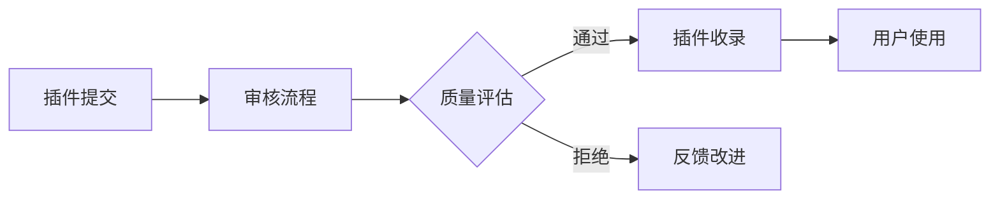
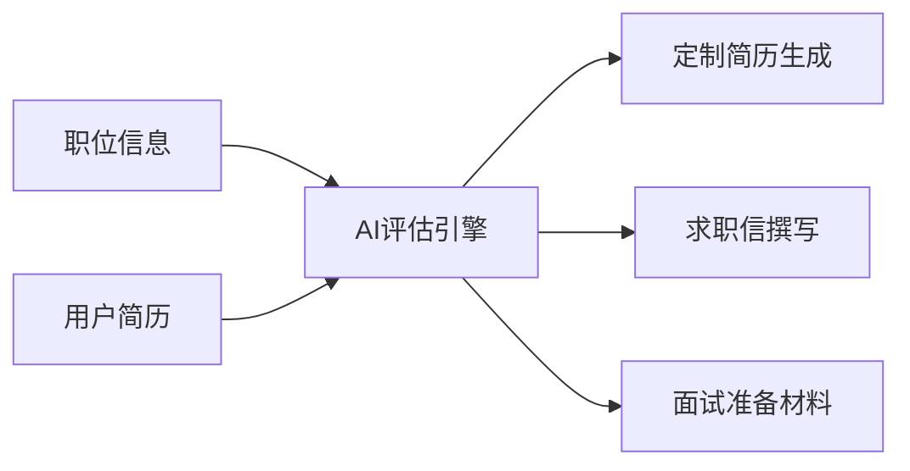
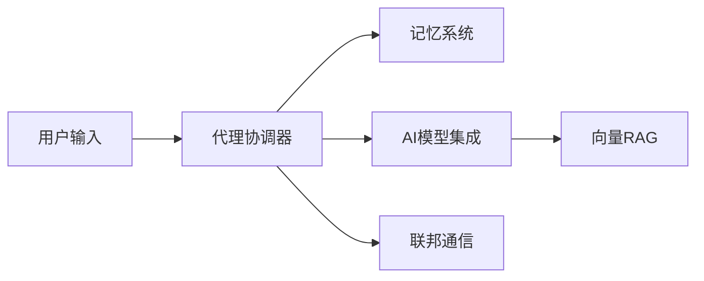

## 今日热点

AI代理生态系统持续爆发，本地化语音处理工具崛起，专业领域AI应用深化，开发者工具向智能化、高效化方向演进。

---

## 热门项目一览

| 排名 | 项目 | 语言 | 今日 | 总计 | 简介 |
|:---:|------|:----:|------:|-----:|------|
| 1 | [debpalash/VoiceStudio](https://github.com/debpalash/VoiceStudio) | Python | +2,301 | 71,321 | VoiceStudio is the open-sou... |
| 2 | [xerj-org/xerj](https://github.com/xerj-org/xerj) | Rust | +1,648 | 6,982 | XERJ is the new way for AI ... |
| 3 | [anthropics/claude-plugins-official](https://github.com/anthropics/claude-plugins-official) | Python | +1,552 | 40,645 | Official, Anthropic-managed... |
| 4 | [K-Dense-AI/scientific-agent-skills](https://github.com/K-Dense-AI/scientific-agent-skills) | Python | +1,158 | 51,550 | Turn any AI agent into an A... |
| 5 | [affaan-m/ECC](https://github.com/affaan-m/ECC) | JavaScript | +1,057 | 281,565 | The agent harness performan... |
| 6 | [obra/superpowers](https://github.com/obra/superpowers) | Shell | +973 | 300,706 | An agentic skills framework... |
| 7 | [MadsLorentzen/ai-job-search](https://github.com/MadsLorentzen/ai-job-search) | Python | +898 | 48,583 | The job search that runs on... |
| 8 | [ruvnet/ruflo](https://github.com/ruvnet/ruflo) | TypeScript | +672 | 75,659 | 🌊 The original agent harnes... |
| 9 | [hmjz100/LinkSwift](https://github.com/hmjz100/LinkSwift) | JavaScript | +538 | 23,770 | 一个基于 JavaScript 的网盘文件下载地址获取... |
| 10 | [mksglu/context-mode](https://github.com/mksglu/context-mode) | TypeScript | +449 | 30,255 | Context window optimization... |
| 11 | [HKUDS/CLI-Anything](https://github.com/HKUDS/CLI-Anything) | Python | +281 | 53,538 | "CLI-Anything: Making ALL S... |
| 12 | [cursor/plugins](https://github.com/cursor/plugins) | TypeScript | +278 | 11,984 | Cursor plugin specification... |

---

## 趋势洞察

```
┌─────────────────────────────────────────────────────────────────┐
│  AI/ML 工具         ████████████████████████  9 个项目        │
│  其他               ████████                  3 个项目        │
│  多媒体应用            ██                        1 个项目        │
└─────────────────────────────────────────────────────────────────┘
```

---

## 项目深度解读

### 1. debpalash/VoiceStudio — 开源语音工作室

> **一句话总结**：全栈语音处理工具，本地化ElevenLabs替代方案，支持646种语言。

#### 价值主张

| 维度 | 说明 |
|------|------|
| **解决痛点** | 提供隐私保护的本地语音处理替代方案，避免数据上传云端 |
| **目标用户** | 内容创作者、语音开发者、多语言内容生产者、隐私敏感用户 |
| **核心亮点** | 完全本地部署 + 646语言全覆盖 + 多功能集成 + 开源免费 |

#### 技术架构


**技术特色**：
- 支持完全本地化部署，确保数据隐私安全
- 多语言语音处理模型集成，覆盖全球主要语言
- 统一处理框架整合多种语音相关功能

#### 热度分析

- 项目星数超7万且持续快速增长，表明社区高度认可其价值
- 作为ElevenLabs的本地替代方案，在隐私保护需求高涨环境下优势明显

#### 快速上手

```bash
# 克隆仓库
git clone https://github.com/debpalash/VoiceStudio.git

# 安装依赖
pip install -r requirements.txt
```

#### 注意事项

- 项目许可证信息未知，使用前需确认授权条款
- 完全本地部署可能需要较高计算资源，特别是处理大型音频文件时
- 646种语言支持可能需要下载大量模型，占用显著存储空间


### 2. xerj-org/xerj — AI智能索引

> **一句话总结**：XERJ是一款使用40倍于grep更少令牌的AI数据搜索系统，支持代码、文档、日志和PDF的快速索引和检索。

#### 价值主张

| 维度 | 说明 |
|------|------|
| **解决痛点** | 传统grep/sed命令在大规模数据搜索中令牌消耗过多且效率低下 |
| **目标用户** | AI开发者、数据分析师、安全审计人员、需要处理大量文档的开发团队 |
| **核心亮点** | 自动索引能力 + 40倍令牌效率提升 + Elasticsearch兼容性 + 多格式支持 + 一键索引 |

#### 技术架构


**技术特色**：
- 基于Rust构建的高性能索引引擎
- 智能自动索引技术，无需手动配置
- 与Elasticsearch完全兼容，保证现有工具无缝衔接
- 使用40倍于grep更少的令牌，显著降低计算资源消耗

#### 热度分析

- 项目近期热度飙升，单日增长达1,648个star，表明技术方向获得高度认可
- 在AI搜索和数据处理领域具有明显优势，有望成为该领域的标准工具

#### 快速上手

```bash
# 索引当前目录下的所有文件
xerj index .

# 在索引中搜索特定内容
xerj search "your query"

# 启动Elasticsearch兼容服务
xerj serve
```

#### 注意事项

- 项目开源许可证信息不明确，可能影响商业使用
- 虽然兼容Elasticsearch，但可能存在某些高级功能不兼容的情况
- 对于超大文件或特殊格式的支持可能有限，需要进一步验证


### 3. anthropics/claude-plugins-official — [官方插件库]

> **一句话总结**：Anthropic 官方维护的高质量 Claude 插件集合，提供开发者扩展 Claude 功能的官方资源。

#### 价值主张

| 维度 | 说明 |
|------|------|
| **解决痛点** | 解决开发者寻找可靠、高质量 Claude 插件的难题，提供官方认证的插件资源 |
| **目标用户** | Claude AI 开发者、扩展功能需求者、AI 应用构建者 |
| **核心亮点** | 官方认证确保质量 + 插件分类便于查找 + 持续更新维护 + 社区贡献机制 |

#### 技术架构



**技术特色**：
- 官方审核机制确保插件质量
- 标准化的插件提交和评估流程
- 分类索引系统便于用户查找

#### 热度分析

- 项目 Star 数超过4万，近期增长迅速，显示社区对 Claude 插件生态的高度关注
- 作为官方目录项目，在 Claude 插件生态中占据核心位置，是开发者的首选资源

#### 快速上手

```bash
# 克隆仓库
git clone https://github.com/anthropics/claude-plugins-official.git

# 查看插件目录
cd claude-plugins-official && ls plugins
```

#### 注意事项

- 插件需要经过官方审核才能被收录
- 项目主要作为目录和索引，不包含插件的源代码
- 插件质量和安全性由 Anthropic 团队负责审核


### 4. K-Dense-AI/scientific-agent-skills — AI科学技能库

> **一句话总结**：提供177个验证过的科学技能和100+科学数据库，赋能AI代理成为科学研究助手。

#### 价值主张

| 维度 | 说明 |
|------|------|
| **解决痛点** | 提升AI在科学研究和专业领域的应用能力 |
| **目标用户** | 全球科学家和研究人员 |
| **核心亮点** | 177+验证科学技能+100+科学数据库+多平台兼容+跨学科覆盖 |

#### 技术架构


**技术特色**：
- 模块化科学技能架构设计
- 多源科学数据整合能力
- 跨平台AI代理适配层

#### 热度分析

- 5.5万星且单日增长上千，表明项目受科学社区高度认可
- 兼容主流AI开发平台，形成科学AI应用标准

#### 快速上手

```bash
# 安装科学技能库
pip install scientific-agent-skills

# 初始化科学代理
python -m scientific_agent init

# 使用特定科学技能
scientific_agent use skill_name --query "your scientific query"
```

#### 注意事项

- 需要确保API密钥安全配置
- 使用前需了解相关科学领域的专业术语
- 部分高级功能可能需要额外订阅


### 5. affaan-m/ECC — AI编程优化

> **一句话总结**：为AI编程助手提供性能优化系统，增强技能、记忆和安全性的开发工具。

#### 价值主张

| 维度 | 说明 |
|------|------|
| **解决痛点** | AI编程助手在代码生成、理解和优化方面存在性能瓶颈 |
| **目标用户** | AI编程工具使用者、开发者、AI研究员 |
| **核心亮点** | + 技能优化 + 本能增强 + 记忆管理 + 安全保障 + 研究优先开发 |

#### 技术架构


**技术特色**：
- 多模块协同优化AI编程助手性能
- 智能记忆管理提升上下文理解
- 安全防护机制确保代码质量

#### 热度分析

- 项目获得28万+星标且持续增长，表明其在AI编程优化领域具有高价值
- 零开放问题反映项目成熟度高，社区维护良好

#### 快速上手

```bash
# 克隆项目
git clone https://github.com/affaan-m/ECC.git
# 安装依赖
npm install
# 启动项目
npm start
```

#### 注意事项

- 项目许可证未知，使用前需确认开源协议
- 可能需要特定的AI编程工具环境才能发挥最佳效果
- 项目文档可能需要进一步补充以降低使用门槛


### 6. obra/superpowers — 智能开发框架

> **一句话总结**：基于Shell的智能代理技能框架与实用开发方法论，提升团队协作效率。

#### 价值主张

| 维度 | 说明 |
|------|------|
| **解决痛点** | 打破传统开发瓶颈，提供系统化技能框架与协作方法论 |
| **目标用户** | 开发团队、技术管理者、追求效率提升的软件工程师 |
| **核心亮点** | 实用导向方法论 + Shell工具集 + 技能框架 + 协作模式 + 持续改进 |

#### 技术架构


**技术特色**：
- 基于Shell的轻量级跨平台实现
- 模块化设计支持灵活扩展
- 无复杂依赖即装即用

#### 热度分析
- 超30万Star且持续高速增长，日均新增近千，表明认可度极高
- 零Open Issues反映项目成熟度高，社区问题解决效率卓越

#### 快速上手

```bash
# 克隆项目
git clone https://github.com/obra/superpowers.git
# 进入目录并初始化
cd superpowers && ./init.sh
```

#### 注意事项
- 项目License信息不明确，使用前需确认授权条款
- 主要依赖Shell环境，Windows用户需配置WSL或类似环境
- 框架理念重于具体工具，需理解方法论才能发挥最大价值


### 7. MadsLorentzen/ai-job-search — AI求职助手

> **一句话总结**：本地运行的全栈AI求职框架，自动化评估职位、定制简历、撰写求职信并准备面试。

#### 价值主张

| 维度 | 说明 |
|------|------|
| **解决痛点** | 简化求职流程，自动化简历定制和申请准备，提高求职效率 |
| **目标用户** | 积极求职的程序员、技术专业人士 |
| **核心亮点** | 本地运行保护隐私 + 全流程自动化 + 基于Claude AI + 灵活可定制 |

#### 技术架构



**技术特色**：
- 基于Claude大语言模型的智能分析能力
- 本地运行确保用户数据隐私安全
- 全流程自动化处理求职各环节
- 模块化设计支持灵活定制

#### 热度分析

- Star数近5万且持续增长(+898今日)，显示项目高度受开发者欢迎
- Fork数达1.6万，表明社区活跃度高，用户积极参与二次开发

#### 快速上手

```bash
# 克隆项目
git clone https://github.com/MadsLorentzen/ai-job-search.git

# 安装依赖
pip install -r requirements.txt
```

#### 注意事项

- 需要配置Claude API密钥才能使用AI功能
- 项目依赖Python环境，确保兼容性
- 本地运行需要足够的计算资源处理AI模型


### 8. ruvnet/ruflo — 智能代理框架

> **一句话总结**：提供多智能体协调与工作流编排能力，支持自适应记忆和多种AI模型集成。

#### 价值主张

| 维度 | 说明 |
|------|------|
| **解决痛点** | 简化多智能体系统构建与协调，提供统一框架管理复杂AI工作流 |
| **目标用户** | AI开发者、构建复杂工作流的研究人员、部署智能代理团队的组织 |
| **核心亮点** | 自适应记忆 + 自学习智能 + 多模型集成 + 联邦能力 + 向量RAG |

#### 技术架构



**技术特色**：
- 智能代理间协调机制
- 自适应记忆与学习能力
- 多AI模型统一接口

#### 热度分析

- 项目拥有75,659个Star，近期增长迅速(+672 today)，表明社区高度关注
- Fork数达8,968，说明开发者积极参与二次开发和贡献

#### 快速上手

```bash
# 克隆项目
git clone https://github.com/ruvnet/ruflo.git
cd ruflo

# 安装依赖
npm install

# 启动示例
npm start
```

#### 注意事项

- 项目License未知，使用前需确认开源协议
- 项目集成多种AI模型，需确保相应API的访问权限
- 自适应记忆和联邦特性可能需要额外的配置和资源


### 9. hmjz100/LinkSwift — 网盘直链提取

> **一句话总结**：多网盘直链提取工具，支持八大主流网盘，无需客户端即可获取下载链接。

#### 价值主张

| 维度 | 说明 |
|------|------|
| **解决痛点** | 解决网盘下载速度慢、需要客户端的问题，提供直接下载链接 |
| **目标用户** | 需要从各大网盘下载文件但受限于客户端或速度的用户 |
| **核心亮点** | 支持八大网盘 + 纯前端实现 + 无需登录获取直链 + 轻量级 |

#### 技术架构


**技术特色**：
- 纯 JavaScript 实现，无需后端支持
- 支持多种网盘的解析算法
- 轻量级设计，无需安装额外依赖

#### 热度分析

- 项目 Star 数增长迅速，单日新增 538 星，显示高关注度
- 作为网盘下载工具领域的重要项目，拥有活跃的社区支持

#### 快速上手

```bash
# 克隆项目
git clone https://github.com/hmjz100/LinkSwift.git

# 进入项目目录
cd LinkSwift

# 安装依赖并运行
npm install && npm start
```

#### 注意事项

- 需要注意各网盘的更新可能导致解析失效，需及时关注项目更新
- 仅用于合法文件下载，请遵守相关平台使用条款


### 10. mksglu/context-mode — AI上下文优化

> **一句话总结**：优化AI编程代理的上下文窗口，通过沙盒化和持久化内存提升多平台工作效率

#### 价值主张

| 维度 | 说明 |
|------|------|
| **解决痛点** | AI编程代理上下文窗口过载，工具输出冗余，跨平台协作效率低 |
| **目标用户** | AI编程工具开发者、多平台自动化工作流构建者 |
| **核心亮点** | 沙盒化工具输出+持久化会话内存+跨平台MCP路由 |

#### 技术架构


**技术特色**：
- 上下文窗口智能优化算法，减少98%冗余输出
- 会话内存持久化机制，保持工作连续性
- MCP协议标准化实现，支持17个平台无缝集成

#### 热度分析

- 项目Star数超3万，日增449，表明项目处于快速上升期，获得开发者高度认可
- 零Open Issues反映项目维护质量高，问题解决及时，社区满意度高

#### 快速上手

```bash
# 安装context-mode
npm install -g @mksglu/context-mode

# 初始化配置
context-mode init

# 启动优化会话
context-mode start --platforms github,slack,notion
```

#### 注意事项

- 需要理解MCP协议基础概念才能充分利用跨平台路由功能
- 沙盒化可能会限制某些需要完整上下文的工具功能，需根据使用场景调整配置
- 项目文档可能需要进一步完善，特别是关于17个平台的具体集成方法


### 11. HKUDS/CLI-Anything — 统一CLI平台

> **一句话总结**：将各类软件转化为原生CLI工具，实现命令行统一管理

#### 价值主张

| 维度 | 说明 |
|------|------|
| **解决痛点** | 统一分散的CLI工具，提供一致的使用体验 |
| **目标用户** | 开发者、系统管理员、自动化工具使用者 |
| **核心亮点** | 智能代理接口 + 跨平台支持 + 自动化执行 + 扩展性强 + 统一管理 |

#### 技术架构


**技术特色**：
- Python实现，跨平台兼容性强
- 模块化设计，易于扩展新工具支持
- 智能解析系统，自动适配不同CLI接口

#### 热度分析

- Star数超5万且持续快速增长，表明项目受到社区高度认可
- Fork数近5千，显示社区积极参与项目贡献和二次开发

#### 快速上手

```bash
# 安装CLI-Anything
pip install cli-anything

# 初始化配置
cli-anything init

# 查看可用工具
cli-anything list
```

#### 注意事项

- 项目许可证信息不明确，使用前需确认授权条款
- 可能需要根据具体需求进行配置调整，并非开箱即用所有功能


### 12. cursor/plugins — AI编辑插件

> **一句话总结**：Cursor编辑器的官方插件规范与实现，扩展AI辅助编程功能生态。

#### 价值主张

| 维度 | 说明 |
|------|------|
| **解决痛点** | 为Cursor编辑器提供标准化插件系统，增强AI代码辅助能力 |
| **目标用户** | Cursor编辑器用户、AI辅助开发者、插件生态贡献者 |
| **核心亮点** | + 统一插件接口规范 + AI功能无缝集成 + 代码智能增强 + 开发体验优化 |

#### 技术架构


**技术特色**：
- 基于TypeScript的强类型插件开发接口
- 模块化架构设计，便于功能扩展
- 深度集成AI能力，提供智能代码辅助

#### 热度分析

- 项目Star数近1.2万，日增278星，显示AI编程工具社区高度关注
- 作为Cursor编辑器核心插件生态，在AI编程工具领域占据重要位置

#### 快速上手

```bash
# 克隆仓库
git clone https://github.com/cursor/plugins.git

# 安装依赖
cd plugins
npm install
```

#### 注意事项

- 插件开发需熟悉Cursor编辑器的特定API和AI集成方式
- 高级AI功能可能需要Cursor订阅账号支持
- 插件兼容性可能随Cursor版本更新而变化，需关注更新日志


### 13. android/skills — [Android技能库]

> **一句话总结**：一个结构化的Android开发技能学习资源，提供实用代码示例和最佳实践指南。

#### 价值主张

| 维度 | 说明 |
|------|------|
| **解决痛点** | 为Android开发者提供系统化的技能学习和实践参考 |
| **目标用户** | Android开发者、移动应用学习者和技术面试准备者 |
| **核心亮点** + 按主题分类的技能点 + 实际可运行的代码示例 + 清晰的实现原理说明 |

#### 技术架构


**技术特色**：
- 采用Kotlin语言展示现代Android开发实践
- 每个技能点包含原理讲解和代码实现
- 涵盖从基础到高级的完整技能栈

#### 热度分析

- 项目获得8,096个Star，近期日均增长约1个，表明社区认可度高且稳定
- Fork数量相对较少，可能表明项目以学习参考为主而非二次开发

#### 快速上手

```bash
# 克隆项目
git clone https://github.com/android/skills.git

# 进入项目目录查看技能分类
cd skills && ls -la
```

#### 注意事项

- 项目License未知，使用前需确认授权条款
- 缺少详细的项目文档，建议通过代码注释和示例理解实现细节


## 今日推荐

| 主题 | 推荐项目 | 亮点 |
|------|----------|------|
| 今日最热 | [debpalash/VoiceStudio](https://github.com/debpalash/VoiceStudio) | VoiceStudio is th... |
| 值得关注 | [xerj-org/xerj](https://github.com/xerj-org/xerj) | XERJ is the new w... |
| 快速上手 | [anthropics/claude-plugins-official](https://github.com/anthropics/claude-plugins-official) | Official, Anthrop... |
| 长期潜力 | [K-Dense-AI/scientific-agent-skills](https://github.com/K-Dense-AI/scientific-agent-skills) | Turn any AI agent... |

---

<div align="center">

*Generated on 2026-10-17 | Powered by GitHub Trending Reporter*

</div>