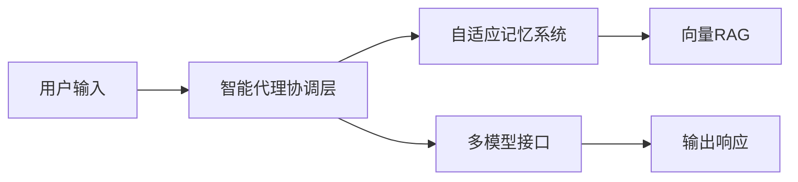

## 今日热点

AI代理生态系统全面爆发，Claude Code为核心，同时专业化AI工具与开源替代方案并行发展，AI正深度融入开发与垂直领域。

---

## 热门项目一览

| 排名 | 项目 | 语言 | 今日 | 总计 | 简介 |
|:---:|------|:----:|------:|-----:|------|
| 1 | [debpalash/VoiceStudio](https://github.com/debpalash/VoiceStudio) | Python | +2,125 | 73,477 | VoiceStudio is the open-sou... |
| 2 | [anthropics/claude-plugins-official](https://github.com/anthropics/claude-plugins-official) | Python | +1,397 | 41,820 | Official, Anthropic-managed... |
| 3 | [MadsLorentzen/ai-job-search](https://github.com/MadsLorentzen/ai-job-search) | Python | +1,365 | 50,509 | The job search that runs on... |
| 4 | [xerj-org/xerj](https://github.com/xerj-org/xerj) | Rust | +1,160 | 7,843 | XERJ is the new way for AI ... |
| 5 | [affaan-m/ECC](https://github.com/affaan-m/ECC) | JavaScript | +1,145 | 282,554 | The agent harness performan... |
| 6 | [K-Dense-AI/scientific-agent-skills](https://github.com/K-Dense-AI/scientific-agent-skills) | Python | +878 | 52,281 | Turn any AI agent into an A... |
| 7 | [stablyai/orca](https://github.com/stablyai/orca) | TypeScript | +830 | 95,476 | Orca is the place for worki... |
| 8 | [HKUDS/CLI-Anything](https://github.com/HKUDS/CLI-Anything) | Python | +574 | 54,090 | "CLI-Anything: Making ALL S... |
| 9 | [anomalyco/opencode](https://github.com/anomalyco/opencode) | TypeScript | +438 | 215,419 | The open source coding agent. |
| 10 | [ruvnet/ruflo](https://github.com/ruvnet/ruflo) | TypeScript | +420 | 76,101 | 🌊 The original agent harnes... |
| 11 | [android/skills](https://github.com/android/skills) | Kotlin | +355 | 8,444 | No description |
| 12 | [anthropics/claude-code](https://github.com/anthropics/claude-code) | TypeScript | +179 | 151,793 | Claude Code is an agentic c... |

---

## 趋势洞察

```
┌─────────────────────────────────────────────────────────────────┐
│  AI/ML 工具         ████████████████████████  11 个项目        │
│  多媒体应用            ██                        1 个项目        │
│  其他               ██                        1 个项目        │
└─────────────────────────────────────────────────────────────────┘
```

---

## 项目深度解读

### 1. debpalash/VoiceStudio — 开源语音工作室

> **一句话总结**：本地化语音克隆、合成与处理的一站式开源解决方案，支持646种语言。

#### 价值主张

| 维度 | 说明 |
|------|------|
| **解决痛点** | 提供本地化、低成本的语音合成与克隆替代商业方案 |
| **目标用户** | 开发者、内容创作者、有声书制作团队、多语言服务提供者 |
| **核心亮点** | 全本地部署 + 646种语言支持 + 多功能语音处理 + 开源免费 |

#### 技术架构


**技术特色**：
- 基于深度学习的语音合成与克隆技术
- 支持离线部署，保障数据隐私
- 多语言架构设计，覆盖646种语言

#### 热度分析

- 项目Star数达7.3万，单日增长2000+，呈爆发式增长态势
- Fork数达8千，表明开发者社区活跃度高，参与度高

#### 快速上手

```bash
# 克隆项目
git clone https://github.com/debpalash/VoiceStudio.git

# 安装依赖
cd VoiceStudio
pip install -r requirements.txt
```

#### 注意事项

- 项目许可证未知，商业使用前需确认授权情况
- 模型可能需要较大计算资源，建议在配置较好的机器上运行
- 语音质量可能与商业方案存在差距，需要根据实际需求评估


### 2. anthropics/claude-plugins-official — [官方插件目录]

> **一句话总结**：Anthropic 官方维护的高质量 Claude 插件目录，为用户提供丰富的扩展功能。

#### 价值主张

| 维度 | 说明 |
|------|------|
| **解决痛点** | 解决用户发现和信任高质量 Claude 插件的难题 |
| **目标用户** | Claude AI 用户、开发者、AI 工具爱好者 |
| **核心亮点** | 官方认证 + 高质量筛选 + 分类管理 + 提供安装指导 + 持续更新 |

#### 技术架构


**技术特色**：
- 官方插件认证机制，确保插件质量和安全性
- 结构化的插件分类系统，便于用户快速定位所需功能
- 标准化的插件文档格式，提供清晰的安装和使用指导

#### 热度分析

- 项目获得超过4万星，近两周增长近1.4万，显示社区对Claude插件生态的高度关注
- 作为Anthropic官方项目，在Claude插件生态中占据核心位置，是插件开发者和用户的重要参考

#### 快速上手

```bash
# 克隆官方插件仓库
git clone https://github.com/anthropics/claude-plugins-official.git

# 浏览插件目录
cd claude-plugins-official && ls plugins

# 查看特定插件详情
cat plugins/[plugin-name]/README.md
```

#### 注意事项

- 插件安装前应仔细阅读文档，确保与你的Claude版本兼容
- 官方插件目录中的插件质量有保障，但仍需遵循安全最佳实践
- 定期检查更新，获取最新功能和安全修复


### 3. MadsLorentzen/ai-job-search — AI求职助手

> **一句话总结**：基于Claude Code构建的AI求职框架，自动化评估职位、定制简历、撰写求职信和准备面试。

#### 价值主张

| 维度 | 说明 |
|------|------|
| **解决痛点** | 自动化繁琐的求职流程，提高求职效率和成功率 |
| **目标用户** | 求职者和需要频繁申请工作的人 |
| **核心亮点** | AI职位评估 + 简历定制 + 求职信生成 + 面试准备 + 本地运行 |

#### 技术架构


**技术特色**：
- 基于Claude Code构建的AI框架
- 本地运行保护用户隐私
- Python实现易于扩展和定制
- 全流程自动化减少手动操作

#### 热度分析

- Star数超5万且单日增长1365，显示项目近期热度极高
- Fork数近1.7万，表明社区活跃度高，用户参与度强

#### 快速上手

```bash
# 克隆项目
git clone https://github.com/MadsLorentzen/ai-job-search.git
cd ai-job-search
# 安装依赖
pip install -r requirements.txt
```

#### 注意事项

- 项目使用Claude Code，需确保API密钥配置正确
- 本地运行但可能需要联网调用AI服务
- 项目许可信息未知，使用前需确认授权条款


### 4. xerj-org/xerj — AI数据索引器

> **一句话总结**：革命性AI数据搜索工具，通过高效索引替代传统grep和ElasticSearch，大幅降低token消耗和基础设施成本。

#### 价值主张

| 维度 | 说明 |
|------|------|
| **解决痛点** | 传统搜索工具在AI应用中token浪费严重，搜索效率低下 |
| **目标用户** | AI开发者、数据分析师、需要处理大量文本的专业人士 |
| **核心亮点** | 自动索引 + 40倍token节省 + 多格式支持 + 替代ElasticSearch + 耐用性强 |

#### 技术架构


**技术特色**：
- 基于Rust构建，保证高性能和内存安全
- 专有索引算法，显著减少token使用
- 智能文件解析，支持代码、文档、日志和PDF

#### 热度分析

- 项目近期爆发式增长，单日新增stars超千，关注度极高
- 0个open issues表明项目维护良好，问题解决及时

#### 快速上手

```bash
# 安装xerj
cargo install xerj

# 索引目录
xerj index /path/to/data

# 搜索数据
xerj search "query"
```

#### 注意事项

- 许可证信息不明确，商业使用前需确认授权条款
- 替代ElasticSearch的声称需在具体场景下验证实际性能
- 作为新兴工具，长期稳定性和生态兼容性有待观察


### 5. affaan-m/ECC — AI编码助手优化

> **一句话总结**：专为Claude、Codex等AI编码助手打造的性能优化系统，提升开发效率与代码质量。

#### 价值主张

| 维度 | 说明 |
|------|------|
| **解决痛点** | 解决AI编码助手性能瓶颈，提升代码生成准确性和效率 |
| **目标用户** | 使用AI辅助编程的开发者和团队 |
| **核心亮点** | 技能优化 + 记忆系统 + 安全机制 + 研究优先开发 |

#### 技术架构


**技术特色**：
- JavaScript开发的跨平台AI助手优化框架
- 针对多种AI编码平台定制优化策略
- 研究优先的性能调优方法

#### 热度分析

- 项目Star数超28万，日增千余，显示AI编码助手优化领域的高关注度
- Fork数近4.2万，表明开发者积极参与定制与二次开发

#### 快速上手

```bash
# 克隆项目
git clone https://github.com/affaan-m/ECC.git

# 安装依赖
npm install

# 启动服务
npm start
```

#### 注意事项

- 项目License信息未知，使用前需确认授权条款
- 集成多种AI平台时可能需要单独配置API密钥
- 性能优化效果可能因硬件环境和AI平台版本而异


### 6. K-Dense-AI/scientific-agent-skills — AI科学技能库

> **一句话总结**：将AI代理转变为AI科学家，提供177个验证技能和100+科学数据库，服务全球25万+科学家。

#### 价值主张

| 维度 | 说明 |
|------|------|
| **解决痛点** | 解决AI代理在科学研究和数据分析方面的能力局限性 |
| **目标用户** | 科学家、研究人员、药物发现专家、生物化学和医学领域专业人士 |
| **核心亮点** | 177个预验证科学技能 + 100+专业科学数据库 + 多平台兼容性 + 跨学科覆盖 |

#### 技术架构


**技术特色**：
- 模块化技能设计，便于扩展和维护
- 多平台API兼容性，支持多种AI代理
- 严格的科学验证流程，确保结果可靠性

#### 热度分析
- 项目获得52,281个Star，单日增长878，表明在科学AI领域热度迅速攀升
- 作为科学AI技能库的领先者，已吸引全球25万+科学家使用，形成活跃的科研AI应用生态

#### 快速上手

```bash
# 安装scientific-agent-skills
pip install scientific-agent-skills

# 初始化科学技能库
python -m scientific_agent_skills init

# 使用特定科学技能
python -m scientific_agent_skills use --skill "protein_folding" --input "protein_sequence.fasta"
```

#### 注意事项
- 需要确保API密钥和数据库访问权限的正确配置
- 使用前应熟悉相关科学领域的专业术语和方法
- 部分高级功能可能需要额外的科学计算资源支持
- 建议在使用前验证结果的科学准确性，特别是在关键研究应用中


### 7. stablyai/orca — AI代理平台

> **一句话总结**：统一平台管理和运行多种AI编码代理，支持多设备访问与个性化订阅。

#### 价值主张

| 维度 | 说明 |
|------|------|
| **解决痛点** | 多个AI编码工具分散，缺乏统一管理平台 |
| **目标用户** | 开发者、AI研究人员和需要AI辅助编程的团队 |
| **核心亮点** | 多代理支持 + 多设备访问 + 订阅集成 + 远程运行时 + 统一界面 |

#### 技术架构


**技术特色**：
- TypeScript全栈开发，确保类型安全与高性能
- 模块化代理适配器，支持多种AI服务集成
- 跨平台兼容架构，支持桌面、移动和远程访问

#### 热度分析

- Star数超9.5万且持续快速增长，显示开发者社区高度认可
- 零开放Issue表明项目维护良好，用户问题解决高效

#### 快速上手

```bash
# 安装Orca CLI
npm install -g @stablyai/orca

# 连到你的订阅账户
orca login

# 启动特定代理
orca run grok
```

#### 注意事项

- 项目许可证信息未知，商业使用前需确认授权条款
- 需要拥有相应的AI服务订阅才能使用特定代理
- 代码执行环境的安全性需自行评估


### 8. HKUDS/CLI-Anything — 命令行代理化工具

> **一句话总结**：将各类软件转化为命令行接口，实现全栈软件的代理原生能力。

#### 价值主张

| 维度 | 说明 |
|------|------|
| **解决痛点** | 统一各类软件的命令行接口，简化操作流程 |
| **目标用户** | 开发者、系统管理员、命令行爱好者 |
| **核心亮点** | 统一接口 + 多平台支持 + 自动化集成 + 代理原生特性 |

#### 技术架构


**技术特色**：
- 多格式软件接口解析技术
- 统一命令行接口抽象层
- 代理原生特性实现机制

#### 热度分析

- 项目获得超过5.4万星，单日增长574，表明近期关注度极高
- 零开放问题反映项目成熟度高，社区可能通过其他渠道交流

#### 快速上手

```bash
# 安装CLI-Anything
pip install cli-anything

# 初始化配置
cli-anything init

# 转换软件为CLI接口
cli-anything convert <software-name>

# 使用转换后的命令
<software-name-cli> <command>
```

#### 注意事项

- 项目许可证信息不明确，商业使用前需确认授权
- 可能存在特定软件兼容性问题，需参考官方文档
- 命令行转换可能需要额外配置以适应特定软件需求


### 9. anomalyco/opencode — 智能编码助手

> **一句话总结**：开源AI驱动的编程代理，自动生成和优化代码，提升开发效率。

#### 价值主张

| 维度 | 说明 |
|------|------|
| **解决痛点** | 解决开发者手动编写代码效率低、质量参差不齐的问题 |
| **目标用户** | 软件开发者、编程初学者、代码审查人员 |
| **核心亮点** | 智能代码生成 + 自动化代码优化 + 多语言支持 + IDE集成 + 开源透明 |

#### 技术架构


**技术特色**：
- 基于TypeScript构建，确保类型安全与跨平台兼容性
- 集成先进AI模型，理解复杂编程需求并生成高质量代码
- 开源架构允许社区贡献与透明审查，促进技术迭代

#### 热度分析

- 超过21.5万星标且持续增长(+438今日)，表明在开发者社区中极受欢迎
- 零开放问题反映项目维护良好，可能通过其他渠道处理用户反馈

#### 快速上手

```bash
# 克隆项目
git clone https://github.com/anomalyco/opencode.git

# 安装依赖
npm install

# 启动开发环境
npm run dev
```

#### 注意事项

- 由于License信息未知，使用前请确认开源许可条款
- 零开放问题不代表无潜在问题，建议关注项目更新和社区讨论


### 10. ruvnet/ruflo — 智能代理平台

> **一句话总结**：支持多智能体协作、自适应学习和多种AI模型集成的企业级代理框架。

#### 价值主张

| 维度 | 说明 |
|------|------|
| **解决痛点** | 简化复杂AI系统开发，提供可扩展的智能代理协作能力 |
| **目标用户** | AI开发者、企业自动化团队、复杂系统架构师 |
| **核心亮点** | 多智能体协作 + 自适应记忆 + 向量RAG集成 + 多模型支持 + 联邦能力 |

#### 技术架构



**技术特色**：
- 支持多智能体群体智能和自主工作流
- 集成Claude、Codex、Hermes等多种AI模型
- 具备自适应记忆和自学习能力
- 支持联邦架构，提供分布式能力
- 内置向量RAG（检索增强生成）功能

#### 热度分析

- 项目获得76k+星标，日增420+，表明项目受社区高度关注且持续增长
- 零开放问题反映项目维护良好，但可能也意味着社区参与度有限

#### 快速上手

```bash
# 克隆项目
git clone https://github.com/ruvnet/ruflo.git
cd ruflo
# 安装依赖
npm install
# 启动示例
npm run example
```

#### 注意事项

- 项目许可证未知，商业使用前需确认许可条款
- 项目描述提到"原始代理平台"，可能存在其他分支或变体
- 零开放问题可能意味着问题通过其他渠道（如Discord、论坛）处理
- 项目依赖多种AI模型，可能需要相应的API密钥和配置


### 12. anthropics/claude-code — AI编程助手

> **一句话总结**：Claude Code是终端内运行的AI编程助手，能理解代码库并通过自然语言命令辅助开发。

#### 价值主张

| 维度 | 说明 |
|------|------|
| **解决痛点** | 减少重复编码工作，提高代码理解效率，简化git操作流程 |
| **目标用户** | 终端重度用户、需要处理复杂代码库的开发者 |
| **核心亮点** | 自然语言交互 + 代码库理解 + 终端集成 + 自动化任务执行 |

#### 技术架构


**技术特色**：
- 基于Claude大语言模型的代码理解能力
- 终端环境下的自然语言处理技术
- 代码库结构化分析与索引

#### 热度分析

- 项目获得15万+星标且持续增长，表明开发者社区对其AI编程助手功能高度认可
- 作为Anthropic公司产品，在AI辅助开发领域具有显著影响力，与GitHub Copilot等工具形成竞争

#### 快速上手

```bash
# 安装Claude Code
npm install -g @anthropic-ai/claude-code

# 初始化项目
claude-code init

# 开始使用自然语言命令
claude-code "解释这个函数的功能"
```

#### 注意事项

- 需要Anthropic API密钥才能使用
- 可能对大型代码库的理解存在局限性
- 自然语言命令的准确性依赖于模型能力


### 13. akitaonrails/ai-memory — AI记忆存储

> **一句话总结**：为AI代理提供长期记忆能力，实现跨平台记忆交接与共享

#### 价值主张

| 维度 | 说明 |
|------|------|
| **解决痛点** | 解决AI代理缺乏长期记忆和跨平台协作问题 |
| **目标用户** | 开发AI代理工具的工程师和研究团队 |
| **核心亮点** | 跨平台兼容性 + 长期记忆存储 + 记忆检索优化 + 安全存储 |

#### 技术架构


**技术特色**：
- 使用Rust语言编写，提供高性能和内存安全
- 支持多种AI代理平台的记忆存储
- 实现高效的记忆检索和更新机制

#### 热度分析

- 项目Star数接近万级，日均增长约180颗，表明项目受到广泛关注
- Fork数适中，表明项目已被较多开发者尝试使用和定制

#### 快速上手

```bash
git clone https://github.com/akitaonrails/ai-memory.git
cd ai-memory
cargo run --example basic
```

#### 注意事项

- 项目许可证未知，商业使用前需确认授权方式
- 需要了解Rust编程语言和相关工具链
- 项目可能需要配置AI代理服务才能完整运行


## 今日推荐

| 主题 | 推荐项目 | 亮点 |
|------|----------|------|
| 今日最热 | [debpalash/VoiceStudio](https://github.com/debpalash/VoiceStudio) | VoiceStudio is th... |
| 值得关注 | [anthropics/claude-plugins-official](https://github.com/anthropics/claude-plugins-official) | Official, Anthrop... |
| 快速上手 | [MadsLorentzen/ai-job-search](https://github.com/MadsLorentzen/ai-job-search) | The job search th... |
| 长期潜力 | [xerj-org/xerj](https://github.com/xerj-org/xerj) | XERJ is the new w... |

---

<div align="center">

*Generated on 2026-10-18 | Powered by GitHub Trending Reporter*

</div>