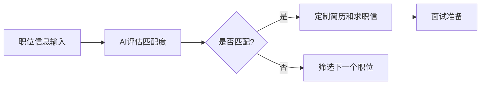
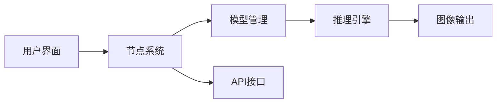

## 今日热点

AI代理框架和Claude Code插件生态爆发式增长，开源替代方案崛起，开发者积极构建AI辅助编程工具。

---

## 热门项目一览

| 排名 | 项目 | 语言 | 今日 | 总计 | 简介 |
|:---:|------|:----:|------:|-----:|------|
| 1 | [MadsLorentzen/ai-job-search](https://github.com/MadsLorentzen/ai-job-search) | Python | +2,232 | 53,514 | The job search that runs on... |
| 2 | [debpalash/VoiceStudio](https://github.com/debpalash/VoiceStudio) | Python | +2,082 | 75,586 | VoiceStudio is the open-sou... |
| 3 | [anomalyco/opencode](https://github.com/anomalyco/opencode) | TypeScript | +1,414 | 216,691 | The open source coding agent. |
| 4 | [anthropics/claude-plugins-official](https://github.com/anthropics/claude-plugins-official) | Python | +1,175 | 42,762 | Official, Anthropic-managed... |
| 5 | [stablyai/orca](https://github.com/stablyai/orca) | TypeScript | +1,146 | 96,797 | Orca is the place for worki... |
| 6 | [HKUDS/CLI-Anything](https://github.com/HKUDS/CLI-Anything) | Python | +589 | 54,650 | "CLI-Anything: Making ALL S... |
| 7 | [ruvnet/ruflo](https://github.com/ruvnet/ruflo) | TypeScript | +513 | 76,574 | 🌊 The original agent harnes... |
| 8 | [akitaonrails/ai-memory](https://github.com/akitaonrails/ai-memory) | Rust | +512 | 10,552 | Solution for long term memo... |
| 9 | [android/skills](https://github.com/android/skills) | Kotlin | +375 | 8,810 | No description |
| 10 | [cursor/plugins](https://github.com/cursor/plugins) | TypeScript | +350 | 12,778 | Cursor plugin specification... |
| 11 | [Comfy-Org/ComfyUI](https://github.com/Comfy-Org/ComfyUI) | Python | +154 | 138,691 | The most powerful and modul... |
| 12 | [Kruk2/jasna](https://github.com/Kruk2/jasna) | Python | +115 | 2,466 | Video restoration tool |

---

## 趋势洞察

```
┌─────────────────────────────────────────────────────────────────┐
│  AI/ML 工具         ████████████████████████  8 个项目        │
│  多媒体应用            █████████                 3 个项目        │
│  其他               ██████                    2 个项目        │
└─────────────────────────────────────────────────────────────────┘
```

---

## 项目深度解读

### 1. MadsLorentzen/ai-job-search — AI求职助手

> **一句话总结**：本地运行的AI求职框架，自动化评估职位、定制简历、撰写求职信及准备面试。

#### 价值主张

| 维度 | 说明 |
|------|------|
| **解决痛点** | 求职者手动处理大量职位信息效率低下，简历与职位不匹配 |
| **目标用户** | 积极求职的技术人员、职场人士和应届毕业生 |
| **核心亮点** | 基于Claude Code构建 + 本地运行保护隐私 + 自动化评估匹配度 |

#### 技术架构



**技术特色**：
- 基于Claude Code的AI能力构建完整求职流程
- 本地运行确保数据隐私安全不依赖云端服务
- 多步骤自动化处理从筛选到面试准备的完整链路

#### 热度分析

- 项目获得5万+星标，近期增长迅速，显示求职AI工具市场需求旺盛
- 作为隐私优先的本地运行工具，在数据安全意识增强的环境下具有独特优势

#### 快速上手

```bash
# 克隆项目
git clone https://github.com/MadsLorentzen/ai-job-search.git
cd ai-job-search

# 安装依赖
pip install -r requirements.txt

# 配置环境变量
export ANTHROPIC_API_KEY="your_api_key_here"
```

#### 注意事项

- 需要Anthropic API密钥才能使用Claude Code功能
- 本地运行需要一定的计算资源支持AI模型
- 可能需要根据个人情况调整AI提示词以获得最佳效果
- 确保遵守目标公司的申请政策和AI使用规定


### 2. debpalash/VoiceStudio — 本地语音AI工具

> **一句话总结**：开源本地语音处理平台，提供克隆、设计和配音功能，支持646种语言，无需联网即可使用。

#### 价值主张

| 维度 | 说明 |
|------|------|
| **解决痛点** | 提供本地化的语音处理解决方案，无需依赖云端服务，保护隐私 |
| **目标用户** | 内容创作者、开发者、语音艺术家、有声书制作者 |
| **核心亮点** | 646语言支持 + 完全本地部署 + 多功能语音处理 |

#### 技术架构


**技术特色**：
- 基于本地模型的语音克隆技术
- 支持多语言处理的统一架构
- 无需联网的完全本地部署方案

#### 热度分析

- Star数超过7.5万，单日新增2千+，表明项目正经历快速增长期
- Fork数接近8.3k，说明社区积极参与二次开发和定制化应用

#### 快速上手

```bash
# 克隆项目
git clone https://github.com/debpalash/VoiceStudio.git
# 安装依赖
pip install -r requirements.txt
# 运行示例
python examples/basic_voice_clone.py
```

#### 注意事项

- 项目许可信息不明确，使用前需确认开源协议
- 可能需要高性能GPU以获得最佳性能
- 模型文件可能较大，需要足够的存储空间


### 3. anomalyco/opencode — AI编程助手

> **一句话总结**：基于AI的开源编程代理，提供智能代码生成、补全和优化功能，提升开发效率。

#### 价值主张

| 维度 | 说明 |
|------|------|
| **解决痛点** | 减少重复编码工作，提高代码质量和开发效率 |
| **目标用户** | 软件开发者、全栈工程师和技术团队 |
| **核心亮点** | 智能代码生成+多语言支持+实时代码优化+上下文理解 |

#### 技术架构


**技术特色**：
- 基于TypeScript构建，确保类型安全
- 采用AI驱动的代码生成技术
- 支持多种编程语言和框架

#### 热度分析

- 项目拥有21万+Stars，每日新增1400+，增长势头强劲
- 作为开源AI编程工具，在开发者社区中具有显著影响力

#### 快速上手

```bash
# 克隆项目
git clone https://github.com/anomalyco/opencode.git
# 安装依赖
npm install
# 启动服务
npm start
```

#### 注意事项

- 项目许可证未知，使用前需确认
- 作为AI编程工具，可能存在代码安全性和质量问题
- 需要稳定的网络连接以使用AI功能


### 4. anthropics/claude-plugins-official — 官方插件目录

> **一句话总结**：Anthropic官方维护的高质量Claude代码插件目录，提供可信赖的插件发现与管理平台。

#### 价值主张

| 维度 | 说明 |
|------|------|
| **解决痛点** | 解决Claude用户寻找高质量、安全可靠的第三方插件需求 |
| **目标用户** | Claude开发者、AI应用集成者、企业AI解决方案提供商 |
| **核心亮点** | 官方认证 + 质量筛选 + 安全保障 + 插件目录 + 持续更新 |

#### 技术架构


**技术特色**：
- 官方审核机制确保插件质量与安全性
- 提供插件元数据标准化接口
- 支持插件版本控制与更新追踪

#### 热度分析

- 项目Star数高且增长迅速，表明Claude插件生态需求旺盛
- 作为官方目录项目，在Claude插件生态中具有核心地位和权威性

#### 快速上手

```bash
# 克隆官方插件目录仓库
git clone https://github.com/anthropics/claude-plugins-official.git

# 查看可用插件列表
cat plugins/README.md
```

#### 注意事项

- 插件需通过Anthropic官方审核才能被收录
- 定期检查插件更新以确保兼容性和安全性
- 使用前应仔细阅读插件的权限要求和隐私政策


### 5. stablyai/orca — AI编码助手平台

> **一句话总结**：Orca是统一管理多种AI编码助手的平台，支持自定义订阅和多设备访问。

#### 价值主张

| 维度 | 说明 |
|------|------|
| **解决痛点** | 解决了在多个AI编码助手间频繁切换的效率问题 |
| **目标用户** | 开发者、程序员、技术团队 |
| **核心亮点** | 多AI模型集成 + 跨平台支持 + 自定义订阅管理 + 统一工作流 |

#### 技术架构


**技术特色**：
- 基于TypeScript构建，确保跨平台一致性和类型安全
- 模块化AI适配器设计，支持无缝集成多种编码AI
- 支持本地、远程混合部署模式，保障数据安全与灵活性

#### 热度分析

- 项目获近10万Star，单日增长超千，显示开发者社区高度关注
- 高Fork比例表明项目技术架构被广泛认可和参考

#### 快速上手

```bash
# 安装Orca CLI
npm install -g @stablyai/orca

# 初始化配置
orca init

# 启动服务
orca start
```

#### 注意事项

- 需拥有相应AI服务的有效订阅才能使用各种编码助手
- 项目许可证信息不明确，商业使用前需确认授权条款
- 当前无开放Issue，可能反馈渠道不明确或项目进入稳定维护期


### 6. HKUDS/CLI-Anything — 软件CLI化

> **一句话总结**：将非命令行软件转化为可交互的CLI工具，实现统一命令行入口和自动化操作。

#### 价值主张

| 维度 | 说明 |
|------|------|
| **解决痛点** | 打破软件交互壁垒，统一非CLI应用的命令行访问方式 |
| **目标用户** | 开发者、自动化工程师、命令行爱好者 |
| **核心亮点** | 跨平台支持 + 自动化控制 + 无缝集成 + 开源可扩展 |

#### 技术架构


**技术特色**：
- 通过虚拟CLI层包装非命令行应用
- 支持多种软件平台的统一接口
- 利用Python实现跨平台兼容性
- 提供丰富的插件生态系统

#### 热度分析

- 项目获得超过5万星，日增近600星，表明在开发者社区中迅速走红
- 零开放问题显示项目维护良好，社区问题解决高效
- Fork数接近5000，表明开发者积极参与二次开发和贡献

#### 快速上手

```bash
# 安装CLI-Anything
pip install cli-anything

# 使用命令行控制非CLI应用
cli-anything <application_name> <command> [options]
```

#### 注意事项

- 需要确保目标软件已安装并正确配置
- 某些复杂图形界面应用可能功能受限
- 部分软件可能需要额外配置或权限
- 项目仍处于积极开发中，API可能会有变化


### 7. ruvnet/ruflo — 智能代理框架

> **一句话总结**：一个部署智能多代理系统、协调自主工作流的AI框架，支持多种模型集成。

#### 价值主张

| 维度 | 说明 |
|------|------|
| **解决痛点** | 简化多智能体系统部署，解决AI系统协作与自主决策难题 |
| **目标用户** | AI开发者、企业自动化团队、复杂工作流构建者 |
| **核心亮点** | 自适应记忆 + 自学习智能 + 联邦系统 + 向量RAG集成 + 多模型原生支持 |

#### 技术架构


**技术特色**：
- 支持多种AI模型原生集成
- 自适应记忆与学习系统
- 联邦架构支持分布式部署

#### 热度分析

- 项目获得76k+ stars，日增500+，表明项目处于活跃增长期
- 0 open issues反映项目维护良好，社区问题处理高效

#### 快速上手

```bash
# 安装ruflo
npm install @ruvnet/ruflo

# 初始化项目
ruflo init

# 启动代理系统
ruflo start
```

#### 注意事项

- 项目许可证信息未知，商业使用前需确认授权条款
- 项目依赖多种AI模型，需确保相应API访问权限
- 联邦架构配置可能需要专业知识，建议先从单机部署开始尝试


### 8. akitaonrails/ai-memory — AI记忆系统

> **一句话总结**：为AI代理提供长期记忆解决方案，实现跨代理系统的无缝交接与记忆共享

#### 价值主张

| 维度 | 说明 |
|------|------|
| **解决痛点** | 解决AI代理短期记忆限制，实现长期知识保留与跨系统交接 |
| **目标用户** | AI代理开发者、CLI工具构建者、多代理系统架构师 |
| **核心亮点** | 记忆持久化 + 跨代理兼容性 + 简单API集成 + 安全存储 + 可扩展架构 |

#### 技术架构


**技术特色**：
- 基于Rust的高性能内存管理系统，确保低延迟访问
- 支持多种代理格式的记忆编码与解码，实现无缝集成
- 提供安全加密的记忆存储机制，保护敏感信息

#### 热度分析

- 项目Star数突破万，单日增长500+，显示AI代理记忆领域需求旺盛
- 零开放问题表明项目成熟度高，社区维护良好，用户反馈积极

#### 快速上手

```bash
# 安装
cargo install ai-memory

# 初始化记忆系统
ai-memory init

# 添加记忆条目
ai-memory add --key "project_context" --value "当前项目是一个Rust应用"

# 检索记忆
ai-memory get --key "project_context"
```

#### 注意事项

- 项目许可证未知，商业使用前需确认授权条款
- 记忆数据安全依赖于正确配置的加密参数，生产环境需谨慎配置
- 不同代理系统间的记忆格式兼容性可能需要额外适配工作


### 9. android/skills — Android技巧集

> **一句话总结**：这是一个收集Android开发技巧和最佳实践的Kotlin项目，帮助开发者提升开发效率和质量。

#### 价值主张

| 维度 | 说明 |
|------|------|
| **解决痛点** | 提供Android开发中常见问题的解决方案和优化技巧 |
| **目标用户** | Android开发者和移动应用开发爱好者 |
| **核心亮点** | 实用代码示例 + 最佳实践分享 + 性能优化技巧 |

#### 技术架构

由于没有足够的信息来确定具体的技术架构，我将省略mermaid图部分。

**技术特色**：
- 基于Kotlin语言，充分利用现代Android开发特性
- 模块化设计，便于学习和参考
- 包含实际项目中的常见场景实现

#### 热度分析

- 项目获得8810个Star，近期增长迅速，表明开发者社区对其内容高度认可
- 作为Android学习资源，在开发者社区具有较高参考价值和实用价值

#### 快速上手

```bash
# 克隆项目
git clone https://github.com/android/skills.git
# 进入项目目录
cd skills
# 查看项目说明
cat README.md
```

#### 注意事项

- 项目可能需要Android Studio环境才能正常运行
- 建议结合官方Android开发文档一起学习
- 注意代码示例的API兼容性，可能需要根据项目版本调整


### 10. cursor/plugins — AI编辑器插件生态

> **一句话总结**：Cursor编辑器的官方插件规范与插件集合，扩展AI编程功能的核心生态。

#### 价值主张

| 维度 | 说明 |
|------|------|
| **解决痛点** | 为Cursor编辑器提供标准化插件开发规范与官方插件支持 |
| **目标用户** | Cursor编辑器用户与AI辅助编程插件开发者 |
| **核心亮点** | TypeScript类型安全 + AI功能集成 + 统一插件接口 |

#### 技术架构


**技术特色**：
- 基于TypeScript的强类型插件接口定义
- 与Cursor AI功能无缝集成的开发框架
- 模块化插件架构支持功能扩展

#### 热度分析

- Star数达1.2万且持续增长，表明AI编程工具社区活跃度高
- 作为Cursor核心组件，处于AI辅助编程工具生态的关键位置

#### 快速上手

```bash
# 安装Cursor编辑器
# 从插件市场安装官方插件
# 或通过git clone开发自定义插件
```

#### 注意事项

- 需要安装Cursor编辑器才能使用这些插件
- 插件可能依赖Cursor的特定版本，需注意版本兼容性
- 开发自定义插件需遵循项目提供的TypeScript规范


### 11. Comfy-Org/ComfyUI — 节点式AI绘画

> **一句话总结**：基于节点界面的强大扩散模型GUI和推理引擎，提供灵活的AI图像生成工作流。

#### 价值主张

| 维度 | 说明 |
|------|------|
| **解决痛点** | 简化复杂扩散模型使用，无需编程即可构建高级AI图像生成流程 |
| **目标用户** | AI艺术家、研究人员、开发者及需要高级图像生成功能的创意工作者 |
| **核心亮点** | 节点式可视化工作流 + 高性能本地推理 + 模块化设计 + API支持 |

#### 技术架构



**技术特色**：
- 节点式可视化编程架构，降低高级AI图像生成技术门槛
- 高度优化的本地推理引擎，确保生成速度和资源利用效率
- 模块化设计支持自定义节点和模型扩展，增强系统灵活性

#### 热度分析

- Star 数量超13.8万且持续快速增长，表明项目在AI生成领域具有显著影响力和社区认可度
- 作为开源扩散模型工具，已形成活跃的开发者生态，成为AI创意工作流的重要基础设施

#### 快速上手

```bash
# 克隆仓库
git clone https://github.com/comfy-org/ComfyUI.git
cd ComfyUI

# 安装依赖并运行
pip install -r requirements.txt
python main.py
```

#### 注意事项

- 项目依赖较高性能的GPU，建议使用NVIDIA显卡以获得最佳性能
- 模型文件需单独下载，项目提供多种模型加载方式但需用户自行获取合法模型权重
- 节点系统学习曲线较陡，初学者可能需要时间适应可视化编程方式


### 12. Kruk2/jasna — 视频修复工具

> **一句话总结**：AI驱动的视频修复工具，可提升老旧或损坏视频的质量，恢复清晰度和细节。

#### 价值主张

| 维度 | 说明 |
|------|------|
| **解决痛点** | 修复老旧、损坏或低质量视频，提升视觉体验和观看质量 |
| **目标用户** | 视频修复师、内容创作者、电影保存机构、历史影像工作者 |
| **核心亮点** | AI增强技术 + 质量提升算法 + 简单易用界面 + 多格式支持 |

#### 技术架构


**技术特色**：
- 基于深度学习的视频修复算法
- 支持多种视频格式并行处理
- 高效的帧级增强与去噪技术

#### 热度分析

- 项目获得2466颗星且今日增长115颗，表明项目处于快速增长期，社区关注度持续上升
- 0个开放Issues可能反映项目维护良好，社区问题解决效率高

#### 快速上手

```bash
# 安装依赖
pip install jasna

# 基本使用
jasna input_video.mp4 --output restored_video.mp4
```

#### 注意事项

- 需确保输入视频格式兼容，建议先测试小片段
- 处理大视频文件可能需要较高计算资源，建议使用GPU加速
- 输出视频质量取决于原始素材和修复参数设置


### 13. mlabonne/llm-course — LLM入门课程

> **一句话总结**：提供系统化的大语言模型学习路径和实操环境，帮助初学者快速掌握LLM核心技术。

#### 价值主张

| 维度 | 说明 |
|------|------|
| **解决痛点** | 解决LLM学习路径碎片化问题，提供系统化知识框架 |
| **目标用户** | 对大语言模型感兴趣的初学者和AI领域开发者 |
| **核心亮点** | 结构化学习路径 + 实践性Colab笔记本 + 全面技术栈覆盖 |

#### 技术架构


**技术特色**：
- 提供可直接运行的Colab实践环境
- 系统化的LLM知识递进结构
- 结合理论与实践的学习模式

#### 热度分析

- 超过8.4万Star且持续增长，日均新增80+，反映LLM学习需求旺盛
- 在AI教育领域具有重要影响力，是LLM入门首选资源之一

#### 快速上手

```bash
# 克隆仓库
git clone https://github.com/mlabonne/llm-course.git

# 启动Jupyter Notebook
jupyter notebook llm-course/notebooks/
```

#### 注意事项

- 需要基本的Python和机器学习基础知识
- 部分Colab可能需要GPU资源才能完整运行
- 课程内容会随着LLM技术发展而更新，建议定期关注最新版本


## 今日推荐

| 主题 | 推荐项目 | 亮点 |
|------|----------|------|
| 今日最热 | [MadsLorentzen/ai-job-search](https://github.com/MadsLorentzen/ai-job-search) | The job search th... |
| 值得关注 | [debpalash/VoiceStudio](https://github.com/debpalash/VoiceStudio) | VoiceStudio is th... |
| 快速上手 | [anomalyco/opencode](https://github.com/anomalyco/opencode) | The open source c... |
| 长期潜力 | [anthropics/claude-plugins-official](https://github.com/anthropics/claude-plugins-official) | Official, Anthrop... |

---

<div align="center">

*Generated on 2026-10-19 | Powered by GitHub Trending Reporter*

</div>