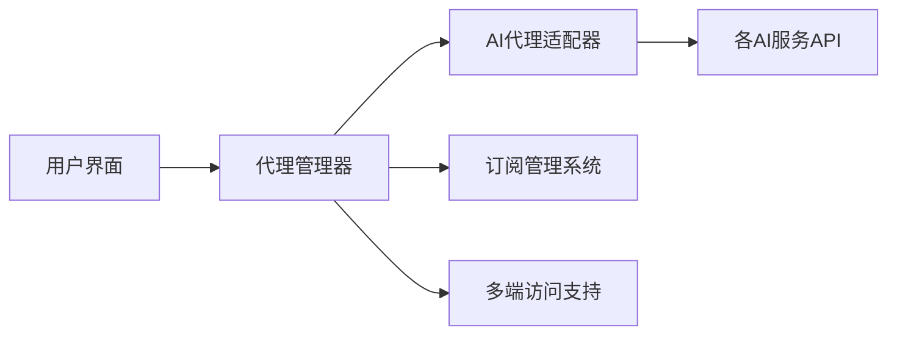
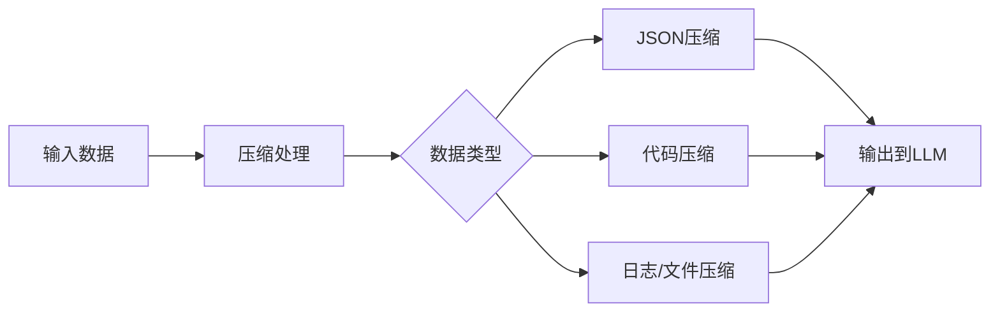

## 今日热点

AI代理技术持续引领GitHub热潮，多代理平台与垂直领域应用爆发式增长，求职工具和编程辅助成为AI落地最热门场景。

---

## 热门项目一览

| 排名 | 项目 | 语言 | 今日 | 总计 | 简介 |
|:---:|------|:----:|------:|-----:|------|
| 1 | [MadsLorentzen/ai-job-search](https://github.com/MadsLorentzen/ai-job-search) | Python | +3,856 | 57,579 | The job search that runs on... |
| 2 | [stablyai/orca](https://github.com/stablyai/orca) | TypeScript | +1,590 | 98,399 | Orca is the place for worki... |
| 3 | [anomalyco/opencode](https://github.com/anomalyco/opencode) | TypeScript | +1,311 | 217,913 | The open source coding agent. |
| 4 | [Comfy-Org/ComfyUI](https://github.com/Comfy-Org/ComfyUI) | Python | +1,011 | 139,831 | The most powerful and modul... |
| 5 | [akitaonrails/ai-memory](https://github.com/akitaonrails/ai-memory) | Rust | +666 | 11,426 | Solution for long term memo... |
| 6 | [HKUDS/CLI-Anything](https://github.com/HKUDS/CLI-Anything) | Python | +606 | 55,300 | "CLI-Anything: Making ALL S... |
| 7 | [ruvnet/ruflo](https://github.com/ruvnet/ruflo) | TypeScript | +564 | 77,261 | 🌊 The original agent harnes... |
| 8 | [Kruk2/jasna](https://github.com/Kruk2/jasna) | Python | +498 | 2,950 | Video restoration tool |
| 9 | [shiyu-coder/Kronos](https://github.com/shiyu-coder/Kronos) | Python | +363 | 41,738 | Kronos: A Foundation Model ... |
| 10 | [headroomlabs-ai/headroom](https://github.com/headroomlabs-ai/headroom) | Python | +310 | 76,291 | Compress tool outputs, logs... |
| 11 | [withmarbleapp/os-taxonomy](https://github.com/withmarbleapp/os-taxonomy) | JavaScript | +284 | 6,189 | No description |
| 12 | [anthropics/claude-code](https://github.com/anthropics/claude-code) | TypeScript | +167 | 152,688 | Claude Code is an agentic c... |

---

## 趋势洞察

```
┌─────────────────────────────────────────────────────────────────┐
│  AI/ML 工具         ████████████████████████  8 个项目        │
│  多媒体应用            ██████                    2 个项目        │
│  其他               ██████                    2 个项目        │
└─────────────────────────────────────────────────────────────────┘
```

---

## 项目深度解读

### 1. MadsLorentzen/ai-job-search — AI求职助手

> **一句话总结**：基于Claude AI的自动化求职框架，可评估职位、定制简历、撰写求职信和准备面试。

#### 价值主张

| 维度 | 说明 |
|------|------|
| **解决痛点** | 自动化全流程求职工作，减少重复劳动，提高申请匹配度和成功率 |
| **目标用户** | 寻找技术职位的求职者，特别是需要大量申请的应届毕业生和转行者 |
| **核心亮点** | 基于Claude AI + 全流程自动化 + 简历定制化 + 面试准备 + 本地运行保护隐私 |

#### 技术架构


**技术特色**：
- 基于Claude AI大模型，提供高质量文本生成
- 本地运行架构，保护用户隐私数据安全
- 全流程自动化，减少人工干预提高效率
- 简历定制化算法，提高职位匹配度
- 面试准备功能，模拟真实面试场景

#### 热度分析

- 单日增长近4千stars，表明求职AI工具市场正处于高速增长期
- 高star与fork比(约3:1)显示项目不仅被关注，还被广泛实际使用和二次开发

#### 快速上手

```bash
# 克隆项目
git clone https://github.com/MadsLorentzen/ai-job-search.git
cd ai-job-search

# 安装依赖
pip install -r requirements.txt

# 配置API密钥并运行
export ANTHROPIC_API_KEY="your_key_here"
python main.py --help
```

#### 注意事项

- 项目依赖Claude API，需要有效的API密钥且可能产生费用
- 本地运行需要一定的计算资源，建议在性能较好的机器上运行
- 自动化生成的内容需要人工审核，确保质量和个性化
- 提供个人信息和简历时需注意隐私保护，建议使用虚拟信息测试


### 2. stablyai/orca — AI代理管理平台

> **一句话总结**：统一管理多个AI编程代理的平台，支持多端访问和自定义订阅。

#### 价值主张

| 维度 | 说明 |
|------|------|
| **解决痛点** | 解决多个AI代理分散管理、无法统一使用的痛点 |
| **目标用户** | 需要使用多种AI编程工具的开发者和技术团队 |
| **核心亮点** | 多代理统一管理 + 支持个人订阅 + 多平台访问 + 远程运行时 |

#### 技术架构



**技术特色**：
- TypeScript实现，确保代码质量和类型安全
- 模块化代理架构，易于扩展新AI服务
- 多平台支持，提供一致的用户体验

#### 热度分析

- Star数近10万，单日增长超1500，表明项目正处于快速增长期，受到社区高度关注
- Issues数量为0，可能表明项目维护良好或问题通过其他渠道解决，社区活跃度高

#### 快速上手

```bash
# 安装Orca
npm install -g @stablyai/orca

# 初始化配置
orca init

# 启动服务
orca start
```

#### 注意事项

- 需要各AI服务的有效订阅才能使用相应代理
- 可能需要配置API密钥和服务访问权限
- 项目许可证未知，商业使用前需确认授权条款


### 3. anomalyco/opencode — AI编程助手

> **一句话总结**：开源AI编程代理工具，通过自然语言输入生成高质量代码，提升开发效率。

#### 价值主张

| 维度 | 说明 |
|------|------|
| **解决痛点** | 降低编程门槛，自动化代码生成，减少重复编码工作 |
| **目标用户** | 开发者、编程初学者、需要快速原型构建的团队 |
| **核心亮点** | 自然语言转代码 + 多语言支持 + 上下文理解 + 智能代码补全 + 实时代码优化 |

#### 技术架构


**技术特色**：
- 基于大语言模型的代码理解与生成能力
- 支持多种编程语言的语法分析与转换
- 上下文感知的代码补全与优化建议

#### 热度分析

- 项目获得超21万Star，日均增长1300+，表明开发者社区对其需求旺盛
- 在AI辅助编程领域处于领先地位，与GitHub Copilot等工具形成开源替代方案

#### 快速上手

```bash
# 克隆项目
git clone https://github.com/anomalyco/opencode.git

# 安装依赖
npm install

# 启动服务
npm start
```

#### 注意事项

- 项目依赖Node.js环境，确保系统兼容性
- 代码生成质量受训练数据影响，关键代码建议人工审查
- 可能需要配置API密钥以使用某些高级功能


### 4. Comfy-Org/ComfyUI — AI图像生成平台

> **一句话总结**：基于节点的强大扩散模型GUI，提供最快本地推理引擎，支持模块化AI图像生成。

#### 价值主张

| 维度 | 说明 |
|------|------|
| **解决痛点** | 将复杂的AI模型操作简化为可视化节点连接，降低使用门槛 |
| **目标用户** | AI研究人员、开发者、艺术家和需要高级图像生成功能的用户 |
| **核心亮点** | 节点式界面 + 高性能本地推理 + 模块化架构 + 强大的API支持 |

#### 技术架构


**技术特色**：
- 基于节点的可视化工作流系统，使复杂AI模型操作直观化
- 高性能本地推理引擎，优化计算资源利用
- 模块化架构设计，支持多种AI模型和扩展
- 完整的API支持，便于集成和自动化

#### 热度分析

- Star数超过13万且持续快速增长，表明项目在AI图像生成领域具有极高影响力
- Fork数相对较少但稳定，说明项目专业性较高，用户更多是深度使用而非简单复制

#### 快速上手

```bash
# 克隆仓库
git clone https://github.com/comfy-org/ComfyUI.git
# 安装依赖
pip install -r requirements.txt
# 启动服务
python main.py
```

#### 注意事项

- 需要较强的GPU性能才能获得最佳体验
- 项目依赖较多，确保系统环境兼容
- 由于项目发展迅速，API可能会有变化，需关注更新


### 5. akitaonrails/ai-memory — AI记忆中枢

> **一句话总结**：为AI代理提供长期记忆能力，实现不同代理间的无缝交接与协作。

#### 价值主张

| 维度 | 说明 |
|------|------|
| **解决痛点** | 解决AI代理缺乏长期记忆和跨平台协作的难题 |
| **目标用户** | AI代理开发者、CLI工具构建者、AI系统集成商 |
| **核心亮点** | 跨代理兼容性 + 长期记忆存储 + 记忆检索优化 + 无缝交接能力 |

#### 技术架构


**技术特色**：
- 基于Rust构建，确保高性能与内存安全
- 采用向量嵌入技术实现高效记忆检索
- 支持多种AI代理格式和协议的兼容层

#### 热度分析

- 项目近期热度显著增长，单日星标增加666，表明社区高度关注
- 在AI代理工具生态中占据重要位置，作为记忆基础设施被广泛采用

#### 快速上手

```bash
# 克隆仓库
git clone https://github.com/akitaonrails/ai-memory.git

# 运行示例
cd ai-memory && cargo run --example basic_usage
```

#### 注意事项

- 需要关注数据隐私和安全性问题，特别是处理敏感AI交互数据时
- 不同AI代理间的兼容性可能需要额外配置
- 记忆存储的容量管理和性能优化需要定期维护


### 6. HKUDS/CLI-Anything — CLI通用工具集

> **一句话总结**：将各类软件转化为代理原生模式，提供统一的命令行操作接口，简化跨软件工作流。

#### 价值主张

| 维度 | 说明 |
|------|------|
| **解决痛点** | 打破软件操作孤岛，提供统一的命令行控制接口 |
| **目标用户** | 开发者、系统管理员、自动化运维工程师 |
| **核心亮点** | 插件化架构 + 跨平台兼容 + 软件抽象层 + 智能命令解析 + 可扩展生态 |

#### 技术架构


**技术特色**：
- 基于Python的插件化架构，支持动态加载和扩展
- 统一的命令接口抽象层，兼容不同软件API
- 智能命令解析和参数转换系统
- 轻量级代理模式，无需修改目标软件源码

#### 热度分析

- 项目Star数超5.5万且持续快速增长，单日新增600+，表明社区认可度高
- 零Open Issues反映项目维护良好，问题解决机制高效，用户满意度高

#### 快速上手

```bash
# 安装CLI-Anything
pip install cli-anything

# 初始化配置并连接软件
cli-anything init --connect vscode git docker

# 使用示例：通过CLI操作VSCode
cli-anything vscode open /path/to/project
cli-anything vscode install extension ms-python.python
```

#### 注意事项

- 项目许可证信息不明确，使用前建议确认授权条款
- 部分高级功能可能需要额外配置或付费订阅
- 插件生态仍在快速发展中，部分软件支持可能不够完善


### 7. ruvnet/ruflo — 智能体工具包

> **一句话总结**：部署多智能体群体、协调自主工作流并构建对话AI系统的TypeScript工具包。

#### 价值主张

| 维度 | 说明 |
|------|------|
| **解决痛点** | 简化多智能体系统部署和AI工作流协调的复杂性 |
| **目标用户** | AI开发者、构建自主系统的团队、对话AI应用开发者 |
| **核心亮点** | 自适应记忆 + 自学习智能 + 联邦功能 + 向量RAG集成 + 多模型原生支持 |

#### 技术架构


**技术特色**：
- 支持多模型原生集成（Claude、Codex、Hermes等）
- 实现自适应记忆和自学习机制
- 提供联邦功能支持分布式智能体系统

#### 热度分析

- 项目获得77k+星标且持续增长，表明其在AI开发领域有显著影响力
- 零开放问题反映项目成熟度高，社区维护良好
- 高fork数表明项目被广泛采用和二次开发

#### 快速上手

```bash
# 克隆仓库
git clone https://github.com/ruvnet/ruflo.git
# 安装依赖
npm install
# 启动示例
npm run example
```

#### 注意事项

- 项目许可证未知，商业使用前需确认授权条款
- 零开放问题可能意味着问题管理方式特殊，贡献前需了解社区规范
- 多模型集成可能需要额外的API密钥和配置


### 8. Kruk2/jasna — 智能视频修复

> **一句话总结**：基于AI的高效视频修复工具，可提升老旧/损坏视频质量，支持多种视频格式。

#### 价值主张

| 维度 | 说明 |
|------|------|
| **解决痛点** | 修复老旧、损坏视频，提升视频质量和清晰度 |
| **目标用户** | 视频修复专家、内容创作者、影视爱好者 |
| **核心亮点** | 基于AI的智能修复技术 + 支持多种视频格式 + 高效处理速度 + 易于使用的命令行界面 |

#### 技术架构


**技术特色**：
- 采用深度学习模型进行视频帧修复
- 支持多种视频编解码格式
- 优化的处理流水线提高修复效率

#### 热度分析

- 项目近期获得498个星，显示出快速增长趋势，表明社区对该视频修复工具的高度认可
- 作为视频修复领域的工具，填补了开源社区在AI视频修复方面的空白

#### 快速上手

```bash
# 安装依赖
pip install -r requirements.txt

# 运行视频修复
python jasna.py input_video.mp4 output_video.mp4
```

#### 注意事项

- 可能需要高性能GPU以获得最佳处理速度
- 视频处理可能需要较长时间，取决于视频长度和复杂度
- 输出视频质量取决于原始视频损坏程度


### 9. shiyu-coder/Kronos — 金融语言模型

> **一句话总结**：Kronos是专为金融市场语言设计的AI基础模型，提供金融文本理解与预测能力。

#### 价值主张

| 维度 | 说明 |
|------|------|
| **解决痛点** | 金融领域专业术语与市场动态分析困难，传统模型理解不足 |
| **目标用户** | 金融分析师、量化交易员、投资机构、研究机构 |
| **核心亮点** | 金融领域专用预训练 + 市场语言理解能力 + 金融文本生成能力 |

#### 技术架构


**技术特色**：
- 金融领域语料专用预训练，提升专业术语理解能力
- 多模态金融数据融合处理，结合文本与市场数据
- 针对金融场景优化的模型架构，增强市场预测准确性

#### 热度分析

- 项目Star数高达4万+，日均增长300+，显示金融AI领域高度关注
- Fork数近7千，表明开发者社区积极参与模型定制与应用开发
- 零Open Issues可能反映项目成熟度高或问题处理机制完善

#### 快速上手

```bash
# 安装依赖
pip install kronos-model

# 基本使用示例
from kronos import KronosModel
model = KronosModel.from_pretrained("shiyu-coder/kronos")
result = model.predict("美联储利率政策对股市的影响")
print(result)
```

#### 注意事项

- 模型使用需遵守金融数据相关法规与隐私政策
- 金融预测结果仅供参考，实际投资决策需结合专业判断
- 模型可能需要针对特定金融领域进行微调以获得最佳效果


### 10. headroomlabs-ai/headroom — LLM数据压缩器

> **一句话总结**：在LLM处理前压缩各类数据，显著减少token使用量同时保持回答质量。

#### 价值主张

| 维度 | 说明 |
|------|------|
| **解决痛点** | LLM处理数据时token消耗过多，导致成本高、效率低 |
| **目标用户** | 使用LLM的开发者、企业AI应用构建者 |
| **核心亮点** | 高压缩率 + 多种数据格式支持 + 保持回答质量 + 多种集成方式 |

#### 技术架构



**技术特色**：
- 专针对LLM输入优化的压缩算法
- 支持多种数据格式（JSON、代码、日志等）
- 提供库、代理和MCP服务器三种集成方式
- 保持高压缩率的同时维持原始数据完整性

#### 热度分析

- 高关注度项目，近7天新增310 stars，显示快速增长趋势
- 作为LLM优化工具，处于AI应用生态的关键位置，解决实际痛点

#### 快速上手

```bash
# 安装
pip install headroom

# 使用示例
import headroom
compressed = headroom.compress(your_data)
```

#### 注意事项

- 压缩可能影响某些需要原始数据上下文的复杂任务
- 不同数据类型压缩效果差异较大，需根据实际场景测试优化
- 项目许可证信息不明确，商业使用前需确认授权条款


### 11. withmarbleapp/os-taxonomy — 操作系统知识库

> **一句话总结**：构建全面的操作系统分类与知识共享平台，提供系统化技术参考。

#### 价值主张

| 维度 | 说明 |
|------|------|
| **解决痛点** | 操作系统信息分散，缺乏系统性分类和知识整合 |
| **目标用户** | 开发者、系统管理员、技术研究人员 |
| **核心亮点** | 操作系统分类体系 + 知识图谱 + 社区贡献 + 交互式浏览 |

#### 技术架构


**技术特色**：
- 使用JavaScript构建的全栈应用，便于跨平台使用
- 采用知识图谱技术组织操作系统相关信息
- 支持社区贡献和实时更新机制

#### 热度分析

- 项目获得超过6k星，近期增长迅速，显示操作系统分类工具需求旺盛
- 零开放问题表明项目维护良好，社区可能通过其他渠道交流

#### 快速上手

```bash
# 克隆项目
git clone https://github.com/withmarbleapp/os-taxonomy.git
# 安装依赖
npm install
# 启动开发服务器
npm run dev
```

#### 注意事项

- 项目许可证未知，商业使用前需确认授权方式
- 由于是知识型项目，数据准确性和时效性需要关注


### 12. anthropics/claude-code — 智能编码助手

> **一句话总结**：Claude Code是终端内运行的AI编码助手，通过自然语言理解代码库并自动化编程任务。

#### 价值主张

| 维度 | 说明 |
|------|------|
| **解决痛点** | 开发者手动处理重复编码任务、理解复杂代码和git工作流的效率问题 |
| **目标用户** | 软件开发者、程序员和需要高效编码的专业人士 |
| **核心亮点** | 终端内直接集成 + 自然语言交互 + 代码库理解 + 自动化任务执行 |

#### 技术架构


**技术特色**：
- 基于大型语言模型的代码理解能力
- 与本地代码库深度集成的分析系统
- 终端环境下的自然语言交互界面

#### 热度分析

- 项目获得超过15万星，并有持续增长趋势，显示开发者社区对其AI辅助编码功能的强烈兴趣
- 作为Anthropic公司推出的工具，在AI辅助编程领域具有显著影响力，与GitHub Copilot等工具形成差异化竞争

#### 快速上手

```bash
# 安装Claude Code
npm install -g @anthropic/claude-code

# 初始化项目
claude-code init

# 开始使用
claude-code "解释这个函数的功能"
```

#### 注意事项

- 需要API密钥才能使用，可能涉及订阅费用
- 代码质量和安全性需要用户自行验证
- 可能需要一定的学习曲线才能充分利用其功能


## 今日推荐

| 主题 | 推荐项目 | 亮点 |
|------|----------|------|
| 今日最热 | [MadsLorentzen/ai-job-search](https://github.com/MadsLorentzen/ai-job-search) | The job search th... |
| 值得关注 | [stablyai/orca](https://github.com/stablyai/orca) | Orca is the place... |
| 快速上手 | [anomalyco/opencode](https://github.com/anomalyco/opencode) | The open source c... |
| 长期潜力 | [Comfy-Org/ComfyUI](https://github.com/Comfy-Org/ComfyUI) | The most powerful... |

---

<div align="center">

*Generated on 2026-10-20 | Powered by GitHub Trending Reporter*

</div>