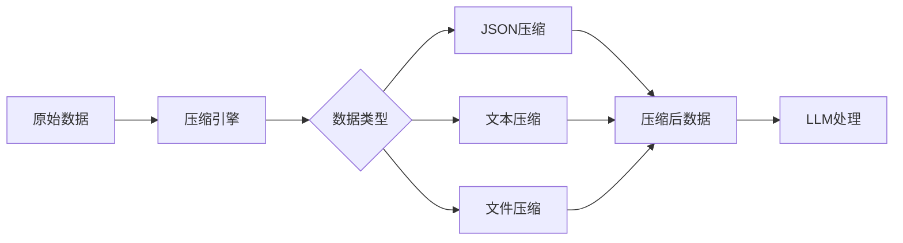
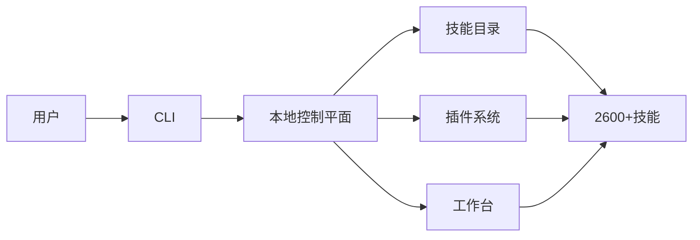

## 今日热点

AI代理框架爆发式增长，多智能体生态系统构建成为主流，同时高效推理与垂直领域AI应用加速落地。

---

## 热门项目一览

| 排名 | 项目 | 语言 | 今日 | 总计 | 简介 |
|:---:|------|:----:|------:|-----:|------|
| 1 | [MadsLorentzen/ai-job-search](https://github.com/MadsLorentzen/ai-job-search) | Python | +3,861 | 60,846 | The job search that runs on... |
| 2 | [cloudflare/security-audit-skill](https://github.com/cloudflare/security-audit-skill) | JavaScript | +1,712 | 34,391 | A coding-agent skill for mu... |
| 3 | [stablyai/orca](https://github.com/stablyai/orca) | TypeScript | +1,565 | 99,875 | Orca is the place for worki... |
| 4 | [anomalyco/opencode](https://github.com/anomalyco/opencode) | TypeScript | +1,240 | 219,019 | The open source coding agent. |
| 5 | [DietrichGebert/ponytail](https://github.com/DietrichGebert/ponytail) | JavaScript | +1,208 | 169,874 | Makes your AI agent think l... |
| 6 | [Comfy-Org/ComfyUI](https://github.com/Comfy-Org/ComfyUI) | Python | +1,206 | 140,852 | The most powerful and modul... |
| 7 | [Graphify-Labs/graphify](https://github.com/Graphify-Labs/graphify) | Python | +802 | 130,359 | Turn any codebase, with its... |
| 8 | [shiyu-coder/Kronos](https://github.com/shiyu-coder/Kronos) | Python | +733 | 42,390 | Kronos: A Foundation Model ... |
| 9 | [ruvnet/ruflo](https://github.com/ruvnet/ruflo) | TypeScript | +684 | 77,898 | 🌊 The original agent harnes... |
| 10 | [msitarzewski/agency-agents](https://github.com/msitarzewski/agency-agents) | Shell | +562 | 162,417 | A complete AI agency at you... |
| 11 | [headroomlabs-ai/headroom](https://github.com/headroomlabs-ai/headroom) | Python | +549 | 76,802 | Compress tool outputs, logs... |
| 12 | [anthropics/knowledge-work-plugins](https://github.com/anthropics/knowledge-work-plugins) | Python | +267 | 30,830 | Open source repository of p... |

---

## 趋势洞察

```
┌─────────────────────────────────────────────────────────────────┐
│  AI/ML 工具         ████████████████████████  13 个项目        │
│  多媒体应用            █                         1 个项目        │
│  其他               █                         1 个项目        │
└─────────────────────────────────────────────────────────────────┘
```

---

## 项目深度解读

### 1. MadsLorentzen/ai-job-search — AI求职助手

> **一句话总结**：基于Claude Code的AI求职框架，自动化评估职位、定制简历、撰写求职信和准备面试。

#### 价值主张

| 维度 | 说明 |
|------|------|
| **解决痛点** | 传统求职流程繁琐耗时，需要大量重复工作定制申请材料 |
| **目标用户** | 求职者，特别是需要批量申请职位的应届毕业生和转行者 |
| **核心亮点** | AI职位评估 + 自动简历定制 + 智能求职信生成 + 面试准备助手 |

#### 技术架构


**技术特色**：
- 基于Claude Code框架构建
- 本地运行保护用户隐私
- 全流程AI自动化处理

#### 热度分析

- 项目Star数超6万，单日新增近4000星，显示市场高度认可和快速增长趋势
- Fork数近1.9万，表明用户积极参与项目定制和二次开发，社区活跃度高

#### 快速上手

```bash
# 克隆项目
git clone https://github.com/MadsLorentzen/ai-job-search.git
cd ai-job-search
pip install -r requirements.txt
```

#### 注意事项

- 需要确保Claude API访问权限和有效密钥
- AI生成内容需要人工审核和适当修改，确保专业性和准确性
- 处理个人信息时需注意隐私保护和数据安全


### 2. cloudflare/security-audit-skill — 安全审计工具

> **一句话总结**：基于AI的多阶段安全审计工具，提供机器可读的独立验证安全报告。

#### 价值主张

| 维度 | 说明 |
|------|------|
| **解决痛点** | 提供自动化的多阶段安全审计，解决人工审计效率低、标准不一的问题 |
| **目标用户** | 安全审计团队、开发人员、DevOps工程师 |
| **核心亮点** | 多阶段安全审计+机器可读发现报告+独立验证机制+自动化分析流程 |

#### 技术架构


**技术特色**：
- 基于AI的代码安全分析技术
- 多阶段审计流程设计
- 机器可读的安全报告生成机制

#### 热度分析

- 项目获得超3.4万星，单日增长1700+，表明社区高度认可，安全审计领域需求旺盛
- 作为Cloudflare开源项目，处于安全工具生态核心位置，与代码审计、CI/CD安全集成紧密

#### 快速上手

```bash
# 安装
npm install -g security-audit-skill

# 运行
security-audit-skill --source /path/to/code --output report.json
```

#### 注意事项

- 需要确保代码分析环境的安全性
- 可能需要配置特定的安全规则集
- 生成报告后应进行人工验证，确保准确性


### 3. stablyai/orca — 多代理管理平台

> **一句话总结**：统一管理多种AI编码助手，支持跨平台部署与个人订阅集成。

#### 价值主张

| 维度 | 说明 |
|------|------|
| **解决痛点** | 分散的AI编码工具缺乏统一管理，工作流程割裂 |
| **目标用户** | 多AI工具依赖的开发者与需要统一工作流的编程团队 |
| **核心亮点** | 多代理集成 + 跨平台支持 + 自定义订阅 + 编程任务优化 + 统一界面 |

#### 技术架构


**技术特色**：
- TypeScript全栈开发确保类型安全与高性能
- 模块化代理架构支持多种AI服务无缝集成
- 跨平台兼容性实现一致的用户体验

#### 热度分析

- 近期Star增长迅猛，日均增长超1500，社区认可度极高
- Fork数量适中，表明项目以使用为主，二次开发需求有限

#### 快速上手

```bash
# 克隆仓库
git clone https://github.com/stablyai/orca.git
cd orca

# 安装依赖并启动
npm install
npm run dev
```

#### 注意事项

- 项目许可证信息不明确，使用前需确认授权条款
- 集成第三方AI服务可能需要额外的API密钥和订阅费用
- 跨平台功能可能存在差异，建议在目标平台上测试核心功能


### 4. anomalyco/opencode — AI编程助手

> **一句话总结**：开源的智能代码生成工具，通过AI辅助开发者提高编程效率和质量。

#### 价值主张

| 维度 | 说明 |
|------|------|
| **解决痛点** | 解决编程效率低、代码质量参差不齐、重复代码多的问题 |
| **目标用户** | 软件开发者、编程学习者、需要快速原型构建的团队 |
| **核心亮点** | AI智能代码生成 + 多语言支持 + 实时代码优化 + 自然语言交互 + 开源可定制 |

#### 技术架构


**技术特色**：
- 基于大型语言模型的代码理解与生成能力
- 采用TypeScript构建，确保类型安全与高性能
- 支持多种编程语言的无缝切换与适配

#### 热度分析

- 项目Star数超21万，日均增长1200+，处于开发者工具类项目热度顶端
- 作为开源编程助手，在AI辅助开发领域占据领先地位，社区活跃度高

#### 快速上手

```bash
# 安装opencode
npm install -g opencode

# 初始化项目
opencode init my-project

# 启动开发助手
opencode assist
```

#### 注意事项

- 项目许可证信息不明确，商业使用前需确认授权条款
- 生成代码可能需要人工审查，建议不直接用于生产环境核心逻辑
- 需要网络连接以调用AI服务，离线环境下功能受限


### 5. DietrichGebert/ponytail — AI代码助手

> **一句话总结**：让AI代理以最省力的方式思考，自动生成高质量代码，实现"少即是多"的开发理念。

#### 价值主张

| 维度 | 说明 |
|------|------|
| **解决痛点** | 减少重复编码工作，提高开发效率 |
| **目标用户** | JavaScript开发者，AI应用构建者 |
| **核心亮点** | 智能代码生成 + 高级开发思维模拟 + 自动化优化 |

#### 技术架构


**技术特色**：
- 基于高级开发者思维模式的AI推理
- 智能代码生成与优化
- 自动化减少手动编码

#### 热度分析

- 项目获得16万+星标，每日新增超千星，显示极高社区认可度和快速增长趋势
- Fork数近万，表明开发者积极参与项目定制和二次开发

#### 快速上手

```bash
# 安装ponytail
npm install ponytail

# 使用ponytail生成代码
ponytail generate --prompt "创建一个React组件用于用户登录"
```

#### 注意事项

- 项目许可证未知，商业使用前需确认授权情况
- AI生成的代码可能需要人工审核和调整
- 项目依赖的AI服务可能有使用限制或成本


### 6. Comfy-Org/ComfyUI — 节点式AI绘画平台

> **一句话总结**：基于节点界面的模块化扩散模型系统，提供最快本地推理体验和强大工作流构建能力。

#### 价值主张

| 维度 | 说明 |
|------|------|
| **解决痛点** | 简化扩散模型使用复杂度，提供直观可视化编程方式 |
| **目标用户** | AI研究人员、数字艺术家、AI应用开发者和创意工作者 |
| **核心亮点** | 节点式图形界面 + 模块化架构 + 高性能本地推理 + 丰富API支持 + 强大扩展生态 |

#### 技术架构


**技术特色**：
- 采用节点式可视化编程，构建复杂AI工作流
- 优化的推理引擎，实现最快本地推理速度
- 基于Python架构，支持多种扩散模型和自定义扩展

#### 热度分析

- 项目Star数超14万，日均增长数百，处于高速发展期，社区活跃度极高
- Fork数约1.6万，表明大量用户进行二次开发和定制，形成强大生态社区

#### 快速上手

```bash
# 克隆仓库
git clone https://github.com/comfy-org/ComfyUI.git
# 安装依赖
pip install -r requirements.txt
# 启动服务
python main.py
```

#### 注意事项
- 需要高性能GPU才能获得最佳推理效果
- 系统对显存和内存要求较高
- 需要一定AI基础知识才能充分利用其功能
- 可通过自定义节点扩展功能，但需要Python编程能力


### 7. Graphify-Labs/graphify — 代码知识图谱

> **一句话总结**：将任何代码库及其文档转换为可查询知识图谱，无需向量存储，支持多AI助手集成。

#### 价值主张

| 维度 | 说明 |
|------|------|
| **解决痛点** | 将分散的代码库和文档结构化为可查询知识图谱，提升代码理解效率 |
| **目标用户** | 开发者、代码审查者、技术文档编写者、AI编程助手用户 |
| **核心亮点** | 本地确定性AST解析 + 全边解释 + 无向量存储 + 多AI助手支持 |

#### 技术架构


**技术特色**：
- 本地确定性AST解析，确保解析结果可重现
- 全边解释机制，提供清晰的关系说明
- 无需向量存储，直接基于结构化数据查询

#### 热度分析

- 项目获得13万+星标，近期每日增长800+，表明项目正迅速获得开发者认可
- 零开放问题反映项目成熟度高，社区反馈机制完善，维护团队响应迅速

#### 快速上手

```bash
# 安装graphify
pip install graphify

# 初始化项目
graphify init

# 构建知识图谱
graphify build
```

#### 注意事项

- 项目许可证未知，商业使用前需确认授权方式
- 依赖大型语言模型进行解析，可能消耗较多计算资源
- 对于超大代码库，构建知识图谱可能需要较长时间和较多内存


### 8. shiyu-coder/Kronos — 金融语言基础模型

> **一句话总结**：Kronos是专为金融市场语言设计的基础模型，能够理解和生成金融领域的专业内容。

#### 价值主张

| 维度 | 说明 |
|------|------|
| **解决痛点** | 金融领域专业术语复杂，传统模型难以准确理解和生成金融内容 |
| **目标用户** | 金融分析师、量化交易员、投资机构、金融科技开发者 |
| **核心亮点** | 金融市场语料预训练 + 金融专业知识增强 + 多模态金融数据处理能力 |

#### 技术架构


**技术特色**：
- 金融市场语料预训练，提升专业领域理解能力
- 金融知识图谱增强，提高术语准确性
- 多模态金融数据处理，整合文本与数值信息

#### 热度分析

- 项目Star数达42,390且日增733，显示在金融AI领域高度受关注
- Fork数7,016反映社区活跃度高，有大量开发者参与贡献

#### 快速上手

```bash
# 安装Kronos
pip install kronos-ai

# 基本使用示例
from kronos import KronosModel
model = KronosModel.from_pretrained("kronos-financial")
result = model.analyze_market_data("AAPL")
```

#### 注意事项

- 模型预测不应作为唯一的投资决策依据
- 需要考虑金融数据的隐私和安全问题
- 建议结合金融领域专业知识使用模型


### 9. ruvnet/ruflo — 智能代理框架

> **一句话总结**：一个强大的AI代理框架，支持多智能体协作、自主工作流和对话式AI系统构建。

#### 价值主张

| 维度 | 说明 |
|------|------|
| **解决痛点** | 简化复杂AI系统构建，解决多智能体协作与自主工作流编排难题 |
| **目标用户** | AI开发者、研究人员及企业构建复杂AI应用的技术团队 |
| **核心亮点** | 自适应记忆 + 自学习智能 + 联邦能力 + 向量RAG集成 + 多模型原生支持 |

#### 技术架构


**技术特色**：
- 基于TypeScript构建，提供类型安全和开发体验
- 支持多智能体联邦与分布式学习架构
- 集成向量数据库和RAG，提升AI上下文理解能力

#### 热度分析

- Star数接近8万且持续高增长，表明项目广受欢迎且有活跃的社区支持
- 高Fork数显示项目被广泛用于二次开发和定制化场景

#### 快速上手

```bash
# 克隆项目
git clone https://github.com/ruvnet/ruflo.git
# 安装依赖
npm install
# 运行示例
npm run example
```

#### 注意事项

- 需要具备TypeScript和AI基础知识才能有效使用
- 需要配置API密钥以访问集成的各种AI模型服务
- 项目文档相对简略，可能需要深入研究源码了解高级功能


### 10. msitarzewski/agency-agents — AI代理集合

> **一句话总结**：提供一系列专业化AI代理，每个具有特定专长和个性，一键完成多样化任务。

#### 价值主张

| 维度 | 说明 |
|------|------|
| **解决痛点** | 简化AI任务执行，无需多个独立工具 |
| **目标用户** | 开发者、内容创作者、社区管理者 |
| **核心亮点** | 多样化AI代理 + 专业分工 + 个性定制 + 即用型工具 + 无缝集成 |

#### 技术架构


**技术特色**：
- Shell脚本实现，轻量级且跨平台兼容
- 模块化设计，每个代理独立封装
- 通过命令行与各种AI服务交互

#### 热度分析

- 项目获得16万+星标，日增500+，表明社区高度认可和活跃
- 零开放问题，反映项目成熟度高，用户反馈可能通过其他渠道处理

#### 快速上手

```bash
# 克隆仓库
git clone https://github.com/msitarzewski/agency-agents.git
cd agency-agents

# 运行特定代理（假设有frontend-wizard代理）
./frontend-wizard "创建一个响应式网页布局"
```

#### 注意事项

- 需要确认每个代理的依赖和前置条件
- 可能需要配置API密钥或访问权限
- Shell脚本执行环境需确保安全，避免执行未知来源的脚本


### 11. headroomlabs-ai/headroom — LLM压缩工具

> **一句话总结**：在LLM处理前压缩输出、日志和文件，显著减少token使用量并保持相同答案质量。

#### 价值主张

| 维度 | 说明 |
|------|------|
| **解决痛点** | LLM处理前数据量过大导致成本高、速度慢的问题 |
| **目标用户** | 使用LLM的应用开发者、AI代理系统构建者 |
| **核心亮点** | 智能压缩算法 + 保持答案质量 + 多种部署方式 |

#### 技术架构



**技术特色**：
- 智能识别不同数据类型并采用针对性压缩算法
- 保持压缩后数据语义完整性，确保LLM答案质量
- 提供库、代理和MCP服务器三种集成方式

#### 热度分析

- 项目Star数超过7.6万，近期增长迅速，显示LLM优化需求旺盛
- 无Open Issues表明项目维护良好，社区贡献集中在功能增强而非问题修复

#### 快速上手

```bash
# 安装headroom
pip install headroom

# 使用headroom代理
headroom --port 8080

# 作为库使用
import headroom
compressed = headroom.compress(your_data)
```

#### 注意事项

- 压缩算法可能会轻微改变数据格式，需确保下游兼容性
- 对于已高度压缩的数据，进一步压缩效果可能有限
- 需要根据具体场景选择合适的压缩级别以平衡压缩率和性能


### 12. anthropics/knowledge-work-plugins — 知识工作插件集

> **一句话总结**：为Claude Cowork打造的知识工作者插件集合，提升AI辅助工作效率。

#### 价值主张

| 维度 | 说明 |
|------|------|
| **解决痛点** | 为知识工作者提供专业插件，扩展Claude Cowork功能 |
| **目标用户** | 知识工作者、研究人员、内容创作者、分析师 |
| **核心亮点** | 开源可定制 + 多领域支持 + 与Claude深度集成 |

#### 技术架构


**技术特色**：
- 基于Python的插件系统，易于扩展
- 模块化设计，支持多种知识工作场景
- 与Claude AI无缝集成，增强自然语言处理能力

#### 热度分析
- Star数超3万且日增267，显示高增长率和社区认可度
- 作为Anthropic官方项目，处于AI辅助工作工具生态的核心位置

#### 快速上手

```bash
# 克隆项目
git clone https://github.com/anthropics/knowledge-work-plugins.git
cd knowledge-work-plugins

# 安装依赖
pip install -r requirements.txt
```

#### 注意事项
- 项目需要配合Claude Cowork使用，单独使用可能功能受限
- 作为官方项目，建议关注更新日志以获取最新功能
- 插件可能需要一定的Python知识进行自定义配置


### 13. vllm-project/vllm — LLM推理引擎

> **一句话总结**：高性能低内存占用的大语言模型推理与部署服务引擎

#### 价值主张

| 维度 | 说明 |
|------|------|
| **解决痛点** | 大模型推理内存消耗大、吞吐量低、服务响应慢的问题 |
| **目标用户** | AI研究员、大模型部署工程师、企业AI应用开发者 |
| **核心亮点** | PagedAttention技术 + 高吞吐量 + 连续批处理 + 多GPU并行 |

#### 技术架构


**技术特色**：
- 创新PagedAttention技术优化内存使用
- 动态批处理最大化GPU利用率
- 与HuggingFace模型无缝集成

#### 热度分析

- 项目Star数超9.4万，日均增长约128星，社区活跃度极高
- 作为LLM推理引擎领域标杆项目，已成为大模型部署生态核心组件

#### 快速上手

```bash
# 安装vllm
pip install vllm

# 启动API服务器
python -m vllm.entrypoints.openai.api_server --model gpt2 --tensor-parallel-size 4
```

#### 注意事项

- 需要足够大的GPU内存来运行大型模型
- 部分高级功能可能需要最新的CUDA版本支持
- 与特定模型架构可能存在兼容性问题，需提前测试


### 14. wshobson/agents — AI编程插件市场

> **一句话总结**：统一集成多个AI编程助手的插件市场，提供跨平台代码增强解决方案。

#### 价值主张

| 维度 | 说明 |
|------|------|
| **解决痛点** | 分散的AI编程工具统一管理，解决多平台切换与学习成本问题 |
| **目标用户** | 开发者、程序员、代码编写人员，追求编程效率提升的专业人士 |
| **核心亮点** | 跨平台统一支持 + 多种AI编程助手集成 + 插件化架构 + 开源可定制 |

#### 技术架构


**技术特色**：
- 模块化插件架构设计，支持动态加载与管理
- 统一的AI接口适配层，抽象不同平台差异
- 跨平台兼容性实现，覆盖主流编程环境

#### 热度分析

- 项目获得41k+ Star且持续增长，表明在开发者社区中备受关注
- 高Fork数显示社区活跃，用户积极参与项目改进与功能扩展

#### 快速上手

```bash
# 克隆项目
git clone https://github.com/wshobson/agents.git

# 安装依赖
cd agents
pip install -r requirements.txt
```

#### 注意事项

- 项目许可证未知，使用前需确认授权条款
- 集成多个AI平台可能需要各自的API密钥
- 插件质量和功能可能因来源而异，建议选择官方维护的插件


### 15. sickn33/agentic-awesome-skills — AI代理技能库

> **一句话总结**：AAS Core是本地代理控制平面，提供2600+技能，支持目录发现、堆栈验证和规划。

#### 价值主张

| 维度 | 说明 |
|------|------|
| **解决痛点** | 简化AI代理技能发现、选择和验证流程 |
| **目标用户** | AI开发者、研究人员和企业AI应用团队 |
| **核心亮点** | 本地控制平面 + 2600+预置技能 + 堆栈验证 + 工作台支持 |

#### 技术架构



**技术特色**：
- 本地优先的代理控制平面设计
- 丰富的技能生态系统（2600+技能）
- 模块化插件架构
- 堆栈验证机制
- MCP协议支持

#### 热度分析

- 项目获得48k+星星，每日增长83个，表明社区活跃度高
- 作为AI代理技能库，在AI开发工具生态中占据重要位置

#### 快速上手

```bash
# 安装AAS Core
pip install aas-core

# 初始化工作台
aas init

# 列出可用技能
aas skills list

# 启动工作台
aas workbench
```

#### 注意事项

- 项目许可证未知，使用前需确认许可条款
- 本地运行可能需要较高计算资源
- 技能生态系统持续更新，需关注版本兼容性


## 今日推荐

| 主题 | 推荐项目 | 亮点 |
|------|----------|------|
| 今日最热 | [MadsLorentzen/ai-job-search](https://github.com/MadsLorentzen/ai-job-search) | The job search th... |
| 值得关注 | [cloudflare/security-audit-skill](https://github.com/cloudflare/security-audit-skill) | A coding-agent sk... |
| 快速上手 | [stablyai/orca](https://github.com/stablyai/orca) | Orca is the place... |
| 长期潜力 | [anomalyco/opencode](https://github.com/anomalyco/opencode) | The open source c... |

---

<div align="center">

*Generated on 2026-10-21 | Powered by GitHub Trending Reporter*

</div>