## 今日热点

AI代理工具与平台爆发式增长，大模型推理优化成为焦点，开发者生态向智能化、高效化快速演进。

---

## 热门项目一览

| 排名 | 项目 | 语言 | 今日 | 总计 | 简介 |
|:---:|------|:----:|------:|-----:|------|
| 1 | [DietrichGebert/ponytail](https://github.com/DietrichGebert/ponytail) | JavaScript | +2,079 | 171,807 | Makes your AI agent think l... |
| 2 | [cloudflare/security-audit-skill](https://github.com/cloudflare/security-audit-skill) | JavaScript | +2,012 | 36,713 | A coding-agent skill for mu... |
| 3 | [stablyai/orca](https://github.com/stablyai/orca) | TypeScript | +1,541 | 101,437 | Orca is the place for worki... |
| 4 | [Graphify-Labs/graphify](https://github.com/Graphify-Labs/graphify) | Python | +1,433 | 131,752 | Turn any codebase, with its... |
| 5 | [Comfy-Org/ComfyUI](https://github.com/Comfy-Org/ComfyUI) | Python | +939 | 141,585 | The most powerful and modul... |
| 6 | [shiyu-coder/Kronos](https://github.com/shiyu-coder/Kronos) | Python | +575 | 42,873 | Kronos: A Foundation Model ... |
| 7 | [supabase/supabase](https://github.com/supabase/supabase) | TypeScript | +504 | 113,055 | The Postgres development pl... |
| 8 | [headroomlabs-ai/headroom](https://github.com/headroomlabs-ai/headroom) | Python | +474 | 77,304 | Compress tool outputs, logs... |
| 9 | [vllm-project/vllm](https://github.com/vllm-project/vllm) | Python | +441 | 94,916 | A high-throughput and memor... |
| 10 | [strelov1/freehire](https://github.com/strelov1/freehire) | Go | +360 | 2,452 | freehire — the open-source ... |
| 11 | [akitaonrails/ai-memory](https://github.com/akitaonrails/ai-memory) | Rust | +286 | 12,388 | Solution for long term memo... |
| 12 | [twentyhq/twenty](https://github.com/twentyhq/twenty) | TypeScript | +112 | 59,222 | The open alternative to Sal... |

---

## 趋势洞察

```
┌─────────────────────────────────────────────────────────────────┐
│  AI/ML 工具         ████████████████████████  9 个项目        │
│  其他               █████                     2 个项目        │
│  多媒体应用            ██                        1 个项目        │
└─────────────────────────────────────────────────────────────────┘
```

---

## 项目深度解读

### 1. DietrichGebert/ponytail — AI 代码助手

> **一句话总结**：让 AI 代理像最懒惰的高级开发者一样思考，自动生成高质量代码，减少开发者手动编写的工作量。

#### 价值主张

| 维度 | 说明 |
|------|------|
| **解决痛点** | 解决开发者重复编写常见代码和繁琐任务的痛点 |
| **目标用户** | JavaScript 开发者、AI 工具使用者、提高开发效率的程序员 |
| **核心亮点** | 模拟"懒惰"高级开发思维 + AI 自动代码生成 + 减少手动编码工作量 |

#### 技术架构

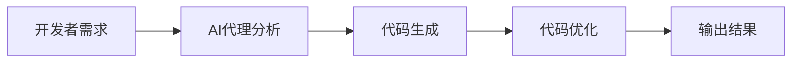

**技术特色**：
- 基于大语言模型的代码理解与生成
- 模拟"懒惰"高级开发者的代码思维模式
- 自动优化和重构生成的代码

#### 热度分析

- 项目 Star 数量超过 17 万，且每日新增超过 2000，增长势头强劲
- 高社区活跃度，表明开发者对 AI 辅助编程工具有强烈需求

#### 快速上手

```bash
# 安装 ponytail
npm install ponytail

# 使用 AI 生成代码
ponytail generate "创建一个用户认证功能"
```

#### 注意事项

- 项目许可证未知，使用前需确认商业使用限制
- 作为 AI 生成工具，可能存在代码质量和安全风险，需谨慎审查
- 项目 Issue 数为 0，可能意味着项目已成熟或社区支持主要通过其他渠道


### 2. cloudflare/security-audit-skill — 安全审计智能助手

> **一句话总结**：基于AI的多阶段安全审计工具，提供机器可读、独立验证的安全发现，自动化安全检测流程。

#### 价值主张

| 维度 | 说明 |
|------|------|
| **解决痛点** | 自动化安全审计流程繁琐且结果难以验证的问题 |
| **目标用户** | 安全审计人员、开发团队和DevOps工程师 |
| **核心亮点** | 多阶段安全审计流程 + 独立验证机制 + 机器可读报告 + 自动化检测 + 可扩展插件架构 |

#### 技术架构

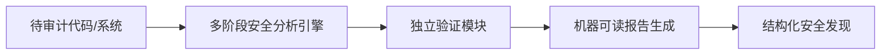

**技术特色**：
- 多阶段安全审计算法，提高检测准确性
- 独立验证机制确保发现可靠性
- 机器可读报告格式便于集成
- 自动化安全检测减少人工干预
- 可扩展的插件架构支持多种安全检查

#### 热度分析

- 项目拥有36,713个Star，近期增长2,012，表明安全自动化工具需求旺盛
- 作为Cloudflare出品的安全工具，在安全领域具有较高影响力和生态位置

#### 快速上手

```bash
# 安装
npm install -g @cloudflare/security-audit-skill

# 初始化审计
security-audit-skill init --target ./my-project

# 执行审计
security-audit-skill audit --phase all

# 查看报告
security-audit-skill report --format json
```

#### 注意事项

- 需要配合适当的AI代理系统使用
- 审计结果需要人工确认
- 可能需要配置安全规则以适应特定环境
- 定期更新以获取最新的安全检测规则


### 3. stablyai/orca — AI 编程代理平台

> **一句话总结**：统一平台管理多种 AI 编程代理，支持多设备访问与自定义订阅。

#### 价值主张

| 维度 | 说明 |
|------|------|
| **解决痛点** | 多个 AI 编程代理分散管理，缺乏统一平台 |
| **目标用户** | 需要集成多种 AI 编程工具的开发者 |
| **核心亮点** | 多代理支持 + 自定义订阅 + 跨平台兼容 + 统一管理界面 |

#### 技术架构

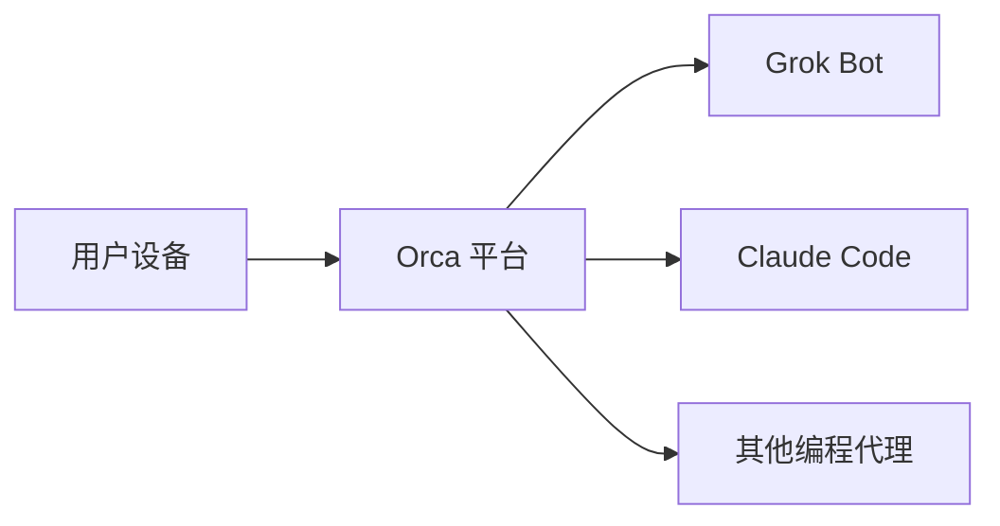

**技术特色**：
- TypeScript 开发确保类型安全
- 支持多种 AI 编程代理无缝集成
- 跨平台兼容性强

#### 热度分析

- 项目获得超 10 万星，近期增长迅猛，表明社区高度认可
- Fork 数量适中，主要用于直接使用而非大规模二次开发

#### 快速上手

```bash
# 克隆仓库
git clone https://github.com/stablyai/orca.git

# 安装依赖
npm install

# 运行应用
npm start
```

#### 注意事项

- 项目许可证信息不明确，使用前需确认
- 需要自己的 AI 编程代理订阅才能使用
- 目前没有开放 Issue，可能通过其他渠道提供支持


### 4. Graphify-Labs/graphify — 代码知识图谱化

> **一句话总结**：将代码库、文档、SQL模式等转换为可查询知识图谱，通过本地AST解析实现无需向量存储的代码理解。

#### 价值主张

| 维度 | 说明 |
|------|------|
| **解决痛点** | 复杂代码库结构理解困难，缺乏系统性知识管理 |
| **目标用户** | 软件开发者、代码审查员、架构师 |
| **核心亮点** | 本地确定性AST解析 + 全边解释说明 + 无需向量存储 + 多IDE集成 |

#### 技术架构

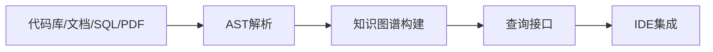

**技术特色**：
- 基于本地确定性AST解析，保证解析结果一致性
- 无需向量存储，直接构建结构化知识图谱
- 支持多种IDE和CLI工具集成，提升开发体验

#### 热度分析

- 项目Star数超13万且持续增长，表明开发者对代码知识图谱化需求强烈
- Fork数相对较低，说明项目定位为成熟工具而非二次开发框架

#### 快速上手

```bash
# 安装graphify
pip install graphify

# 初始化知识图谱
graphify init

# 分析代码库
graphify analyze /path/to/codebase
```

#### 注意事项

- 项目许可证未知，可能存在商业使用限制
- Open Issues为0，可能问题通过其他渠道解决或项目处于早期阶段


### 5. Comfy-Org/ComfyUI — 节点式AI绘画平台

> **一句话总结**：ComfyUI 是一个基于节点界面的强大扩散模型GUI与API系统，提供最快的本地AI图像生成体验。

#### 价值主张

| 维度 | 说明 |
|------|------|
| **解决痛点** | 解决传统AI绘画工具不灵活、性能低的问题 |
| **目标用户** | AI艺术家、开发者、研究人员和高级用户 |
| **核心亮点** | 节点式工作流 + 高性能推理 + 强大定制性 + 模块化设计 |

#### 技术架构

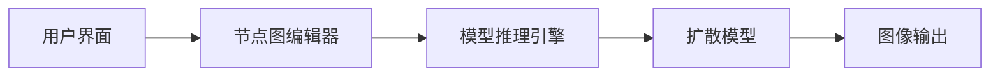

**技术特色**：
- 基于节点的可视化编程界面，实现复杂的AI工作流
- 优化的扩散模型推理引擎，提供高性能本地生成
- 模块化设计，支持多种模型和插件扩展
- 提供API接口，便于集成和自动化

#### 热度分析

- 项目获得14万+ stars，近期增长迅速，表明在AI生成领域受到高度关注
- 作为开源AI工具，形成了活跃的社区生态，贡献者众多

#### 快速上手

```bash
# 克隆仓库
git clone https://github.com/comfy-org/ComfyUI.git
# 安装依赖
pip install -r requirements.txt
# 运行界面
python main.py
```

#### 注意事项

- 需要较强大的GPU才能获得最佳性能，尤其是生成高分辨率图像
- 节点式界面有一定学习曲线，新用户需要时间适应
- 模型文件需要额外下载和配置，占用大量存储空间


### 6. shiyu-coder/Kronos — [金融语言模型]

> **一句话总结**：Kronos是专为金融市场语言设计的预训练模型，提供金融文本理解与生成能力。

#### 价值主张

| 维度 | 说明 |
|------|------|
| **解决痛点** | 解决金融专业文本理解与生成的挑战，提升市场分析效率 |
| **目标用户** | 金融分析师、量化交易员、投资机构研究人员 |
| **核心亮点** | 金融领域预训练+多任务处理能力+专业术语理解 |

#### 技术架构


**技术特色**：
- 基于大规模金融语料预训练，掌握专业金融知识
- 支持金融文本理解、摘要、情感分析等多种任务
- 针对金融数据特点优化的模型架构与训练方法

#### 热度分析

- 项目Star数高且持续增长，显示金融AI领域热度上升
- Fork数表明开发者社区积极参与模型应用与二次开发

#### 快速上手

```bash
# 克隆项目
git clone https://github.com/shiyu-coder/Kronos.git

# 安装依赖
pip install -r requirements.txt
```

#### 注意事项

- 模型可能需要大量计算资源进行训练或推理
- 金融领域应用需注意合规性与数据安全要求
- 模型预测结果仅供参考，不应作为投资决策唯一依据


### 7. supabase/supabase — 开源Postgres平台

> **一句话总结**：提供基于PostgreSQL的开源后端即服务，支持实时数据库、认证、存储等功能，帮助开发者快速构建应用。

#### 价值主张

| 维度 | 说明 |
|------|------|
| **解决痛点** | 传统后端开发复杂，缺乏一站式解决方案 |
| **目标用户** | Web、移动应用开发者，需要快速后端支持的团队 |
| **核心亮点** | 实时数据库 + 身份认证 + 文件存储 + Edge Functions + 开源替代Firebase |

#### 技术架构

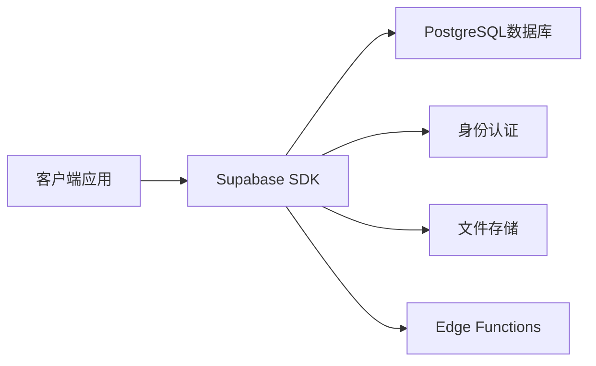

**技术特色**：
- 基于PostgreSQL，支持丰富的扩展和功能
- 提供实时数据库订阅功能
- 开源且自托管，避免供应商锁定
- RESTful API与GraphQL双重支持
- 与Firebase类似但开源的架构设计

#### 热度分析

- 项目Star数超过11万，日增500+，增长势头强劲，表明开发者对其高度认可
- 作为开源Firebase替代方案，在开发者社区中占据重要位置，生态持续扩张

#### 快速上手

```bash
# 安装Supabase CLI
npm install -g supabase

# 初始化项目
supabase init

# 启动本地开发环境
supabase start
```

#### 注意事项

- 需要基本的PostgreSQL知识才能充分利用其高级功能
- 自托管版本需要一定的DevOps知识进行维护
- 某些高级功能可能需要付费版本才能完全使用
- 与Firebase的API设计相似但存在差异，迁移时需注意兼容性


### 8. headroomlabs-ai/headroom — LLM输入压缩优化

> **一句话总结**：通过压缩工具输出、日志、文件和RAG块，显著减少LLM的token使用量，同时保持相同回答质量。

#### 价值主张

| 维度 | 说明 |
|------|------|
| **解决痛点** | 大型语言模型处理大量输入数据时产生高昂计算成本，通过压缩减少token使用 |
| **目标用户** | 使用LLM的开发者、AI代理构建者和需要处理大量文本数据的企业 |
| **核心亮点** | 专有压缩算法 + 多种数据类型支持 + 无损压缩质量 + 多种部署方式 |

#### 技术架构

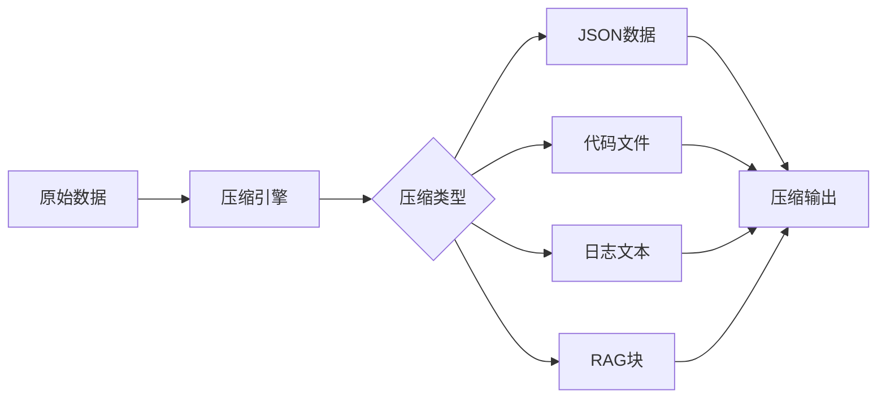

**技术特色**：
- 专有压缩算法，可减少60-95%的JSON token使用
- 针对代码优化的压缩策略，减少20%的编码agent token
- 支持多种部署模式：库、代理和MCP服务器

#### 热度分析

- 项目拥有77,304个星标，日增474个，显示出极强的增长势头和社区认可
- 零开放Issues表明项目成熟度高，维护者问题响应及时

#### 快速上手

```bash
# 安装headroom
pip install headroom

# 使用headroom压缩数据
headroom compress --input data.json --output compressed.json

# 作为代理运行
headroom proxy --port 8080
```

#### 注意事项

- 项目许可证未知，商业使用前需确认授权条款
- 压缩算法可能存在特定场景下的兼容性问题
- 作为MCP服务器的功能可能需要额外配置


### 9. vllm-project/vllm — 高性能LLM推理引擎

> **一句话总结**：vllm是专为LLM设计的高吞吐量、低内存消耗的推理和服务引擎，显著提升大模型推理效率。

#### 价值主张

| 维度 | 说明 |
|------|------|
| **解决痛点** | 解决传统LLM推理内存占用高、吞吐量低的问题 |
| **目标用户** | 大语言模型开发者、AI研究人员、企业AI服务提供者 |
| **核心亮点** | PagedAttention技术 + 高内存效率 + 高吞吐量 + 易于集成 |

#### 技术架构

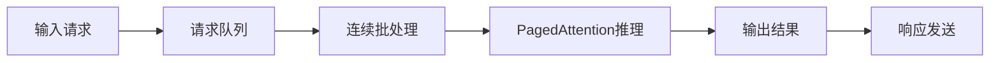

**技术特色**：
- PagedAttention技术替代传统KV缓存，减少内存占用高达50%
- 支持动态批处理和请求优先级调整，优化GPU资源利用
- 与主流LLM框架无缝集成，支持HuggingFace模型格式

#### 热度分析

- 项目近95k stars，日增400+，表明LLM推理引擎领域需求旺盛
- Fork数达23k+，社区贡献活跃，开发者参与度高

#### 快速上手

```bash
# 安装vllm
pip install vllm

# 运行示例
from vllm import LLM, SamplingParams

llm = LLM(model="gpt2")
sampling_params = SamplingParams(temperature=0.8, top_p=0.95)
outputs = llm.generate(["Hello, my name is"], sampling_params)
for output in outputs:
    print(output.outputs[0].text)
```

#### 注意事项

- 需要NVIDIA GPU支持，CUDA版本需与vllm兼容
- 大模型推理仍需充足显存，建议根据模型大小选择适当GPU配置
- API接口与OpenAI兼容，但部分高级功能可能有限制


### 10. strelov1/freehire — 开源求职引擎

> **一句话总结**：freehire是一个开源的求职搜索引擎，帮助求职者高效精准地匹配工作机会。

#### 价值主张

| 维度 | 说明 |
|------|------|
| **解决痛点** | 打破传统求职平台信息壁垒，提供无广告干扰的高效职位搜索 |
| **目标用户** | 开发者、技术专业人士及其他求职者 |
| **核心亮点** | 开源透明 + 精准匹配算法 + 多源数据整合 + 用户隐私保护 + 无广告干扰 |

#### 技术架构

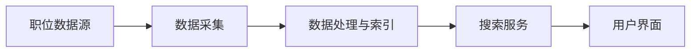

**技术特色**：
- 基于Go语言开发，性能高效且部署简单
- 开源架构支持自定义部署和数据源扩展
- 专为职位搜索优化的精准匹配算法

#### 热度分析

- 项目单日新增360个Star，表明求职领域对开源工具有强烈需求
- 作为垂直领域搜索工具，填补了市场空白，具有持续增长潜力

#### 快速上手

```bash
git clone https://github.com/strelov1/freehire.git
cd freehire
go run main.go
```

#### 注意事项

- 项目License未知，使用前需确认授权方式
- 无Open Issues可能表明项目处于早期阶段，功能可能不够完善
- 数据源的准确性和更新频率将直接影响搜索结果质量


### 11. akitaonrails/ai-memory — AI记忆系统

> **一句话总结**：为AI代理提供长期记忆功能，实现不同供应商间的无缝交接。

#### 价值主张

| 维度 | 说明 |
|------|------|
| **解决痛点** | 解决AI代理长期记忆缺失与供应商间交接困难问题 |
| **目标用户** | 使用AI代理进行编码的开发者和CLI工具使用者 |
| **核心亮点** | 长期记忆存储 + 跨供应商兼容性 + 上下文持久化 |

#### 技术架构

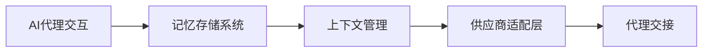

**技术特色**：
- 基于Rust实现的高效记忆存储系统
- 支持多种AI代理供应商的统一接口
- 提供长期记忆的持久化和检索机制

#### 热度分析

- 项目增长迅速，单日增长286星标，显示出社区对该解决方案的高度认可
- 作为AI辅助编码工具生态的重要组件，具有明确的生态定位

#### 快速上手

```bash
# 安装项目
cargo install ai-memory

# 初始化记忆系统
ai-memory init

# 配置代理供应商
ai-memory config set --provider openai

# 启动带有记忆功能的代理
ai-memory start
```

#### 注意事项

- 需要明确许可证信息，以便商业使用
- 不同AI供应商API的兼容性可能需要额外配置
- 记忆数据的隐私和安全保护需要重点关注


### 12. twentyhq/twenty — AI驱动CRM

> **一句话总结**：开源AI驱动的客户关系管理平台，替代传统Salesforce的强大选择。

#### 价值主张

| 维度 | 说明 |
|------|------|
| **解决痛点** | 传统CRM价格高昂、封闭且AI功能有限，企业需要更开放智能的替代方案 |
| **目标用户** | 需要客户关系管理且重视AI功能的中大型企业团队 |
| **核心亮点** | 开源替代Salesforce + 深度AI集成 + 灵活可定制 |

#### 技术架构

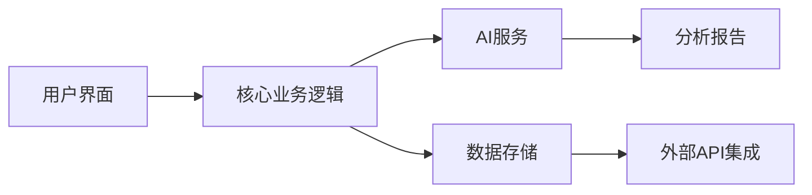

**技术特色**：
- 基于TypeScript的全栈开发架构
- 微服务设计支持高可扩展性
- 深度AI集成提升数据处理能力

#### 热度分析
- 项目获得近6万星且持续增长，表明市场对开源AI驱动的CRM解决方案有强烈需求
- 高star与fork比例反映社区对项目的认可和积极参与

#### 快速上手

```bash
# 克隆项目
git clone https://github.com/twentyhq/twenty.git

# 安装依赖
cd twenty && npm install

# 启动开发服务器
npm run dev
```

#### 注意事项
- 项目可能需要较强的技术背景才能正确部署和配置
- 作为开源项目，企业级应用可能需要额外的专业支持
- 许可证信息不明确，使用前需确认开源条款


## 今日推荐

| 主题 | 推荐项目 | 亮点 |
|------|----------|------|
| 今日最热 | [DietrichGebert/ponytail](https://github.com/DietrichGebert/ponytail) | Makes your AI age... |
| 值得关注 | [cloudflare/security-audit-skill](https://github.com/cloudflare/security-audit-skill) | A coding-agent sk... |
| 快速上手 | [stablyai/orca](https://github.com/stablyai/orca) | Orca is the place... |
| 长期潜力 | [Graphify-Labs/graphify](https://github.com/Graphify-Labs/graphify) | Turn any codebase... |

---

<div align="center">

*Generated on 2026-10-22 | Powered by GitHub Trending Reporter*

</div>