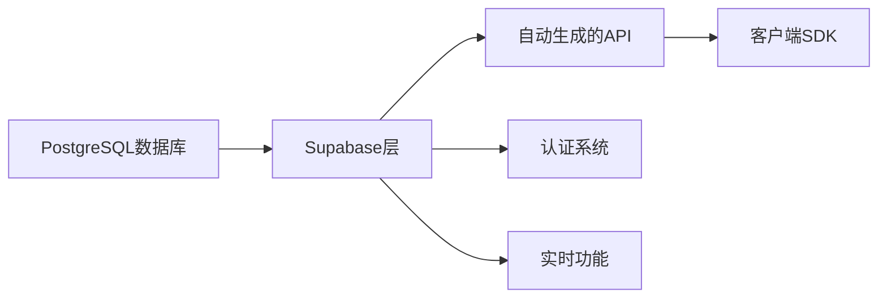
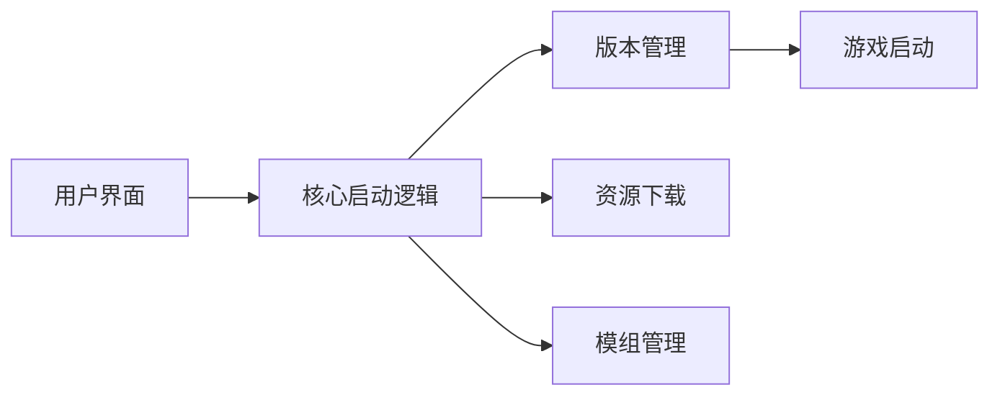
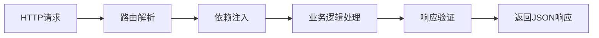

## 今日热点

AI开发工具与安全审计技术成为今日GitHub热点，Anthropic插件库、代码知识图谱转换工具及自动化安全审计项目获得显著关注，显示开发者对AI辅助开发和代码质量保障的强烈需求。

---

## 热门项目一览

| 排名 | 项目 | 语言 | 今日 | 总计 | 简介 |
|:---:|------|:----:|------:|-----:|------|
| 1 | [cloudflare/security-audit-skill](https://github.com/cloudflare/security-audit-skill) | JavaScript | +2,979 | 39,721 | A coding-agent skill for mu... |
| 2 | [DietrichGebert/ponytail](https://github.com/DietrichGebert/ponytail) | JavaScript | +1,948 | 173,630 | Makes your AI agent think l... |
| 3 | [Graphify-Labs/graphify](https://github.com/Graphify-Labs/graphify) | Python | +1,408 | 133,057 | Turn any codebase, with its... |
| 4 | [supabase/supabase](https://github.com/supabase/supabase) | TypeScript | +693 | 113,522 | The Postgres development pl... |
| 5 | [anthropics/knowledge-work-plugins](https://github.com/anthropics/knowledge-work-plugins) | Python | +303 | 31,671 | Open source repository of p... |
| 6 | [php/php-src](https://github.com/php/php-src) | C | +287 | 41,218 | The PHP Interpreter |
| 7 | [luongnv89/claude-howto](https://github.com/luongnv89/claude-howto) | Python | +177 | 43,317 | A visual, example-driven gu... |
| 8 | [Meloong-Git/PCL](https://github.com/Meloong-Git/PCL) | Visual Basic .NET | +119 | 8,732 | Minecraft 启动器 Plain Craft L... |
| 9 | [fastapi/fastapi](https://github.com/fastapi/fastapi) | Python | +101 | 103,803 | FastAPI framework, high per... |

---

## 趋势洞察

```
┌─────────────────────────────────────────────────────────────────┐
│  AI/ML 工具         ████████████████████████  7 个项目        │
│  开发框架             ███                       1 个项目        │
│  其他               ███                       1 个项目        │
└─────────────────────────────────────────────────────────────────┘
```

---

## 项目深度解读

### 1. cloudflare/security-audit-skill — 安全审计技能

> **一句话总结**：提供多阶段安全审计能力，输出独立验证的机器可读安全发现结果

#### 价值主张

| 维度 | 说明 |
|------|------|
| **解决痛点** | 将安全审计流程自动化，提高效率和准确性 |
| **目标用户** | 安全研究人员、开发团队、DevOps工程师 |
| **核心亮点** | 多阶段审计流程 + 独立验证机制 + 机器可读输出 + 自动化处理 + Cloudflare背书 |

#### 技术架构


**技术特色**：
- 多层次安全检测机制，覆盖多种漏洞类型
- 自动化验证流程，确保发现结果的可靠性
- 与主流开发工具链集成，便于开发者使用

#### 热度分析

- 项目近期获得大量关注，单日增长近3000星，表明安全审计领域需求旺盛
- 作为Cloudflare出品项目，在安全领域具有较高权威性和影响力

#### 快速上手

```bash
# 安装
npm install security-audit-skill

# 使用
security-audit-skill --input ./path/to/code --output results.json
```

#### 注意事项

- 项目License未知，使用前需确认授权条款
- 可能需要配合其他Cloudflare工具或服务使用
- 需要确保输入代码符合隐私和安全要求


### 2. DietrichGebert/ponytail — AI 代码助手

> **一句话总结**：让 AI 智能体模拟高级开发者思维，通过最小化手动编码提高开发效率。

#### 价值主张

| 维度 | 说明 |
|------|------|
| **解决痛点** | 减少重复编码工作，提升开发效率与代码质量 |
| **目标用户** | JavaScript 开发者与寻求效率提升的开发团队 |
| **核心亮点** | AI 驱动代码生成 + 模拟高级开发者思维 + 代码最小化优化 |

#### 技术架构


**技术特色**：
- 基于 AI 的代码智能分析能力
- 高级开发者思维模式模拟算法
- 代码复用和最小化编写优化

#### 热度分析

- 超过17万星标，近期增长迅速，开发者社区认可度高
- 零开放问题表明项目已成熟或社区问题处理高效

#### 快速上手

```bash
# 安装 ponytail
npm install -g ponytail

# 使用 ponytail 生成代码
ponytail generate "创建一个用户登录组件"
```

#### 注意事项

- 项目许可证未知，使用时需注意授权问题
- AI 生成的代码可能需要人工审查以确保质量和安全性


### 3. Graphify-Labs/graphify — 代码知识图谱

> **一句话总结**：将代码库转化为可查询知识图谱，无需向量存储，提供本地确定性AST解析。

#### 价值主张

| 维度 | 说明 |
|------|------|
| **解决痛点** | 解决复杂代码库难以理解、搜索和分析的问题 |
| **目标用户** | 软件开发人员、代码审查者、系统架构师 |
| **核心亮点** | 本地确定性AST解析 + 不依赖向量存储 + 多文件类型支持 + 详细边解释 + 多AI助手集成 |

#### 技术架构


**技术特色**：
- 基于确定性AST解析，保证分析结果可复现
- 支持多种编程语言和文件类型的统一处理
- 提供详细的边解释和关系映射，增强可理解性

#### 热度分析

- 项目Star数超13万，近期每日新增1400+星，增长势头强劲
- Fork数达1.2万+，表明开发者社区积极参与和二次开发热情高

#### 快速上手

```bash
# 安装graphify
pip install graphify

# 初始化项目
graphify init

# 构建知识图谱
graphify build
```

#### 注意事项

- 项目License未知，使用前需确认授权条款
- 依赖AST解析，可能不支持所有编程语言或特殊语法结构
- 不使用向量存储，在语义理解和模糊匹配方面可能有限制


### 4. supabase/supabase — 开源Postgres平台

> **一句话总结**：开源Postgres开发平台，提供数据库、认证、存储等全栈功能，简化应用开发流程。

#### 价值主张

| 维度 | 说明 |
|------|------|
| **解决痛点** | 传统数据库开发复杂，缺少一站式解决方案 |
| **目标用户** | Web、移动应用开发者，需要后端即服务(BaaS)的团队 |
| **核心亮点** | 完整的PostgreSQL支持 + 实时数据同步 + 自动生成的API + 身份验证 + 存储服务 |

#### 技术架构



**技术特色**：
- 基于强大的PostgreSQL数据库，支持扩展
- 提供自动RESTful API生成，无需手动编写
- 支持实时数据订阅，实现即时数据同步

#### 热度分析

- Star数超过11万，近期增长迅速，日均增长约700 stars，表明社区高度认可
- Fork数与Star数比例合理，表明项目不仅有高关注度，也有实际使用和二次开发

#### 快速上手

```bash
# 安装Supabase CLI
npm install -g supabase

# 初始化项目
supabase init

# 启动本地开发环境
supabase start
```

#### 注意事项

- Supabase虽然提供了丰富的功能，但对于生产环境，需要考虑数据安全和隐私保护
- 免费版有使用限制，大规模应用需要升级到付费计划
- 与传统自托管方案相比，存在一定的供应商锁定风险


### 5. anthropics/knowledge-work-plugins — Claude插件库

> **一句话总结**：为知识工作者提供丰富的Claude协作插件，提升工作效率和专业能力。

#### 价值主张

| 维度 | 说明 |
|------|------|
| **解决痛点** | 知识工作者缺乏专业工具与AI助手的深度集成 |
| **目标用户** | 研究人员、分析师、内容创作者等知识工作者 |
| **核心亮点** | 插件化架构 + 专业领域支持 + 无缝AI协作 + 开源可定制 |

#### 技术架构


**技术特色**：
- 插件化架构设计，支持动态加载和扩展
- 与Claude API深度集成，优化AI交互体验
- 提供标准化的插件接口，便于开发者贡献

#### 热度分析

- 项目Star数超过3万，日增长300+，显示知识工作者对AI协作工具的强烈需求
- 作为Anthropic官方项目，处于AI辅助知识工作生态的核心位置

#### 快速上手

```bash
# 克隆项目
git clone https://github.com/anthropics/knowledge-work-plugins.git

# 安装依赖
cd knowledge-work-plugins
pip install -r requirements.txt
```

#### 注意事项

- 需要Claude Cowork环境才能使用这些插件
- 部分插件可能需要API密钥或额外配置
- 项目许可证未知，商业使用前需确认授权条款


### 6. php/php-src — PHP核心引擎

> **一句话总结**：PHP解释器是开源Web开发语言的核心实现，支持多平台，具有丰富扩展生态和持续优化的性能。

#### 价值主张

| 维度 | 说明 |
|------|------|
| **解决痛点** | 解决Web开发中动态脚本执行、跨平台兼容和高效计算需求 |
| **目标用户** | Web开发者、PHP应用构建者、服务器管理员和语言扩展开发者 |
| **核心亮点** | 高性能执行引擎 + 跨平台支持 + 丰富扩展生态 + 现代语言特性 + 强大社区支持 |

#### 技术架构


**技术特色**：
- 基于Zend引擎的高效字节码执行系统
- 支持多种SAPI接口实现灵活部署
- 模块化设计便于扩展功能
- 引入JIT编译器提升性能
- 支持OPcache缓存加速执行

#### 热度分析

- PHP作为经典Web开发语言，保持稳定高关注度，每月新增数百个star，反映其在Web开发领域的持久影响力
- 拥有庞大开发者社区和丰富生态系统，是LAMP架构核心组件，广泛应用于企业级Web应用

#### 快速上手

```bash
# 获取源代码
git clone https://github.com/php/php-src.git
cd php-src

# 编译安装
./buildconf
./configure --enable-debug
make
make install
```

#### 注意事项

- PHP源代码编译需要依赖多种开发工具库，如autoconf, libtool等
- 编译过程可能根据目标平台需要不同的配置选项
- 修改源代码后需要重新编译才能生效
- 生产环境建议使用预编译的二进制包而非自行编译


### 7. luongnv89/claude-howto — Claude使用指南

> **一句话总结**：提供视觉化示例驱动的Claude Code指南，从基础到高级，包含可直接使用的模板。

#### 价值主张

| 维度 | 说明 |
|------|------|
| **解决痛点** | 解决Claude Code使用入门难、缺乏实用示例的问题 |
| **目标用户** | 开发者、AI工具使用者、Claude应用研究者 |
| **核心亮点** | 视觉化示例驱动 + 即用型模板库 + 结构化学习路径 |

#### 技术架构


**技术特色**：
- 结构化知识体系设计
- 实用模板库组织方式
- 视觉化学习方法论

#### 热度分析

- 项目获43,317星，日增177星，显示持续高热度与社区认可度
- 作为AI工具指南，在Claude生态中占据重要学习资源位置

#### 快速上手

```bash
# 克隆项目到本地
git clone https://github.com/luongnv89/claude-howto.git

# 浏览项目中的示例和模板
cd claude-howto && ls -la
```

#### 注意事项

- 项目需要Claude账号才能实践相关示例
- 随Claude API更新，部分内容可能需要同步更新
- 建议结合实际项目场景应用模板，而非简单复制


### 8. Meloong-Git/PCL — 简洁启动器

> **一句话总结**：一个轻量级、开源的 Minecraft 启动器，提供简洁的游戏管理体验。

#### 价值主张

| 维度 | 说明 |
|------|------|
| **解决痛点** | 解决玩家管理多版本、模组和资源包的复杂性问题，简化游戏启动流程 |
| **目标用户** | Minecraft 玩家，特别是需要管理多个游戏版本和模组的中高级玩家 |
| **核心亮点** | 简洁界面设计 + 多版本管理 + 资源整合 + 开源可定制 + 跨平台支持 |

#### 技术架构



**技术特色**：
- 基于 VB.NET 开发，确保 Windows 平台兼容性
- 轻量级设计，资源占用低
- 模块化架构，各组件功能分离

#### 热度分析

- 项目获得 8,732 个 Star，在 Minecraft 启动器领域具有较高认可度
- Fork 数为 1,207，显示社区活跃且有一定二次开发需求

#### 快速上手

```bash
# 下载最新版本 release
# 解压到指定目录
# 运行 PCL.exe 启动程序
```

#### 注意事项

- 项目使用 Visual Basic .NET 开发，主要面向 Windows 平台
- License 信息不明确，使用时需要注意版权问题
- 0 个 Open Issues 可能不代表没有问题，而是问题在其他渠道处理


### 9. fastapi/fastapi — 现代API框架

> **一句话总结**：高性能、易学、易用的 Python Web 框架，专为构建快速、生产就绪的 API 而设计。

#### 价值主张

| 维度 | 说明 |
|------|------|
| **解决痛点** | 解决传统 Python Web 框架性能低、开发效率不高的问题 |
| **目标用户** | Python 后端开发者、API 构建者、微服务架构师 |
| **核心亮点** | 高性能 + 自动交互文档 + 依赖注入 + 类型提示支持 |

#### 技术架构



**技术特色**：
- 基于 Starlette 和 Pydantic 构建，提供高性能和自动数据验证
- 内置自动 API 文档生成，支持 Swagger UI 和 ReDoc
- 完整的类型提示支持，提供优秀的开发体验和 IDE 支持

#### 热度分析

- 项目 Star 数超 10 万，增长迅速，表明社区认可度高
- 作为 Python 生态系统中的新兴框架，已形成活跃的社区和丰富的插件生态

#### 快速上手

```bash
# 安装 FastAPI
pip install fastapi uvicorn

# 创建简单 API
echo 'from fastapi import FastAPI
app = FastAPI()
@app.get("/")
def read_root():
    return {"Hello": "World"}' > main.py

# 运行服务器
uvicorn main:app --reload
```

#### 注意事项

- 需要熟悉 Python 类型提示系统以充分利用 FastAPI 的优势
- 异步编程模型需要一定的学习成本
- 对于复杂项目，需要合理设计依赖注入系统


## 今日推荐

| 主题 | 推荐项目 | 亮点 |
|------|----------|------|
| 今日最热 | [cloudflare/security-audit-skill](https://github.com/cloudflare/security-audit-skill) | A coding-agent sk... |
| 值得关注 | [DietrichGebert/ponytail](https://github.com/DietrichGebert/ponytail) | Makes your AI age... |
| 快速上手 | [Graphify-Labs/graphify](https://github.com/Graphify-Labs/graphify) | Turn any codebase... |
| 长期潜力 | [supabase/supabase](https://github.com/supabase/supabase) | The Postgres deve... |

---

<div align="center">

*Generated on 2026-10-23 | Powered by GitHub Trending Reporter*

</div>