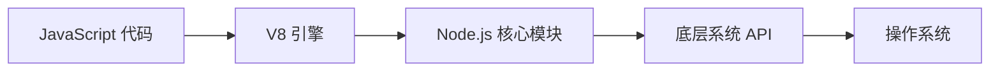

## 今日热点

今日GitHub热榜主要呈现AI安全工具爆发式增长态势，同时AI能力向知识工作和语音生成等垂直领域扩展，大型科技公司开源项目引领技术前沿。

---

## 热门项目一览

| 排名 | 项目 | 语言 | 今日 | 总计 | 简介 |
|:---:|------|:----:|------:|-----:|------|
| 1 | [cloudflare/security-audit-skill](https://github.com/cloudflare/security-audit-skill) | JavaScript | +2,716 | 42,268 | A coding-agent skill for mu... |
| 2 | [NVIDIA/OpenShell](https://github.com/NVIDIA/OpenShell) | Rust | +1,119 | 18,850 | OpenShell is the safe, priv... |
| 3 | [php/php-src](https://github.com/php/php-src) | C | +716 | 41,582 | The PHP Interpreter |
| 4 | [anthropics/knowledge-work-plugins](https://github.com/anthropics/knowledge-work-plugins) | Python | +635 | 32,262 | Open source repository of p... |
| 5 | [Renhuai123/ziwei-doushu](https://github.com/Renhuai123/ziwei-doushu) | TypeScript | +546 | 6,909 | 紫微斗数开源排盘引擎 — 基于倪海厦《天纪》体系，含完... |
| 6 | [SnailSploit/Claude-Red](https://github.com/SnailSploit/Claude-Red) | Python | +226 | 8,540 | claude-red is a curated lib... |
| 7 | [OpenBMB/VoxCPM](https://github.com/OpenBMB/VoxCPM) | Python | +150 | 40,295 | VoxCPM2: Tokenizer-Free TTS... |
| 8 | [nodejs/node](https://github.com/nodejs/node) | JavaScript | +66 | 122,902 | Node.js JavaScript runtime ... |

---

## 趋势洞察

```
┌─────────────────────────────────────────────────────────────────┐
│  AI/ML 工具         ████████████████████████  5 个项目        │
│  其他               ██████████████            3 个项目        │
└─────────────────────────────────────────────────────────────────┘
```

---

## 项目深度解读

### 1. cloudflare/security-audit-skill — 安全审计工具

> **一句话总结**：提供多阶段安全审计能力，输出可验证的机器可读安全发现结果。

#### 价值主张

| 维度 | 说明 |
|------|------|
| **解决痛点** | 传统安全审计结果难以验证，无法有效自动化处理 |
| **目标用户** | 安全研究人员、开发团队、DevOps工程师 |
| **核心亮点** | 多阶段审计流程 + 机器可读输出 + 独立验证机制 + 自动化处理 |

#### 技术架构


**技术特色**：
- 采用多阶段安全审计处理流程
- 独立验证机制确保结果可靠性
- 输出标准化机器可读报告便于集成

#### 热度分析

- 项目获得超4.2万星，单日增长2700+，表明安全审计领域需求强烈
- 零开放问题反映项目维护良好，社区可能通过其他渠道交流问题

#### 快速上手

```bash
# 安装
npm install -g @cloudflare/security-audit-skill

# 使用
security-audit-skill --input ./code --output report.json
```

#### 注意事项

- 需配合特定安全环境使用，确保审计准确性
- 报告结果需结合人工审核，避免误报
- 建议在使用前了解项目支持的编程语言和框架范围


### 2. NVIDIA/OpenShell — AI安全运行时

> **一句话总结**：安全私有运行时环境，专为自主AI代理提供隐私保护和安全执行保障。

#### 价值主张

| 维度 | 说明 |
|------|------|
| **解决痛点** | 解决AI代理执行过程中的安全漏洞和数据隐私泄露风险 |
| **目标用户** | AI开发者、企业AI应用部署者、隐私敏感型AI研究人员 |
| **核心亮点** | 安全沙箱执行 + 隐私保护机制 + NVIDIA技术背书 + 资源隔离 + 自主代理支持 |

#### 技术架构


**技术特色**：
- 基于Rust构建的内存安全运行时，避免传统语言的安全漏洞
- 采用隔离执行环境，防止AI代理越权访问系统资源
- 内置隐私保护机制，确保敏感数据处理安全

#### 热度分析

- 项目Star数近2万且单日增长超千，显示AI安全领域高度关注
- 作为NVIDIA开源项目，在AI开发者社区具有显著影响力和生态位置

#### 快速上手

```bash
# 克隆仓库
git clone https://github.com/NVIDIA/OpenShell.git

# 构建项目
cargo build --release

# 运行示例
./target/release/openshell --config examples/sample_config.toml
```

#### 注意事项

- 项目目前处于早期阶段，API可能不稳定
- 需要具备Rust和AI系统基础知识才能有效使用
- 部分高级功能可能需要NVIDIA GPU支持


### 3. php/php-src — PHP语言核心

> **一句话总结**：PHP是广泛使用的开源脚本语言，特别适合Web开发，具有简单易学和功能丰富的特点。

#### 价值主张

| 维度 | 说明 |
|------|------|
| **解决痛点** | 为Web开发提供简单而强大的解决方案，解决服务器端动态网页生成需求 |
| **目标用户** | Web开发者、网站管理员、内容管理系统构建者和全栈工程师 |
| **核心亮点** | 简单易学 + 跨平台 + 丰富的框架生态 + 高性能引擎 + 广泛的社区支持 |

#### 技术架构


**技术特色**：
- 采用Zend引擎作为核心执行引擎，提供高性能代码执行
- 支持多种扩展机制，可以轻松扩展功能
- 采用C语言编写，保证了性能和跨平台能力

#### 热度分析

- PHP作为最流行的Web开发语言之一，持续获得开发者关注，每日新增700+ stars显示其活跃度高
- 拥有庞大的开发者社区和丰富的生态系统，在Web开发领域占据重要地位

#### 快速上手

```bash
# 获取源代码
git clone https://github.com/php/php-src.git
cd php-src

# 配置和编译
./buildconf
./configure --enable-debug
make
```

#### 注意事项

- PHP源代码编译需要依赖多种开发工具和库
- 不同版本的PHP可能有不同的API变化，开发扩展时需要注意版本兼容性
- 生产环境使用建议使用官方预编译版本而非自行编译的版本


### 4. anthropics/knowledge-work-plugins — AI知识插件

> **一句话总结**：为Claude Cowork提供开源插件集合，增强知识工作者的AI辅助能力。

#### 价值主张

| 维度 | 说明 |
|------|------|
| **解决痛点** | 知识工作者在使用AI助手时缺乏专业化的工具和功能 |
| **目标用户** | 需要高效处理信息、文档和知识的专业人士和研究人员 |
| **核心亮点** | 模块化插件设计 + 专为知识工作优化 + 与Claude深度集成 + 开源可扩展 |

#### 技术架构


**技术特色**：
- 基于Python的轻量级插件架构
- 与Claude API无缝集成
- 模块化设计便于功能扩展

#### 热度分析

- 项目Star数超3万，近期日均增长600+，显示知识工作者对AI辅助工具的高需求。
- 作为Anthropic官方维护项目，在AI辅助知识工作领域具有标杆地位，社区参与度高。

#### 快速上手

```bash
# 克隆仓库
git clone https://github.com/anthropics/knowledge-work-plugins.git

# 安装依赖
cd knowledge-work-plugins
pip install -r requirements.txt
```

#### 注意事项

- 需要Claude Cowork环境才能使用这些插件
- 插件可能需要Anthropic API密钥
- 部分插件可能需要额外的依赖配置
- 可根据需求自定义和扩展功能


### 5. Renhuai123/ziwei-doushu — 紫微斗数排盘引擎

> **一句话总结**：基于《天纪》体系的紫微斗数开源排盘引擎，提供完整排盘算法与古籍知识库。

#### 价值主张

| 维度 | 说明 |
|------|------|
| **解决痛点** | 紫微斗数排盘工具算法不透明、知识不系统的问题 |
| **目标用户** | 紫微斗数研究者、占星爱好者、命理分析从业者 |
| **核心亮点** | 完整排盘算法 + 四化系统 + 格局知识库 + 古籍原文数据 + TypeScript实现 |

#### 技术架构


**技术特色**：
- 基于倪海厦《天纪》体系的完整算法实现
- TypeScript编写，类型安全且易于集成
- 包含古籍原文数据，知识库全面

#### 热度分析

- 项目Star数近7千，单日新增546，表明近期关注度快速上升
- Fork数达1.4千，说明开发者社区积极参与二次开发

#### 快速上手

```bash
# 安装
npm install ziwei-doushu

# 基本使用
import { Ziwei } from 'ziwei-doushu';
const chart = Ziwei.calculate({ year: 1990, month: 1, day: 1, hour: 0, gender: 'male' });
console.log(chart);
```

#### 注意事项

- 项目基于倪海厦《天纪》体系，与其他体系可能有差异
- 需要理解紫微斗数基本概念才能有效使用
- License未知，商业使用前需确认授权方式


### 6. SnailSploit/Claude-Red — AI安全技能库

> **一句话总结**：为Claude AI系统构建的精选攻击技能库，提供专家级安全方法论与攻击面覆盖。

#### 价值主张

| 维度 | 说明 |
|------|------|
| **解决痛点** | 为安全研究人员提供结构化攻击技能知识库，提升AI在安全领域的专业能力 |
| **目标用户** | 安全研究人员、渗透测试人员、红队专家及使用Claude进行安全分析的专业人士 |
| **核心亮点** | 结构化技能表示 + 专家级方法论 + 多攻击面覆盖 + 易于集成 + 持续更新 |

#### 技术架构


**技术特色**：
- 基于Markdown的结构化技能表示方法
- 针对Claude系统优化的技能格式
- 涵盖从基础到高级的多种攻击技术

#### 热度分析

- 项目获得8,540个Star，单日增长226，表明在安全社区中高度关注
- 作为AI安全领域的创新项目，填补了AI助手在安全专业知识方面的空白

#### 快速上手

```bash
# 克隆仓库
git clone https://github.com/SnailSploit/Claude-Red.git

# 查看可用技能
ls -la skills/

# 使用特定技能
cat skills/[技能名称]/SKILL.md
```

#### 注意事项

- 项目内容涉及攻击性安全技能，仅限授权安全测试使用
- 使用前应确保了解相关技能的合法应用场景
- 持续关注技能更新，以获取最新的安全技术和方法


### 7. OpenBMB/VoxCPM — 多语言TTS系统

> **一句话总结**：VoxCPM2是一个无需分词器的多语言文本转语音系统，支持创意声音设计与逼真克隆

#### 价值主张

| 维度 | 说明 |
|------|------|
| **解决痛点** | 传统TTS系统依赖分词器，语言受限且语音克隆真实性不足 |
| **目标用户** | 多语言语音应用开发者、AI语音研究团队、内容创作者 |
| **核心亮点** | 无需分词器 + 多语言支持 + 逼真声音克隆 + 创意声音设计 + 高效生成 |

#### 技术架构


**技术特色**：
- 基于Transformer的端到端语音生成模型
- 无需分词器的直接文本到语音转换
- 支持多语言统一处理框架
- 高效的声音克隆与定制技术
- 低资源环境下的高性能实现

#### 热度分析

- 项目Star数超4万，近期每日增长约150，表明项目处于活跃增长阶段
- OpenBMB开源社区支持，Fork数近4600，显示开发者社区参与度高

#### 快速上手

```bash
# 克隆项目
git clone https://github.com/OpenBMB/VoxCPM.git
cd VoxCPM

# 安装依赖
pip install -r requirements.txt

# 运行示例
python examples/demo.py
```

#### 注意事项

- 项目可能需要较高的计算资源，特别是GPU支持
- 声音克隆功能涉及伦理问题，需谨慎使用
- 多语言支持可能存在质量差异，需测试特定语言效果
- 许可证信息不明确，使用前需确认授权条款


### 8. nodejs/node — 服务器端 JS 运行时

> **一句话总结**：基于 Chrome V8 引擎的 JavaScript 运行时，实现高效非阻塞 I/O 的服务器端开发平台。

#### 价值主张

| 维度 | 说明 |
|------|------|
| **解决痛点** | 解决 JavaScript 无法在服务器端运行的问题，统一前后端开发语言 |
| **目标用户** | Web 开发者、全栈工程师、构建实时应用的开发团队 |
| **核心亮点** | 事件驱动非阻塞 I/O + 轻量高效 + 丰富的 npm 生态系统 |

#### 技术架构



**技术特色**：
- 事件循环机制实现非阻塞 I/O 操作
- 单线程模型配合事件队列提高并发性能
- 模块化系统 CommonJS 规范实现代码组织

#### 热度分析

- Node.js 作为主流后端技术，拥有超过12万 stars，持续稳定增长，表明其在开发者社区中保持高度认可
- 作为前端生态的延伸，Node.js 在全栈开发领域占据核心地位，npm 作为全球最大包管理系统反映其生态影响力

#### 快速上手

```bash
# 安装 Node.js
curl -o- https://raw.githubusercontent.com/nvm-sh/nvm/v0.39.0/install.sh | bash
nvm install node

# 创建第一个应用
mkdir my-node-app
cd my-node-app
npm init -y
```

#### 注意事项

- Node.js 的单线程模型不适合 CPU 密集型任务，需要考虑使用 Worker Threads
- 异步编程虽然提高了性能，但也带来了回调地狱问题，建议使用 async/await 语法改善代码可读性
- 注意内存管理，避免长时间运行导致的内存泄漏问题


## 今日推荐

| 主题 | 推荐项目 | 亮点 |
|------|----------|------|
| 安全审计开发 | [cloudflare

---

<div align="center">

*Generated on 2026-10-24 | Powered by GitHub Trending Reporter*

</div>