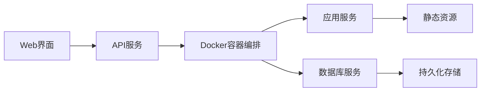

## 今日热点

AI代理技术爆发式增长，从通用助手到专业领域应用，同时开源替代方案崛起，开发者社区正积极构建自主可控的AI工具生态。

---

## 热门项目一览

| 排名 | 项目 | 语言 | 今日 | 总计 | 简介 |
|:---:|------|:----:|------:|-----:|------|
| 1 | [cloudflare/security-audit-skill](https://github.com/cloudflare/security-audit-skill) | JavaScript | +2,878 | 47,050 | A coding-agent skill for mu... |
| 2 | [debpalash/VoiceStudio](https://github.com/debpalash/VoiceStudio) | Python | +1,592 | 86,990 | VoiceStudio is the open-sou... |
| 3 | [Nutlope/hallmark](https://github.com/Nutlope/hallmark) | CSS | +1,317 | 33,992 | Anti-AI-slop design skill f... |
| 4 | [pbakaus/impeccable](https://github.com/pbakaus/impeccable) | Rust | +1,092 | 87,823 | The design language that ma... |
| 5 | [makecindy/cindy](https://github.com/makecindy/cindy) | TypeScript | +675 | 4,988 | Consider it done. The open-... |
| 6 | [pollen-robotics/microduck](https://github.com/pollen-robotics/microduck) | Rust | +647 | 11,725 | A Tiny biped duck robot 🦆 |
| 7 | [TauricResearch/TradingAgents](https://github.com/TauricResearch/TradingAgents) | Python | +381 | 114,713 | TradingAgents: Multi-Agents... |
| 8 | [Renhuai123/ziwei-doushu](https://github.com/Renhuai123/ziwei-doushu) | TypeScript | +199 | 7,707 | 紫微斗数开源排盘引擎 — 基于倪海厦《天纪》体系，含完... |
| 9 | [AgriciDaniel/claude-seo](https://github.com/AgriciDaniel/claude-seo) | Python | +197 | 20,990 | Universal SEO skill for Cla... |
| 10 | [coollabsio/coolify](https://github.com/coollabsio/coolify) | PHP | +152 | 64,469 | An open-source, self-hostab... |
| 11 | [JetBrains/thinkrail](https://github.com/JetBrains/thinkrail) | TypeScript | +51 | 1,842 | Vibe code with pi in a ligh... |

---

## 趋势洞察

```
┌─────────────────────────────────────────────────────────────────┐
│  AI/ML 工具         ████████████████████████  8 个项目        │
│  多媒体应用            ███                       1 个项目        │
│  开发工具             ███                       1 个项目        │
│  其他               ███                       1 个项目        │
└─────────────────────────────────────────────────────────────────┘
```

---

## 项目深度解读

### 1. cloudflare/security-audit-skill — 安全审计助手

> **一句话总结**：自动化多阶段安全审计工具，提供机器可读的独立验证安全发现。

#### 价值主张

| 维度 | 说明 |
|------|------|
| **解决痛点** | 自动化识别代码中的安全漏洞，提高审计效率和准确性 |
| **目标用户** | 安全研究人员、开发团队、DevOps工程师 |
| **核心亮点** | 多阶段审计流程 + 独立验证机制 + 机器可读报告 + 自动化执行 |

#### 技术架构


**技术特色**：
- 基于JavaScript的安全审计引擎
- 多阶段分层分析方法
- 独立验证机制确保结果可靠性

#### 热度分析

- 项目获得47,050个星标，近期增长2,878，表明安全审计领域需求旺盛
- 作为Cloudflare项目，在安全领域具有显著影响力，社区参与度高

#### 快速上手

```bash
# 安装
npm install -g @cloudflare/security-audit-skill

# 基本使用
security-audit-skill --path ./your-code
```

#### 注意事项

- 需要明确项目的具体使用场景和限制
- 注意依赖项和兼容性要求
- 确保理解报告结果的解读方式


### 2. debpalash/VoiceStudio — 开源语音工作室

> **一句话总结**：完全本地化的开源 ElevenLabs 替代方案，支持646种语言的语音克隆与合成。

#### 价值主张

| 维度 | 说明 |
|------|------|
| **解决痛点** | 提供隐私保护、无需云服务的开源语音合成解决方案 |
| **目标用户** | 内容创作者、开发者、语音技术爱好者 |
| **核心亮点** | 完全本地部署 + 646种语言支持 + 多样化语音功能 + 开源可定制 |

#### 技术架构


**技术特色**：
- 完全本地化部署，保护用户隐私
- 支持多达646种语言的语音合成
- 开源架构，便于二次开发和定制

#### 热度分析

- Star数达86,990且近期增长迅速(+1,592 today)，项目热度持续攀升
- 作为 ElevenLabs 的开源替代方案，在语音技术领域占据重要生态位置

#### 快速上手

```bash
git clone https://github.com/debpalash/VoiceStudio.git
cd VoiceStudio
pip install -r requirements.txt
python setup.py install
```

#### 注意事项

- 项目许可证未知，使用前需确认授权条款
- 由于支持646种语言，模型文件可能较大，需要足够的存储空间
- 完全本地部署需要较强的计算资源，特别是处理高质量语音时


### 3. Nutlope/hallmark — AI设计优化

> **一句话总结**：为AI编程工具提供高质量CSS样式，提升界面美观度和用户体验

#### 价值主张

| 维度 | 说明 |
|------|------|
| **解决痛点** | AI编程工具界面设计质量参差不齐，影响开发体验 |
| **目标用户** | 使用Claude Code、Cursor和Codex的开发者 |
| **核心亮点** | 精心设计的UI组件 + 提升代码阅读体验 + 保持工具原有功能 |

#### 技术架构


**技术特色**：
- 专门针对AI编程工具优化的CSS样式
- 提供清晰的代码高亮和排版
- 注重视觉层次和信息密度平衡

#### 热度分析

- 项目获得近3.4万星，单日新增1300+星，显示社区高度认可
- 作为CSS工具项目，在AI编程工具生态中具有重要影响力

#### 快速上手

```bash
# 克隆项目
git clone https://github.com/Nutlope/hallmark.git

# 将CSS文件引入你的项目
<link rel="stylesheet" href="path/to/hallmark.css">
```

#### 注意事项

- 确保与目标AI工具版本兼容
- 可能需要根据个人偏好调整部分样式
- 项目未明确许可证，使用时需注意版权问题


### 4. pbakaus/impeccable — AI设计语言

> **一句话总结**：Rust构建的设计语言系统，专为提升AI工具的用户界面与交互体验。

#### 价值主张

| 维度 | 说明 |
|------|------|
| **解决痛点** | 解决AI工具设计不一致、用户体验欠佳的问题 |
| **目标用户** | AI应用开发者、UI/UX设计师、产品团队 |
| **核心亮点** | 设计语言规范 + 组件库 + AI专用优化 + 高性能 |

#### 技术架构


**技术特色**：
- Rust实现确保高性能和内存安全
- 模块化架构支持灵活定制和扩展
- 专为AI交互场景优化的设计元素

#### 热度分析

- 获近8.8万星，日增超千星，显示社区高度认可
- 零开放问题表明项目维护良好，功能稳定成熟

#### 快速上手

```bash
git clone https://github.com/pbakaus/impeccable.git
cd impeccable
cargo run --example demo
```

#### 注意事项

- 项目许可证未知，商业使用前需确认授权条款
- 项目描述较简略，具体功能和使用方式需进一步探索源码


### 5. makecindy/cindy — AI智能代理

> **一句话总结**：开箱即用的AI智能助手，实现想法到执行的自动化处理

#### 价值主张

| 维度 | 说明 |
|------|------|
| **解决痛点** | 解决AI助手部署复杂、配置繁琐的问题，提供即开即用的AI代理解决方案 |
| **目标用户** | 需要AI助手辅助工作的开发者和企业用户 |
| **核心亮点** | 开箱即用 + 多场景支持 + 自动化执行 + TypeScript开发 |

#### 技术架构


**技术特色**：
- 基于TypeScript开发，类型安全
- 开箱即用，无需复杂配置
- 支持多场景任务自动化处理

#### 热度分析

- 项目近期增长迅速，单日增长675星，表明社区高度关注
- 高Star与Fork比例显示项目实用性强，社区活跃度高

#### 快速上手

```bash
# 克隆项目
git clone https://github.com/makecindy/cindy.git
cd cindy

# 安装依赖并启动
npm install
npm start
```

#### 注意事项

- 项目许可证未知，商业使用前需确认授权
- 虽然Issues为0，但建议关注项目更新和潜在问题


### 6. pollen-robotics/microduck — [双足机器人]

> **一句话总结**：一款基于Rust开发的小型双足机器鸭，实现高度仿真的步态控制与运动。

#### 价值主张

| 维度 | 说明 |
|------|------|
| **解决痛点** | 开源双足机器人平台，降低机器人开发门槛与成本 |
| **目标用户** | 机器人爱好者、研究人员、STEM教育工作者 |
| **核心亮点** | 精确步态算法 + 小型化设计 + Rust高性能实现 |

#### 技术架构


**技术特色**：
- 使用Rust语言确保系统安全性和内存安全
- 模块化设计便于功能扩展与二次开发
- 高效的双足步态算法实现稳定行走能力

#### 热度分析

- 项目关注度快速增长，单日增加647个stars，表明技术社区对其高度关注
- 高star数与零open issues对比，显示项目成熟度高，用户体验良好

#### 快速上手

```bash
git clone https://github.com/pollen-robotics/microduck.git
cd microduck
cargo build --release
```

#### 注意事项

- 项目许可证未知，商业使用前需确认授权情况
- 需要3D打印部件和特定电子元件才能完整构建
- Rust编程知识对深度修改和功能扩展有帮助


### 7. TauricResearch/TradingAgents — AI交易框架

> **一句话总结**：基于多智能体大语言模型的金融交易框架，实现自动化交易策略。

#### 价值主张

| 维度 | 说明 |
|------|------|
| **解决痛点** | 传统交易策略开发复杂，AI模型难以适应市场动态变化 |
| **目标用户** | 量化交易者、金融分析师、算法交易开发者 |
| **核心亮点** | 多智能体协作 + 大语言模型驱动 + 自适应交易策略 + 回测框架 + 实时执行 |

#### 技术架构


**技术特色**：
- 多智能体协同决策系统，提升交易策略的适应性
- 大语言模型理解市场动态和新闻影响
- 完整的回测与模拟环境验证策略有效性
- 支持多种数据源和交易接口

#### 热度分析

- 项目获得11万+星标，近期增长迅速，表明市场对AI交易框架高度关注
- 22k+次fork，显示开发者社区活跃度高，项目具有良好生态潜力

#### 快速上手

```bash
# 克隆项目
git clone https://github.com/TauricResearch/TradingAgents.git
cd TradingAgents

# 安装依赖
pip install -r requirements.txt

# 运行示例
python examples/basic_trading_agent.py
```

#### 注意事项

- 项目依赖大量外部API和数据源，需要相应配置API密钥
- 实盘交易需谨慎评估风险，建议先在模拟环境中测试
- 模型表现受市场条件影响，需持续优化和调整参数


### 8. Renhuai123/ziwei-doushu — 紫微斗数排盘引擎

> **一句话总结**：基于倪海厦《天纪》体系的紫微斗数开源排盘引擎，提供完整算法、四化系统和古籍数据。

#### 价值主张

| 维度 | 说明 |
|------|------|
| **解决痛点** | 传统紫微斗数计算复杂，缺乏标准化开源工具，命理研究者难以高效应用 |
| **目标用户** | 命理研究者、紫微斗数爱好者、八字命理软件开发者 |
| **核心亮点** | 完整排盘算法 + 四化系统 + 格局知识库 + 古籍原文数据 + TypeScript实现 |

#### 技术架构


**技术特色**：
- 基于倪海厦《天纪》体系的完整算法实现
- TypeScript编写，类型安全，易于集成
- 包含古籍原文数据，支持传统命理研究

#### 热度分析

- 项目Star数达7,707且持续增长(+199 today)，表明在命理领域有较高关注度
- Fork数1,563显示有较多二次开发或使用场景，社区活跃度高

#### 快速上手

```bash
# 安装
npm install ziwei-doushu

# 使用示例
import { Ziwei } from 'ziwei-doushu';
const result = Ziwei.calculate({ year: 1990, month: 1, day: 1, hour: 0, gender: 'male' });
console.log(result);
```

#### 注意事项

- 项目许可证未知，商业使用需谨慎
- 基于特定命理体系，可能与其他体系存在差异
- 古籍数据可能需要进一步验证和补充


### 9. AgriciDaniel/claude-seo — [Claude SEO助手]

> **一句话总结**：为Claude Code提供全面的SEO技能，涵盖从技术优化到内容策略的全方位解决方案。

#### 价值主张

| 维度 | 说明 |
|------|------|
| **解决痛点** | 提供一站式SEO解决方案，解决从技术优化到内容策略的全方位需求 |
| **目标用户** | SEO专家、数字营销人员、网站开发者和内容创作者 |
| **核心亮点** | 26个子技能覆盖全面SEO领域 + 19个子代理实现自动化处理 + 多格式报告生成 |

#### 技术架构


**技术特色**：
- 模块化设计，支持26个子技能独立运行
- 集成多种Google API获取实时SEO数据
- 支持Lighthouse、WebMCP等前沿技术进行网站分析

#### 热度分析

- 项目Star数超过2万，近期增长稳定，表明SEO工具市场持续需求旺盛
- 作为Claude生态系统的重要工具，占据了AI辅助SEO领域的领先位置

#### 快速上手

```bash
# 克隆项目
git clone https://github.com/AgriciDaniel/claude-seo.git

# 安装依赖
pip install -r requirements.txt
```

#### 注意事项

- 项目未明确许可证信息，使用前需确认授权条款
- 部分功能可能需要Google API密钥，需提前申请
- 扩展功能需要额外配置，建议先熟悉基础功能后再尝试


### 10. coollabsio/coolify — 自托管PaaS

> **一句话总结**：开源自托管PaaS平台，一键部署应用到自有服务器，替代Vercel/Heroku

#### 价值主张

| 维度 | 说明 |
|------|------|
| **解决痛点** | 打破商业PaaS平台依赖，实现应用完全自主控制与成本优化 |
| **目标用户** | 追求数据主权、降低成本或需要定制化部署环境的全栈开发者 |
| **核心亮点** | 容器化多应用部署 + 360+一键服务支持 + 直观Web界面 + 完整数据库管理 |

#### 技术架构



**技术特色**：
- 基于PHP构建的轻量级PaaS解决方案
- 容器化技术实现应用隔离与资源优化
- 一键服务简化复杂应用的部署流程

#### 热度分析

- 项目Star数突破6.4万且持续增长，显示其在自托管PaaS领域的强劲吸引力
- 0个Open Issues反映项目成熟度高，社区维护质量优异

#### 快速上手

```bash
# 使用Docker快速部署Coolify
docker run -d --name coolify -p 80:8080 coollabsio/coolify:latest
```

#### 注意事项

- 确保服务器资源充足，能支持Coolify及其所有部署应用的运行需求
- 作为自托管解决方案，用户需自行负责服务器维护、安全更新与数据备份
- 部分高级功能可能需要额外配置，建议参考官方文档获取完整部署指南


### 11. JetBrains/thinkrail — 轻量智能IDE

> **一句话总结**：一款自适应开发者工作方式的轻量级IDE，专注于提供高效的编码体验。

#### 价值主张

| 维度 | 说明 |
|------|------|
| **解决痛点** | 传统IDE过于笨重，缺乏个性化，影响开发效率与体验 |
| **目标用户** | 追求高效工作流的开发者，特别是Python开发者 |
| **核心亮点** | 轻量级设计 + 自适应工作流 + 智能代码分析 |

#### 技术架构


**技术特色**：
- 基于TypeScript构建，确保类型安全与跨平台兼容性
- 模块化架构设计，支持快速扩展与定制
- 智能工作流分析，动态调整IDE功能布局

#### 热度分析

- 项目近期增长稳定，每日新增Star约50个，社区认可度持续提升
- Fork数相对较少，表明项目处于早期发展阶段，社区贡献潜力大

#### 快速上手

```bash
# 安装thinkrail
npm install -g @jetbrains/thinkrail

# 启动IDE
thinkrail

# 创建新项目
thinkrail new my-project
```

#### 注意事项

- 项目许可证信息不明确，使用前需确认开源协议
- 作为JetBrains新产品，API和功能可能仍在快速迭代中


## 今日推荐

| 主题 | 推荐项目 | 亮点 |
|------|----------|------|
| 今日最热 | [cloudflare/security-audit-skill](https://github.com/cloudflare/security-audit-skill) | A coding-agent sk... |
| 值得关注 | [debpalash/VoiceStudio](https://github.com/debpalash/VoiceStudio) | VoiceStudio is th... |
| 快速上手 | [Nutlope/hallmark](https://github.com/Nutlope/hallmark) | Anti-AI-slop desi... |
| 长期潜力 | [pbakaus/impeccable](https://github.com/pbakaus/impeccable) | The design langua... |

---

<div align="center">

*Generated on 2026-10-26 | Powered by GitHub Trending Reporter*

</div>