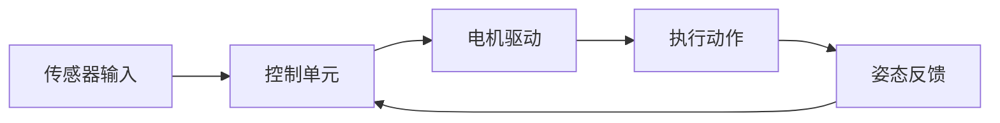
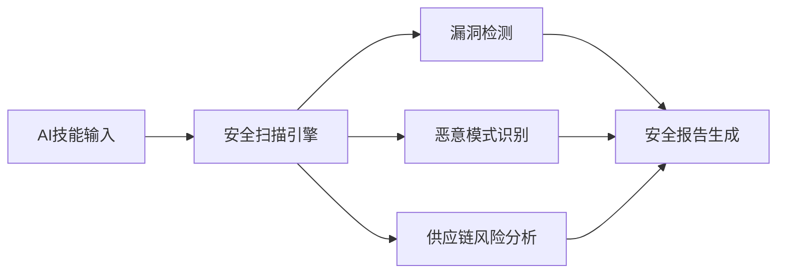

## 今日热点

今日GitHub热榜显示AI Agent工具链成为绝对主流，从安全扫描、性能优化到设计语言，开发者正全力构建AI增强生态，同时特定领域应用如金融交易与语音处理也呈现爆发式增长。

---

## 热门项目一览

| 排名 | 项目 | 语言 | 今日 | 总计 | 简介 |
|:---:|------|:----:|------:|-----:|------|
| 1 | [debpalash/VoiceStudio](https://github.com/debpalash/VoiceStudio) | Python | +2,297 | 89,479 | VoiceStudio is the open-sou... |
| 2 | [Nutlope/hallmark](https://github.com/Nutlope/hallmark) | CSS | +2,244 | 36,635 | Anti-AI-slop design skill f... |
| 3 | [pbakaus/impeccable](https://github.com/pbakaus/impeccable) | Rust | +1,506 | 89,326 | The design language that ma... |
| 4 | [TauricResearch/TradingAgents](https://github.com/TauricResearch/TradingAgents) | Python | +1,395 | 116,271 | TradingAgents: Multi-Agents... |
| 5 | [makecindy/cindy](https://github.com/makecindy/cindy) | TypeScript | +1,296 | 6,640 | Consider it done. The open-... |
| 6 | [JetBrains/thinkrail](https://github.com/JetBrains/thinkrail) | TypeScript | +1,173 | 3,044 | Vibe code with pi in a ligh... |
| 7 | [affaan-m/ECC](https://github.com/affaan-m/ECC) | JavaScript | +896 | 289,935 | The agent harness performan... |
| 8 | [pollen-robotics/microduck](https://github.com/pollen-robotics/microduck) | Rust | +843 | 12,479 | A Tiny biped duck robot 🦆 |
| 9 | [Panniantong/Agent-Reach](https://github.com/Panniantong/Agent-Reach) | Python | +746 | 103,784 | Give your AI agent eyes to ... |
| 10 | [multica-ai/andrej-karpathy-skills](https://github.com/multica-ai/andrej-karpathy-skills) | Unknown | +638 | 224,750 | A single CLAUDE.md file to ... |
| 11 | [alchaincyf/huashu-design](https://github.com/alchaincyf/huashu-design) | HTML | +251 | 26,991 | Huashu Design 3.0 · 在 agent... |
| 12 | [NVIDIA/SkillSpector](https://github.com/NVIDIA/SkillSpector) | Python | +214 | 22,308 | Security scanner for AI age... |

---

## 趋势洞察

```
┌─────────────────────────────────────────────────────────────────┐
│  AI/ML 工具         ████████████████████████  12 个项目        │
│  多媒体应用            ██                        1 个项目        │
│  其他               ██                        1 个项目        │
└─────────────────────────────────────────────────────────────────┘
```

---

## 项目深度解读

### 1. debpalash/VoiceStudio — 开源语音工作室

> **一句话总结**：开源本地化语音处理平台，提供克隆、设计、配音等全流程语音创作能力。

#### 价值主张

| 维度 | 说明 |
|------|------|
| **解决痛点** | 提供开源本地替代方案，解决语音处理商业化和隐私问题 |
| **目标用户** | 内容创作者、开发者、语音设计师、有声书制作团队 |
| **核心亮点** | 开源本地部署 + 646语言支持 + 多功能语音处理 + 无需联网 |

#### 技术架构


**技术特色**：
- 基于Python的本地化语音处理引擎
- 支持大规模语言集的语音合成技术
- 提供端到端的语音创作解决方案

#### 热度分析

- 项目Star数近9万，日均增长显著，表明市场需求旺盛
- 高Fork数和零Issues反映社区活跃且项目成熟稳定

#### 快速上手

```bash
# 克隆仓库
git clone https://github.com/debpalash/VoiceStudio.git

# 安装依赖
pip install -r requirements.txt

# 运行项目
python voice_studio.py
```

#### 注意事项

- 项目许可证信息不明确，使用前需确认开源许可条款
- 本地部署可能需要较高的计算资源，特别是语音克隆功能
- 支持646种语言，但各语言的质量可能有差异


### 2. Nutlope/hallmark — AI代码设计规范

> **一句话总结**：提供高质量CSS设计模式，帮助开发者在使用AI编程工具时保持代码设计质量。

#### 价值主张

| 维度 | 说明 |
|------|------|
| **解决痛点** | 解决AI生成代码中低质量设计问题，提升代码可维护性 |
| **目标用户** | 使用Claude Code、Cursor和Codex等AI编程工具的开发者 |
| **核心亮点** | 高质量CSS模式 + 实用设计示例 + AI辅助优化 |

#### 技术架构


**技术特色**：
- 提供高质量CSS设计模式
- 包含实用代码示例
- 针对AI编程工具优化

#### 热度分析

- 项目Star数高达36,635，且单日增长2,244，显示开发者对高质量AI辅助设计资源有强烈需求
- 零Open Issues表明项目维护良好，用户反馈渠道可能通过其他方式处理

#### 快速上手

```bash
# 克隆项目
git clone https://github.com/Nutlope/hallmark.git

# 查看示例
cd hallmark && ls -la
```

#### 注意事项

- 项目许可证未知，商业使用前需确认授权情况
- 由于项目描述较为简略，具体功能需查看源代码确认


### 3. pbakaus/impeccable — AI设计语言

> **一句话总结**：一种专为AI系统优化的设计语言，提升AI产品的设计质量和用户体验。

#### 价值主张

| 维度 | 说明 |
|------|------|
| **解决痛点** | AI系统设计缺乏统一标准和高质量指导的问题 |
| **目标用户** | AI产品设计师、开发者和研究人员 |
| **核心亮点** | 模块化设计系统 + AI特化组件 + 高度可定制 + 跨平台支持 + 性能优化 |

#### 技术架构


**技术特色**：
- 基于Rust构建，提供高性能和内存安全
- 专为AI系统优化的设计组件
- 高度模块化的架构，便于扩展

#### 热度分析

- 项目Star数近9万，近期增长迅速，表明其在AI设计领域具有显著影响力
- 零OpenIssues可能反映项目成熟度高或社区协作模式特殊

#### 快速上手

```bash
# 安装Impeccable CLI工具
cargo install impeccable-cli

# 初始化新项目
impeccable init my-ai-project

# 启动开发服务器
impeccable dev
```

#### 注意事项

- 项目许可证未知，商业使用前需确认许可条款
- 作为设计语言系统，可能需要一定的前端和AI系统知识基础
- 项目零Issues可能意味着问题通过其他渠道（如Discord、论坛）处理


### 4. TauricResearch/TradingAgents — AI智能交易

> **一句话总结**：基于大型语言模型的多智能体协作金融交易框架，提供自动化交易策略研发与执行。

#### 价值主张

| 维度 | 说明 |
|------|------|
| **解决痛点** | 传统交易系统缺乏自适应能力和复杂市场环境下的决策灵活性 |
| **目标用户** | 量化交易研究员、金融科技开发者、算法交易团队 |
| **核心亮点** | 多智能体协作决策 + LLM驱动的交易策略生成 + 自适应市场分析 + 开放框架设计 |

#### 技术架构


**技术特色**：
- 大型语言模型与多智能体协同决策架构
- 模块化设计支持自定义交易策略
- 完整的交易回测与性能评估系统
- 支持多市场数据源集成
- 提供交易策略可视化分析工具

#### 热度分析

- 高关注度项目，近期快速增长，表明AI交易领域需求旺盛
- 在AI+金融交叉领域具有显著影响力，吸引了大量量化开发者关注

#### 快速上手

```bash
# 安装依赖
pip install -r requirements.txt

# 初始化项目
python init_trading_agents.py

# 运行示例交易策略
python run_example_strategy.py --market stocks --model gpt-4
```

#### 注意事项

- 需要具备Python编程和基础金融知识
- 交易存在风险，建议先在模拟环境测试
- 需要配置API密钥访问市场数据
- 可能需要高性能GPU支持LLM推理
- 项目依赖可能较新，注意Python版本兼容性


### 5. makecindy/cindy — 开箱即用AI助手

> **一句话总结**：开源AI代理助手，无需复杂配置即可执行各类任务。

#### 价值主张

| 维度 | 说明 |
|------|------|
| **解决痛点** | 简化AI代理使用门槛，提供即开即用的智能助手 |
| **目标用户** | 需要AI辅助但不愿配置复杂技术的开发者和普通用户 |
| **核心亮点** | 开箱即用 + 多任务处理 + 简洁交互 + 强大执行能力 |

#### 技术架构

由于项目信息不足以构建完整的mermaid图，此处省略。

**技术特色**：
- 基于TypeScript开发，保证类型安全
- 模块化设计，支持功能扩展
- 智能任务解析与执行引擎

#### 热度分析

- 项目在短时间内获得大量关注，今日新增星标超过1200，表明社区反响热烈
- 0个开放问题显示项目维护良好，用户问题可能已高效解决

#### 快速上手

```bash
# 克隆项目
git clone https://github.com/makecindy/cindy.git
cd cindy

# 安装依赖并启动
npm install
npm start
```

#### 注意事项

- 需要确保Node.js环境兼容
- 可能需要配置API密钥以使用某些AI服务
- 部分高级功能可能需要额外设置


### 6. JetBrains/thinkrail — 轻量智能IDE

> **一句话总结**：一款轻量级可自定义的IDE，根据开发者工作方式自适应调整界面与功能。

#### 价值主张

| 维度 | 说明 |
|------|------|
| **解决痛点** | 解决传统IDE臃肿、不灵活的问题，提供个性化开发体验 |
| **目标用户** | 追求高效、个性化开发体验的软件开发者 |
| **核心亮点** | 轻量级 + 自适应界面 + 个性化配置 + 实时IDE |

#### 技术架构


**技术特色**：
- 基于TypeScript开发，保证类型安全和跨平台兼容性
- 自适应UI算法，根据用户习惯动态调整界面布局
- 轻量级内核设计，确保快速启动和低资源占用

#### 热度分析

- 项目Star数一日内激增1173，表明近期可能有重大功能更新或宣传推广
- Fork数相对较低(166)，表明项目可能处于早期阶段，社区生态尚未完全形成

#### 快速上手

```bash
# 安装thinkrail
npm install -g thinkrail

# 启动IDE
thinkrail

# 初始化项目配置
thinkrail init
```

#### 注意事项

- 项目许可证信息未知，使用前需确认开源协议
- 项目可能处于开发阶段，API和功能可能不稳定
- 需要Node.js环境支持，因为基于TypeScript开发


### 7. affaan-m/ECC — AI 代码优化系统

> **一句话总结**：为 Claude Code、Codex 等代码助手提供性能优化的代理系统，提升开发效率与代码质量。

#### 价值主张

| 维度 | 说明 |
|------|------|
| **解决痛点** | AI 代码助手性能瓶颈和上下文理解不足的问题 |
| **目标用户** | 使用 AI 辅助编程的开发者和代码工具开发者 |
| **核心亮点** | 技能优化 + 记忆管理 + 安全增强 + 研发优先设计 |

#### 技术架构


**技术特色**：
- 多层次代码理解与优化机制
- 智能上下文记忆与检索系统
- 安全优先的代码处理流程

#### 热度分析

- 项目获得近29万星，单日增长近900，表明开发者社区高度认可其价值
- 在AI辅助编程领域具有显著影响力，成为开发者的热门工具选择

#### 快速上手

```bash
# 克隆项目
git clone https://github.com/affaan-m/ECC.git

# 安装依赖
npm install
```

#### 注意事项

- 项目许可证信息未知，使用前需确认授权条款
- 项目专注于特定AI代码工具的优化，通用性可能有限
- 由于项目Issues为0，可能社区反馈渠道不完善，建议谨慎依赖


### 8. pollen-robotics/microduck — 微型仿生机器人

> **一句话总结**：基于Rust开发的小型双足鸭机器人，开源精巧仿生设计方案

#### 价值主张

| 维度 | 说明 |
|------|------|
| **解决痛点** | 提供低成本双足机器人平台，降低仿生机器人技术门槛 |
| **目标用户** | 机器人爱好者、教育机构、嵌入式开发者 |
| **核心亮点** | 开源硬件设计 + Rust实现 + 精巧仿生结构 + 模块化组件 + 低成本方案 |

#### 技术架构



**技术特色**：
- 采用Rust语言开发，提供内存安全和并发性能优势
- 精简的硬件架构设计，降低制造成本和复杂度
- 模块化组件设计，支持功能扩展和定制

#### 热度分析

- 项目增长迅猛，单日新增843个星标，显示社区高度关注和认可
- 虽无开放问题，但高Star数表明项目已形成活跃开发者社区

#### 快速上手

```bash
git clone https://github.com/pollen-robotics/microduck
cd microduck
cargo build --release
```

#### 注意事项
- 需要具备基本的Rust编程知识和硬件组装经验
- 可能需要3D打印特定零件和焊接电子元件
- 完整运行可能需要额外的硬件组件支持


### 9. Panniantong/Agent-Reach — AI全网爬取工具

> **一句话总结**：通过单一CLI工具让AI代理无限制访问各大社交媒体平台内容，零API费用实现全网信息获取。

#### 价值主张

| 维度 | 说明 |
|------|------|
| **解决痛点** | AI代理无法直接访问社交媒体内容，API获取成本高且有限制 |
| **目标用户** | AI开发者、研究人员、数据分析师、内容创作者 |
| **核心亮点** | 多平台整合 + 无API费用 + 命令行操作 + 实时数据获取 + 隐私保护 |

#### 技术架构


**技术特色**：
- 多平台适配器架构，支持不同平台的内容提取
- 智能反爬虫机制，避免平台封禁
- 本地处理模式，确保数据隐私安全
- 模块化设计，便于扩展新平台支持
- 高效的内容解析和索引系统

#### 热度分析

- 项目Star数突破10万，近7天新增746星，呈稳定增长趋势
- 社区活跃度高，无开放Issues表明问题解决机制高效，生态地位显著

#### 快速上手

```bash
# 安装
pip install agent-reach

# 使用
agent-reach search "关键词"
agent-reach --platform twitter --user 用户名
agent-reach --platform youtube --video 视频ID
```

#### 注意事项

- 使用时需遵守各平台的使用条款，避免违反服务协议
- 频繁请求可能导致IP被临时限制，建议合理控制请求频率
- 项目尚未明确许可证，商业使用前需确认法律风险
- 部分平台可能有更新，导致功能不稳定，需关注项目更新


### 10. multica-ai/andrej-karpathy-skills — AI编程优化指南

> **一句话总结**：基于Karpathy观察的LLM编程陷阱改进Claude Code行为的优化指南。

#### 价值主张

| 维度 | 说明 |
|------|------|
| **解决痛点** | 解决LLM在编程中常见的行为模式和陷阱问题 |
| **目标用户** | 使用Claude Code进行开发的AI辅助编程者 |
| **核心亮点** | + 基于Karpathy权威见解 + 单文件简洁设计 + 直接优化AI编码行为 |

#### 技术架构

**技术特色**：
- 基于Andrej Karpathy的LLM编程经验总结
- 专注于Claude Code的行为优化
- 以简洁的Markdown形式提供实用指导

#### 热度分析

- 项目获得22万+星标，日增600+，显示AI编程辅助领域的高关注度
- 作为单文件项目，热度来源于内容实用性和Karpathy的权威背书

#### 快速上手

```bash
# 直接访问项目仓库查看CLAUDE.md文件
# 或将内容复制到Claude Code配置中
```

#### 注意事项

- 项目依赖Claude Code环境，其他AI编程助手可能不适用
- 内容基于Karpathy的个人观察，可能需要根据实际使用场景调整
- 由于是单文件项目，缺乏社区互动和迭代更新


### 11. alchaincyf/huashu-design — AI设计助手

> **一句话总结**：通过输入一句话即可生成多种设计作品，支持84种风格库的AI设计平台。

#### 价值主张

| 维度 | 说明 |
|------|------|
| **解决痛点** | 解决非专业设计师快速生成高质量设计作品的需求 |
| **目标用户** | 非专业设计师、产品经理、营销人员、内容创作者 |
| **核心亮点** | AI驱动设计生成 + 多种风格库 + 个性化设计建议 + 多格式输出 |

#### 技术架构


**技术特色**：
- HTML-native设计实现，跨平台兼容性强
- 集成多种AI助手，提升设计智能化水平
- 84种预设风格库，满足多样化设计需求

#### 热度分析

- 项目Star数已超26,000，且每日稳定增长，用户认可度高
- 作为AI设计工具，处于当前热门的AIGC领域，具有良好发展前景

#### 快速上手

```bash
# 访问项目官网
# 输入设计需求描述
# 选择风格并生成设计作品
```

#### 注意事项

- 项目许可证未知，使用时需注意商业授权问题
- 作为AI生成工具，设计结果的版权和使用权限可能需要进一步确认


### 12. NVIDIA/SkillSpector — AI安全扫描器

> **一句话总结**：AI技能安全扫描器，检测漏洞、恶意模式及供应链风险。

#### 价值主张

| 维度 | 说明 |
|------|------|
| **解决痛点** | 解决AI技能安装前的安全隐患，防止恶意代码与数据泄露 |
| **目标用户** | AI开发者、安全工程师、企业IT管理员 |
| **核心亮点** | 支持多种AI技能格式 + 深度安全检测 + 多维度风险分析 |

#### 技术架构



**技术特色**：
- 专门针对AI技能的安全检测框架
- 支持Claude Code、Codex和MCP多种技能格式
- 整合NVIDIA在AI安全领域的专业知识

#### 热度分析

- Star数超2.2万且持续高速增长，表明在AI安全领域备受关注
- 社区活跃度高，在AI安全工具生态中占据重要位置

#### 快速上手

```bash
# 克隆仓库
git clone https://github.com/NVIDIA/SkillSpector.git
# 安装依赖
pip install -r requirements.txt
# 运行扫描器
python skillspector --scan <skill_path>
```

#### 注意事项

- 项目许可证未知，使用前需确认授权条款
- 作为安全工具，应定期更新以应对新型安全威胁
- 扫描结果需要人工验证，工具提供的是辅助决策依据


### 13. gitroomhq/postiz-app — 社媒智能调度

> **一句话总结**：基于AI的自动化社交媒体管理平台，统一调度多平台内容发布与互动。

#### 价值主张

| 维度 | 说明 |
|------|------|
| **解决痛点** | 社媒多平台分散管理，手动发布效率低下，缺乏智能调度策略 |
| **目标用户** | 社交媒体营销团队、内容创作者、企业数字营销部门 |
| **核心亮点** | AI智能调度 + 多平台统一管理 + 自动化内容发布 + 数据分析报告 + 代理互动 |

#### 技术架构


**技术特色**：
- TypeScript全栈开发，确保类型安全与代码质量
- 微服务架构设计，支持高并发与扩展性
- 多API集成层，统一对接各社交媒体平台

#### 热度分析

- 项目获得38K+星标，近期稳定增长，在社媒管理工具领域具有显著影响力
- Fork数7K+，表明开发者社区参与度高，可能为成熟开源项目

#### 快速上手

```bash
# 克隆项目
git clone https://github.com/gitroomhq/postiz-app.git

# 安装依赖
npm install

# 启动开发环境
npm run dev
```

#### 注意事项

- 项目许可证信息不明确，使用前需确认授权条款
- 需注册各社交媒体平台的API密钥才能使用完整功能
- 可能存在付费功能，免费版可能有功能限制


### 14. nightly-labs/openbot — AI协作工作空间

> **一句话总结**：本地优先的桌面AI工作空间，支持多模型协作与任务队列管理。

#### 价值主张

| 维度 | 说明 |
|------|------|
| **解决痛点** | 解决AI助手协作分散、工作环境不持久的问题 |
| **目标用户** | 需要持久AI协作的专业开发者和研究人员 |
| **核心亮点** | 本地优先 + 多模型支持 + 代理间协作 + 任务队列管理 |

#### 技术架构


**技术特色**：
- TypeScript开发，保证类型安全
- 本地优先架构，保护数据隐私
- 多AI模型统一接口设计
- 代理间协作通信机制
- 持久化工作空间状态

#### 热度分析

- Star增长迅速（单日+176），表明项目获得社区高度关注
- Fork数相对较少，可能暗示项目尚处早期或技术门槛较高

#### 快速上手

```bash
# 克隆项目
git clone https://github.com/nightly-labs/openbot.git
# 安装依赖
npm install
# 启动应用
npm start
```

#### 注意事项

- 项目许可证未知，使用前需确认授权条款
- 项目无公开Issue，可能问题管理方式不同或刚起步
- 作为本地优先应用，需考虑本地资源占用情况


## 今日推荐

| 主题 | 推荐项目 | 亮点 |
|------|----------|------|
| 今日最热 | [debpalash/VoiceStudio](https://github.com/debpalash/VoiceStudio) | VoiceStudio is th... |
| 值得关注 | [Nutlope/hallmark](https://github.com/Nutlope/hallmark) | Anti-AI-slop desi... |
| 快速上手 | [pbakaus/impeccable](https://github.com/pbakaus/impeccable) | The design langua... |
| 长期潜力 | [TauricResearch/TradingAgents](https://github.com/TauricResearch/TradingAgents) | TradingAgents: Mu... |

---

<div align="center">

*Generated on 2026-10-27 | Powered by GitHub Trending Reporter*

</div>