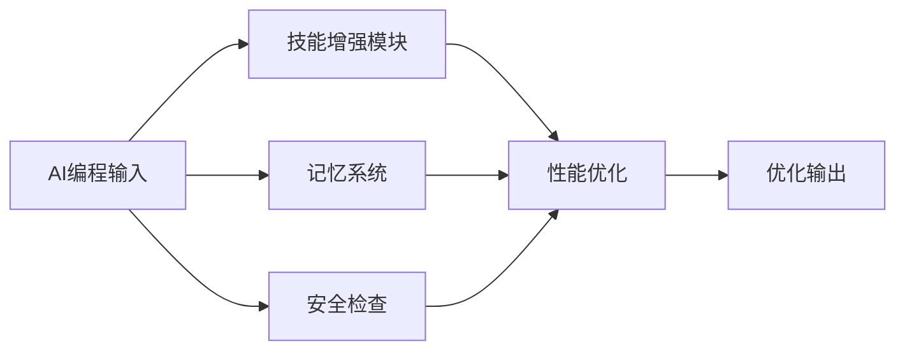

## 今日热点

今日GitHub热榜聚焦AI辅助开发工具爆发，特别是提高AI代码质量和构建本地化AI代理框架的项目受到高度关注，反映开发者对AI实用性和可控性的追求。

---

## 热门项目一览

| 排名 | 项目 | 语言 | 今日 | 总计 | 简介 |
|:---:|------|:----:|------:|-----:|------|
| 1 | [Nutlope/hallmark](https://github.com/Nutlope/hallmark) | CSS | +2,830 | 39,211 | Anti-AI-slop design skill f... |
| 2 | [HKUDS/DeepTutor](https://github.com/HKUDS/DeepTutor) | Python | +1,598 | 46,164 | DeepTutor: Lifelong Persona... |
| 3 | [makecindy/cindy](https://github.com/makecindy/cindy) | TypeScript | +1,465 | 7,569 | Consider it done. The open-... |
| 4 | [pbakaus/impeccable](https://github.com/pbakaus/impeccable) | Rust | +1,449 | 90,746 | The design vocabulary for y... |
| 5 | [elayadesign/ai-design-skills](https://github.com/elayadesign/ai-design-skills) | Unknown | +1,395 | 9,650 | No description |
| 6 | [JetBrains/thinkrail](https://github.com/JetBrains/thinkrail) | TypeScript | +1,204 | 4,154 | Vibe code with pi in a ligh... |
| 7 | [affaan-m/ECC](https://github.com/affaan-m/ECC) | JavaScript | +1,165 | 290,991 | The agent harness performan... |
| 8 | [gitroomhq/postiz-app](https://github.com/gitroomhq/postiz-app) | TypeScript | +951 | 39,476 | 📨 The ultimate agentic soci... |
| 9 | [togg53192-cmd/jailbreaks](https://github.com/togg53192-cmd/jailbreaks) | Unknown | +902 | 5,736 | LIST OF ALL MY JAILBREAKS |
| 10 | [nightly-labs/openbot](https://github.com/nightly-labs/openbot) | TypeScript | +777 | 2,555 | A local-first desktop works... |
| 11 | [obra/superpowers](https://github.com/obra/superpowers) | Shell | +617 | 306,539 | An agentic skills framework... |

---

## 趋势洞察

```
┌─────────────────────────────────────────────────────────────────┐
│  AI/ML 工具         ████████████████████████  10 个项目        │
│  其他               ██                        1 个项目        │
└─────────────────────────────────────────────────────────────────┘
```

---

## 项目深度解读

### 1. Nutlope/hallmark — AI设计增强

> **一句话总结**：为AI编程工具提供高质量CSS设计规范，提升代码视觉质量与可读性。

#### 价值主张

| 维度 | 说明 |
|------|------|
| **解决痛点** | AI生成代码缺乏设计感与视觉一致性，影响代码可读性 |
| **目标用户** | 使用Claude Code、Cursor和Codex的AI辅助编程开发者 |
| **核心亮点** | 精心设计的CSS样式 + 设计规范指南 + 代码视觉美化 |

#### 技术架构


**技术特色**：
- 采用模块化CSS结构，便于集成到不同开发环境
- 提供多套设计主题，适应不同开发场景
- 优化代码高亮与排版，增强代码可读性

#### 热度分析

- 项目近4万星且单日增长超2800，表明AI设计增强需求强烈
- 社区活跃度高，无开放问题显示项目成熟稳定

#### 快速上手

```bash
# 克隆项目到本地
git clone https://github.com/Nutlope/hallmark.git

# 将样式文件引入项目中
<link rel="stylesheet" href="path/to/hallmark.css">
```

#### 注意事项

- 项目主要针对Claude Code、Cursor和Codex，其他编辑器可能需要适配
- 使用前请确认项目最新版本与你的开发环境兼容


### 2. HKUDS/DeepTutor — 个性化教育平台

> **一句话总结**：基于AI的个性化终身教育辅导系统，为学习者提供定制化学习路径和智能辅导。

#### 价值主张

| 维度 | 说明 |
|------|------|
| **解决痛点** | 传统教育无法满足个性化学习需求，缺乏长期学习跟踪和适应性指导 |
| **目标用户** | 需要个性化学习体验的学生、教育工作者及终身学习者 |
| **核心亮点** | 个性化学习路径 + 智能辅导系统 + 自适应内容推荐 + 学习效果分析 |

#### 技术架构


**技术特色**：
- 基于机器学习的个性化学习模型
- 自适应内容推荐算法
- 长期学习效果追踪机制

#### 热度分析

- 项目获星数达46,164，近期单日增长1,598，表明受广泛关注
- 社区活跃度高，但未公开Issues，可能通过其他渠道交流维护

#### 快速上手

```bash
# 克隆仓库
git clone https://github.com/HKUDS/DeepTutor.git
# 安装依赖
pip install -r requirements.txt
# 运行项目
python main.py
```

#### 注意事项

- 项目许可证未知，使用前需确认授权条款
- 缺少详细的文档和示例代码，需要自行研究源码
- 可能需要特定的数据集或环境配置才能完全运行


### 3. makecindy/cindy — 智能执行助手

> **一句话总结**：开源AI代理，将抽象想法转化为具体行动，开箱即用无需复杂配置。

#### 价值主张

| 维度 | 说明 |
|------|------|
| **解决痛点** | 将抽象想法转化为具体行动，降低AI使用门槛 |
| **目标用户** | 需要AI辅助完成任务的普通用户和开发者 |
| **核心亮点** | 开箱即用 + 自动执行任务 + 多场景支持 + 开源透明 |

#### 技术架构


**技术特色**：
- 基于TypeScript开发，保证代码质量和类型安全
- 模块化设计，支持多种场景的AI代理需求
- 开源架构，允许社区扩展和定制功能

#### 热度分析

- 项目近期Star数量激增，单日增长超过1400，表明项目热度快速上升
- 相对较少的Fork数量(897)说明项目可能处于早期阶段，用户更多关注而非二次开发

#### 快速上手

```bash
# 克隆仓库
git clone https://github.com/makecindy/cindy.git
# 安装依赖
npm install
# 启动服务
npm start
```

#### 注意事项

- 项目许可证未知，商业使用前需确认授权条款
- 作为AI代理项目，数据隐私和安全问题需关注
- 项目可能仍在快速迭代，API和功能可能发生变化


### 4. pbakaus/impeccable — AI代码审查工具

> **一句话总结**：为AI辅助编程提供设计词汇和代码质量审查，防止低质量代码提交

#### 价值主张

| 维度 | 说明 |
|------|------|
| **解决痛点** | 解决AI辅助编程中的代码质量问题，防止AI生成的低质量代码被提交 |
| **目标用户** | 开发者、代码审查者、AI辅助编程工具使用者 |
| **核心亮点** | 设计词汇库 + 代码审查机制 + AI质量检测 + 实时反馈 + 防御性编程 |

#### 技术架构


**技术特色**：
- 基于Rust构建，确保高性能和内存安全
- 提供结构化的设计词汇，规范代码风格
- 实时分析代码质量，识别潜在问题

#### 热度分析

- 项目Star数超9万，单日增长近1500，热度持续攀升
- 无Open Issues显示项目成熟度高，问题处理机制完善

#### 快速上手

```bash
# 安装impeccable
cargo install impeccable

# 初始化项目配置
impeccable init

# 检查代码质量
impeccable check path/to/code
```

#### 注意事项

- 项目许可证信息不明确，使用前需确认授权条款
- 可能需要与特定的AI编程工具集成才能发挥完整功能
- 需要一定的学习成本以充分利用设计词汇库的功能


### 5. elayadesign/ai-design-skills — AI设计技能库

> **一句话总结**：系统化AI设计学习资源，从基础到高级的实用指南集合。

#### 价值主张

| 维度 | 说明 |
|------|------|
| **解决痛点** | 提供结构化AI设计学习路径，解决技能碎片化问题 |
| **目标用户** | 设计师、产品经理、AI应用开发者 |
| **核心亮点** | 实用案例 + 技能树结构 + 行业最佳实践 |

#### 技术架构


**技术特色**：
- 结构化学习路径设计
- 案例驱动的教学方法
- 实践与理论相结合

#### 热度分析

- 项目近期热度显著增长，单日新增星标近1400，表明需求旺盛
- 高关注度但问题数为0，可能为资源型项目或已解决所有用户问题

#### 快速上手

```bash
# 克隆项目仓库
git clone https://github.com/elayadesign/ai-design-skills.git

# 查看项目结构
cd ai-design-skills && ls -la
```

#### 注意事项

- 项目可能需要一定的设计基础和AI基础知识
- 建议按照项目推荐的顺序学习，以获得最佳效果
- 部分内容可能需要配合实际设计工具使用


### 6. JetBrains/thinkrail — 轻量定制IDE

> **一句话总结**：轻量级智能IDE，根据开发者工作流自动定制，提供高效编程体验。

#### 价值主张

| 维度 | 说明 |
|------|------|
| **解决痛点** | 传统IDE臃肿，无法根据个人工作习惯定制，降低开发效率 |
| **目标用户** | 追求高效开发体验、喜欢个性化工作流的程序员 |
| **核心亮点** | 轻量级 + 智能定制 + 个性化工作流 + 高效编程 |

#### 技术架构


**技术特色**：
- 基于TypeScript开发，确保类型安全和跨平台兼容性
- 采用轻量级架构，避免传统IDE的资源占用问题
- 智能学习用户工作习惯，实现个性化界面和功能配置

#### 热度分析

- 近期Star激增(+1,204 today)，表明项目获得开发者社区高度关注
- Fork数相对较少，可能项目处于早期阶段，尚未形成广泛分支

#### 快速上手

```bash
# 克隆项目
git clone https://github.com/JetBrains/thinkrail.git

# 安装依赖
npm install

# 启动开发环境
npm run dev
```

#### 注意事项

- 项目许可证未知，使用前需确认开源协议
- 目前Open Issues为0，可能意味着项目处于早期阶段，稳定性有待验证
- 作为IDE项目，可能需要较高的系统资源才能流畅运行


### 7. affaan-m/ECC — AI编程优化系统

> **一句话总结**：为AI编程助手提供性能优化，集成技能、记忆和安全功能的增强系统。

#### 价值主张

| 维度 | 说明 |
|------|------|
| **解决痛点** | 提升AI编程助手性能，解决代码质量和安全性问题 |
| **目标用户** | AI辅助开发者、代码生成工具使用者 |
| **核心亮点** | 技能增强 + 记忆系统 + 安全优化 + 研究优先开发 |

#### 技术架构



**技术特色**：
- 多模块协同优化的架构设计
- 记忆系统实现上下文理解
- 安全机制保障代码质量

#### 热度分析

- 项目拥有29万+星标，近期增长迅速，显示开发者高度认可
- 高星标和零未解决问题表明社区维护良好，生态成熟

#### 快速上手

```bash
# 克隆项目
git clone https://github.com/affaan-m/ECC.git

# 安装依赖
npm install

# 启动系统
npm start
```

#### 注意事项

- 项目许可证未知，商业使用前需确认授权
- 作为性能优化系统，可能需要与现有AI工具集成使用
- 项目没有公开的未解决问题，表明维护良好但可能更新不活跃


### 8. gitroomhq/postiz-app — 社交媒体调度

> **一句话总结**：基于AI代理的社交媒体内容智能调度与管理平台，提升内容发布效率与效果。

#### 价值主张

| 维度 | 说明 |
|------|------|
| **解决痛点** | 解决社交媒体内容发布时间安排、多平台管理和内容效果分析问题 |
| **目标用户** | 社交媒体营销团队、内容创作者、数字营销机构 |
| **核心亮点** | AI智能调度 + 多平台集成 + 数据分析 + 自动化内容生成 + 团队协作 |

#### 技术架构


**技术特色**：
- 基于TypeScript的全栈开发，确保类型安全和代码质量
- AI驱动的智能内容调度算法，优化发布时间
- 多平台API集成，支持主流社交媒体平台

#### 热度分析

- 项目Star数近4万，且每日新增近千星，表明社区认可度高且增长迅速
- Fork数与Star数比例约为1:5，说明用户更倾向于直接使用而非二次开发

#### 快速上手

```bash
# 克隆项目
git clone https://github.com/gitroomhq/postiz-app.git
# 安装依赖
npm install
# 启动开发服务器
npm run dev
```

#### 注意事项

- 需要注册各社交媒体平台的API密钥才能使用完整功能
- 项目可能需要付费才能解锁高级功能
- 由于Open Issues为0，可能问题通过其他渠道反馈，建议关注官方社区


### 9. togg53192-cmd/jailbreaks — [越狱工具库]

> **一句话总结**：收录各类设备越狱方法与工具的综合性资源库。

#### 价值主张

| 维度 | 说明 |
|------|------|
| **解决痛点** | 提供一站式越狱工具获取渠道，解决寻找可靠越狱方法困难的问题 |
| **目标用户** | 设备越狱爱好者、技术研究人员、系统安全测试人员 |
| **核心亮点** | 工具全面性 + 版本历史 + 使用指南 + 安全提醒 + 社区支持 |

#### 技术架构


**技术特色**：
- 跨平台工具整合，支持多种设备系统
- 版本历史追踪，确保使用最新稳定版本
- 详细的使用说明和安全风险提示

#### 热度分析

- 项目近期获得大量关注，单日新增902个Star，表明越狱社区需求旺盛
- Fork数847表明项目具有较高的参考价值和二次开发潜力

#### 快速上手

```bash
# 查看项目结构
ls -la

# 查看特定设备的越狱工具
find . -name "*iphone*" -type f

# 查看使用说明
cat README.md
```

#### 注意事项

- 越狱操作可能导致设备保修失效
- 不当的越狱操作可能损坏设备系统
- 建议在越狱前备份重要数据
- 注意安全风险，避免下载来源不明的工具
- 不同系统版本可能需要不同的越狱方法


### 10. nightly-labs/openbot — AI助手工作空间

> **一句话总结**：本地优先的桌面工作空间，为AI助手提供持久化环境，支持多种AI模型协作和任务管理。

#### 价值主张

| 维度 | 说明 |
|------|------|
| **解决痛点** | AI助手协作碎片化，缺乏持久工作空间和任务管理 |
| **目标用户** | AI开发者、研究人员和需要AI协作的专业人士 |
| **核心亮点** | 本地优先架构 + 多AI模型支持 + 任务队列管理 + 文件共享 + 代理间协作 |

#### 技术架构


**技术特色**：
- 本地优先架构确保数据安全和隐私保护
- 支持多种AI模型无缝集成和协作
- 模块化设计便于扩展和定制

#### 热度分析

- 项目在短时间内获得大量关注，单日增长777个star，表明AI协作工具市场热度高
- 虽然issues为0，但fork数相对较少，可能项目处于早期阶段或技术门槛较高

#### 快速上手

```bash
# 克隆项目
git clone https://github.com/nightly-labs/openbot.git
# 安装依赖
npm install
# 启动应用
npm start
```

#### 注意事项

- 项目许可证未知，使用前需确认商业使用条款
- 作为本地优先应用，可能需要较强的本地计算资源来支持AI模型运行
- 项目issues为0，可能意味着社区支持有限，遇到问题可能需要自行探索


### 11. obra/superpowers — 智能技能框架

> **一句话总结**：提供实用的代理技能框架和软件开发方法论，提升团队效率与协作能力。

#### 价值主张

| 维度 | 说明 |
|------|------|
| **解决痛点** | 解决软件开发中效率低下与协作混乱问题 |
| **目标用户** | 软件开发团队与个人开发者 |
| **核心亮点** | 代理技能框架 + 实用开发方法论 + 高效协作模式 |

#### 技术架构


**技术特色**：
- 基于代理的技能管理系统
- 模块化技能框架设计
- 实践导向的方法论

#### 热度分析

- 超高star数与稳定增长，表明项目在开发者社区中广受欢迎。
- 零开放问题显示项目成熟度高，社区维护良好。

#### 快速上手

```bash
# 克隆项目
git clone https://github.com/obra/superpowers.git
# 进入目录
cd superpowers
# 查看帮助
./superpowers --help
```

#### 注意事项

- 项目为Shell语言编写，需要一定的Shell脚本知识才能完全理解和使用
- 项目描述较为简略，建议进一步阅读文档或源代码以全面理解工作原理


## 今日推荐

| 主题 | 推荐项目 | 亮点 |
|------|----------|------|
| 今日最热 | [Nutlope/hallmark](https://github.com/Nutlope/hallmark) | Anti-AI-slop desi... |
| 值得关注 | [HKUDS/DeepTutor](https://github.com/HKUDS/DeepTutor) | DeepTutor: Lifelo... |
| 快速上手 | [makecindy/cindy](https://github.com/makecindy/cindy) | Consider it done.... |
| 长期潜力 | [pbakaus/impeccable](https://github.com/pbakaus/impeccable) | The design vocabu... |

---

<div align="center">

*Generated on 2026-10-28 | Powered by GitHub Trending Reporter*

</div>