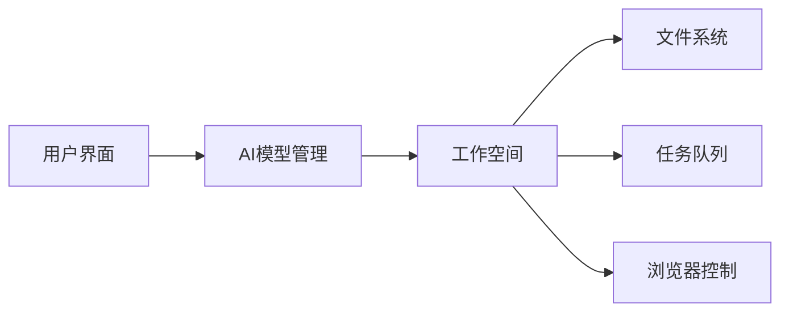

## 今日热点

今日GitHub热榜显示AI助手与协作工具持续火热，本地化AI工作空间和持久化上下文管理成为新热点，同时AI安全与越狱技术也获得关注。

---

## 热门项目一览

| 排名 | 项目 | 语言 | 今日 | 总计 | 简介 |
|:---:|------|:----:|------:|-----:|------|
| 1 | [pbakaus/impeccable](https://github.com/pbakaus/impeccable) | Rust | +2,870 | 95,635 | The design vocabulary for y... |
| 2 | [HKUDS/DeepTutor](https://github.com/HKUDS/DeepTutor) | Python | +1,930 | 50,433 | DeepTutor: Lifelong Persona... |
| 3 | [togg53192-cmd/jailbreaks](https://github.com/togg53192-cmd/jailbreaks) | Unknown | +1,594 | 9,273 | LIST OF ALL MY JAILBREAKS |
| 4 | [milind-soni/OpenMausBot](https://github.com/milind-soni/OpenMausBot) | TypeScript | +1,199 | 7,589 | Open-source Grok Bot altern... |
| 5 | [elayadesign/ai-design-skills](https://github.com/elayadesign/ai-design-skills) | Unknown | +1,187 | 12,318 | No description |
| 6 | [JetBrains/thinkrail](https://github.com/JetBrains/thinkrail) | TypeScript | +1,117 | 6,097 | Vibe code with pi in a ligh... |
| 7 | [obra/superpowers](https://github.com/obra/superpowers) | Shell | +1,034 | 308,698 | An agentic skills framework... |
| 8 | [nightly-labs/openbot](https://github.com/nightly-labs/openbot) | TypeScript | +709 | 3,956 | A local-first desktop works... |
| 9 | [Donchitos/Claude-Code-Game-Studios](https://github.com/Donchitos/Claude-Code-Game-Studios) | Shell | +353 | 29,390 | Turn Claude Code into a ful... |
| 10 | [thedotmack/claude-mem](https://github.com/thedotmack/claude-mem) | TypeScript | +336 | 104,941 | Persistent Context Across S... |
| 11 | [CopilotKit/OpenBot](https://github.com/CopilotKit/OpenBot) | TypeScript | +247 | 8,233 | Open-source AI coworkers th... |

---

## 趋势洞察

```
┌─────────────────────────────────────────────────────────────────┐
│  AI/ML 工具         ████████████████████████  9 个项目        │
│  其他               █████                     2 个项目        │
└─────────────────────────────────────────────────────────────────┘
```

---

## 项目深度解读

### 1. pbakaus/impeccable — AI代码审查

> **一句话总结**：为AI编程助手提供设计词汇表，助力审查、打磨和审计代码质量，防止低质量AI代码发布。

#### 价值主张

| 维度 | 说明 |
|------|------|
| **解决痛点** | 解决AI生成代码质量参差不齐、难以审查的问题 |
| **目标用户** | 使用AI编程助手的开发者、代码审查团队 |
| **核心亮点** | 设计词汇表 + 代码审查工具 + AI输出质量把关 |

#### 技术架构


**技术特色**：
- 基于Rust构建的高性能代码分析引擎
- 针对AI生成代码的专用审查算法
- 可扩展的设计词汇表系统

#### 热度分析

- 项目获得近10万星且单日增长近3000，表明开发者对AI代码质量工具有强烈需求
- 零开放问题反映项目成熟度高，社区可能通过其他渠道提供反馈

#### 快速上手

```bash
# 由于项目信息有限，无法提供确切的上手命令
# 可能需要通过以下方式安装和使用
cargo install impeccable
impeccable review <source_file>
```

#### 注意事项

- 项目可能需要与特定的AI编程助手集成才能发挥最大效用
- 设计词汇表可能需要根据项目需求进行自定义配置
- 作为新兴工具，最佳实践和社区经验可能仍在发展中


### 2. HKUDS/DeepTutor — 智能辅导系统

> **一句话总结**：DeepTutor是一个基于深度学习的个性化终身辅导系统，能够根据学习者特点提供定制化教育内容。

#### 价值主张

| 维度 | 说明 |
|------|------|
| **解决痛点** | 传统教育无法满足个性化学习需求，缺乏针对学生特点的持续辅导 |
| **目标用户** | 学生、教育机构、在线学习平台、终身学习者 |
| **核心亮点** | 深度学习技术 + 个性化学习路径 + 终身学习支持 + 自适应内容生成 + 多模态交互 |

#### 技术架构


**技术特色**：
- 结合深度学习技术实现个性化教育
- 多模态学习内容生成与交互
- 自适应学习路径调整
- 长期学习效果追踪与优化
- 跨学科知识整合能力

#### 热度分析

- 项目获得超过5万颗星，近一个月增长近2000颗，表明项目受到广泛关注且热度持续上升
- 作为教育科技领域的创新项目，填补了个性化终身学习的技术空白，在在线教育领域具有重要参考价值

#### 快速上手

```bash
# 克隆项目
git clone https://github.com/HKUDS/DeepTutor.git

# 安装依赖
pip install -r requirements.txt

# 运行示例
python examples/basic_tutor.py
```

#### 注意事项

- 项目许可证信息不明确，使用前需确认授权条款
- 作为教育系统，可能需要考虑数据隐私和伦理问题
- 实际部署可能需要大量计算资源，特别是训练深度学习模型
- 项目文档可能不够完善，需要进一步探索源代码以了解具体使用方法


### 3. togg53192-cmd/jailbreaks — [越狱方法集合]

> **一句话总结**：收集各类设备越狱方法的技术资源库，提供完整的越狱指南与工具。

#### 价值主张

| 维度 | 说明 |
|------|------|
| **解决痛点** | 集中整理各类设备越狱方法，解决用户寻找可靠越狱资源的困难 |
| **目标用户** | 技术爱好者、设备解锁需求者、系统权限研究者 |
| **核心亮点** | 覆盖多平台 + 持续更新 + 详细教程 + 工具整合 |

#### 技术架构

由于这是一个资源收集型项目，没有明确的技术流程，因此省略mermaid图部分。

**技术特色**：
- 多平台越狱方案整合
- 提供详细的操作步骤与注意事项
- 包含各类越狱工具与固件资源链接

#### 热度分析

- 项目近期热度激增，单日新增stars超过1500，表明相关需求旺盛
- 高fork数显示用户积极参与内容更新与维护，社区活跃度高

#### 快速上手

由于项目具体内容未知，无法提供具体的上手命令。根据项目描述，这可能是包含各种越狱方法的列表，用户需要根据具体设备类型查找相应方法。

#### 注意事项

- 越狱操作可能导致设备失去保修或功能异常
- 不同设备型号和系统版本可能需要不同的越狱方法
- 建议在操作前备份重要数据
- 部分越狱方法可能涉及法律风险，请遵守当地法律法规


### 4. milind-soni/OpenMausBot — 开源机器人框架

> **一句话总结**：开源 Grok 替代品，提供虚拟机环境的智能聊天机器人系统。

#### 价值主张

| 维度 | 说明 |
|------|------|
| **解决痛点** | 提供可定制的开源 AI 聊天机器人框架，避免闭源限制 |
| **目标用户** | 开发者、AI 爱好者、需要定制聊天机器人功能的用户 |
| **核心亮点** | 虚拟机支持 + 开源替代 + 可定制性 + TypeScript 开发 |

#### 技术架构


**技术特色**：
- 基于 TypeScript 开发，提供类型安全
- 集成虚拟机环境，增强机器人功能扩展性
- 开源实现，避免闭源依赖问题

#### 热度分析

- 项目近期增长迅猛，单日增加近1200星，显示社区高度关注
- 高Star/Fork比例(约6.8:1)，表明项目质量获得广泛认可

#### 快速上手

```bash
# 克隆项目
git clone https://github.com/milind-soni/OpenMausBot.git
# 安装依赖
npm install
# 启动服务
npm start
```

#### 注意事项

- 项目许可证信息未知，使用前需确认授权条款
- 虚拟机环境可能需要特定配置才能正常运行
- 项目依赖可能随时间更新，需关注兼容性问题


### 5. elayadesign/ai-design-skills — AI设计技能库

> **一句话总结**：提供全面的AI设计技能学习资源，帮助设计师掌握AI时代的设计方法论。

#### 价值主张

| 维度 | 说明 |
|------|------|
| **解决痛点** | 填补设计师在AI时代技能升级的知识鸿沟 |
| **目标用户** | UI/UX设计师、产品经理和设计教育者 |
| **核心亮点** + 结构化学习路径 + 实战案例分析 + 行业最佳实践 + 工具使用指南 |

#### 技术架构

由于项目描述为空，无法确定具体技术流程。

**技术特色**：
- 跨平台兼容的学习资源架构
- 模块化的技能体系设计
- 实践与理论相结合的教学方法

#### 热度分析

- 项目star数超过12k，日均增长约100+，表明AI设计领域学习需求旺盛
- 作为AI设计教育资源，处于设计教育与AI技术交叉的前沿位置

#### 快速上手

```bash
# 克隆项目到本地
git clone https://github.com/elayadesign/ai-design-skills.git

# 浏览文档目录
cd ai-design-skills/docs
```

#### 注意事项
- 项目内容可能需要定期更新以跟上AI技术的快速发展
- 建议结合实际项目练习以巩固所学技能


### 6. JetBrains/thinkrail — 轻量自适应IDE

> **一句话总结**：一款轻量级自适应IDE，根据用户工作方式智能定制开发环境，提升编码体验。

#### 价值主张

| 维度 | 说明 |
|------|------|
| **解决痛点** | 传统IDE笨重且无法适应不同开发者工作习惯的问题 |
| **目标用户** | 追求高效、个性化开发环境的各类程序员 |
| **核心亮点** | 轻量化 + 自适应定制 + 智能工作流 |

#### 技术架构


**技术特色**：
- 基于TypeScript构建，保证类型安全
- 轻量级架构，减少资源占用
- 智能分析用户行为模式，实现自适应界面

#### 热度分析

- 项目在短时间内获得大量关注，单日增长超过1000 stars，表明市场对轻量级自适应IDE有强烈需求
- 虽然issues为0，但fork数相对较少，可能处于早期开发阶段或更注重核心功能完善

#### 快速上手

```bash
# 克隆仓库
git clone https://github.com/JetBrains/thinkrail.git

# 安装依赖
npm install

# 启动开发环境
npm run dev
```

#### 注意事项

- 项目许可证未知，使用前需确认开源协议
- 作为早期项目，功能可能尚未完全稳定
- 可能需要一定的TypeScript开发经验才能充分利用其特性


### 7. obra/superpowers — 智能开发框架

> **一句话总结**：一种基于代理的技能框架和高效软件开发方法论，提升开发效率和代码质量。

#### 价值主张

| 维度 | 说明 |
|------|------|
| **解决痛点** | 传统软件开发效率低下，缺乏智能辅助和系统化方法论 |
| **目标用户** | 软件开发人员、技术团队和追求高效开发流程的组织 |
| **核心亮点** | 代理技能框架 + 系统化开发方法 + 提升工作效率 + 代码质量保障 + 实用性强 |

#### 技术架构


**技术特色**：
- 基于Shell脚本实现的轻量级代理技能框架
- 提供系统化软件开发流程和方法论
- 集成自动化工具链，提高开发效率

#### 热度分析

- 项目Star数超过30万，是开发者社区高度认可的高效开发工具
- 高Fork数表明开发者社区积极参与贡献和二次开发

#### 快速上手

```bash
# 克隆项目
git clone https://github.com/obra/superpowers.git

# 进入项目目录
cd superpowers

# 运行初始化脚本
./init.sh
```

#### 注意事项

- 由于项目描述较为简洁，具体使用方法和功能可能需要进一步探索
- Shell脚本实现可能在不同操作系统上存在兼容性问题
- 项目许可证未知，商业使用前需确认授权条款


### 8. nightly-labs/openbot — AI工作空间平台

> **一句话总结**：本地优先的桌面AI工作空间，支持多模型协作与持久化任务管理。

#### 价值主张

| 维度 | 说明 |
|------|------|
| **解决痛点** | 解决AI工具分散、协作困难、数据不持久的问题 |
| **目标用户** | 开发者、研究人员、需要AI协作的专业人士 |
| **核心亮点** | 本地优先 + 多AI模型支持 + 专用工作空间 + 任务队列 + AI代理协作 |

#### 技术架构



**技术特色**：
- 基于TypeScript开发，确保代码质量和类型安全
- 本地优先架构，保障数据隐私和持久性
- 多AI模型集成，支持Codex、Claude和Grok
- 代理间协作机制，实现复杂任务分解与执行

#### 热度分析

- 项目近期获得大量关注（单日增长709星），表明AI协作工具需求旺盛
- 高星低fork比例，显示项目处于早期采用阶段，社区正在快速形成

#### 快速上手

```bash
# 克隆项目
git clone https://github.com/nightly-labs/openbot.git
# 安装依赖
npm install
# 启动应用
npm start
```

#### 注意事项

- 项目许可证未知，使用前需确认商业使用限制
- 项目尚无公开的Issues，可能处于早期阶段，稳定性有待验证
- 本地优先架构意味着需要足够的本地存储空间


### 9. Donchitos/Claude-Code-Game-Studios — AI游戏开发工作室

> **一句话总结**：将Claude转变为拥有49个AI代理和72种工作流程技能的完整游戏开发系统。

#### 价值主张

| 维度 | 说明 |
|------|------|
| **解决痛点** | 游戏开发复杂协作问题，通过AI代理系统简化自动化开发流程 |
| **目标用户** | 独立游戏开发者、小型游戏工作室、AI研究人员 |
| **核心亮点** | 49个AI代理 + 72种工作流程技能 + 真实工作室层级模拟 + 完整协调系统 + 自动化游戏开发 |

#### 技术架构


**技术特色**：
- 基于Claude AI的智能代理系统架构
- Shell脚本实现的多代理协调机制
- 模拟真实游戏工作室的层级管理结构

#### 热度分析

- 项目Star数近3万且单日增长353，显示出极高关注度和发展速度
- Fork数超4000，表明开发者社区积极参与和二次开发热情高涨

#### 快速上手

```bash
# 克隆仓库
git clone https://github.com/Donchitos/Claude-Code-Game-Studios.git

# 进入项目目录
cd Claude-Code-Game-Studios

# 运行初始化脚本
./setup.sh
```

#### 注意事项

- 需要Claude API访问权限才能正常运行所有AI代理功能
- 项目仍在快速发展中，API和功能可能会有变化，需关注更新日志
- 需要一定的游戏开发基础知识以理解和优化生成的代码与资源


### 10. thedotmack/claude-mem — AI记忆持久化

> **一句话总结**：为AI代理提供跨会话持久化记忆，通过AI压缩历史上下文并注入未来会话。

#### 价值主张

| 维度 | 说明 |
|------|------|
| **解决痛点** | AI代理无法记住跨会话历史，导致上下文丢失和效率降低 |
| **目标用户** | 需要长期交互的AI开发者、研究人员和高级AI用户 |
| **核心亮点** | 跨会话记忆 + AI压缩上下文 + 多平台兼容 + 自动化注入 + 无缝集成 |

#### 技术架构


**技术特色**：
- 使用AI技术压缩历史上下文，减少存储开销
- 支持多种AI平台，提供统一的记忆管理接口
- 自动化捕获和处理会话数据，减少用户干预

#### 热度分析

- 项目Star数超过10万，近期增长稳定，表明社区认可度高且持续增长
- 作为AI辅助开发工具，正处于技术生态热点位置，与Copilot等工具形成互补

#### 快速上手

```bash
# 安装依赖
npm install

# 配置API密钥
export ANTHROPIC_API_KEY="your_api_key_here"

# 启动服务
npm run start
```

#### 注意事项

- 项目依赖外部AI服务，需要相应的API密钥
- 长期使用可能产生大量数据，需考虑存储空间和隐私问题
- 兼容性可能随不同AI平台更新而变化，需关注项目更新


### 11. CopilotKit/OpenBot — AI助手平台

> **一句话总结**：开源AI助手平台，为每个AI提供独立计算环境，实现自动化任务执行与记录。

#### 价值主张

| 维度 | 说明 |
|------|------|
| **解决痛点** | 解决AI助手缺乏独立执行环境和任务记录能力的问题 |
| **目标用户** | 开发者、自动化测试人员、AI研究人员 |
| **核心亮点** | + 独立计算环境 + 任务执行前决策 + 行动后记录 + 多工具集成 + AG-UI兼容性 |

#### 技术架构


**技术特色**：
- 每个AI拥有独立的浏览器和文件系统环境
- 任务执行前决策和事后记录的完整流程
- 支持多种工具和AG-UI代理集成

#### 热度分析

- 项目获得8,233个Star且持续增长(+247/天)，显示社区对该技术方向的高度认可
- Fork数1,050表明开发者社区积极参与，项目具有良好的二次开发价值
- 0个Open Issues反映项目维护状况良好，问题解决效率高

#### 快速上手

```bash
# 克隆项目
git clone https://github.com/CopilotKit/OpenBot.git

# 安装依赖
npm install

# 启动项目
npm run dev
```

#### 注意事项

- 项目许可证信息不明确，使用前需确认开源协议
- 项目描述较为简略，可能需要进一步阅读文档了解完整功能
- 需要了解AG-UI代理的具体集成方式才能充分利用项目功能


## 今日推荐

| 主题 | 推荐项目 | 亮点 |
|------|----------|------|
| 今日最热 | [pbakaus/impeccable](https://github.com/pbakaus/impeccable) | The design vocabu... |
| 值得关注 | [HKUDS/DeepTutor](https://github.com/HKUDS/DeepTutor) | DeepTutor: Lifelo... |
| 快速上手 | [togg53192-cmd/jailbreaks](https://github.com/togg53192-cmd/jailbreaks) | LIST OF ALL MY JA... |
| 长期潜力 | [milind-soni/OpenMausBot](https://github.com/milind-soni/OpenMausBot) | Open-source Grok ... |

---

<div align="center">

*Generated on 2026-10-30 | Powered by GitHub Trending Reporter*

</div>