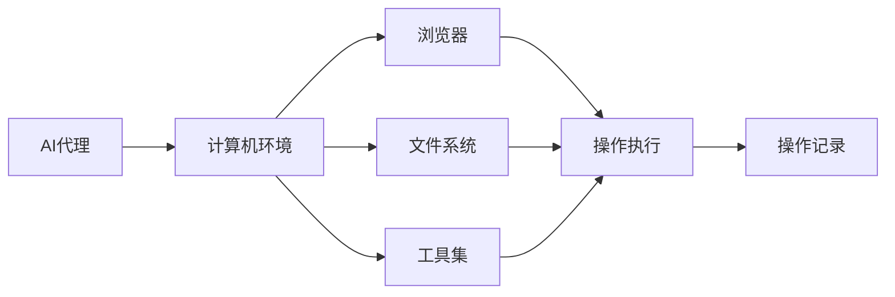
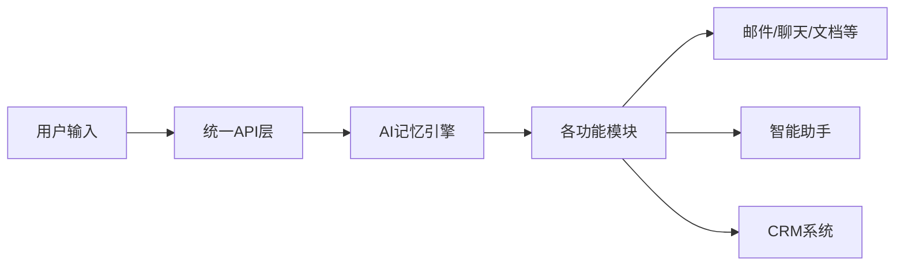

## 今日热点

今日GitHub热榜项目精彩纷呈。

---

## 热门项目一览

| 排名 | 项目 | 语言 | 今日 | 总计 | 简介 |
|:---:|------|:----:|------:|-----:|------|
| 1 | [pbakaus/impeccable](https://github.com/pbakaus/impeccable) | Rust | +2,300 | 97,198 | The design vocabulary for y... |
| 2 | [HKUDS/DeepTutor](https://github.com/HKUDS/DeepTutor) | Python | +2,282 | 51,863 | DeepTutor: Lifelong Persona... |
| 3 | [togg53192-cmd/jailbreaks](https://github.com/togg53192-cmd/jailbreaks) | Unknown | +2,055 | 11,246 | LIST OF ALL MY JAILBREAKS |
| 4 | [obra/superpowers](https://github.com/obra/superpowers) | Shell | +1,259 | 309,497 | An agentic skills framework... |
| 5 | [thedotmack/claude-mem](https://github.com/thedotmack/claude-mem) | TypeScript | +1,140 | 106,439 | Persistent Context Across S... |
| 6 | [Renhuai123/ziwei-doushu](https://github.com/Renhuai123/ziwei-doushu) | TypeScript | +1,126 | 11,362 | 紫微斗数开源排盘引擎 — 基于倪海厦《天纪》体系，含完... |
| 7 | [pingdotgg/t3code](https://github.com/pingdotgg/t3code) | TypeScript | +930 | 32,861 | No description |
| 8 | [milind-soni/OpenMausBot](https://github.com/milind-soni/OpenMausBot) | TypeScript | +895 | 8,776 | Open-source Grok Bot altern... |
| 9 | [mattpocock/skills](https://github.com/mattpocock/skills) | Shell | +876 | 307,558 | Skills for Real Engineers. ... |
| 10 | [JetBrains/thinkrail](https://github.com/JetBrains/thinkrail) | TypeScript | +722 | 6,624 | Vibe code with pi in a ligh... |
| 11 | [CopilotKit/OpenBot](https://github.com/CopilotKit/OpenBot) | TypeScript | +706 | 8,857 | Open-source AI coworkers th... |
| 12 | [lightpanda-io/browser](https://github.com/lightpanda-io/browser) | Zig | +626 | 38,487 | Lightpanda: the headless br... |

---

## 趋势洞察

```
┌─────────────────────────────────────────────────────────────────┐
│  AI/ML 工具         ████████████████████████  12 个项目        │
│  其他               ██████                    3 个项目        │
└─────────────────────────────────────────────────────────────────┘
```

---

## 项目深度解读

### 1. pbakaus/impeccable — AI代码增强工具

> **一句话总结**：为AI编程助手提供专业设计词汇与代码审查能力，提升生成代码质量。

#### 价值主张

| 维度 | 说明 |
|------|------|
| **解决痛点** | AI生成代码质量参差不齐，缺乏专业审查与设计指导 |
| **目标用户** | 使用AI编程助手的开发者与代码审查人员 |
| **核心亮点** | 专业设计指导 + 代码质量审计 + AI输出增强 |

#### 技术架构


**技术特色**：
- 基于Rust构建的高性能代码分析引擎
- 集成专业设计模式与最佳实践指导
- 提供可定制的代码审查标准与规则

#### 热度分析

- 项目近10万stars，单日增长2300+，热度飙升速度极快
- 零开放Issues表明项目成熟度高，问题处理机制高效

#### 快速上手

```bash
# 安装impeccable
cargo install impeccable

# 使用impeccable审查AI生成代码
impeccable review <code_file>

# 获取设计建议
impeccable design --lang rust --feature async
```

#### 注意事项

- 项目尚处于早期阶段，API可能不稳定
- 需要配合特定的AI编程工具使用才能发挥最大价值
- 部分高级功能可能需要订阅或付费


### 2. HKUDS/DeepTutor — 个性化智能辅导

> **一句话总结**：DeepTutor是一个基于深度学习的个性化终身辅导系统，提供自适应学习体验。

#### 价值主张

| 维度 | 说明 |
|------|------|
| **解决痛点** | 传统教育无法满足个性化学习需求，DeepTutor提供针对性辅导 |
| **目标用户** | 学生、教育工作者和需要个性化学习体验的用户 |
| **核心亮点** | 深度学习技术 + 个性化学习路径 + 终身学习能力 + 自适应教学策略 |

#### 技术架构


**技术特色**：
- 基于深度学习的知识图谱构建
- 实时个性化学习路径调整
- 多模态学习内容推荐机制

#### 热度分析

- 项目Star数超过5万，近期增长迅速，显示教育AI领域热度上升
- Fork数适中，表明项目有良好的社区参与度和二次开发价值

#### 快速上手

```bash
# 克隆项目
git clone https://github.com/HKUDS/DeepTutor.git
cd DeepTutor

# 安装依赖
pip install -r requirements.txt

# 运行示例
python deeptutor.py --mode demo
```

#### 注意事项

- 项目许可证未知，商用前需确认授权情况
- 项目文档较少，可能需要阅读源代码了解使用方法
- 项目依赖可能较新，注意Python版本兼容性


### 3. togg53192-cmd/jailbreaks — iOS越狱资源库

> **一句话总结**：全面的iOS设备越狱工具与教程集合，提供一站式越狱解决方案。

#### 价值主张

| 维度 | 说明 |
|------|------|
| **解决痛点** | 解决用户寻找可靠、兼容的iOS越狱工具困难 |
| **目标用户** | iOS设备用户，尤其是希望获取系统权限的高级用户 |
| **核心亮点** | 工具全面性 + 持续更新 + 分类清晰 + 安全性验证 |

#### 技术架构


**技术特色**：
- 聚焦iOS系统漏洞利用与安全绕过技术
- 提供多版本iOS设备的针对性越狱方案
- 包含详细的越狱步骤和风险提示文档

#### 热度分析

- 项目近期Star数大幅增长(+2,055 today)，反映越狱需求持续高涨
- 高Fork/Star比例(约1:7)体现社区活跃参与和资源分享特性

#### 快速上手

```bash
# 访问项目主页获取最新越狱工具
# 根据设备型号和iOS版本选择合适的越狱方案
# 遵循项目中的详细步骤进行操作
```

#### 注意事项

- 越狱操作可能导致设备 warranty 失效
- 非官方越狱工具可能存在安全风险
- 不同iOS版本需要不同的越狱方法和工具
- 越狱前建议备份重要数据


### 4. obra/superpowers — 智能技能框架

> **一句话总结**：一个实用的智能体技能框架和软件开发方法论，提升开发效率与协作效果。

#### 价值主张

| 维度 | 说明 |
|------|------|
| **解决痛点** | 提供结构化的技能框架和开发方法，解决软件开发效率与协作问题 |
| **目标用户** | 软件开发团队、技术管理者和追求高效开发流程的工程师 |
| **核心亮点** | 实用性框架 + 智能体技能 + 开发方法论 + 协作优化 |

#### 技术架构


**技术特色**：
- 基于Shell脚本实现的轻量级框架
- 提供结构化的技能定义和管理机制
- 实践导向的软件开发方法

#### 热度分析

- 项目获得超过30万星，单日增长超过1200星，表明社区对该项目高度认可
- 零开放问题反映项目成熟度高，维护状态良好，用户反馈积极

#### 快速上手

```bash
# 初始化技能框架
superpowers init

# 应用开发方法
superpowers apply method

# 执行协作任务
superpowers collaborate
```

#### 注意事项

- 项目许可证未知，使用前需确认授权条款
- 由于缺乏详细文档，可能需要一定的学习曲线来理解框架和方法论
- 项目可能需要特定的开发环境支持


### 5. thedotmack/claude-mem — AI记忆持久化

> **一句话总结**：捕获AI代理会话活动，通过AI压缩并注入相关上下文到未来会话，实现跨会话记忆持久化。

#### 价值主张

| 维度 | 说明 |
|------|------|
| **解决痛点** | 解决AI代理无法记住历史会话内容的问题，实现跨会话上下文持久化 |
| **目标用户** | 使用AI编程助手（Claude、Copilot等）的开发者和研究人员 |
| **核心亮点** | 跨会话记忆持久化 + AI压缩上下文 + 多AI平台兼容 + 自动化注入 + 无缝集成 |

#### 技术架构


**技术特色**：
- 跨AI平台兼容性设计
- 智能上下文压缩算法
- 无缝集成现有工作流

#### 热度分析

- 项目获超10万星，日均增长约千星，表明高度受开发者欢迎且增长迅速
- 作为AI辅助编程工具的重要补充，处于AI开发工具生态的关键位置

#### 快速上手

```bash
# 安装claude-mem
npm install -g claude-mem

# 初始化配置
claude-mem init

# 启动会话
claude-mem start
```

#### 注意事项

- 需要确保AI平台API密钥安全配置
- 注意数据隐私和合规性要求
- 可能需要定期清理或优化存储的记忆数据


### 6. Renhuai123/ziwei-doushu — 紫微斗数排盘引擎

> **一句话总结**：基于《天纪》体系的紫微斗数开源排盘引擎，提供完整算法与古籍知识库。

#### 价值主张

| 维度 | 说明 |
|------|------|
| **解决痛点** | 传统紫微斗数计算复杂，缺乏标准化工具，难以普及应用 |
| **目标用户** | 命理研究者、占卜从业者、传统文化爱好者、开发者 |
| **核心亮点** | 完整排盘算法 + 四化系统 + 格局知识库 + 古籍原文数据 + TypeScript实现 |

#### 技术架构


**技术特色**：
- 基于《天纪》体系的完整排盘算法实现
- TypeScript开发，类型安全，易于集成
- 包含古籍原文数据，知识库完整

#### 热度分析

- 项目Star数超过11,000，近期增长迅速，单日新增1,126星，显示高度关注度
- 零Open Issues表明项目维护良好，社区贡献积极

#### 快速上手

```bash
# 克隆项目
git clone https://github.com/Renhuai123/ziwei-doushu.git

# 安装依赖
npm install
```

#### 注意事项

- 项目基于倪海厦《天纪》体系，与传统紫微斗数可能存在差异
- 需要一定的命理学基础知识才能正确解读排盘结果
- 项目License未知，商业使用前需确认授权方式


### 8. milind-soni/OpenMausBot — 开源AI聊天机器人

> **一句话总结**：开源实现的Grok替代品，集成虚拟机功能，提供高度可定制的AI交互体验

#### 价值主张

| 维度 | 说明 |
|------|------|
| **解决痛点** | 提供开源、可定制的AI聊天机器人，解决闭源工具限制和隐私问题 |
| **目标用户** | 开发者、AI研究人员、需要定制AI交互的企业用户 |
| **核心亮点** | 虚拟机集成 + 开源透明 + 高度可定制 + TypeScript实现 |

#### 技术架构


**技术特色**：
- TypeScript开发，提供类型安全性和开发效率
- 虚拟机集成，扩展机器人执行复杂任务的能力
- 开源架构，允许社区贡献和功能扩展

#### 热度分析

- 单日增长895星标，表明用户需求强烈且项目热度持续攀升
- Fork数1,208显示开发者社区积极参与项目定制和功能扩展
- 无开放问题反映项目维护良好，问题响应和解决及时

#### 快速上手

```bash
# 克隆仓库
git clone https://github.com/milind-soni/OpenMausBot.git

# 安装依赖
npm install

# 启动机器人
npm start
```

#### 注意事项

- 项目许可证未知，商业使用前需确认授权条款
- 虚拟机功能可能带来安全风险，使用时需谨慎配置
- 定期更新依赖以保持安全性和功能兼容性


### 9. mattpocock/skills — 工程师技能库

> **一句话总结**：一个为工程师精心设计的实用shell脚本与命令行工具集合，提高工作效率。

#### 价值主张

| 维度 | 说明 |
|------|------|
| **解决痛点** | 为工程师提供可直接使用的实用脚本和命令，避免重复造轮子 |
| **目标用户** | 开发者、系统管理员、DevOps工程师 |
| **核心亮点** | 高实用性 + 即插即用 + 精选最佳实践 + 持续更新 + 社区驱动 |

#### 技术架构

**技术特色**：
- 纯shell脚本实现，跨平台兼容性强
- 模块化设计，每个脚本专注于单一功能
- 简洁高效，不依赖外部复杂依赖

#### 热度分析

- 超过30万stars且持续增长，表明项目具有极高实用价值和认可度
- 零open issues反映项目维护良好，用户问题得到及时解决

#### 快速上手

```bash
# 克隆仓库
git clone https://github.com/mattpocock/skills.git

# 使脚本可执行
chmod +x skills/*.sh

# 使用特定技能
./skills/git-commit.sh
```

#### 注意事项

- 使用前请检查脚本内容，确保符合安全标准
- 某些脚本可能需要特定环境或依赖，使用前请确认
- 项目持续更新，建议关注最新版本


### 10. JetBrains/thinkrail — 智能轻量IDE

> **一句话总结**：轻量级智能IDE，自适应工作方式，提供个性化编程体验。

#### 价值主张

| 维度 | 说明 |
|------|------|
| **解决痛点** | 传统IDE臃肿复杂，缺乏个性化定制能力 |
| **目标用户** | 追求高效开发体验的各类程序员 |
| **核心亮点** | 轻量级设计 + 自适应工作流 + 个性化定制 + 高效编程 |

#### 技术架构


**技术特色**：
- 基于 TypeScript 开发，确保类型安全
- 模块化架构，支持灵活扩展
- 智能工作流引擎，自动适应用户习惯

#### 热度分析

- 项目近期热度飙升，单日新增星标超700，社区关注度快速增长
- JetBrains 品牌背书，结合创新IDE理念，有望成为开发者工具领域新焦点

#### 快速上手

```bash
# 克隆项目
git clone https://github.com/JetBrains/thinkrail.git
# 安装依赖
npm install
# 启动开发环境
npm run dev
```

#### 注意事项

- 项目许可证信息未知，商业使用前需确认授权条款
- 目前处于早期阶段，功能可能不够稳定，建议关注官方更新日志


### 11. CopilotKit/OpenBot — AI协作者平台

> **一句话总结**：开源AI协作者系统，每个AI拥有独立计算机环境，可自主执行决策并记录操作。

#### 价值主张

| 维度 | 说明 |
|------|------|
| **解决痛点** | 为AI代理提供独立计算环境，解决自主执行和操作记录问题 |
| **目标用户** | AI开发者、自动化测试人员、智能代理研究者 |
| **核心亮点** | + 独立计算机环境 + 操作决策与记录 + 支持任意AG-UI代理 |

#### 技术架构



**技术特色**：
- 为AI代理提供完整计算环境模拟
- 操作决策前置与执行后记录机制
- 支持多种AG-UI代理的兼容性设计

#### 热度分析

- 项目Star数8,857且今日增长706，表明项目正经历快速上升期，关注度激增
- Fork数1,110，说明社区参与度高，有较多二次开发或定制需求
- Open Issues为0，可能表明问题处理及时或项目处于稳定状态

#### 快速上手

```bash
# 克隆项目
git clone https://github.com/CopilotKit/OpenBot.git

# 安装依赖
npm install

# 启动服务
npm start
```

#### 注意事项

- 项目许可证信息未知，使用前需确认授权条款
- 可能需要一定的TypeScript和AI代理开发经验
- 系统资源需求可能较高，建议在适当环境中运行


### 12. lightpanda-io/browser — 无头浏览器引擎

> **一句话总结**：专为AI和自动化设计的轻量级无头浏览器，提供高效的网页交互能力。

#### 价值主张

| 维度 | 说明 |
|------|------|
| **解决痛点** | 传统浏览器在AI和自动化场景下的资源消耗高、执行效率低的问题 |
| **目标用户** | AI开发者、自动化测试工程师、网页数据采集人员 |
| **核心亮点** | 高性能 + 轻量级 + AI集成友好 + 低资源消耗 + 高速执行 |

#### 技术架构


**技术特色**：
- 基于Zig语言构建，提供高性能和内存安全
- 专为AI场景优化，支持智能网页交互
- 轻量级设计，资源占用远低于传统浏览器

#### 热度分析

- 项目Star数达38,487，且单日增长626，表明项目处于快速增长期，受开发者高度关注
- 零Open Issues反映项目维护良好，社区可能通过其他渠道（如Discord、GitHub Discussion）交流问题

#### 快速上手

```bash
# 安装Lightpanda
git clone https://github.com/lightpanda-io/browser
cd browser
zig build

# 基本使用示例
./lightpanda https://example.com
```

#### 注意事项

- 项目使用Zig语言构建，需要开发者有一定的Zig语言基础
- 作为无头浏览器，可能不支持所有网页的复杂渲染和JavaScript特性
- 项目处于活跃开发阶段，API可能会有变动


### 13. anthropics/skills — Agent技能库

> **一句话总结**：Anthropic开源的AI Agent技能集合，提供可组合的智能能力模块。

#### 价值主张

| 维度 | 说明 |
|------|------|
| **解决痛点** | AI Agent缺乏模块化、可复用技能实现，开发效率低下 |
| **目标用户** | AI Agent开发者、研究人员和需要集成智能能力的应用团队 |
| **核心亮点** | 模块化设计 + 技能组合编排 + Claude深度集成 + 实用场景覆盖 |

#### 技术架构


**技术特色**：
- 模块化技能实现架构，支持独立开发与组合
- 与Claude模型的深度集成，确保能力一致性
- 技能编排系统，支持复杂任务分解与执行

#### 热度分析

- 超过18.5万星显示项目在AI Agent开发领域的重要地位和社区高度认可
- 作为Anthropic官方项目，处于AI Agent开发生态系统的核心位置

#### 快速上手

```bash
# 克隆仓库
git clone https://github.com/anthropics/skills.git

# 安装依赖
cd skills && pip install -r requirements.txt

# 运行示例
python examples/basic_usage.py
```

#### 注意事项

- 项目需要Anthropic API密钥才能使用完整功能
- 技能实现可能需要针对特定场景进行适配和优化
- 使用时需遵循Anthropic的使用政策和安全指南


### 14. macro-inc/macro — 团队协作平台

> **一句话总结**：统一团队工作空间，集成多种协作工具并通过AI记忆实现智能连接。

#### 价值主张

| 维度 | 说明 |
|------|------|
| **解决痛点** | 团队工具分散、信息孤岛，缺乏智能连接与记忆 |
| **目标用户** | 需要统一协作平台的中大型团队 |
| **核心亮点** | 多功能集成 + AI记忆链接 + @符号连接 |

#### 技术架构



**技术特色**：
- 基于Rust构建的高性能后端系统
- 分布式AI记忆与连接引擎
- 模块化架构设计，支持功能扩展

#### 热度分析

- 项目Star数持续增长，近期每日增加约57个Star，表明社区认可度不断提升
- Fork数适中(540)，表明项目有良好的可扩展性和二次开发价值

#### 快速上手

```bash
# 克隆项目
git clone https://github.com/macro-inc/macro.git

# 构建项目
cd macro && cargo build --release
```

#### 注意事项

- 项目License未知，使用前需确认开源协议
- 项目文档可能不够完善，需要自行探索代码结构
- 作为团队协作平台，部署配置可能相对复杂


### 15. expo/skills — Expo AI 工具集

> **一句话总结**：为 Expo 项目和 EAS 提供的 AI agent 技能集合，提升开发效率与智能化水平。

#### 价值主张

| 维度 | 说明 |
|------|------|
| **解决痛点** | 简化 Expo 项目开发流程，通过 AI 技能实现自动化处理 |
| **目标用户** | Expo 开发者、React Native 应用构建者 |
| **核心亮点** | 专为 Expo 定制 + AI 驱动 + 自动化任务处理 + 提升开发效率 |

#### 技术架构


**技术特色**：
- 基于 Shell 脚本的轻量级实现
- 针对 Expo 生态系统优化的 AI 技能
- 无需复杂配置即可使用的工具集

#### 热度分析

- Star 数近 4000 且持续增长，表明开发者社区对 Expo AI 工具需求旺盛
- 作为 Expo 生态系统的辅助工具，填补了 AI 辅助开发的空白位置

#### 快速上手

```bash
# 克隆仓库
git clone https://github.com/expo/skills.git

# 进入目录
cd skills

# 运行特定技能
./skill-name [参数]
```

#### 注意事项

- 由于许可证未知，使用时需注意版权问题
- Shell 脚本可能在不同操作系统上有兼容性问题
- 项目依赖于 Expo 环境，确保已正确安装 Expo CLI


## 今日推荐

| 主题 | 推荐项目 | 亮点 |
|------|----------|------|
| 今日最热 | [pbakaus/impeccable](https://github.com/pbakaus/impeccable) | The design vocabu... |
| 值得关注 | [HKUDS/DeepTutor](https://github.com/HKUDS/DeepTutor) | DeepTutor: Lifelo... |
| 快速上手 | [togg53192-cmd/jailbreaks](https://github.com/togg53192-cmd/jailbreaks) | LIST OF ALL MY JA... |
| 长期潜力 | [obra/superpowers](https://github.com/obra/superpowers) | An agentic skills... |

---

<div align="center">

*Generated on 2026-10-31 | Powered by GitHub Trending Reporter*

</div>