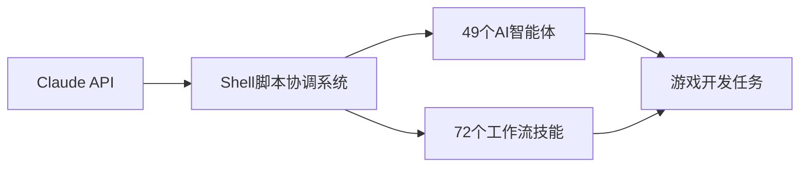
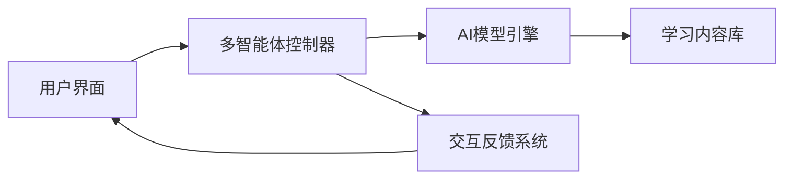

## 今日热点

AI代理生态系统蓬勃发展，从持久化上下文到多代理协作系统；同时垂直领域AI应用加速落地，从游戏开发到传统文化数字化。

---

## 热门项目一览

| 排名 | 项目 | 语言 | 今日 | 总计 | 简介 |
|:---:|------|:----:|------:|-----:|------|
| 1 | [thedotmack/claude-mem](https://github.com/thedotmack/claude-mem) | TypeScript | +1,723 | 107,988 | Persistent Context Across S... |
| 2 | [pbakaus/impeccable](https://github.com/pbakaus/impeccable) | Rust | +1,338 | 98,403 | The design vocabulary for y... |
| 3 | [milind-soni/OpenMausBot](https://github.com/milind-soni/OpenMausBot) | TypeScript | +1,303 | 9,743 | Open-source Grok Bot altern... |
| 4 | [pingdotgg/t3code](https://github.com/pingdotgg/t3code) | TypeScript | +1,148 | 35,787 | No description |
| 5 | [Renhuai123/ziwei-doushu](https://github.com/Renhuai123/ziwei-doushu) | TypeScript | +1,092 | 12,375 | 紫微斗数开源排盘引擎 — 基于倪海厦《天纪》体系，含完... |
| 6 | [Orkas-AI/Orkas](https://github.com/Orkas-AI/Orkas) | JavaScript | +1,044 | 6,512 | Orkas is an open-source (MI... |
| 7 | [HKUDS/DeepTutor](https://github.com/HKUDS/DeepTutor) | Python | +1,034 | 52,942 | DeepTutor: Lifelong Persona... |
| 8 | [lightpanda-io/browser](https://github.com/lightpanda-io/browser) | Zig | +929 | 39,320 | Lightpanda: the headless br... |
| 9 | [mattpocock/skills](https://github.com/mattpocock/skills) | Shell | +883 | 308,509 | Skills for Real Engineers. ... |
| 10 | [Donchitos/Claude-Code-Game-Studios](https://github.com/Donchitos/Claude-Code-Game-Studios) | Shell | +742 | 31,259 | Turn Claude Code into a ful... |
| 11 | [obra/superpowers](https://github.com/obra/superpowers) | Shell | +665 | 310,126 | An agentic skills framework... |
| 12 | [vorssaint/vorssaint-utils](https://github.com/vorssaint/vorssaint-utils) | Swift | +501 | 31,974 | Free and open-source macOS ... |

---

## 趋势洞察

```
┌─────────────────────────────────────────────────────────────────┐
│  AI/ML 工具         ████████████████████████  10 个项目        │
│  其他               █████████                 4 个项目        │
└─────────────────────────────────────────────────────────────────┘
```

---

## 项目深度解读

### 1. thedotmack/claude-mem — AI上下文持久化

> **一句话总结**：为AI助手提供跨会话上下文记忆，自动捕获、压缩并注入历史交互，提升连续对话体验。

#### 价值主张

| 维度 | 说明 |
|------|------|
| **解决痛点** | AI助手缺乏长期记忆，无法在会话间保持上下文连贯性 |
| **目标用户** | 需要长期、连贯交互的开发者和AI助手重度使用者 |
| **核心亮点** | 自动捕获会话内容 + AI压缩上下文 + 多平台支持 + 无缝集成 |

#### 技术架构


**技术特色**：
- 使用AI智能压缩上下文信息，减少冗余
- 支持多种AI助手平台，通用性强
- 轻量级实现，不影响原有助手性能

#### 热度分析

- 项目Star数超10万，近期日均增长1700+，热度呈指数级上升
- 作为AI辅助工具生态的关键组件，社区贡献活跃，生态位重要

#### 快速上手

```bash
# 克隆仓库
git clone https://github.com/thedotmack/claude-mem.git

# 安装依赖
npm install

# 配置环境变量
cp .env.example .env
```

#### 注意事项

- 需要谨慎处理用户隐私和数据安全问题
- 可能需要根据不同AI助手平台进行特定配置
- 压缩算法可能需要定期优化以适应不同类型的对话内容


### 2. pbakaus/impeccable — AI代码审查工具

> **一句话总结**：为AI辅助编程提供设计词汇和审查机制，确保代码质量与一致性。

#### 价值主张

| 维度 | 说明 |
|------|------|
| **解决痛点** | 解决AI生成代码质量参差不齐、风格不一致的问题 |
| **目标用户** | 使用AI辅助编程的开发者和团队 |
| **核心亮点** | 设计词汇库 + 代码审查机制 + AI生成内容过滤 |

#### 技术架构


**技术特色**：
- 基于Rust构建的高性能代码分析引擎
- 提供可扩展的设计词汇库系统
- 集成AI生成内容的智能审查机制

#### 热度分析

- 项目Star数近10万，近期增长迅速，显示开发者社区对其高度认可
- 作为AI辅助编程领域的重要工具，在开发者生态中占据重要位置

#### 快速上手

```bash
# 安装impeccable
cargo install impeccable

# 使用impeccable审查代码
impeccable review your_code.rs

# 创建自定义设计词汇
impeccable vocab create my_style.toml
```

#### 注意事项

- 项目License未知，可能存在使用限制
- 作为AI辅助工具，需要正确配置才能发挥最大效用
- 可能需要与特定的AI编程工具集成才能使用完整功能


### 3. milind-soni/OpenMausBot — 开源机器人框架

> **一句话总结**：提供开源的 Grok 替代方案，通过虚拟机技术增强机器人执行能力

#### 价值主张

| 维度 | 说明 |
|------|------|
| **解决痛点** | 提供可自托管的开源聊天机器人，避免依赖封闭平台和API限制 |
| **目标用户** | 开发者、AI爱好者、需要私有化部署AI助力的企业和个人 |
| **核心亮点** | 虚拟机支持 + 开源架构 + 自托管能力 + 可扩展设计 |

#### 技术架构


**技术特色**：
- 基于 TypeScript 开发，提供类型安全保障
- 内置虚拟机环境，支持复杂任务执行
- 开源架构，允许深度定制和扩展

#### 热度分析

- 项目获得近万星且单日增长1300+，表明近期有重大更新或获得广泛关注
- 零 open issues 可能显示项目已成熟或问题处理高效，社区反馈机制完善

#### 快速上手

```bash
# 克隆仓库
git clone https://github.com/milind-soni/OpenMausBot.git

# 安装依赖
npm install

# 启动项目
npm start
```

#### 注意事项

- 项目许可证未知，使用前需确认授权条款
- 虚拟机环境可能需要较高硬件配置
- 作为 Grok 替代品，可能需要了解相关模型和API知识


### 4. pingdotgg/t3code — [T3全栈框架]

> **一句话总结**：T3 App是结构化的Next.js全栈开发框架，提供类型安全与开箱即用的最佳实践。

#### 价值主张

| 维度 | 说明 |
|------|------|
| **解决痛点** | 解决Next.js项目结构混乱、配置不统一、类型安全问题 |
| **目标用户** | 寻求高效、规范开发的Next.js团队与个人开发者 |
| **核心亮点** | 类型安全 + 结构化项目 + 内置最佳实践 + 简化配置 + 全栈一体化 |

#### 技术架构


**技术特色**：
- 基于Zod的端到端类型安全验证
- 集成Prisma与数据库最佳实践
- 模块化架构支持渐进式采用
- 内置身份验证与授权系统
- 服务端渲染与API路由统一架构

#### 热度分析

- 项目Star数超过3.5万，月增长约3000+，处于快速上升期
- 在Next.js生态中占据重要位置，成为全栈开发新标准

#### 快速上手

```bash
# 创建新项目
npx create-t3-app@latest my-app

# 进入项目目录
cd my-app

# 启动开发服务器
npm run dev
```

#### 注意事项
- 需要TypeScript基础知识
- 项目结构较为固定，定制化需要一定学习成本
- 部分功能依赖特定数据库，迁移可能需要额外工作


### 5. Renhuai123/ziwei-doushu — 紫微斗数排盘引擎

> **一句话总结**：开源紫微斗数排盘引擎，完整实现传统命理算法，支持古籍数据与四化系统

#### 价值主张

| 维度 | 说明 |
|------|------|
| **解决痛点** | 提供开源、完整的紫微斗数排盘算法，打破传统命理软件封闭壁垒 |
| **目标用户** | 命理研究者、传统文化爱好者、算法开发者、占卜从业者 |
| **核心亮点** | 基于古籍体系 + 完整算法实现 + 四化系统 + 知识库支持 + TypeScript开发 |

#### 技术架构


**技术特色**：
- 基于倪海厦《天纪》体系的完整算法实现
- TypeScript开发，类型安全，易于集成
- 包含古籍原文数据，保证传统准确性
- 模块化设计，支持灵活扩展

#### 热度分析

- 项目Star数达1.2万，近期增长迅速，日均新增近百Star，表明传统文化算法类项目在技术社区受到高度关注
- Fork数2.4千，表明项目被广泛用于二次开发和研究，在传统文化数字化领域具有重要生态地位

#### 快速上手

```bash
# 克隆项目
git clone https://github.com/Renhuai123/ziwei-doushu.git

# 安装依赖
npm install

# 运行示例
npm run example
```

#### 注意事项

- 项目基于特定流派(倪海厦《天纪》体系)的算法，与其他流派可能存在差异
- 使用时需注意传统文化算法的局限性和伦理考量
- 项目License不明确，商业使用前需确认授权情况


### 6. Orkas-AI/Orkas — [桌面AI团队]

> **一句话总结**：本地优先的桌面AI团队助手，通过指挥者角色协调多个专业AI代理实现自动化任务处理。

#### 价值主张

| 维度 | 说明 |
|------|------|
| **解决痛点** | 将复杂目标分解为可执行任务，协调多个AI代理完成工作流程 |
| **目标用户** | 需要AI辅助提高效率的开发者、研究人员和知识工作者 |
| **核心亮点** | 本地优先 + 多代理协作 + 自定义模型支持 + 任务自动化 + 跨平台支持 |

#### 技术架构


**技术特色**：
- 基于JavaScript构建的跨平台桌面应用
- 集成多种AI模型，支持自定义API密钥
- 本地优先架构，保护数据隐私
- 模块化代理设计，支持16个内置专家
- 定时自动化和项目管理系统

#### 热度分析

- 项目获得6512颗星，单日增长1044，表明近期受到广泛关注和认可
- 作为开源AI工具生态中的重要一环，填补了本地AI团队协作的空白

#### 快速上手

```bash
# 克隆项目
git clone https://github.com/Orkas-AI/Orkas.git

# 安装依赖
npm install

# 启动应用
npm start
```

#### 注意事项

- 项目目前许可证信息不明确，使用前需确认开源许可条款
- 需要配置AI模型API密钥才能使用外部模型功能
- 项目处于快速发展阶段，API和功能可能会有较大变化


### 7. HKUDS/DeepTutor — 智能教育系统

> **一句话总结**：基于深度学习的个性化终身辅导系统，提供自适应学习体验。

#### 价值主张

| 维度 | 说明 |
|------|------|
| **解决痛点** | 解决大规模教育中个性化辅导不足的问题 |
| **目标用户** | 学生、教育机构和在线学习平台 |
| **核心亮点** | 深度学习驱动 + 终身学习支持 + 自适应学习路径 |

#### 技术架构


**技术特色**：
- 基于深度学习的个性化推荐算法
- 自适应学习路径规划系统
- 多模态学习内容生成技术

#### 热度分析

- 超过5万星且持续增长，在教育AI领域具有重要影响力
- 无开放问题，表明项目已成熟或社区通过其他渠道交流

#### 快速上手

```bash
# 克隆项目
git clone https://github.com/HKUDS/DeepTutor.git

# 安装依赖
pip install -r requirements.txt
```

#### 注意事项

- 需要确认开源协议使用权限
- 可能需要大量计算资源运行深度学习模型
- 可能需要特定数据集进行模型训练


### 8. lightpanda-io/browser — AI无头浏览器

> **一句话总结**：Lightpanda 是专为AI和自动化设计的高性能无头浏览器，提供强大的网页交互能力。

#### 价值主张

| 维度 | 说明 |
|------|------|
| **解决痛点** | 传统浏览器资源占用高、难以程序化控制，无法满足AI大规模网页交互需求 |
| **目标用户** | AI开发者、自动化测试工程师、网页数据采集人员 |
| **核心亮点** | 高性能无头浏览器 + AI优化设计 + 低资源占用 + 程序化控制能力 |

#### 技术架构


**技术特色**：
- 使用Zig语言编写，提供高性能和内存安全
- 专为AI场景优化的无头浏览器架构
- 轻量级设计，资源占用远低于传统浏览器

#### 热度分析

- 项目获得近4万星，单日增长900+，表明项目受到广泛关注和认可
- 零开放问题，说明项目维护良好，或问题处理机制高效

#### 快速上手

```bash
# 安装Lightpanda
git clone https://github.com/lightpanda-io/browser
cd browser
zig build
```

#### 注意事项

- 项目使用Zig语言，需要开发者熟悉Zig或愿意学习
- 作为无头浏览器，可能不支持所有传统浏览器的功能
- 许可证未知，商业使用前需确认授权方式


### 9. mattpocock/skills — 工程师技能库

> **一句话总结**：一个包含实用Shell脚本的工程师工具集，提升命令行工作效率

#### 价值主张

| 维度 | 说明 |
|------|------|
| **解决痛点** | 解决工程师日常命令行操作效率低的问题 |
| **目标用户** | 命令行频繁使用的开发者、系统管理员 |
| **核心亮点** | 即插即用脚本 + 高效命令组合 + 实用工具集 |

#### 技术架构


**技术特色**：
- 基于Shell脚本，跨平台兼容性好
- 模块化设计，便于按需使用
- 精简高效，资源占用低

#### 热度分析

- 高星项目，308k+ stars表明获得广泛认可，每日新增近900 stars
- 作为实用工具集，在开发者社区中有重要影响力

#### 快速上手

```bash
# 克隆项目
git clone https://github.com/mattpocock/skills.git
# 进入目录
cd skills
# 查看可用脚本
ls -la
# 执行需要的脚本
./script-name
```

#### 注意事项

- 使用前需确保系统已安装必要的Shell环境
- 部分脚本可能需要根据个人环境进行适当调整
- 建议在使用前查看每个脚本的具体说明


### 10. Donchitos/Claude-Code-Game-Studios — AI游戏工作室

> **一句话总结**：将Claude转变为拥有49个智能体和72项技能的完整游戏开发工作室系统。

#### 价值主张

| 维度 | 说明 |
|------|------|
| **解决痛点** | 解决游戏开发中AI协作效率低、角色分工不明确的问题 |
| **目标用户** | 独立游戏开发者、小型游戏工作室、AI技术探索者 |
| **核心亮点** | 49个AI智能体 + 72个工作流技能 + 完整协调系统 + 真实工作室层级模拟 |

#### 技术架构



**技术特色**：
- 基于Shell脚本的轻量级协调系统
- 模拟真实游戏开发工作室的组织架构
- 通过API调用实现多AI智能体协同工作
- 完整的工作流技能体系支持游戏开发全流程

#### 热度分析

- 项目获得31k+星标且单日增长700+，表明AI游戏开发领域热度极高
- 零开放问题反映项目成熟度高，社区可能通过其他渠道支持交流

#### 快速上手

```bash
# 克隆仓库
git clone https://github.com/Donchitos/Claude-Code-Game-Studios.git

# 运行安装脚本
cd Claude-Code-Game-Studios
chmod +x setup.sh
./setup.sh
```

#### 注意事项

- 需要确保已正确配置Claude API密钥
- 系统可能需要较新的Shell环境支持
- 建议先阅读项目文档了解各AI智能体的具体职责


### 12. vorssaint/vorssaint-utils — macOS 菜单栏工具

> **一句话总结**：免费开源的 macOS 菜单栏应用开发工具包，简化菜单栏应用的创建与管理。

#### 价值主张

| 维度 | 说明 |
|------|------|
| **解决痛点** | 为 macOS 开发者提供简单易用的菜单栏应用开发工具包 |
| **目标用户** | macOS 应用开发者，需要创建菜单栏工具的开发者 |
| **核心亮点** | Swift 编写 + 简洁 API + 高度可定制 + 跨平台支持 + 开源免费 |

#### 技术架构


**技术特色**：
- 基于 Swift 语言，充分利用 macOS 原生能力
- 提供简洁的 API，降低开发门槛
- 支持现代化的 macOS 设计语言和交互模式

#### 热度分析

- 项目获得近 32,000 stars，显示其在开发者社区中高度受欢迎
- 作为 macOS 生态中的重要工具包，社区活跃度持续增长

#### 快速上手

```bash
# 克隆项目
git clone https://github.com/vorssaint/vorssaint-utils.git
# 进入项目目录
cd vorssaint-utils
# 运行示例
./run-example.sh
```

#### 注意事项

- 需要一定的 Swift 开发经验
- 主要针对 macOS 平台，iOS 支持有限
- 需要遵循苹果的开发规范和指南


### 13. bregman-arie/devops-exercises — DevOps面试题库

> **一句话总结**：全面的DevOps技术栈面试资源集合，涵盖基础设施到云平台的实践问题。

#### 价值主张

| 维度 | 说明 |
|------|------|
| **解决痛点** | 为DevOps工程师提供系统化面试准备，解决知识盲区 |
| **目标用户** | DevOps工程师、SRE、云计算从业者、技术面试官 |
| **核心亮点** | 技术栈全面 + 问题分类清晰 + 社区活跃 + 持续更新 |

#### 技术架构

由于这是一个问题集合库，而非应用系统，无复杂技术流程图。

**技术特色**：
- 覆盖从Linux到云平台的全链路DevOps知识体系
- 问题按技术栈分类，便于针对性学习和复习
- 社区贡献持续更新，紧跟行业技术发展趋势

#### 热度分析

- 高星高fork项目，每周新增数百star，社区认可度高
- 在DevOps学习资源中处于领先地位，是技术人员必备参考

#### 快速上手

```bash
# 克隆项目到本地
git clone https://github.com/bregman-arie/devops-exercises.git

# 浏览目录结构，按技术栈分类学习
cd devops-exercises && ls -R
```

#### 注意事项

- 本项目为面试题集合，部分问题需结合实际经验深入理解
- 建议结合实践环境操作，加深对知识点的掌握
- 定期关注项目更新，获取最新的面试问题和行业趋势


### 14. THU-MAIC/OpenMAIC — 多智能体教室

> **一句话总结**：一键获取沉浸式多智能体互动学习体验的开源平台

#### 价值主张

| 维度 | 说明 |
|------|------|
| **解决痛点** | 传统教育资源缺乏互动性和个性化，学习体验单一 |
| **目标用户** | 教育机构、在线学习平台、AI研究人员、教育科技开发者 |
| **核心亮点** | 多智能体互动系统 + 一键部署 + 沉浸式学习体验 + 开源可定制 + 教育场景优化 |

#### 技术架构



**技术特色**：
- 基于TypeScript构建的全栈多智能体交互系统
- 提供一键部署的简化配置流程
- 支持高度可定制的教育场景和交互模式
- 集成先进AI模型实现自然语言交互和个性化学习

#### 热度分析

- 项目获得42k+ Star且持续增长，表明多智能体教育领域受到广泛关注
- Zero Open Issues反映项目维护良好，社区活跃度高

#### 快速上手

```bash
# 克隆仓库
git clone https://github.com/THU-MAIC/OpenMAIC.git

# 安装依赖并启动
cd OpenMAIC && npm install && npm run dev
```

#### 注意事项
- 项目License未明确说明，使用前需确认授权条款
- 可能需要一定的AI和TypeScript知识才能进行深度定制
- 建议查看项目文档了解详细部署要求和环境配置


## 今日推荐

| 主题 | 推荐项目 | 亮点 |
|------|----------|------|
| 今日最热 | [thedotmack/claude-mem](https://github.com/thedotmack/claude-mem) | Persistent Contex... |
| 值得关注 | [pbakaus/impeccable](https://github.com/pbakaus/impeccable) | The design vocabu... |
| 快速上手 | [milind-soni/OpenMausBot](https://github.com/milind-soni/OpenMausBot) | Open-source Grok ... |
| 长期潜力 | [pingdotgg/t3code](https://github.com/pingdotgg/t3code) | No description |

---

<div align="center">

*Generated on 2026-11-01 | Powered by GitHub Trending Reporter*

</div>