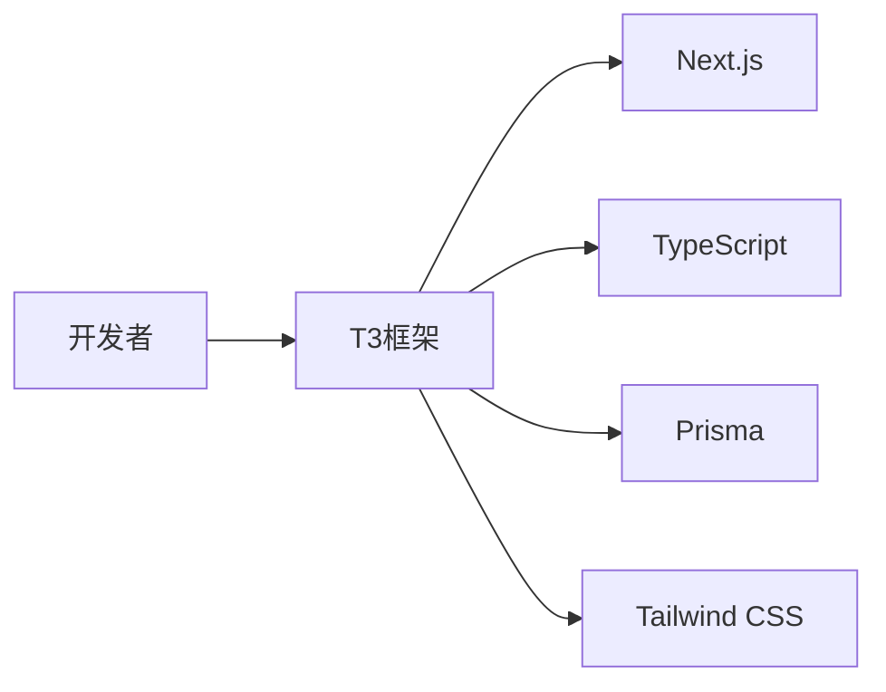
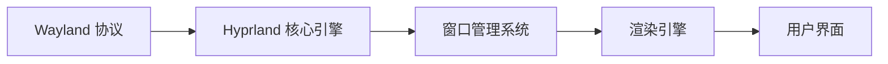

## 今日热点

今日 GitHub 热榜显示 AI Agent 生态系统与大模型本地化运行成为两大核心趋势，从 Agent 管理工具到本地化大模型部署，开发者正积极构建更强大、更易用的 AI 工作流。

---

## 热门项目一览

| 排名 | 项目 | 语言 | 今日 | 总计 | 简介 |
|:---:|------|:----:|------:|-----:|------|
| 1 | [pingdotgg/t3code](https://github.com/pingdotgg/t3code) | TypeScript | +3,229 | 42,340 | No description |
| 2 | [vercel-labs/agent-desktop](https://github.com/vercel-labs/agent-desktop) | Rust | +2,275 | 10,419 | Computer use CLI for AI agents |
| 3 | [thedotmack/claude-mem](https://github.com/thedotmack/claude-mem) | TypeScript | +1,803 | 110,948 | Persistent Context Across S... |
| 4 | [Donchitos/Claude-Code-Game-Studios](https://github.com/Donchitos/Claude-Code-Game-Studios) | Shell | +1,379 | 33,773 | Turn Claude Code into a ful... |
| 5 | [mattpocock/skills](https://github.com/mattpocock/skills) | Shell | +858 | 310,409 | Skills for Real Engineers. ... |
| 6 | [shiyu-coder/Kronos](https://github.com/shiyu-coder/Kronos) | Python | +857 | 46,073 | Kronos: A Foundation Model ... |
| 7 | [D4Vinci/Scrapling](https://github.com/D4Vinci/Scrapling) | Python | +706 | 93,195 | 🕷️ The BEST Web Scraping fr... |
| 8 | [JustVugg/colibri](https://github.com/JustVugg/colibri) | C | +675 | 46,701 | Run frontier MoE models on ... |
| 9 | [FlashML-org/FreeToken](https://github.com/FlashML-org/FreeToken) | Python | +653 | 16,213 | FreeToken brings datacenter... |
| 10 | [hyprwm/Hyprland](https://github.com/hyprwm/Hyprland) | C++ | +509 | 40,024 | Hyprland is an independent,... |
| 11 | [p-e-w/heretic](https://github.com/p-e-w/heretic) | Python | +420 | 38,206 | Training-free language mode... |
| 12 | [kornia/kornia](https://github.com/kornia/kornia) | Python | +412 | 12,186 | 🐍 Geometric Computer Vision... |

---

## 趋势洞察

```
┌─────────────────────────────────────────────────────────────────┐
│  AI/ML 工具         ████████████████████████  11 个项目        │
│  其他               ██████                    3 个项目        │
│  媒体资源             ██                        1 个项目        │
└─────────────────────────────────────────────────────────────────┘
```

---

## 项目深度解读

### 1. pingdotgg/t3code — TypeScript全栈框架

> **一句话总结**：一个现代化的TypeScript全栈框架，提供类型安全的开发体验和开箱即用的功能。

#### 价值主张

| 维度 | 说明 |
|------|------|
| **解决痛点** | 简化全栈应用开发，解决类型安全和项目配置复杂性问题 |
| **目标用户** | TypeScript开发者、全栈工程师、追求类型安全的Web应用构建者 |
| **核心亮点** | 类型安全 + 开箱即用 + 优化项目结构 + 集成现代工具链 |

#### 技术架构



**技术特色**：
- 基于Next.js构建，提供全栈开发能力
- 集成Prisma ORM，简化数据库操作
- 内置TypeScript配置，确保类型安全

#### 热度分析

- 项目增长迅猛，近期新增3000+ stars，表明开发者社区高度认可
- 高Fork数反映项目被广泛学习和二次开发，生态活跃

#### 快速上手

```bash
# 创建新项目
npx create-t3-app@latest my-app
cd my-app
npm install
npm run dev
```

#### 注意事项

- 项目依赖Next.js最新版本，可能存在兼容性问题
- 需要一定的TypeScript和React基础知识才能充分利用框架优势


### 2. vercel-labs/agent-desktop — AI代理工具箱

> **一句话总结**：为AI代理提供计算机操作能力的命令行工具，实现与用户环境无缝交互。

#### 价值主张

| 维度 | 说明 |
|------|------|
| **解决痛点** | 解决AI代理无法直接操作计算机环境的限制，实现真实世界任务执行 |
| **目标用户** | AI开发者、研究人员、构建自动化工作流程的技术人员 |
| **核心亮点** | 高性能Rust实现 + 安全沙箱环境 + 跨平台支持 + 丰富的API接口 |

#### 技术架构


**技术特色**：
- 基于Rust构建的高性能命令行工具，确保低资源消耗和高执行效率
- 实现安全沙箱环境，隔离AI代理操作与系统核心资源
- 提供丰富的API接口，支持多种计算机操作和交互方式

#### 热度分析

- 项目热度极高，单日增长超过2000 stars，表明AI代理领域正处于爆发式增长期
- 作为Vercel实验室项目，在AI开发社区具有较高影响力和信任度

#### 快速上手

```bash
# 克隆仓库
git clone https://github.com/vercel-labs/agent-desktop.git
# 进入项目目录
cd agent-desktop
# 运行项目（假设有cargo命令）
cargo run
```

#### 注意事项

- 项目可能需要较新的Rust版本才能编译运行
- 使用前需了解项目提供的API和安全限制
- 由于Open Issues为0，可能处于早期开发阶段，稳定性有待验证


### 3. thedotmack/claude-mem — AI上下文持久化

> **一句话总结**：为AI代理提供跨会话上下文持久化，自动捕获并压缩历史内容，提升AI连续工作能力。

#### 价值主张

| 维度 | 说明 |
|------|------|
| **解决痛点** | 解决AI代理无法记住历史会话内容的问题，提升工作连续性 |
| **目标用户** | 使用AI编程助手和代码生成工具的开发者 |
| **核心亮点** | 跨会话上下文持久化 + AI智能压缩 + 多平台兼容 + 自动化注入 |

#### 技术架构


**技术特色**：
- 基于AI的内容压缩技术，减少存储空间占用
- 多平台兼容性，支持主流AI编程助手
- 自动化上下文注入机制，无需手动干预

#### 热度分析

- 项目获得超过11万星，单日增长近1800，显示出极高的市场关注度和需求
- Fork数量近万，表明开发者社区积极参与贡献，项目生态活跃

#### 快速上手

```bash
# 安装依赖
npm install

# 配置API密钥
export ANTHROPIC_API_KEY=your_api_key_here

# 启动服务
npm start
```

#### 注意事项

- 需要配置相应的AI服务API密钥
- 需考虑数据隐私和安全问题
- 应定期清理或管理存储的上下文数据，防止存储空间占用过大


### 4. Donchitos/Claude-Code-Game-Studios — AI游戏开发

> **一句话总结**：基于Claude的AI游戏开发工作室系统，49个专业代理模拟真实游戏开发流程。

#### 价值主张

| 维度 | 说明 |
|------|------|
| **解决痛点** | 解决游戏开发中专业技能分散和团队协作效率低的问题 |
| **目标用户** | 独立游戏开发者、小型游戏团队、AI应用探索者 |
| **核心亮点** | 49个专业AI代理 + 72种工作流技能 + 真实工作室层级模拟 |

#### 技术架构


**技术特色**：
- 基于Claude API的智能代理网络架构
- 模拟真实游戏开发团队的层级协作机制
- 72种专业化工作流技能集成与调度系统

#### 热度分析

- 项目获得33,773个星标，单日增长1,379，显示出极高的关注度和采用率
- 零开放问题表明项目成熟度高，用户反馈积极，社区维护良好
- Fork数与Star数比例约为1:7.5，显示项目以使用为主，二次开发较少

#### 快速上手

```bash
# 克隆项目
git clone https://github.com/Donchitos/Claude-Code-Game-Studios.git

# 进入项目目录
cd Claude-Code-Game-Studios

# 运行安装脚本
./setup.sh
```

#### 注意事项

- 需要确保已获得Claude API访问权限
- 项目依赖特定的Shell环境和工具链
- 使用前建议阅读项目文档了解各AI代理的职责分工和协作流程


### 5. mattpocock/skills — 工程效率工具

> **一句话总结**：一套实用的Shell脚本工具集，帮助工程师提高工作效率和解决常见开发问题。

#### 价值主张

| 维度 | 说明 |
|------|------|
| **解决痛点** | 简化工程师日常重复性任务，提供现成的命令行解决方案 |
| **目标用户** | 命令行开发者、系统管理员和DevOps工程师 |
| **核心亮点** | 实用脚本集合 + 直接来源于实战经验 + 轻量级集成 + 持续更新维护 |

#### 技术架构


**技术特色**：
- 纯Shell实现，跨平台兼容性好
- 脚本模块化设计，便于组合使用
- 无需额外依赖，开箱即用

#### 热度分析

- Star数超31万且持续增长，日均新增近900，表明项目获得广泛认可
- Fork数超2.6万，显示社区活跃度高，用户积极参与定制和贡献

#### 快速上手

```bash
git clone https://github.com/mattpocock/skills.git
echo 'export PATH="$PATH:$(pwd)/skills"' >> ~/.bashrc
source ~/.bashrc
```

#### 注意事项

- Windows系统可能需要WSL或其他兼容层才能运行
- 使用前应检查脚本权限和安全性
- 可能需要根据个人环境进行适当配置


### 6. shiyu-coder/Kronos — 金融大模型

> **一句话总结**：Kronos是专为金融市场语言设计的强大基础模型，提供金融文本理解和生成能力。

#### 价值主张

| 维度 | 说明 |
|------|------|
| **解决痛点** | 金融专业文本处理难题，非专业人士难以理解金融语言 |
| **目标用户** | 金融分析师、量化交易员、投资经理、研究人员 |
| **核心亮点** | 金融领域专业知识 + 专业术语理解 + 市场趋势分析 + 风险评估能力 |

#### 技术架构


**技术特色**：
- 金融领域专业知识注入，确保专业术语理解准确
- 多模态金融数据处理能力，整合文本、数值和图表信息
- 金融风险预警机制，提供实时市场风险评估

#### 热度分析

- 项目增长迅猛，单日新增857个Star，显示金融AI领域的高关注度
- 高Star高Fork比例，表明项目在金融AI社区具有重要影响力

#### 快速上手

```bash
# 安装依赖
pip install kronos-ai

# 基本使用
from kronos import KronosModel
model = KronosModel()
result = model.analyze("请分析最新的美联储政策对股市的影响")
print(result)
```

#### 注意事项

- 模型输出仅供参考，不应作为投资决策的唯一依据
- 需要遵守相关金融数据使用法规，注意数据隐私和合规性
- 模型性能可能随金融市场变化需要定期更新和调整


### 7. D4Vinci/Scrapling — 全能爬虫框架

> **一句话总结**：一站式网页抓取解决方案，从简单请求到大规模爬取均可轻松处理。

#### 价值主张

| 维度 | 说明 |
|------|------|
| **解决痛点** | 简化复杂网页抓取流程，提供无需编写复杂代码的自动化数据提取 |
| **目标用户** | 数据分析师、研究人员、开发者及需要批量获取网络数据的用户 |
| **核心亮点** | 高度自动化 + 智能解析 + 异步处理 + 分布式支持 + 易于扩展 |

#### 技术架构


**技术特色**：
- 智能识别网页结构，自动适配不同网站布局
- 异步并发处理，大幅提升爬取效率
- 内置反反爬机制，自动处理常见防护措施

#### 热度分析
- 项目Star数超9.3万，增长势头强劲，表明在爬虫领域获得广泛认可
- Discord和Twitter社区活跃，开发者持续维护更新，生态健康度高

#### 快速上手

```bash
# 安装Scrapling
pip install scrapling

# 基本使用示例
from scrapling import Scrapling

# 创建爬虫实例
crawler = Scrapling('https://example.com')

# 提取数据
data = crawler.extract(selector='div.content')
print(data)
```

#### 注意事项
- 使用前请确保遵守目标网站的robots.txt规则和服务条款
- 避免过于频繁的请求，以免对目标服务器造成压力或导致IP被封禁
- 对于动态加载内容的网站，可能需要配置额外的JavaScript渲染选项


### 8. JustVugg/colibri — 轻量MoE引擎

> **一句话总结**：纯C实现零依赖的前沿MoE模型运行器，支持专家模型流式加载，小体积大模型。

#### 价值主张

| 维度 | 说明 |
|------|------|
| **解决痛点** | 让用户在普通硬件上运行前沿MoE大模型，无需高端设备 |
| **目标用户** | 资源受限的AI开发者、研究人员和爱好者 |
| **核心亮点** | 纯C实现 + 零依赖 + 专家模型磁盘流式加载 + 高效内存管理 |

#### 技术架构


**技术特色**：
- 专家模型分片存储，按需加载减少内存占用
- 纯C实现的高效推理路径，无运行时依赖
- 磁盘流式加载技术实现大模型运行

#### 热度分析

- 项目Star数近4.7万，单日增长675，呈现高速增长态势
- 0个Open Issues表明项目维护良好，问题响应及时

#### 快速上手

```bash
# 克隆项目并编译
git clone https://github.com/JustVugg/colibri.git
cd colibri && make

# 运行模型
./colibri --model-path /path/to/model
```

#### 注意事项

- 纯C实现虽高效但跨平台兼容性需自行测试
- 大型模型需要充足的磁盘空间，建议使用SSD提高加载速度
- 流式加载可能带来I/O延迟，建议在性能较好的硬件上运行


### 9. FlashML-org/FreeToken — 本地模型加速器

> **一句话总结**：FreeToken是一个能在本地桌面高效运行大规模模型的推理加速框架。

#### 价值主张

| 维度 | 说明 |
|------|------|
| **解决痛点** | 大型AI模型需强大计算资源，本地运行困难 |
| **目标用户** | 需本地运行大型模型的开发者和研究人员 |
| **核心亮点** | 高效本地推理 + 显著降低资源需求 + 桌面环境友好 |

#### 技术架构


**技术特色**：
- 模型压缩与优化技术减少资源需求
- 智能内存管理提升运行效率
- 专用推理算法加速计算过程

#### 热度分析

- 项目获16,213个Star，单日增长653，社区关注度极高
- 高Star低Fork比例表明项目定位为成熟工具而非二次开发平台

#### 快速上手

```bash
# 安装FreeToken
pip install freetoken

# 运行大型模型
python -m freetoken.run --model /path/to/model
```

#### 注意事项

- 需要相当的计算资源，特别是GPU支持
- 模型大小受限于本地硬件配置
- 许可证信息不明确，使用前需确认开源协议


### 10. hyprwm/Hyprland — 平铺Wayland合成器

> **一句话总结**：高度可定制、动态平铺的 Wayland 合成器，兼顾性能与美观。

#### 价值主张

| 维度 | 说明 |
|------|------|
| **解决痛点** | 提供高性能、美观且高度可定制的 Wayland 平铺窗口管理方案 |
| **目标用户** | 追求高性能与美观的 Linux 桌面用户、开发者 |
| **核心亮点** | 高度可定制 + 动态平铺 + 美观设计 + 性能优化 |

#### 技术架构



**技术特色**：
- 基于 C++ 实现高性能窗口管理
- 支持 Wayland 协议，不依赖 X11
- 采用高度模块化架构，支持丰富扩展
- 提供强大的配置系统，支持动态调整

#### 热度分析

- 项目 Star 数达 40,024，近期增长迅速，单日新增 509，表明 Wayland 生态持续升温
- 在 Wayland 合成器领域处于领先地位，社区活跃度高，Fork 数 2,158 显示良好的社区参与度

#### 快速上手

```bash
# 克隆并构建 Hyprland
git clone --recursive https://github.com/hyprwm/Hyprland.git
cd Hyprland && cmake --build build --target install
```

#### 注意事项

- 仅支持 Wayland 协议，不支持 X11
- 配置相对复杂，需要一定的技术门槛
- 可能存在与某些应用程序的兼容性问题


### 11. p-e-w/heretic — AI模型去偏工具

> **一句话总结**：无需训练即可修改大型语言模型，移除审查、偏见和谄媚行为，保持模型能力的同时增强输出质量。

#### 价值主张

| 维度 | 说明 |
|------|------|
| **解决痛点** | 解决大语言模型中的审查、偏见和谄媚问题，提升模型输出质量 |
| **目标用户** | AI研究人员、开发者、对模型输出有特定要求的用户 |
| **核心亮点** | 无需重新训练 + 直接修改模型行为 + 保持原有能力 + 多种调整选项 |

#### 技术架构


**技术特色**：
- 无需重新训练，直接修改模型行为
- 保留模型原有能力的同时调整特定输出
- 支持多种调整选项，如移除审查、抑制不良内容等

#### 热度分析

- 项目获得超过3.8万星，近期每日增长420星，热度极高，表明AI模型去偏是当前热门需求
- 无开放问题，说明项目成熟度较高，用户反馈主要通过其他渠道处理

#### 快速上手

```bash
# 安装heretic
pip install heretic

# 基本使用示例
python -m heretic --model gpt-3.5-turbo --remove-censorship --input "你的提示"
```

#### 注意事项

- 项目可能涉及伦理问题，使用时需考虑合规性
- 修改后的模型行为可能不完全可控，建议在测试环境中验证
- 项目许可信息不明确，使用前需确认授权条款


### 12. kornia/kornia — 几何视觉库

> **一句话总结**：kornia是专为空间AI设计的可微分几何计算机视觉库，提供丰富的图像变换和空间操作。

#### 价值主张

| 维度 | 说明 |
|------|------|
| **解决痛点** | 提供可微分几何变换，解决传统计算机视觉与深度学习结合的挑战 |
| **目标用户** | 计算机视觉研究者、空间AI开发者、几何算法工程师 |
| **核心亮点** | 可微分变换 + PyTorch原生集成 + 空间AI支持 + 高性能GPU加速 |

#### 技术架构


**技术特色**：
- 基于PyTorch构建的全可微分视觉变换库
- 提供丰富的2D/3D几何变换和空间操作
- 高性能GPU加速的图像处理算法
- 与深度学习模型无缝集成的设计

#### 热度分析

- 项目Star数持续快速增长，近期单日增长400+，表明社区活跃度高
- 作为空间AI领域的重要工具库，在学术研究和工业应用中均有广泛应用

#### 快速上手

```bash
# 安装kornia
pip install kornia

# 基本图像变换示例
import kornia
import torch

# 创建图像张量
img = torch.rand(1, 3, 224, 224)

# 应用旋转
rotated = kornia.rotate(img, angle=torch.tensor(45.0))
```

#### 注意事项

- kornia主要基于PyTorch，需要先安装PyTorch
- 部分高级功能需要CUDA支持，使用前需确认环境配置
- 文档和示例代码主要面向PyTorch用户，不熟悉深度学习框架的用户可能需要额外学习


### 13. paperclipai/paperclip — 智能代理管理

> **一句话总结**：开源智能代理管理平台，统一调度工作助手，提升团队协作效率。

#### 价值主张

| 维度 | 说明 |
|------|------|
| **解决痛点** | 团队协作中多代理管理混乱，缺乏统一调度平台 |
| **目标用户** | 需要管理多个AI助力的工作团队和专业人士 |
| **核心亮点** | 多代理协同 + 统一管理界面 + 自定义工作流 + 开源可扩展 |

#### 技术架构


**技术特色**：
- 基于TypeScript构建，提供类型安全
- 开源架构，支持社区扩展
- 模块化设计，便于功能定制

#### 热度分析

- Star数超11万，日增400+，表明项目处于快速增长期，用户认可度高
- Fork数近1.8万，社区贡献活跃，形成良好生态

#### 快速上手

```bash
# 克隆项目
git clone https://github.com/paperclipai/paperclip.git

# 安装依赖
npm install

# 启动开发服务器
npm run dev
```

#### 注意事项

- 由于项目没有明确许可证，使用前需确认授权条款
- 项目可能需要Node.js环境和相关依赖
- 建议查看项目文档了解具体配置要求


### 14. karpathy/nanochat — 低成本ChatGPT

> **一句话总结**：基于本地模型的高性价比对话系统，提供接近ChatGPT的体验。

#### 价值主张

| 维度 | 说明 |
|------|------|
| **解决痛点** | 降低使用高级AI对话模型的成本，无需依赖API或云端服务 |
| **目标用户** | 开发者、研究人员、AI爱好者 |
| **核心亮点** | 本地部署 + 低成本 + 高性能 + 隐私保护 + 开源可定制 |

#### 技术架构


**技术特色**：
- 使用开源大语言模型替代商业API
- 优化的模型量化技术降低硬件需求
- 轻量级实现，可在消费级硬件运行

#### 热度分析

- 项目获得近6万星，增长迅速，显示AI社区对低成本AI解决方案的强烈需求
- 高fork数量表明开发者积极参与二次开发和功能扩展

#### 快速上手

```bash
# 克隆项目
git clone https://github.com/karpathy/nanochat.git
cd nanochat
# 安装依赖
pip install -r requirements.txt
# 运行
python nanochat.py
```

#### 注意事项

- 需要一定的硬件资源，特别是GPU加速
- 模型性能可能不及最新的商业API
- 需要自行处理模型下载和配置


### 15. max-sixty/worktrunk — Git工作流管理

> **一句话总结**：Worktrunk是一个专为并行AI工作流设计的Git worktree管理命令行工具。

#### 价值主张

| 维度 | 说明 |
|------|------|
| **解决痛点** | 简化Git工作树管理，支持多分支并行开发，提升AI工作流效率 |
| **目标用户** | 需要管理多个分支并行工作的开发者和AI代理系统 |
| **核心亮点** | 并行工作流支持 + 智能分支管理 + 轻量级CLI + 高效资源利用 |

#### 技术架构


**技术特色**：
- 基于Rust构建，提供高性能和内存安全
- 专为Git worktree优化，支持复杂分支管理场景
- 设计考虑AI代理并行工作流需求

#### 热度分析

- 超过10k Star且持续增长，显示Git工作流管理工具需求旺盛
- 零开放问题表明项目维护良好，社区参与度高

#### 快速上手

```bash
# 安装worktrunk
cargo install worktrunk

# 创建新的工作树
worktrunk create <branch-name>

# 列出所有工作树
worktrunk list
```

#### 注意事项

- 需要Git环境支持worktree功能
- 对于大型仓库，工作树管理可能需要较多磁盘空间
- 建议在使用前熟悉Git worktree的基本概念


## 今日推荐

| 主题 | 推荐项目 | 亮点 |
|------|----------|------|
| 今日最热 | [pingdotgg/t3code](https://github.com/pingdotgg/t3code) | No description |
| 值得关注 | [vercel-labs/agent-desktop](https://github.com/vercel-labs/agent-desktop) | Computer use CLI ... |
| 快速上手 | [thedotmack/claude-mem](https://github.com/thedotmack/claude-mem) | Persistent Contex... |
| 长期潜力 | [Donchitos/Claude-Code-Game-Studios](https://github.com/Donchitos/Claude-Code-Game-Studios) | Turn Claude Code ... |

---

<div align="center">

*Generated on 2026-11-03 | Powered by GitHub Trending Reporter*

</div>