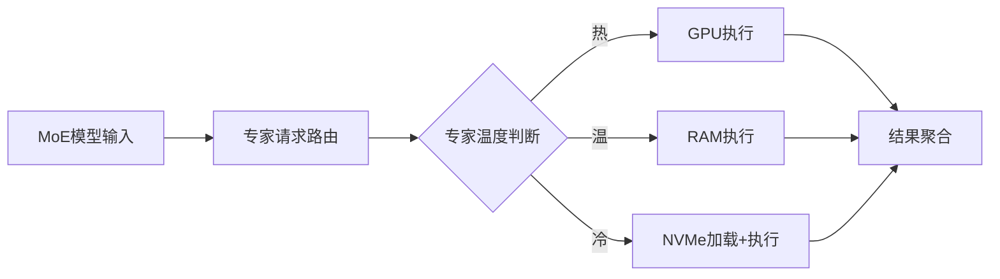
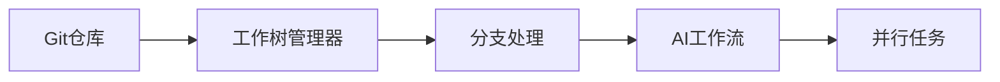

## 今日热点

AI代理工具链与模型优化成为今日焦点，持久上下文管理、并行工作流以及高效推理引擎项目获得显著关注，反映了AI应用向实用化和高效化发展的趋势。

---

## 热门项目一览

| 排名 | 项目 | 语言 | 今日 | 总计 | 简介 |
|:---:|------|:----:|------:|-----:|------|
| 1 | [vercel-labs/agent-desktop](https://github.com/vercel-labs/agent-desktop) | Rust | +3,791 | 13,139 | Computer use CLI for AI agents |
| 2 | [D4Vinci/Scrapling](https://github.com/D4Vinci/Scrapling) | Python | +1,658 | 95,120 | 🕷️ The BEST Web Scraping fr... |
| 3 | [Donchitos/Claude-Code-Game-Studios](https://github.com/Donchitos/Claude-Code-Game-Studios) | Shell | +1,182 | 34,791 | Turn Claude Code into a ful... |
| 4 | [mattpocock/skills](https://github.com/mattpocock/skills) | Shell | +1,164 | 311,645 | Skills for Real Engineers. ... |
| 5 | [thedotmack/claude-mem](https://github.com/thedotmack/claude-mem) | TypeScript | +1,139 | 112,084 | Persistent Context Across S... |
| 6 | [JustVugg/colibri](https://github.com/JustVugg/colibri) | C | +802 | 47,335 | A hierarchical inference en... |
| 7 | [p-e-w/heretic](https://github.com/p-e-w/heretic) | Python | +701 | 38,904 | Training-free language mode... |
| 8 | [shiyu-coder/Kronos](https://github.com/shiyu-coder/Kronos) | Python | +503 | 46,579 | Kronos: A Foundation Model ... |
| 9 | [floci-io/floci](https://github.com/floci-io/floci) | Java | +482 | 28,929 | Light, fluffy, and always f... |
| 10 | [max-sixty/worktrunk](https://github.com/max-sixty/worktrunk) | Rust | +438 | 10,588 | Worktrunk is a CLI for Git ... |
| 11 | [anomalyco/hex](https://github.com/anomalyco/hex) | Rust | +410 | 4,683 | Local voice dictation for m... |
| 12 | [Usagi-org/ai-goofish-monitor](https://github.com/Usagi-org/ai-goofish-monitor) | Python | +228 | 16,661 | 基于 Playwright 和AI实现的闲鱼多任务实时... |

---

## 趋势洞察

```
┌─────────────────────────────────────────────────────────────────┐
│  AI/ML 工具         ████████████████████████  9 个项目        │
│  其他               ████████                  3 个项目        │
│  媒体资源             ██                        1 个项目        │
└─────────────────────────────────────────────────────────────────┘
```

---

## 项目深度解读

### 1. vercel-labs/agent-desktop — AI交互终端

> **一句话总结**：为AI代理提供计算机操作能力的命令行交互工具，实现人机协同任务执行。

#### 价值主张

| 维度 | 说明 |
|------|------|
| **解决痛点** | 解决AI代理无法直接操作计算机执行实际任务的限制 |
| **目标用户** | AI开发者、研究人员及需要AI辅助完成桌面任务的用户 |
| **核心亮点** | 提供AI代理计算机操作能力 + 命令行界面高效交互 + 支持复杂任务自动化 |

#### 技术架构


**技术特色**：
- 使用Rust构建高性能安全核心
- 提供系统级操作抽象接口
- 实现AI与计算机无缝交互机制

#### 热度分析

- 单日增长近4k星，社区关注度和采用速度极高，显示强烈市场需求
- 作为Vercel实验室项目，位于AI实用化工具生态前沿位置

#### 快速上手

```bash
# 安装
cargo install agent-desktop

# 运行
agent-desktop --model gpt-4
```

#### 注意事项

- 项目许可证信息未知，商业使用前需确认授权条款
- AI代理操作计算机涉及系统安全和隐私问题，需谨慎配置权限
- 可能需要特定AI模型API密钥才能完整使用所有功能


### 2. D4Vinci/Scrapling — 全能爬虫框架

> **一句话总结**：Scrapling是功能全面的Python爬虫框架，提供从简单请求到大规模爬取的一站式解决方案。

#### 价值主张

| 维度 | 说明 |
|------|------|
| **解决痛点** | 简化爬虫开发复杂度，处理反爬、动态内容和数据清洗等常见挑战 |
| **目标用户** | 需要从网站提取数据的开发者、数据分析师和研究人员 |
| **核心亮点** | 智能反爬绕过 + 异步高效处理 + 分布式爬取支持 + 自动JS渲染 + 内置数据清洗 |

#### 技术架构


**技术特色**：
- 智能反爬机制绕过常见限制
- 异步处理提升爬取效率
- 自动处理JavaScript渲染内容
- 分布式爬取架构支持
- 内置数据清洗和转换功能

#### 热度分析

- 项目Star数超9.5万，单日增长1,658，处于快速增长期，备受开发者关注
- 高Fork数(近1万)与零Open Issues，反映项目成熟度高且维护良好

#### 快速上手

```bash
# 安装Scrapling
pip install scrapling

# 基本使用示例
from scrapling import Scrapling

# 创建爬虫实例
crawler = Scrapling('https://example.com')

# 执行爬取并提取数据
data = crawler.extract(selector='div.content')
print(data)
```

#### 注意事项

- 使用前需确认项目的许可证类型，确保合规使用
- 爬取网站时应遵守robots.txt和网站服务条款
- 大规模爬取需考虑请求频率和代理设置，避免对目标服务器造成过大压力
- 部分网站可能有反爬机制，需适当配置Scrapling的反绕过参数


### 3. Donchitos/Claude-Code-Game-Studios — AI游戏工作室

> **一句话总结**：将Claude AI转变为拥有49个专业代理和72项工作流技能的完整游戏开发工作室。

#### 价值主张

| 维度 | 说明 |
|------|------|
| **解决痛点** | 独立开发者和小团队缺乏专业游戏开发资源和完整工作流程 |
| **目标用户** | 独立游戏开发者、小型游戏工作室、AI应用探索者 |
| **核心亮点** | 49个AI专业代理 + 72项游戏开发工作流技能 + 真实工作室层级结构 |

#### 技术架构


**技术特色**：
- 基于Claude AI的多代理协作系统
- 模拟真实游戏工作室的层级结构和专业分工
- 通过Shell脚本实现自动化工作流和任务分配
- 集成72种游戏开发专业技能

#### 热度分析

- 项目获得超过34k星并持续快速增长，表明AI辅助游戏开发领域需求旺盛
- 零开放问题暗示项目成熟度高或问题通过其他渠道快速解决

#### 快速上手

```bash
# 克隆仓库并进入目录
git clone https://github.com/Donchitos/Claude-Code-Game-Studios.git
cd Claude-Code-Game-Studios

# 运行主脚本启动游戏工作室系统
./start_game_studio.sh
```

#### 注意事项

- 需要确保Claude API访问权限和正确配置
- 项目可能需要一定的游戏开发基础知识才能充分利用
- 由于使用Shell脚本，可能需要在Linux或macOS环境中运行
- 注意API使用限制和成本控制


### 4. mattpocock/skills — 工程师技能库

> **一句话总结**：提供实用Shell脚本集合，提升工程师日常工作效率的自动化工具集。

#### 价值主张

| 维度 | 说明 |
|------|------|
| **解决痛点** | 解决工程师日常工作中重复性任务，提高工作效率 |
| **目标用户** | 软件开发工程师和系统管理员 |
| **核心亮点** | 实用脚本 + 即插即用 + 高效工具集 + 开源共享 |

#### 技术架构


**技术特色**：
- 纯Shell实现，跨平台兼容
- 模块化设计，易于扩展
- 即开即用，无需复杂配置

#### 热度分析

- 超过31万Star，日均增长1000+，表明工程师群体对此类工具需求旺盛
- 26K Fork量显示社区积极参与和二次开发热情高

#### 快速上手

```bash
# 克隆项目
git clone https://github.com/mattpocock/skills.git
# 进入目录
cd skills
# 运行可用脚本
ls -la scripts/
```

#### 注意事项

- 需要基本的Shell知识才能理解和使用脚本
- 可能需要根据个人环境调整部分脚本参数
- 建议先在测试环境验证后再在生产环境使用


### 5. thedotmack/claude-mem — AI代理记忆系统

> **一句话总结**：为AI代理提供跨会话持久化记忆，通过AI压缩历史上下文，增强代理连续对话能力。

#### 价值主张

| 维度 | 说明 |
|------|------|
| **解决痛点** | AI代理无法记忆跨会话上下文，导致对话缺乏连贯性 |
| **目标用户** | AI开发者、研究人员及长时间使用AI代理的专业用户 |
| **核心亮点** | 跨会话持久化记忆 + AI压缩技术 + 多代理兼容性 + 自动上下文注入 |

#### 技术架构


**技术特色**：
- 跨AI代理兼容的通用接口设计
- AI驱动的智能上下文压缩算法
- 高效的增量式记忆更新机制

#### 热度分析

- 项目Star数高达11万+，近期每日新增超1000星，呈现爆发式增长态势
- 作为AI代理增强工具，正处于技术热点领域，社区活跃度高，生态扩展迅速

#### 快速上手

```bash
# 安装claude-mem
npm install -g claude-mem

# 初始化配置
claude-mem init

# 启动增强代理
claude-mem start
```

#### 注意事项

- 需要注意数据隐私问题，因为系统会捕获和存储代理会话数据
- 不同AI代理可能需要不同的配置和适配
- 可能需要API密钥来使用AI压缩功能


### 6. JustVugg/colibri — MoE分层推理引擎

> **一句话总结**：一个用C编写的高效MoE推理引擎，通过分层存储和流式传输优化计算资源使用。

#### 价值主张

| 维度 | 说明 |
|------|------|
| **解决痛点** | 解决MoE模型在资源受限环境下的高效推理问题 |
| **目标用户** | 需要部署大规模MoE模型的AI研究者和开发者 |
| **核心亮点** | 分层专家管理 + GPU/RAM/NVMe三级存储 + 硬件资源优化 |

#### 技术架构



**技术特色**：
- 分层专家管理策略，根据使用频率动态调整存储位置
- 支持CUDA和Vulkan两种GPU加速方案
- 流式加载机制，减少内存占用
- 硬件资源优化，最大化利用现有设备
- C语言实现，轻量高效

#### 热度分析

- 项目获得47k+高星，显示MoE模型部署是当前AI领域热点，项目提供实用解决方案
- 零open issues表明项目维护良好，社区可能通过其他渠道交流

#### 快速上手

```bash
git clone https://github.com/JustVugg/colibri.git
cd colibri
make
./colibri --model_path /path/to/model
```

#### 注意事项

- 项目使用C语言编写，需要一定的系统编程知识
- 需要支持CUDA或Vulkan的GPU硬件
- 项目可能需要特定的模型格式支持
- 由于项目使用C语言，内存管理需要特别注意


### 7. p-e-w/heretic — 无训练模型修改

> **一句话总结**：无需重新训练即可修改大型语言模型行为，去除审查并减少不良输出。

#### 价值主张

| 维度 | 说明 |
|------|------|
| **解决痛点** | 大型语言模型存在内容审查和不良行为问题 |
| **目标用户** | 需要更自由语言模型输出的研究者和开发者 |
| **核心亮点** | 无需重新训练 + 即插即用 + 多种行为优化 |

#### 技术架构


**技术特色**：
- 通过直接修改模型参数实现行为调整
- 保持模型原有能力的同时改变特定输出模式
- 可针对多种不良行为进行定制化干预

#### 热度分析

- 项目近期增长迅速，单日增加701个Star，表明社区高度关注
- 高Star与Fork比例显示项目有很强的实用价值和社区参与度

#### 快速上手

```bash
# 安装依赖
pip install -r requirements.txt

# 运行模型修改
python heretic --model-name gpt-3.5-turbo --apply-modifications
```

#### 注意事项

- 项目可能涉及伦理问题，使用时需考虑合规性
- 修改后的模型输出可能不符合某些平台的使用政策
- 项目License未知，商业使用前需确认授权条款


### 8. shiyu-coder/Kronos — [金融语言模型]

> **一句话总结**：专为金融市场设计的语言基础模型，融合金融文本理解与市场趋势预测能力。

#### 价值主张

| 维度 | 说明 |
|------|------|
| **解决痛点** | 金融文本解析与市场预测的准确性和专业性不足 |
| **目标用户** | 金融分析师、量化交易员、投资机构、研究机构 |
| **核心亮点** | 金融领域专业预训练 + 时间序列分析 + 多模态数据处理 + 市场情绪分析 |

#### 技术架构


**技术特色**：
- 金融领域专业语料预训练，提升金融术语理解能力
- 结合时间序列分析，捕捉市场动态变化规律
- 多模态金融数据处理，整合文本、数值和图表信息

#### 热度分析

- 项目在金融AI领域获得极高关注，近期增长迅速，日增星超500
- 作为金融大模型领域的代表性项目，吸引了大量从业者和研究者的关注

#### 快速上手

```bash
# 安装Kronos
pip install kronos-model

# 基本使用示例
from kronos import KronosModel
model = KronosModel.from_pretrained("kronos-financial-v1")
result = model.analyze("分析美联储加息对科技股的影响")
```

#### 注意事项

- 模型预测仅供参考，不构成投资建议
- 需要大量金融数据预训练，初次使用需要下载模型权重
- 模型持续更新，建议关注最新版本和文档


### 9. floci-io/floci — 轻量云模拟

> **一句话总结**：轻量级免费AWS本地模拟器，让开发者在本地完整测试云应用。

#### 价值主张

| 维度 | 说明 |
|------|------|
| **解决痛点** | 解决本地开发无法模拟AWS服务的问题，降低云端测试成本 |
| **目标用户** | 需要本地测试AWS应用的开发者和DevOps工程师 |
| **核心亮点** | 轻量级 + 免费开源 + 完整AWS服务模拟 + 简单配置 |

#### 技术架构


**技术特色**：
- 基于Java构建，跨平台兼容性好
- 模拟多种AWS核心服务，如S3、DynamoDB、Lambda等
- 提供RESTful API接口，易于集成到开发流程

#### 热度分析

- 项目获得28,929个Star和3,221个Fork，近482个新增Star，增长迅速
- 0个Open Issues表明项目维护良好，问题处理高效，社区活跃度高

#### 快速上手

```bash
# 下载并运行floci
git clone https://github.com/floci-io/floci.git
cd floci && ./start.sh
```

#### 注意事项

- 项目许可证信息不明确，使用前需确认开源协议
- 本地模拟可能与实际AWS服务存在行为差异，生产环境前需充分测试
- 需要确保本地资源足够支持模拟服务运行


### 10. max-sixty/worktrunk — AI工作流管理

> **一句话总结**：专为AI并行工作流设计的Git工作树管理CLI工具，提升多分支协作效率。

#### 价值主张

| 维度 | 说明 |
|------|------|
| **解决痛点** | 简化Git工作树管理，解决AI并行工作流中的分支混乱问题 |
| **目标用户** | AI开发者、多分支并行工作的团队 |
| **核心亮点** | 高效工作树管理 + AI工作流优化 + 命令行界面 + 并行支持 |

#### 技术架构



**技术特色**：
- 基于Rust构建，性能高效且内存安全
- 专为AI并行工作流程优化设计
- 提供简洁命令行界面，降低使用门槛

#### 热度分析

- 项目Star数达10,588，近期增长迅速，表明Git工作树管理工具需求旺盛
- Open Issues为0，说明项目维护良好，社区问题解决效率高

#### 快速上手

```bash
# 安装worktrunk
cargo install worktrunk

# 创建新工作树
worktrunk create feature-branch

# 列出所有工作树
worktrunk list

# 删除工作树
worktrunk remove feature-branch
```

#### 注意事项

- 需要安装Rust环境才能编译和安装
- 项目许可证信息不明确，商业使用前需确认
- 依赖Git环境，确保系统已安装Git


### 11. anomalyco/hex — 跨平台语音听写

> **一句话总结**：本地化跨平台语音听写工具，无需联网即可实现实时语音转文字。

#### 价值主张

| 维度 | 说明 |
|------|------|
| **解决痛点** | 跨平台统一的本地语音输入方案，解决隐私顾虑和网络依赖问题 |
| **目标用户** | 注重隐私的开发者、作家、研究人员及需要高效输入的专业人士 |
| **核心亮点** | 跨平台支持 + 本地处理 + 隐私保护 + 实时转换 + 离线可用 |

#### 技术架构


**技术特色**：
- 基于 Rust 开发，内存安全且高性能
- 采用本地语音识别引擎，保护用户隐私
- 跨平台架构设计，统一用户体验
- 实时处理低延迟，提供流畅输入体验

#### 热度分析

- 项目近期增长迅速，单日新增410星，表明市场认可度高
- Issues数量为0，说明项目成熟度较高，维护良好

#### 快速上手

```bash
# 克隆项目
git clone https://github.com/anomalyco/hex.git

# 构建项目
cd hex
cargo build --release
```

#### 注意事项

- 项目使用 Rust 开发，需要安装 Rust 环境
- 可能需要额外安装语音识别引擎的依赖
- 不同平台的配置和安装步骤可能有所差异


### 12. Usagi-org/ai-goofish-monitor — 闲鱼AI智能监控

> **一句话总结**：基于AI和Playwright的闲鱼商品智能监控系统，帮助用户实时追踪心仪商品。

#### 价值主张

| 维度 | 说明 |
|------|------|
| **解决痛点** | 解决闲鱼海量商品信息过载，难以实时追踪心仪商品的问题 |
| **目标用户** | 频繁关注闲鱼特定商品或价格变化的二手商品爱好者、寻宝者 |
| **核心亮点** | AI智能分析 + 多任务实时监控 + Web后台管理 + 自动化操作 |

#### 技术架构


**技术特色**：
- 基于Playwright的自动化浏览器操作，模拟真实用户行为
- AI算法智能分析商品特征和价格趋势
- 多任务并行处理系统，支持实时和定时监控

#### 热度分析

- 项目Star数达16,661且每日新增228个Star，显示快速增长趋势
- Fork数2,861，表明社区活跃度高，用户二次开发需求强

#### 快速上手

```bash
# 克隆项目
git clone https://github.com/Usagi-org/ai-goofish-monitor.git

# 安装依赖
pip install -r requirements.txt

# 启动服务
python app.py
```

#### 注意事项

- 项目可能需要配置AI服务API密钥
- 使用前需了解闲鱼网站使用规则，避免违反平台政策
- 需要一定的Python基础和环境配置能力


### 13. spotify/portal-ai-plugins — AI插件框架

> **一句话总结**：Spotify的AI插件门户系统，提供标准化AI能力集成与扩展支持。

#### 价值主张

| 维度 | 说明 |
|------|------|
| **解决痛点** | 解决Spotify平台AI能力分散、集成复杂的标准化问题 |
| **目标用户** | Spotify开发者、AI插件构建者、音乐服务集成者 |
| **核心亮点** | 统一AI接口规范 + 插件热部署能力 + 类型安全保障 |

#### 技术架构


**技术特色**：
- 基于TypeScript开发，提供端到端类型安全
- 采用模块化插件架构，支持能力动态加载
- 提供标准化API，简化AI功能集成流程

#### 热度分析
- 项目获3000+ stars，近期增长稳定，表明社区认可度高
- 作为Spotify官方项目，在AI音乐应用领域具有生态引领作用

#### 快速上手

```bash
# 克隆项目
git clone https://github.com/spotify/portal-ai-plugins.git
# 安装依赖
npm install
# 启动开发服务器
npm run dev
```

#### 注意事项
- 项目许可信息未知，使用前需确认授权条款
- 建议参考项目官方文档获取最新API使用指南
- 插件开发需遵循Spotify制定的AI能力规范


## 今日推荐

| 主题 | 推荐项目 | 亮点 |
|------|----------|------|
| 今日最热 | [vercel-labs/agent-desktop](https://github.com/vercel-labs/agent-desktop) | Computer use CLI ... |
| 值得关注 | [D4Vinci/Scrapling](https://github.com/D4Vinci/Scrapling) | 🕷️ The BEST Web S... |
| 快速上手 | [Donchitos/Claude-Code-Game-Studios](https://github.com/Donchitos/Claude-Code-Game-Studios) | Turn Claude Code ... |
| 长期潜力 | [mattpocock/skills](https://github.com/mattpocock/skills) | Skills for Real E... |

---

<div align="center">

*Generated on 2026-11-04 | Powered by GitHub Trending Reporter*

</div>