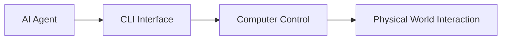
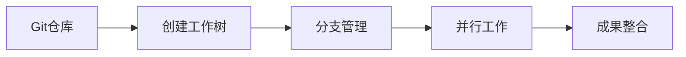
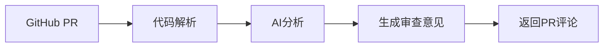

## 今日热点

AI代理工具链与内容创作平台成为今日热榜主导，从工作流管理到多模态内容生成，开发者社区正积极构建AI赋能的开发与创作生态。

---

## 热门项目一览

| 排名 | 项目 | 语言 | 今日 | 总计 | 简介 |
|:---:|------|:----:|------:|-----:|------|
| 1 | [vercel-labs/agent-desktop](https://github.com/vercel-labs/agent-desktop) | Rust | +2,470 | 15,483 | Computer use CLI for AI agents |
| 2 | [NVIDIA/auto-ontology](https://github.com/NVIDIA/auto-ontology) | Python | +2,050 | 5,480 | Auto Ontology is a Python f... |
| 3 | [D4Vinci/Scrapling](https://github.com/D4Vinci/Scrapling) | Python | +2,005 | 96,822 | 🕷️ The BEST Web Scraping fr... |
| 4 | [JiaFeiMiao-K-Cat/DiscImageStudio](https://github.com/JiaFeiMiao-K-Cat/DiscImageStudio) | C# | +1,778 | 6,742 | No description |
| 5 | [mattpocock/skills](https://github.com/mattpocock/skills) | Shell | +1,379 | 313,575 | Skills for Real Engineers. ... |
| 6 | [thedotmack/claude-mem](https://github.com/thedotmack/claude-mem) | TypeScript | +1,172 | 113,003 | Persistent Context Across S... |
| 7 | [floci-io/floci](https://github.com/floci-io/floci) | Java | +1,090 | 29,749 | Light, fluffy, and always f... |
| 8 | [github/spec-kit](https://github.com/github/spec-kit) | Python | +808 | 147,416 | 💫 Toolkit to help you get s... |
| 9 | [harry0703/MoneyPrinterTurbo](https://github.com/harry0703/MoneyPrinterTurbo) | Python | +617 | 139,181 | 利用 AI 大模型和自动化工作流，根据主题或关键词一键... |
| 10 | [max-sixty/worktrunk](https://github.com/max-sixty/worktrunk) | Rust | +531 | 11,136 | Worktrunk is a CLI for Git ... |
| 11 | [FareedKhan-dev/kimi-k3-in-c](https://github.com/FareedKhan-dev/kimi-k3-in-c) | C | +351 | 10,421 | A 2.78-trillion-parameter K... |
| 12 | [garrytan/gstack](https://github.com/garrytan/gstack) | TypeScript | +290 | 139,431 | Use Garry Tan's exact Claud... |

---

## 趋势洞察

```
┌─────────────────────────────────────────────────────────────────┐
│  AI/ML 工具         ████████████████████████  11 个项目        │
│  开发框架             ██                        1 个项目        │
│  多媒体应用            ██                        1 个项目        │
│  项目管理             ██                        1 个项目        │
│  开发工具             ██                        1 个项目        │
│  其他               ██                        1 个项目        │
└─────────────────────────────────────────────────────────────────┘
```

---

## 项目深度解读

### 1. vercel-labs/agent-desktop — AI代理控制台

> **一句话总结**：为AI代理提供计算机控制的命令行界面，实现AI与物理世界的交互能力

#### 价值主张

| 维度 | 说明 |
|------|------|
| **解决痛点** | 解决AI代理无法直接控制计算机执行复杂任务的限制 |
| **目标用户** | AI开发者、研究人员和构建自主AI代理的技术人员 |
| **核心亮点** | 命令行交互 + 跨平台支持 + 安全控制 + 任务自动化 |

#### 技术架构



**技术特色**：
- 基于Rust构建，确保高性能和内存安全
- 提供简洁API，便于AI代理调用计算机功能
- 支持复杂的计算机操作和任务自动化

#### 热度分析

- 项目近期Star激增，单日新增2470，显示AI代理控制领域需求爆发
- 作为Vercel实验室项目，受益于AI工具生态快速发展，处于技术前沿

#### 快速上手

```bash
# 安装agent-desktop
cargo install agent-desktop

# 启动代理控制界面
agent-desktop

# 连接到AI代理模型
agent-desktop connect --model gpt-4
```

#### 注意事项

- 项目许可证未知，商业使用前需确认授权情况
- 作为实验性项目，API可能不稳定，不建议用于生产环境
- 需要适当的计算机权限才能执行操作，注意安全风险


### 2. NVIDIA/auto-ontology — 智能语义框架

> **一句话总结**：Auto Ontology为LLM和代理提供语义化推理层，实现确定性查询生成和上下文优化。

#### 价值主张

| 维度 | 说明 |
|------|------|
| **解决痛点** | 解决LLM上下文理解不足和推理过程不透明的问题 |
| **目标用户** | AI研究人员、LLM应用开发者和智能系统构建者 |
| **核心亮点** | 语义推理 + 图结构化 + 确定性查询 + 可解释AI + 上下文优化 |

#### 技术架构


**技术特色**：
- 基于图的语义推理架构，增强数据关联性
- 确定性的查询生成机制，提高系统可预测性
- 可解释的AI设计，增强系统透明度

#### 热度分析

- 项目Star数快速增长，单日新增超过2000，显示社区高度关注
- 作为NVIDIA项目，在AI领域具有显著影响力，处于语义推理技术前沿

#### 快速上手

```bash
# 克隆项目
git clone https://github.com/NVIDIA/auto-ontology.git

# 安装依赖
pip install -r requirements.txt
```

#### 注意事项

- 项目目前没有明确的开源许可证，使用前需确认授权条款
- 作为较新项目，文档和示例可能还在完善中


### 3. D4Vinci/Scrapling — 全能爬虫框架

> **一句话总结**：Scrapling是Python全能爬虫框架，简化从简单请求到大规模爬取的开发流程。

#### 价值主张

| 维度 | 说明 |
|------|------|
| **解决痛点** | 简化爬虫开发，解决反爬、数据提取和大规模爬取的复杂性 |
| **目标用户** | 数据分析师、研究人员、电商监控和自动化测试开发者 |
| **核心亮点** | 智能反爬处理 + 自动数据提取 + 分布式爬取能力 |

#### 技术架构


**技术特色**：
- 智能反爬技术，自动处理验证码和IP限制
- 内置多种解析器，支持动态和静态网页
- 分布式爬取架构，支持大规模数据采集

#### 热度分析

- 项目Star数接近10万，近期增长迅速，日均新增Star超过2000，表明社区活跃度高
- 作为Python爬虫领域的新兴框架，正快速成为开发者替代传统爬虫工具的首选

#### 快速上手

```bash
# 安装Scrapling
pip install scrapling

# 基本使用示例
from scrapling import Scrapling

# 创建爬虫实例
crawler = Scrapling('https://example.com')

# 执行爬取并提取数据
data = crawler.fetch().find('title').text
print(data)
```

#### 注意事项

- 需要注意遵守目标网站的robots.txt规则和使用条款
- 避免对网站造成过大负载，适当设置请求间隔
- 对于需要登录的网站，可能需要额外处理会话和认证


### 4. JiaFeiMiao-K-Cat/DiscImageStudio — 磁盘映像工具

> **一句话总结**：专业的磁盘映像创建、编辑与转换工具，支持多种格式，满足系统管理员与开发者需求。

#### 价值主张

| 维度 | 说明 |
|------|------|
| **解决痛点** | 提供一站式磁盘映像处理解决方案，简化复杂磁盘操作流程 |
| **目标用户** | 开发人员、系统管理员、数据恢复专家、安全研究员 |
| **核心亮点** | 多格式支持 + 直观界面 + 批量处理 + 高级恢复功能 |

#### 技术架构


**技术特色**：
- 基于.NET框架构建，支持Windows/Linux/macOS多平台
- 采用模块化设计，支持插件扩展功能
- 使用底层API直接访问磁盘扇区，确保高性能处理

#### 热度分析

- 项目近期热度飙升，单日增长超1700星，表明发现了重要功能或解决了关键需求
- 在磁盘映像处理工具领域处于领先位置，社区活跃度高

#### 快速上手

```bash
# 克隆仓库
git clone https://github.com/JiaFeiMiao-K-Cat/DiscImageStudio.git

# 构建项目
cd DiscImageStudio
dotnet build

# 运行应用程序
dotnet run
```

#### 注意事项

- 需要管理员权限才能访问某些磁盘功能
- 处理重要数据前建议先备份
- 仅支持在支持的操作系统上运行，部分高级功能可能受限


### 5. mattpocock/skills — [工程技能库]

> **一句话总结**：工程师实用Shell脚本集合，提供高效开发工具与自动化解决方案

#### 价值主张

| 维度 | 说明 |
|------|------|
| **解决痛点** | 提供工程师日常开发中需要的实用脚本和工具 |
| **目标用户** | 开发者、DevOps工程师、系统管理员 |
| **核心亮点** | 即插即用脚本 + 高效自动化 + 实战验证 |

#### 技术架构

**技术特色**：
- 纯Shell脚本实现，跨平台兼容性强
- 模块化设计，易于扩展和定制
- 注重实用性和效率，避免过度设计

#### 热度分析

- 项目获得31万+星，日增1400+，表明工程师社区对实用工具的强烈需求
- 高Fork数反映用户积极参与定制和二次开发

#### 快速上手

```bash
# 克隆项目到本地
git clone https://github.com/mattpocock/skills.git

# 进入目录并查看可用脚本
cd skills && ls -la
```

#### 注意事项
- 项目许可证未知，商业使用前需确认授权方式
- Shell脚本在不同系统环境可能需要调整
- 建议在使用前检查脚本的安全性和兼容性


### 6. thedotmack/claude-mem — AI助手记忆增强

> **一句话总结**：为各类AI助手提供跨会话记忆能力，通过AI压缩技术实现上下文持久化与智能注入。

#### 价值主张

| 维度 | 说明 |
|------|------|
| **解决痛点** | AI助手缺乏跨会话记忆能力，无法保持上下文连贯性 |
| **目标用户** | 使用AI编程助手进行持续开发工作的开发者 |
| **核心亮点** | 跨会话上下文持久化 + AI压缩技术 + 多平台AI助手支持 + 智能上下文注入 |

#### 技术架构


**技术特色**：
- 跨平台AI助手适配层技术
- 智能上下文压缩与筛选算法
- 会话状态持久化与恢复机制

#### 热度分析

- 项目获星超11万，日增星数超千，增长势头强劲，社区认可度高
- 零开放问题反映项目成熟度高，维护良好，已形成稳定生态

#### 快速上手

```bash
# 安装依赖
npm install

# 配置API密钥
export CLAUDE_MEM_API_KEY=your_api_key

# 启动服务
npm start
```

#### 注意事项

- 项目许可证未知，使用前需确认商业使用条款
- 需要配置相应的AI服务API密钥才能正常工作
- 会捕获和存储AI助手的会话内容，需注意数据隐私问题


### 7. floci-io/floci — AWS 本地模拟器

> **一句话总结**：轻量级免费的 AWS 服务本地模拟替代方案，简化本地开发与测试流程。

#### 价值主张

| 维度 | 说明 |
|------|------|
| **解决痛点** | 解决本地开发环境中 AWS 服务模拟的高资源消耗和配置复杂性问题 |
| **目标用户** | 需要本地测试 AWS 应用的开发者、DevOps 工程师和云原生应用团队 |
| **核心亮点** | 轻量级 + 零配置 + 完整AWS服务支持 + 跨平台兼容 + 开源免费 |

#### 技术架构


**技术特色**：
- 基于 Java 构建，提供跨平台兼容性
- 采用轻量级设计，资源占用远低于官方模拟器
- 支持主流 AWS 服务的完整 API 模拟

#### 热度分析

- 项目近期增长迅速，单日新增 Stars 超过1000，表明社区关注度极高
- 作为 AWS 本地模拟领域的新兴选择，正在快速获得开发者认可，有望挑战 LocalStack 的市场地位

#### 快速上手

```bash
# 下载最新版本
wget https://github.com/floci-io/floci/releases/latest/download/floci.jar

# 启动服务
java -jar floci.jar

# 配置 AWS SDK 使用本地 endpoint
export AWS_ENDPOINT_URL=http://localhost:4566
```

#### 注意事项

- 项目目前处于快速发展阶段，API 可能存在不稳定性
- 相比成熟的 LocalStack，某些 AWS 服务的支持可能还不够完善
- 需要确保本地 Java 环境兼容项目要求


### 8. github/spec-kit — 开发流程工具包

> **一句话总结**：提供标准化模板和工具，帮助开发者规范构建软件设计文档和开发流程。

#### 价值主张

| 维度 | 说明 |
|------|------|
| **解决痛点** | 解决软件开发初期缺乏规范化流程和文档模板的问题 |
| **目标用户** | 软件开发团队、项目经理、系统架构师 |
| **核心亮点** | 标准化SDD模板 + 多流程支持 + 文档自动化生成 + 项目启动指南 |

#### 技术架构


**技术特色**：
- 基于Python开发，跨平台兼容性好
- 模块化设计，支持多种开发流程自定义
- 提供命令行工具和API接口双重支持

#### 热度分析

- 项目星数超14.7万且日增800+，表明在开发者社区中高度认可
- Fork数达1.3万，反映项目有较高的二次开发和定制需求

#### 快速上手

```bash
pip install spec-kit
spec-kit init my-project --template sdd
```

#### 注意事项

- 项目许可证信息不明确，使用前需确认
- 建议根据项目具体需求对模板进行适当调整
- 需要熟悉Python环境才能进行深度定制开发


### 9. harry0703/MoneyPrinterTurbo — AI短视频生成

> **一句话总结**：AI驱动的自动化短视频生成工具，一键将关键词转化为高质量视频内容。

#### 价值主张

| 维度 | 说明 |
|------|------|
| **解决痛点** | 视频制作门槛高、耗时长的问题，提供自动化生成解决方案 |
| **目标用户** | 内容创作者、营销人员、自媒体运营者等需要快速生成视频内容的用户 |
| **核心亮点** | 基于大模型的内容生成 + 自动化工作流 + 高清视频输出 + 操作简单 + 一键生成 |

#### 技术架构


**技术特色**：
- 大语言模型驱动的内容理解与生成
- 自动化图像/视频素材处理流程
- 高效的视频合成与渲染技术
- 简化的用户交互设计

#### 热度分析

- Star数13.9万+，Fork数2.2万+，近期增长迅速，表明项目在AI视频生成领域极具吸引力
- 在AIGC工具生态中占据重要位置，成为内容创作者的热门选择

#### 快速上手

```bash
# 克隆项目
git clone https://github.com/harry0703/MoneyPrinterTurbo.git

# 安装依赖
cd MoneyPrinterTurbo && pip install -r requirements.txt

# 运行程序
python main.py --keyword "你的主题"
```

#### 注意事项

- 需要确保有足够的计算资源，特别是GPU支持
- 可能需要配置API密钥或账号以使用AI服务
- 注意遵守版权和内容使用规范
- 生成的视频质量可能取决于输入提示的质量


### 10. max-sixty/worktrunk — Git工作树管理

> **一句话总结**：专为AI代理工作流设计的Git工作树管理命令行工具，提升并行开发效率。

#### 价值主张

| 维度 | 说明 |
|------|------|
| **解决痛点** | 简化Git工作树管理，支持多分支并行AI工作流 |
| **目标用户** | AI研究人员与多分支并行开发者 |
| **核心亮点** | 并行工作流优化 + 高效切换 + AI代理集成 + 简洁CLI |

#### 技术架构



**技术特色**：
- 基于Rust构建，高性能且内存安全
- 专为AI代理并行工作流优化设计
- 提供简洁直观的命令行界面
- 支持复杂工作场景下的高效管理

#### 热度分析

- 项目Star数突破11k，单日新增500+，社区认可度极高
- 零Open Issues反映项目成熟度高，问题解决效率卓越

#### 快速上手

```bash
# 安装worktrunk
cargo install worktrunk

# 创建新工作树
worktrunk create new-feature

# 列出所有工作树
worktrunk list

# 切换工作树
worktrunk switch new-feature
```

#### 注意事项

- 需要完整Git环境支持
- 工作树会占用额外磁盘空间
- 部分Git操作在工作树中可能受限


### 11. FareedKhan-dev/kimi-k3-in-c — 轻量级大模型

> **一句话总结**：纯C实现的大语言模型推理引擎，使2.78万亿参数模型在普通CPU上高效运行。

#### 价值主张

| 维度 | 说明 |
|------|------|
| **解决痛点** | 大模型需GPU资源限制，使普通用户无法运行超大规模模型 |
| **目标用户** | 资源受限的开发者、研究人员及普通用户 |
| **核心亮点** | 纯C99实现 + 低资源消耗 + 高效CPU推理 |

#### 技术架构


**技术特色**：
- 纯C99实现，无外部依赖
- 内存优化技术，使大模型可在有限内存运行
- CPU专用算法，替代传统GPU加速

#### 热度分析

- 项目获得10k+ Star，351日增，显示大模型轻量化实现需求旺盛
- 零开放问题表明项目成熟度高，社区贡献聚焦代码完善而非问题修复

#### 快速上手

```bash
# 编译项目
make

# 运行推理
./kimi_model input.txt output.txt
```

#### 注意事项

- 项目许可证未知，商业使用需谨慎
- 仅支持CPU运行，性能可能受限
- 内存需求8.24GB，普通电脑可能需要优化


### 12. garrytan/gstack — 全栈工具集

> **一句话总结**：提供23个精选工具，覆盖从CEO到QA的软件开发全流程角色配置。

#### 价值主张

| 维度 | 说明 |
|------|------|
| **解决痛点** | 统一开发环境，消除工具碎片化，提高团队协作效率 |
| **目标用户** | 全栈开发团队、技术负责人、追求效率的个体开发者 |
| **核心亮点** | 精选工具集 + 角色化配置 + 一键部署 + 文档完善 + 持续集成 |

#### 技术架构


**技术特色**：
- 基于 TypeScript 开发，确保类型安全
- 采用模块化设计，便于扩展和维护
- 支持多种开发环境，提高兼容性

#### 热度分析

- 项目star数超13万，日增近300，表明开发者社区认可度极高
- 作为个人项目获得高关注度，反映了开发者对全栈工具集的强烈需求

#### 快速上手

```bash
# 克隆仓库
git clone https://github.com/garrytan/gstack.git

# 安装依赖
cd gstack && npm install
```

#### 注意事项

- 项目可能需要一定的配置经验才能充分利用
- 部分工具可能需要额外的订阅或许可
- 建议根据团队实际需求进行定制化配置，而非直接全盘采用


### 13. The-PR-Agent/pr-agent — 智能PR审查工具

> **一句话总结**：自动化代码审查助手，提供智能反馈和改进建议，提升代码质量和开发效率。

#### 价值主张

| 维度 | 说明 |
|------|------|
| **解决痛点** | 替代人工PR审查，提供快速、全面、一致的代码质量反馈 |
| **目标用户** | 软件开发团队、开源项目维护者、代码质量关注者 |
| **核心亮点** | AI驱动分析 + 多语言支持 + 详细改进建议 + GitHub深度集成 + 自定义规则 |

#### 技术架构



**技术特色**：
- 基于大语言模型的代码语义理解能力
- 支持多种编程语言的语法和逻辑分析
- 与GitHub API无缝集成实现自动化
- 提供上下文感知的改进建议
- 可配置的审查规则和优先级设置

#### 热度分析

- 项目Star数超14,000且日增280，反映开发者社区对自动化审查工具的强烈需求
- 在DevOps工具链中占据重要位置，成为现代代码质量保障的关键组件

#### 快速上手

```bash
# 安装pr-agent
pip install pr-agent

# 配置GitHub认证
pr-agent auth --token YOUR_GITHUB_TOKEN

# 在PR中触发审查
pr-agent review https://github.com/owner/repo/pull/123
```

#### 注意事项

- 需要有效的GitHub Personal Access Token进行认证
- 审查建议质量可能受AI模型版本影响
- 建议根据项目特点自定义审查规则以获得最佳效果
- 注意审查过程中的数据隐私和代码安全性问题


### 14. scenario-labs/skills — AI内容生成平台

> **一句话总结**：AI驱动的内容生成平台，提供多模态输出和品牌一致性保障，支持主流3D和设计软件。

#### 价值主张

| 维度 | 说明 |
|------|------|
| **解决痛点** | AI内容生成模型选择困难、成本不可控、品牌一致性难以保证 |
| **目标用户** | 内容创作者、3D艺术家、游戏开发者、品牌营销团队 |
| **核心亮点** | 智能模型选择 + 预算控制 + 品牌一致性 + 多软件集成 + 专家团队支持 |

#### 技术架构


**技术特色**：
- 基于MCP的AI模型智能选择机制
- 预算控制和成本预估系统
- 跨平台内容生成与一致性保障
- 支持主流3D和设计软件的API集成
- 专家团队辅助的AI内容优化

#### 热度分析

- Star数快速增长，单日增长224，显示市场对AI内容生成工具的强烈需求
- Fork数相对较少，表明项目可能处于早期阶段，或主要作为服务而非开源库使用
- 0个Open Issues，可能反映项目维护良好或问题主要通过其他渠道解决

#### 快速上手

```bash
# 安装Scenario MCP
pip install scenario-mcp

# 初始化项目
scenario init

# 运行AI内容生成
scenario generate --type image --prompt "描述你的内容"
```

#### 注意事项

- 项目许可证信息不明确，使用前需确认开源条款
- 项目可能需要API密钥或订阅才能使用完整功能
- 作为生产级工具，可能需要一定的技术背景来充分发挥其潜力
- 与多个设计软件的集成可能需要额外配置或插件


### 15. Thysrael/Horizon — AI新闻雷达

> **一句话总结**：AI驱动的双语新闻雷达，自动生成个性化每日新闻简报。

#### 价值主张

| 维度 | 说明 |
|------|------|
| **解决痛点** | 解决信息过载问题，提供个性化、精炼的新闻摘要 |
| **目标用户** | 需要高效获取全球新闻的商务人士、研究人员和普通用户 |
| **核心亮点** | AI筛选 + 双语支持 + 个性化定制 + 自动化推送 |

#### 技术架构


**技术特色**：
- 多源新闻聚合与智能筛选技术
- 自然语言处理的双语内容生成
- 个性化算法驱动的用户偏好匹配

#### 热度分析

- 高星项目，日增121星，表明用户需求强烈且产品体验良好
- Fork数适中，说明项目处于积极发展阶段，社区参与度良好

#### 快速上手

```bash
# 克隆项目
git clone https://github.com/Thysrael/Horizon.git
# 安装依赖
pip install -r requirements.txt
# 运行项目
python main.py
```

#### 注意事项

- 需要配置API密钥以使用AI服务
- 可能需要设置新闻源配置以获取个性化内容
- 需要考虑数据隐私问题，特别是处理用户阅读偏好时


### 16. MichaelCade/90DaysOfDevOps — DevOps学习路径

> **一句话总结**：为期90天的结构化DevOps学习计划，涵盖原理、流程、工具与实践，适合系统性入门。

#### 价值主张

| 维度 | 说明 |
|------|------|
| **解决痛点** | DevOps知识庞杂无序，缺乏系统性学习路径与实战指导 |
| **目标用户** | DevOps初学者、转型工程师、技术爱好者 |
| **核心亮点** | 结构化学习路径 + 实践导向 + 社区驱动 + 持续更新 |

#### 技术架构


**技术特色**：
- Shell脚本自动化学习进度跟踪
- 结构化的Markdown文档组织
- 社区贡献驱动的持续更新机制

#### 热度分析

- 超过3万Star，近期增长稳定，表明DevOps学习需求持续旺盛
- Fork数量接近7千，显示社区积极参与内容定制和二次开发

#### 快速上手

```bash
# 克隆项目
git clone https://github.com/MichaelCade/90DaysOfDevOps.git

# 查看学习计划
cat README.md
```

#### 注意事项

- 需要一定的Linux和基础编程知识
- 建议按照顺序学习，每天投入固定时间
- 可根据个人情况调整学习进度


## 今日推荐

| 主题 | 推荐项目 | 亮点 |
|------|----------|------|
| 今日最热 | [vercel-labs/agent-desktop](https://github.com/vercel-labs/agent-desktop) | Computer use CLI ... |
| 值得关注 | [NVIDIA/auto-ontology](https://github.com/NVIDIA/auto-ontology) | Auto Ontology is ... |
| 快速上手 | [D4Vinci/Scrapling](https://github.com/D4Vinci/Scrapling) | 🕷️ The BEST Web S... |
| 长期潜力 | [JiaFeiMiao-K-Cat/DiscImageStudio](https://github.com/JiaFeiMiao-K-Cat/DiscImageStudio) | No description |

---

<div align="center">

*Generated on 2026-11-05 | Powered by GitHub Trending Reporter*

</div>