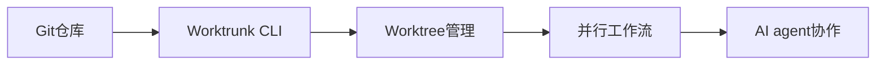

## 今日热点

今日GitHub热榜聚焦AI代理技能生态的爆发式增长与多媒体生成技术的成熟，NVIDIA、Google、Microsoft等科技巨头纷纷布局，推动AI应用向专业化、工具化方向发展。

---

## 热门项目一览

| 排名 | 项目 | 语言 | 今日 | 总计 | 简介 |
|:---:|------|:----:|------:|-----:|------|
| 1 | [NVIDIA/auto-ontology](https://github.com/NVIDIA/auto-ontology) | Python | +2,679 | 7,642 | Auto Ontology is a Python f... |
| 2 | [vercel-labs/agent-desktop](https://github.com/vercel-labs/agent-desktop) | Rust | +2,173 | 17,139 | Computer use CLI for AI agents |
| 3 | [mattpocock/skills](https://github.com/mattpocock/skills) | Shell | +2,071 | 315,513 | Skills for Real Engineers. ... |
| 4 | [D4Vinci/Scrapling](https://github.com/D4Vinci/Scrapling) | Python | +1,655 | 98,184 | 🕷️ The BEST Web Scraping fr... |
| 5 | [JiaFeiMiao-K-Cat/DiscImageStudio](https://github.com/JiaFeiMiao-K-Cat/DiscImageStudio) | C# | +984 | 7,387 | No description |
| 6 | [floci-io/floci](https://github.com/floci-io/floci) | Java | +779 | 30,519 | Light, fluffy, and always f... |
| 7 | [scenario-labs/skills](https://github.com/scenario-labs/skills) | Python | +667 | 3,163 | Get production-ready images... |
| 8 | [garrytan/gstack](https://github.com/garrytan/gstack) | TypeScript | +612 | 140,052 | Use Garry Tan's exact Claud... |
| 9 | [max-sixty/worktrunk](https://github.com/max-sixty/worktrunk) | Rust | +546 | 11,587 | Worktrunk is a CLI for Git ... |
| 10 | [Usagi-org/ai-goofish-monitor](https://github.com/Usagi-org/ai-goofish-monitor) | Python | +240 | 17,781 | 基于 Playwright 和AI实现的闲鱼多任务实时... |
| 11 | [microsoft/VibeVoice](https://github.com/microsoft/VibeVoice) | Python | +223 | 56,094 | Open-Source Frontier Voice AI |
| 12 | [google/skills](https://github.com/google/skills) | Python | +211 | 22,452 | Agent Skills for Google pro... |

---

## 趋势洞察

```
┌─────────────────────────────────────────────────────────────────┐
│  AI/ML 工具         ████████████████████████  11 个项目        │
│  多媒体应用            ████                      2 个项目        │
│  其他               ████                      2 个项目        │
└─────────────────────────────────────────────────────────────────┘
```

---

## 项目深度解读

### 1. NVIDIA/auto-ontology — 语义推理框架

> **一句话总结**：基于图的本体构建框架，为LLM和AI代理提供确定性查询生成和可解释推理能力。

#### 价值主张

| 维度 | 说明 |
|------|------|
| **解决痛点** | 解决AI系统中语义理解不足和推理过程黑盒问题 |
| **目标用户** | AI研究人员、LLM开发者、需要增强语义推理能力的系统架构师 |
| **核心亮点** | 基于图的语义推理 + 确定性查询生成 + 上下文优化 + 可解释AI + LLM工作流集成 |

#### 技术架构


**技术特色**：
- 基于图的语义推理引擎，提供结构化的知识表示
- 确定性查询生成机制，减少LLM输出的随机性
- 上下文优化技术，提高信息检索的相关性

#### 热度分析

- 项目Star数超7,600且近期增长显著(+2,679)，显示语义推理领域热度攀升
- 作为NVIDIA开发的开源项目，在AI基础设施生态中占据重要战略位置

#### 快速上手

```bash
# 安装框架
pip install auto-ontology

# 基本使用示例
from auto_ontology import OntologyBuilder
builder = OntologyBuilder(data_source="your_data")
ontology = builder.build()
```

#### 注意事项

- 由于许可证信息未知，商业使用前需确认开源许可条款
- 项目文档和API可能还不够完善，需要参考源码和示例
- 作为NVIDIA项目，可能与特定硬件或软件生态有深度集成，使用时需考虑兼容性


### 3. mattpocock/skills — 工程效率工具集

> **一句话总结**：面向真实工程师的实用Shell脚本集合，提供日常开发高效工具。

#### 价值主张

| 维度 | 说明 |
|------|------|
| **解决痛点** | 提供现成Shell脚本，解决工程师日常任务自动化问题 |
| **目标用户** | 开发人员、系统管理员和DevOps工程师 |
| **核心亮点** | 即插即用脚本 + 模块化设计 + 跨平台兼容 + 高效工具集 |

#### 技术架构


**技术特色**：
- 纯Shell实现，无需依赖环境
- 模块化设计，各脚本功能独立
- 即插即用，提高工作效率

#### 热度分析

- 项目获得31万+Stars，单日增长2000+，社区认可度极高
- Fork/Star比例合理，表明用户积极参与贡献和定制

#### 快速上手

```bash
# 克隆仓库
git clone https://github.com/mattpocock/skills.git
# 添加到PATH并加载
echo $(pwd)/skills >> ~/.bashrc && source ~/.bashrc
```

#### 注意事项

- 项目许可信息未知，商业使用前需确认授权
- 主要为Shell脚本，Windows环境需使用WSL
- 使用前应检查脚本内容，确保安全性


### 4. D4Vinci/Scrapling — 全能爬虫框架

> **一句话总结**：Scrapling是Python全能爬虫框架，支持从简单请求到大规模爬取的全流程自动化处理。

#### 价值主张

| 维度 | 说明 |
|------|------|
| **解决痛点** | 统一处理网页请求、解析、存储和反爬虫等复杂爬虫任务 |
| **目标用户** | 需要高效采集网络数据的数据科学家与开发者 |
| **核心亮点** | 全流程自动化 + 高效反爬机制 + 异步处理能力 + 多格式输出 |

#### 技术架构


**技术特色**：
- 内置智能反爬虫系统，自动识别和绕过常见反爬措施
- 异步处理架构，大幅提升大规模爬取效率
- 模块化设计，支持灵活配置和功能扩展

#### 热度分析

- 近10万stars且单日增长超1.6k，表明项目处于高速增长期，社区认可度高
- 零Open Issues显示项目维护质量优秀，用户问题响应及时

#### 快速上手

```bash
# 安装Scrapling
pip install scrapling

# 基本爬取示例
from scrapling import Scrapling
scraper = Scrapling('https://example.com')
data = scraper.get().parse()
print(data.text)
```

#### 注意事项

- 使用时需遵守目标网站的使用条款，避免过度请求导致服务器压力
- 部分高级功能可能需要额外配置API密钥或付费服务
- 对于动态加载内容，可能需要额外配置JavaScript渲染器


### 5. JiaFeiMiao-K-Cat/DiscImageStudio — 光盘映像处理工具

> **一句话总结**：专业的光盘映像创建、编辑与转换工具，支持多种格式，提供直观界面。

#### 价值主张

| 维度 | 说明 |
|------|------|
| **解决痛点** | 解决光盘映像创建、编辑、转换与管理需求，替代复杂命令行操作 |
| **目标用户** | 需要处理光盘映像的开发者、系统管理员和普通用户 |
| **核心亮点** | 直观的图形界面 + 多格式支持 + 高效处理 + 批量操作 |

#### 技术架构


**技术特色**：
- 基于.NET的高性能映像处理引擎
- 支持ISO、BIN、CUE、NRG等多种光盘映像格式
- 采用流式处理技术，大文件处理高效

#### 热度分析

- 项目近期关注度显著提升，单日新增近千星，反映用户需求强烈
- Fork数量相对较少，表明用户更倾向于直接使用而非二次开发

#### 快速上手

```bash
# 克隆项目
git clone https://github.com/JiaFeiMiao-K-Cat/DiscImageStudio.git

# 使用Visual Studio打开解决方案并运行
```

#### 注意事项
- 项目未明确许可证信息，使用前需确认开源协议
- 需要安装.NET运行环境才能运行
- 处理大文件时可能需要较高内存配置


### 6. floci-io/floci — AWS本地模拟器

> **一句话总结**：轻量级AWS服务本地模拟器，无需云资源即可开发和测试云应用。

#### 价值主张

| 维度 | 说明 |
|------|------|
| **解决痛点** | 解决本地开发和测试AWS服务时依赖云资源的问题 |
| **目标用户** | AWS应用开发者、DevOps工程师、云服务测试人员 |
| **核心亮点** | 轻量级 + 免费使用 + 无需云资源 + 高兼容性 + 易于部署 |

#### 技术架构


**技术特色**：
- 基于Java构建，跨平台兼容性好
- 轻量级设计，资源占用低
- 支持多种AWS服务API模拟

#### 热度分析

- 项目Star数超过3万，近期增长迅速，日均增加约800星，表明社区认可度高
- Fork数量适中，显示项目已被广泛采用并二次开发
- Issues数量为0，表明项目成熟稳定或问题处理高效

#### 快速上手

```bash
# 下载floci
curl -sSL https://floci.io/install | bash

# 启动floci
floci start

# 访问AWS服务
aws s3 ls --endpoint-url=http://localhost:4566
```

#### 注意事项

- 项目许可证信息不明确，使用前需确认授权条款
- 需要Java运行环境支持
- 不支持所有AWS服务的完整功能
- 生产环境使用前需充分测试兼容性


### 7. scenario-labs/skills — AI内容创作平台

> **一句话总结**：智能AI内容创作工具，提供图像、视频、音频和3D内容生成，支持多软件集成与成本优化。

#### 价值主张

| 维度 | 说明 |
|------|------|
| **解决痛点** | AI创作中模型选择难、成本不可控、风格不一致问题 |
| **目标用户** | 内容创作者、3D艺术家、游戏开发者、品牌营销团队 |
| **核心亮点** | 智能模型选择 + 成本预估 + 风格一致性 + 多软件集成 + 专业团队支持 |

#### 技术架构


**技术特色**：
- 智能AI模型匹配算法
- 实时成本预估系统
- 跨平台内容一致性保证
- 多专业软件API集成
- MCP协议支持

#### 热度分析

- 项目近期Star数激增(+667 today)，显示社区高度关注
- 处于AI内容创作热点领域，具有良好生态发展潜力

#### 快速上手

```bash
# 安装项目
pip install scenario-skills

# 初始化项目
scenario-init --project my-creative-project

# 生成内容
scenario-generate --type image --prompt "创意描述"
```

#### 注意事项

- 项目许可证信息未知，使用前需确认授权条款
- 作为AI生成工具，需注意内容版权和使用规范
- 高级功能可能需要付费订阅


### 8. garrytan/gstack — 开发工具集

> **一句话总结**：23个精心挑选的开发工具组合，覆盖CEO、设计师、工程经理等多角色工作流程。

#### 价值主张

| 维度 | 说明 |
|------|------|
| **解决痛点** | 整合分散的开发工具，提供一站式开发体验 |
| **目标用户** | 全栈开发者和需要多角色协作的开发团队 |
| **核心亮点** | 精选工具组合 + 全角色覆盖 + 高度集成 + 优化工作流 + 提升效率 |

#### 技术架构

**技术特色**：
- 基于TypeScript构建，提供类型安全
- 工具高度集成，减少切换成本
- 精心挑选的23个工具组合

#### 热度分析

- 项目获得14万+星标，近期呈快速增长趋势，表明开发者高度认可
- Fork数量与Star比例合理，显示项目被广泛采用并可能进行二次开发

#### 快速上手

```bash
# 克隆项目
git clone https://github.com/garrytan/gstack.git

# 安装依赖
cd gstack && npm install

# 启动工具栈
npm start
```

#### 注意事项

- 项目包含23个工具，初次使用可能需要时间适应
- 工具组合基于Garry Tan的个人工作流，可能需要根据团队需求调整
- 项目许可证未知，商业使用前需确认许可条款


### 9. max-sixty/worktrunk — Git工作流管理

> **一句话总结**：Worktrunk 简化 Git worktree 管理，专为支持多个 AI agent 并行工作流而设计。

#### 价值主张

| 维度 | 说明 |
|------|------|
| **解决痛点** | 简化多个分支并行工作管理，解决 AI agent 协作冲突问题 |
| **目标用户** | 需要同时处理多个分支的开发者和 AI 协作团队 |
| **核心亮点** | 简化worktree管理 + 支持并行工作流 + 智能冲突解决 + 高效切换 |

#### 技术架构



**技术特色**：
- 基于Rust构建，提供高性能和内存安全
- 专为Git worktree管理优化，简化多分支操作
- 支持AI agent并行工作流，智能处理分支冲突

#### 热度分析

- 项目Star数超过11,500，且近期增长迅速(+546 today)，表明社区对Git工作流工具有强烈需求
- 零Open Issues反映项目成熟度高，社区维护良好

#### 快速上手

```bash
# 安装worktrunk
cargo install worktrunk

# 创建新的worktree
worktrunk create <branch-name>

# 列出所有worktree
worktrunk list
```

#### 注意事项

- 需要安装Git才能使用worktrunk
- 在Windows上可能需要额外配置Git路径
- 大型仓库中创建多个worktree可能占用较多磁盘空间


### 10. Usagi-org/ai-goofish-monitor — AI闲鱼监控

> **一句话总结**：基于Playwright和AI的闲鱼多任务实时/定时监控系统，智能筛选海量商品信息。

#### 价值主张

| 维度 | 说明 |
|------|------|
| **解决痛点** | 解决闲鱼海量商品信息筛选难、实时监控成本高的问题 |
| **目标用户** | 需要在闲鱼上寻找特定商品的买家、收藏家、二手交易爱好者 |
| **核心亮点** | AI智能分析 + 多任务实时监控 + 定时任务 + 后台管理UI + 智能筛选 |

#### 技术架构


**技术特色**：
- Playwright实现高效网页自动化和数据采集
- AI智能分析商品特征和价值
- 多任务并发监控系统
- 完善的后台管理UI界面
- 定时任务和实时监控双模式

#### 热度分析

- 项目Star数达17,781且近期增长240，显示社区高度关注和活跃使用
- 作为AI驱动的电商监控工具，处于AI应用与电商交叉的热门领域

#### 快速上手

```bash
# 克隆项目
git clone https://github.com/Usagi-org/ai-goofish-monitor.git
# 安装依赖
pip install -r requirements.txt
# 启动服务
python app.py
```

#### 注意事项

- 需要注意闲鱼平台的使用条款，避免违反平台规则
- AI分析结果仅供参考，实际购买前仍需人工确认商品信息
- 系统可能需要定期更新以适应闲鱼网站结构变化


### 11. microsoft/VibeVoice — 前沿语音AI

> **一句话总结**：Microsoft开源的尖端语音AI技术，提供高精度语音识别与合成能力。

#### 价值主张

| 维度 | 说明 |
|------|------|
| **解决痛点** | 解决传统语音技术在复杂环境下的识别准确率低和自然度不足的问题 |
| **目标用户** | 语音应用开发者、AI研究人员、智能系统构建者 |
| **核心亮点** | 多语言支持 + 实时处理能力 + 低资源优化 + 开源可定制 |

#### 技术架构


**技术特色**：
- 基于Transformer架构的先进语音模型
- 端到端语音处理流水线设计
- 高效的音频特征提取与编码技术

#### 热度分析

- 项目Star数超5.6万且持续快速增长，显示语音AI领域热度持续攀升
- 作为Microsoft开源项目，在AI社区具有重要影响力，吸引大量开发者参与

#### 快速上手

```bash
# 安装依赖
pip install vibevoice

# 基本语音识别
vibevoice recognize --input audio.wav

# 语音合成
vibevoice synthesize --text "Hello World" --output output.wav
```

#### 注意事项

- 项目License未知，使用前需确认授权条款
- 可能需要较高计算资源进行模型训练
- 作为前沿技术，API可能仍在快速迭代中


### 12. google/skills — Google技能库

> **一句话总结**：为Google产品提供统一的代理技能接口，简化开发者与Google生态系统的交互

#### 价值主张

| 维度 | 说明 |
|------|------|
| **解决痛点** | 解决开发者与多Google产品API交互的复杂性和碎片化问题 |
| **目标用户** | 使用Google API的开发者和AI系统构建者 |
| **核心亮点** | 模块化技能设计 + 跨Google产品支持 + 统一接口抽象 + 易于扩展 |

#### 技术架构


**技术特色**：
- 基于Python的模块化技能实现框架
- 统一的Google产品API接口抽象层
- 可扩展的技能注册与发现机制

#### 热度分析

- 高星项目(22K+)且持续稳定增长(+211/天)，社区认可度高
- 零开放问题，表明项目维护状态良好，成熟度高

#### 快速上手

```bash
# 安装项目
pip install google-skills

# 基本使用
from google_skills import GmailSkill, DriveSkill

# 初始化并使用技能
gmail = GmailSkill()
gmail.send_email(to="test@gmail.com", subject="Hello", body="Test message")
```

#### 注意事项

- 项目许可证未知，商业使用前需确认许可条款
- 需要有效的Google API认证才能使用相关功能
- 依赖Google服务状态，可能受到API限制或变更影响


### 13. ConardLi/garden-skills — 前端技能宝典

> **一句话总结**：一个全面的前端技术资源库，汇集设计、检索、图像生成等多领域实用技能。

#### 价值主张

| 维度 | 说明 |
|------|------|
| **解决痛点** | 解决开发者寻找高质量前端资源和实用技能的难题 |
| **目标用户** | 前端开发者、全栈工程师、技术爱好者 |
| **核心亮点** | 内容全面覆盖 + 实用代码示例 + 持续更新 + 结构化组织 |

#### 热度分析

- 项目Star数超14,000且持续增长，在前端开发领域具有高影响力
- Fork数与Star数比例合理，表明用户不仅关注还积极参与使用和贡献

#### 快速上手

```bash
# 克隆项目到本地
git clone https://github.com/ConardLi/garden-skills.git

# 进入项目目录查看内容
cd garden-skills && ls
```

#### 注意事项

- 项目内容需要一定前端基础才能完全理解
- 作为个人维护项目，更新频率可能不稳定
- 部分技术方案可能需要根据最新发展趋势进行调整


### 14. vercel-labs/agent-browser — AI浏览器自动化

> **一句话总结**：为AI代理提供强大的浏览器自动化能力，实现智能网页交互与任务执行。

#### 价值主张

| 维度 | 说明 |
|------|------|
| **解决痛点** | AI代理无法直接与网页交互，限制了其在实际应用中的能力 |
| **目标用户** | AI开发者、自动化测试工程师、智能系统构建者 |
| **核心亮点** | 基于Rust构建的高性能 + 支持复杂网页交互 + 命令行接口简洁易用 + 专为AI代理优化 |

#### 技术架构


**技术特色**：
- 基于Rust构建，性能优异且内存安全
- 提供高级API简化浏览器自动化操作
- 支持复杂网页元素定位和交互

#### 热度分析

- 项目获得46,015个Star且持续增长(+150 today)，表明在浏览器自动化和AI结合领域备受关注
- 作为Vercel实验室项目，在开发者社区具有较高可信度和影响力

#### 快速上手

```bash
# 安装
cargo install agent-browser

# 基本使用
agent-browser navigate "https://example.com"
agent-browser click ".submit-button"
agent-browser get-text ".content"
```

#### 注意事项

- 项目可能需要特定的浏览器环境支持
- 对于复杂的动态网页，可能需要额外的配置
- 由于项目基于Rust，需要安装Rust工具链
- 项目可能仍在开发中，API可能会有变化


### 15. lz4/lz4 — 极速压缩库

> **一句话总结**：lz4是一款极致快速的压缩算法库，提供极高的压缩/解压速度，适合实时数据压缩场景。

#### 价值主张

| 维度 | 说明 |
|------|------|
| **解决痛点** | 解决传统压缩算法速度慢，无法满足实时数据处理需求的问题 |
| **目标用户** | 需要高性能数据压缩的开发者，特别是实时系统和大数据处理领域 |
| **核心亮点** | 极高压缩速度 + 合理的压缩率 + 零拷贝设计 + 流式API支持 |

#### 技术架构


**技术特色**：
- 基于LZ77算法变种，优化了速度和内存访问模式
- 使用哈希表加速匹配查找，提升压缩效率
- 支持流式处理和随机访问，适应多种使用场景

#### 热度分析

- 项目拥有12k+星标，持续稳定增长，表明其在压缩领域的重要性和受欢迎程度
- 零开放问题表明项目成熟度高，社区维护良好，是数据压缩领域的重要基础设施

#### 快速上手

```bash
# 安装
sudo apt-get install liblz4-dev  # Ubuntu/Debian
brew install lz4                 # macOS

# 基本使用
echo "Hello World" | lz4 -c > compressed.lz4
lz4 -d compressed.lz4 -c
```

#### 注意事项

- 压缩率相比gzip等算法较低，不适合需要高压缩率的场景
- 解压缩速度极快，适合需要快速读取压缩数据的场景
- 提供了多种API，需要根据使用场景选择合适的接口


## 今日推荐

| 主题 | 推荐项目 | 亮点 |
|------|----------|------|
| 今日最热 | [NVIDIA/auto-ontology](https://github.com/NVIDIA/auto-ontology) | Auto Ontology is ... |
| 值得关注 | [vercel-labs/agent-desktop](https://github.com/vercel-labs/agent-desktop) | Computer use CLI ... |
| 快速上手 | [mattpocock/skills](https://github.com/mattpocock/skills) | Skills for Real E... |
| 长期潜力 | [D4Vinci/Scrapling](https://github.com/D4Vinci/Scrapling) | 🕷️ The BEST Web S... |

---

<div align="center">

*Generated on 2026-11-06 | Powered by GitHub Trending Reporter*

</div>