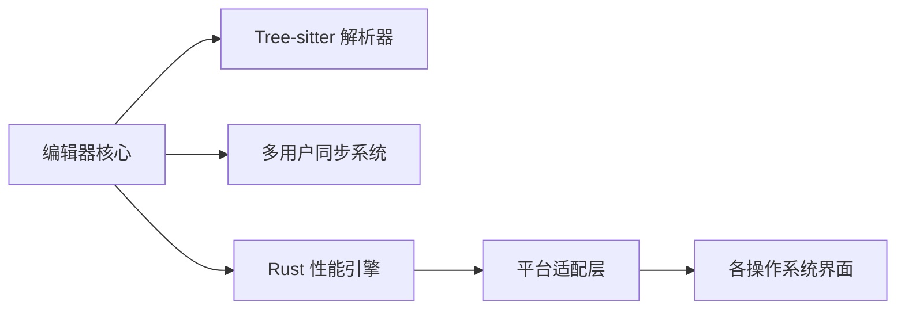
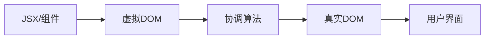
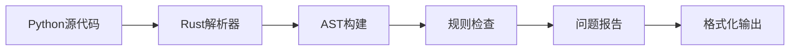
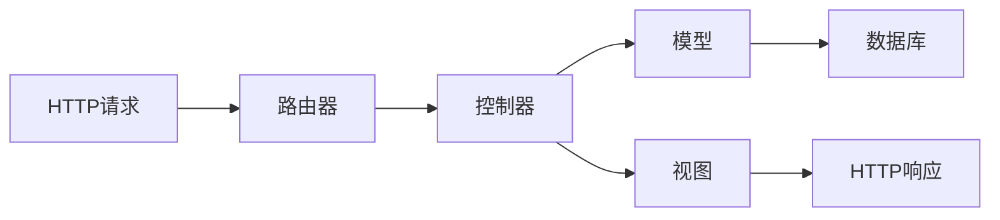
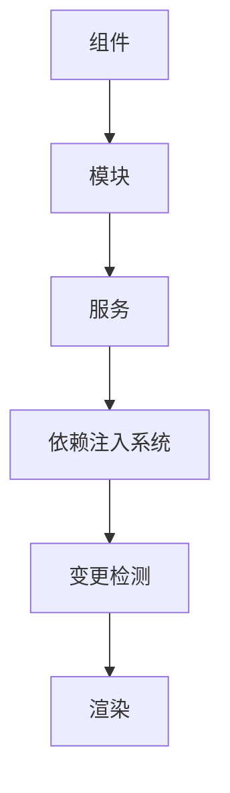
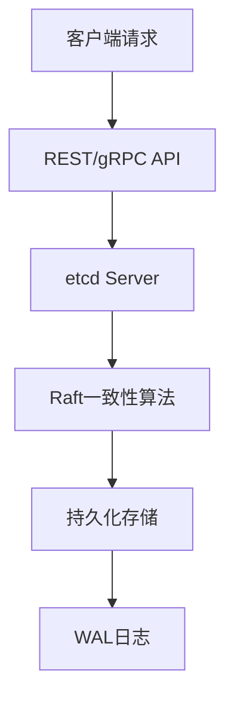

## 今日热点

AI辅助开发工具与高性能代码编辑器引领今日热榜，Rust语言持续崛起，安全审计工具受广泛关注。

---

## 热门项目一览

| 排名 | 项目 | 语言 | 今日 | 总计 | 简介 |
|:---:|------|:----:|------:|-----:|------|
| 1 | [cloudflare/security-audit-skill](https://github.com/cloudflare/security-audit-skill) | JavaScript | +2,548 | 64,257 | A coding-agent skill for mu... |
| 2 | [mattpocock/skills](https://github.com/mattpocock/skills) | Shell | +2,070 | 316,843 | Skills for Real Engineers. ... |
| 3 | [NVIDIA/auto-ontology](https://github.com/NVIDIA/auto-ontology) | Python | +2,015 | 9,199 | Auto Ontology is a Python f... |
| 4 | [google/skills](https://github.com/google/skills) | Python | +534 | 22,884 | Agent Skills for Google pro... |
| 5 | [zed-industries/zed](https://github.com/zed-industries/zed) | Rust | +306 | 93,731 | Code at the speed of though... |
| 6 | [microsoft/vscode](https://github.com/microsoft/vscode) | TypeScript | +301 | 195,053 | Visual Studio Code |
| 7 | [react/react](https://github.com/react/react) | JavaScript | +248 | 252,280 | The library for web and nat... |
| 8 | [rust-lang/rust](https://github.com/rust-lang/rust) | Rust | +192 | 121,491 | Empowering everyone to buil... |
| 9 | [astral-sh/ruff](https://github.com/astral-sh/ruff) | Rust | +169 | 50,722 | An extremely fast Python li... |
| 10 | [prometheus/prometheus](https://github.com/prometheus/prometheus) | Go | +148 | 67,213 | The Prometheus monitoring s... |
| 11 | [rails/rails](https://github.com/rails/rails) | Ruby | +142 | 59,042 | Ruby on Rails |
| 12 | [angular/angular](https://github.com/angular/angular) | TypeScript | +135 | 101,396 | Deliver web apps with confi... |

---

## 趋势洞察

```
┌─────────────────────────────────────────────────────────────────┐
│  AI/ML 工具         ████████████████████████  5 个项目        │
│  其他               ███████████████████       4 个项目        │
│  开发框架             ██████████████            3 个项目        │
│  数据分析             █████████                 2 个项目        │
│  多媒体应用            ████                      1 个项目        │
│  开发工具             ████                      1 个项目        │
│  安全工具             ████                      1 个项目        │
└─────────────────────────────────────────────────────────────────┘
```

---

## 项目深度解读

### 1. cloudflare/security-audit-skill — 安全审计工具

> **一句话总结**：提供多阶段安全审计能力，输出机器可读的独立验证安全发现。

#### 价值主张

| 维度 | 说明 |
|------|------|
| **解决痛点** | 安全审计流程复杂、结果不标准、难以自动化的问题 |
| **目标用户** | 安全审计人员、开发团队、DevOps工程师 |
| **核心亮点** | 多阶段审计 + 机器可读结果 + 独立验证 + 自动化审计流程 |

#### 技术架构


**技术特色**：
- 多阶段安全分析方法
- 机器可读的输出格式
- 独立验证机制确保结果可靠性

#### 热度分析

- Star数高达64,257且近期增长2,548，表明项目受到广泛关注
- 作为Cloudflare的开源项目，在企业安全领域具有重要影响力

#### 快速上手

```bash
npm install -g security-audit-skill
audit-skill --help
```

#### 注意事项

- 可能需要配置特定环境或参数才能运行
- 结果解读需要一定的安全专业知识
- 项目许可证信息不明确，使用前需确认许可条款


### 2. mattpocock/skills — 工程师技能库

> **一句话总结**：一个高星级的工程师实用命令与脚本集合，提供日常开发中的高效工具与解决方案。

#### 价值主张

| 维度 | 说明 |
|------|------|
| **解决痛点** | 提供工程师日常开发中的实用脚本，解决重复性工作问题 |
| **目标用户** | 开发人员、系统管理员、DevOps工程师 |
| **核心亮点** | 精选实用命令 + 直接可执行脚本 + 高效解决方案 |

#### 技术架构


**技术特色**：
- 纯Shell脚本实现，跨平台兼容性好
- 脚本模块化设计，便于组合使用
- 直接从实践出发，解决真实工程问题

#### 热度分析

- 项目获得31万+ stars，单日增长2000+，表明工程师社区对实用工具的强烈需求
- 在开发者工具领域具有显著影响力，成为许多开发者的必备参考资源

#### 快速上手

```bash
# 克隆项目到本地
git clone https://github.com/mattpocock/skills.git

# 浏览并使用需要的脚本
cd skills && ls
```

#### 注意事项

- 使用前请检查脚本兼容性，确保适合你的系统环境
- 部分脚本可能需要根据实际需求进行修改，不建议在生产环境直接使用未经测试的脚本


### 3. NVIDIA/auto-ontology — 语义图推理框架

> **一句话总结**：Auto Ontology构建语义图推理层，为LLM和代理提供确定性查询与可解释AI能力。

#### 价值主张

| 维度 | 说明 |
|------|------|
| **解决痛点** | 解决LLM和代理工作流中语义理解与推理能力不足的问题 |
| **目标用户** | AI研究人员、数据科学家、构建LLM应用的开发者 |
| **核心亮点** | 语义图推理+确定性查询+可解释AI+上下文增强+图结构数据 |

#### 技术架构


**技术特色**：
- 结合语义本体与图结构增强LLM推理能力
- 提供确定性查询生成，减少LLM不确定性
- 构建可解释的AI决策路径，提高透明度

#### 热度分析

- 项目Star数达9,199且今日增长2,015，表明该项目近期获得高度关注，可能是NVIDIA最新发布的重要项目
- 作为NVIDIA官方项目，具有强大的技术背书和社区支持，在AI基础设施领域占据重要位置

#### 快速上手

```bash
# 安装auto-ontology框架
pip install auto-ontology

# 基本使用示例
from auto_ontology import OntologyBuilder
ontology = OntologyBuilder()
ontology.build_from_data("your_data_source")
query = ontology.generate_query("your_question")
```

#### 注意事项

- 需要了解基本的图数据库和语义网概念才能充分利用框架功能
- 作为NVIDIA项目，可能需要特定的GPU资源来获得最佳性能
- 项目可能需要与其他NVIDIA AI工具链配合使用才能发挥最大效用


### 4. google/skills — Google智能技能

> **一句话总结**：为Google产品提供可复用的AI能力接口，简化开发者与Google服务的集成。

#### 价值主张

| 维度 | 说明 |
|------|------|
| **解决痛点** | 简化开发者与Google产品集成的复杂性，提供标准化技能接口 |
| **目标用户** | Google服务开发者、AI应用构建者 |
| **核心亮点** | 模块化设计 + 易于集成 + 跨Google产品支持 + 可扩展性 |

#### 技术架构


**技术特色**：
- 基于Python的轻量级框架
- 模块化技能设计
- 统一的API接口规范

#### 热度分析

- 项目Star数超过22k，近期增长迅速，显示社区高度认可
- 作为Google官方项目，在AI技能开发领域具有重要生态地位

#### 快速上手

```bash
# 克隆仓库
git clone https://github.com/google/skills.git

# 安装依赖
pip install -r requirements.txt
```

#### 注意事项

- 需要Google API访问权限
- 部分功能可能需要Google Cloud账号
- 注意API使用限制和配额


### 5. zed-industries/zed — 高性能多人编辑器

> **一句话总结**：由 Atom 和 Tree-sitter 创作者打造的高性能多人协作代码编辑器，实现思维与代码同步的速度。

#### 价值主张

| 维度 | 说明 |
|------|------|
| **解决痛点** | 解决传统编辑器性能瓶颈与协作障碍，提供极速编辑体验 |
| **目标用户** | 高性能需求开发者、远程协作团队、大项目维护者 |
| **核心亮点** | 高性能引擎 + 多人实时协作 + 跨平台支持 + AI 辅助编程 + 智能错误检测 |

#### 技术架构



**技术特色**：
- 基于 Rust 编写，提供卓越性能与内存安全
- 利用 Tree-sitter 实现精确语法解析与代码分析
- 采用分布式架构支持多人实时协作编辑
- 自定义渲染引擎，保证流畅编辑体验
- 跨平台支持，保持一致的用户体验

#### 热度分析

- 项目短期内获得 93k+ stars，日均增长 300+，呈现指数级增长趋势
- 作为新兴编辑器已形成活跃社区，与 VS Code 等传统编辑器形成差异化竞争

#### 快速上手

```bash
# 通过官方安装脚本安装
curl https://zed.dev/install.sh | sh

# 启动 Zed
zed

# 安装扩展
zed package install <extension-name>
```

#### 注意事项

- 项目仍处于早期开发阶段，API 和功能可能不稳定
- 相比成熟的编辑器，插件生态系统仍在建设中
- 部分高级功能可能需要订阅付费版本


### 6. microsoft/vscode — 跨平台代码编辑器

> **一句话总结**：轻量级但功能强大的源代码编辑器，内置调试、Git控制和丰富的扩展生态系统。

#### 价值主张

| 维度 | 说明 |
|------|------|
| **解决痛点** | 提供轻量级替代传统IDE的编辑环境，无需牺牲功能 |
| **目标用户** | 专业开发者、学生和需要多语言支持的技术人员 |
| **核心亮点** | 轻量快速 + 丰富的扩展生态 + 强大的调试功能 + 跨平台支持 + 内置终端 |

#### 技术架构


**技术特色**：
- 基于Electron框架构建，结合Web技术与原生性能
- 采用语言服务器协议(LSP)实现多语言智能支持
- 模块化设计，通过插件系统实现功能扩展

#### 热度分析

- 作为GitHub上最受欢迎的开源项目之一，持续稳定增长，反映开发者社区的高度认可
- 庞大的用户基础和活跃的插件生态系统，形成了完整的开发工具链生态

#### 快速上手

```bash
# 克隆仓库
git clone https://github.com/microsoft/vscode.git

# 安装依赖
npm install

# 运行开发版本
code .
```

#### 注意事项

- 项目体积较大，编译和运行需要较好的硬件支持
- 插件开发需要熟悉TypeScript和VS Code API
- 某些功能可能因操作系统不同而有差异


### 7. react/react — 组件化UI框架

> **一句话总结**：使用组件化和虚拟DOM技术构建高效、可维护的用户界面，提供声明式编程范式。

#### 价值主张

| 维度 | 说明 |
|------|------|
| **解决痛点** | 解决UI构建复杂、难以维护的问题，提供声明式编程范式 |
| **目标用户** | 前端开发者、全栈工程师、移动应用开发者 |
| **核心亮点** | 组件化 + 虚拟DOM + 单向数据流 + Hooks + JSX语法 |

#### 技术架构



**技术特色**：
- 虚拟DOM技术减少直接操作DOM的次数，提高性能
- 单向数据流使状态变化可预测，便于调试
- Hooks机制简化状态管理和副作用处理

#### 热度分析

- React作为前端三大框架之一，拥有超过25万stars，持续增长，显示其在业界的统治地位
- 拥有庞大的生态系统和社区支持，是Facebook/Meta维护的核心项目，稳定性有保障

#### 快速上手

```bash
# 创建React应用
npx create-react-app my-app
cd my-app
npm start
```

#### 注意事项

- React仅关注视图层，需要结合其他库(如Redux、React Router)构建完整应用
- 学习曲线相对陡峭，需要理解JSX、组件生命周期、Hooks等概念


### 8. rust-lang/rust — 系统编程语言

> **一句话总结**：Rust是一种内存安全的系统编程语言，无需垃圾回收即可实现高性能与可靠性。

#### 价值主张

| 维度 | 说明 |
|------|------|
| **解决痛点** | 解决传统系统编程语言中内存安全和并发控制的难题 |
| **目标用户** | 系统开发者、嵌入式工程师、高性能应用开发者 |
| **核心亮点** | 所有权系统 + 零成本抽象 + 并发安全 + 强类型系统 |

#### 技术架构


**技术特色**：
- 所有权系统确保内存安全
- 借用检查器在编译时捕获数据竞争
- 无需垃圾回收器的内存管理
- 强类型系统与模式匹配
- 丰富的 trait 系统实现多态

#### 热度分析

- Rust项目保持稳定高增长，Star数超12万，每日新增约190星，表明社区持续活跃
- 作为系统编程领域的新兴力量，已被广泛应用于浏览器内核、操作系统等底层系统

#### 快速上手

```bash
# 安装Rust
curl --proto '=https' --tlsv1.2 -sSf https://sh.rustup.rs | sh

# 创建新项目
cargo new hello_rust
cd hello_rust

# 运行项目
cargo run
```

#### 注意事项

- Rust的学习曲线较陡峭，特别是所有权和借用概念需要时间适应
- 某些场景下，Rust的严格类型系统可能增加代码复杂度
- 生态系统相比C++和Java仍在发展中，某些第三方库可能不够成熟


### 9. astral-sh/ruff — 极速Python工具

> **一句话总结**：用Rust重写的超高速Python代码检查和格式化工具，性能远超传统工具。

#### 价值主张

| 维度 | 说明 |
|------|------|
| **解决痛点** | 解决Python代码检查慢、资源消耗高的问题 |
| **目标用户** | Python开发者、代码审查团队、CI/CD流程 |
| **核心亮点** | 极致速度 + 兼容flake8/pylint规则 + 内置格式化功能 |

#### 技术架构



**技术特色**：
- 基于Rust的高性能实现，比纯Python工具快10-100倍
- 自研Python解析器，无需依赖CPython API
- 支持并行处理，充分利用多核CPU
- 单一可执行文件，无需依赖Python环境

#### 热度分析

- Star数超5万且持续增长，表明项目获得社区广泛认可
- 作为Python生态中的新兴工具，正在替代传统lint工具

#### 快速上手

```bash
# 安装
pip install ruff

# 检查代码
ruff check your_file.py

# 格式化代码
ruff format your_file.py
```

#### 注意事项

- 部分flake8规则可能存在兼容差异，需仔细验证
- 对于复杂项目，可能需要配置文件进行精细控制
- 格式化功能相对较新，可能不如black成熟


### 10. prometheus/prometheus — 云原生监控核心

> **一句话总结**：专为云原生环境设计的开源监控系统和时序数据库，提供强大的数据采集与查询能力。

#### 价值主张

| 维度 | 说明 |
|------|------|
| **解决痛点** | 解决云原生环境下分布式系统监控、数据收集和告警的核心问题 |
| **目标用户** | DevOps工程师、SRE团队、云原生应用开发者 |
| **核心亮点** | 多维数据模型 + 强大的查询语言(PromQL) + 服务发现能力 + 高效时序存储 |

#### 技术架构


**技术特色**：
- 基于Pull模型的监控数据采集方式，减少客户端负担
- 自定义的时序数据库格式，针对监控数据高度优化
- 支持多维标签数据模型，便于灵活查询和分析

#### 热度分析

- Prometheus作为CNCF顶级项目，Star数持续稳定增长，显示其在监控领域的领导地位
- 在云原生监控领域占据主导地位，与Grafana等工具形成完整监控生态

#### 快速上手

```bash
# 下载并启动 Prometheus
wget https://github.com/prometheus/prometheus/releases/download/v2.35.0/prometheus-2.35.0.linux-amd64.tar.gz
tar xvfz prometheus-*.tar.gz && ./prometheus
```

#### 注意事项

- Prometheus默认数据存储在本地，需要额外配置持久化存储
- 在大规模部署环境中，需要合理配置数据保留策略和分片策略
- Prometheus的查询语言(PromQL)需要学习成本，建议通过Grafana简化可视化


### 11. rails/rails — Web开发框架

> **一句话总结**：Ruby on Rails是遵循"约定优于配置"原则的全栈Web开发框架，快速构建可扩展的Web应用。

#### 价值主张

| 维度 | 说明 |
|------|------|
| **解决痛点** | 提供全栈Web开发解决方案，简化复杂应用构建流程 |
| **目标用户** | Ruby开发者、Web应用开发者、初创企业团队 |
| **核心亮点** | 约定优于配置 + 全栈开发 + 丰富生态 + 高效迭代 + 活跃社区 |

#### 技术架构



**技术特色**：
- 内置Active Record ORM，简化数据库交互
- 强大的生成器工具，提高开发效率
- 完善的测试支持，保障代码质量

#### 热度分析

- 拥有近6万星且持续增长，日均约140颗星新增，保持稳定热度
- 作为成熟框架，在企业和初创项目中均有广泛应用，社区生态完善

#### 快速上手

```bash
# 安装Rails
gem install rails

# 创建新应用
rails new myapp

# 启动服务器
cd myapp && rails server
```

#### 注意事项

- Rails 6+ 需要Ruby 2.5+版本
- 学习曲线较陡，建议先掌握Ruby语言基础
- 对于高并发场景，可能需要额外优化


### 12. angular/angular — 企业级框架

> **一句话总结**：谷歌开发的现代化前端框架，通过组件化架构提升大型Web应用开发效率。

#### 价值主张

| 维度 | 说明 |
|------|------|
| **解决痛点** | 解决大型Web应用开发复杂度与维护性问题 |
| **目标用户** | 企业级Web应用开发团队与全栈开发者 |
| **核心亮点** | 组件化架构 + 依赖注入 + 变更检测优化 + 跨平台支持 + 完整工具链 |

#### 技术架构



**技术特色**：
- 基于TypeScript的类型安全开发体验
- 分层依赖注入系统提升代码可测试性
- 统一的变更检测机制优化性能

#### 热度分析

- 超过10万stars表明Angular在企业级前端开发领域具有强大影响力
- 作为谷歌官方维护的前端框架，拥有稳定的技术路线和活跃的社区支持

#### 快速上手

```bash
# 安装Angular CLI
npm install -g @angular/cli

# 创建新项目
ng new my-app

# 启动开发服务器
cd my-app
ng serve
```

#### 注意事项

- Angular的学习曲线较陡，需要理解其核心概念如模块、组件、服务等
- 对于小型项目，Angular的重量级特性可能显得过于复杂


### 13. nushell/nushell — 现代化数据Shell

> **一句话总结**：基于Rust的新型shell，提供强大数据处理能力和现代化脚本体验，重新定义命令行交互方式。

#### 价值主张

| 维度 | 说明 |
|------|------|
| **解决痛点** | 传统shell处理结构化数据能力有限，难以实现复杂数据处理流程 |
| **目标用户** | 开发者、数据分析师、系统管理员和命令行工具爱好者 |
| **核心亮点** | 强大数据处理能力 + 结构化数据支持 + 插件系统 + 跨平台支持 + 现代化脚本语法 |

#### 技术架构


**技术特色**：
- 基于Rust构建，提供高性能和内存安全保障
- 采用数据流管道处理，支持表格、JSON等结构化数据
- 内置丰富的数据类型和转换工具，无需额外依赖

#### 热度分析

- 项目Star数超4万，近期稳定增长，表明开发者社区对其持续关注
- 作为新型shell工具，在命令行生态中占据独特位置，吸引寻求现代shell体验的用户

#### 快速上手

```bash
# 安装nushell
cargo install nu

# 启动nushell
nu

# 示例命令：列出文件并过滤
ls | where type == "dir" | sort-by name
```

#### 注意事项

- nushell与传统bash在语法和命令上存在差异，需要学习适应
- 部分传统shell脚本可能需要重写才能在nushell中运行
- 作为较新的项目，某些高级功能可能仍在发展中


### 14. symfony/symfony — 企业级PHP框架

> **一句话总结**：Symfony是高度模块化、可扩展的企业级PHP框架，提供丰富的组件库和最佳实践。

#### 价值主张

| 维度 | 说明 |
|------|------|
| **解决痛点** | 提供企业级Web应用开发所需的结构化框架和组件库 |
| **目标用户** | PHP开发者、企业级Web应用开发团队、需要快速构建复杂系统的团队 |
| **核心亮点** | 高度模块化 + 丰富的组件库 + 严格遵循PSR标准 + 强大的命令行工具 + 活跃的社区支持 |

#### 技术架构


**技术特色**：
- 依赖注入容器实现松耦合架构
- 基于事件的系统支持灵活扩展
- 提供全面的测试工具和最佳实践

#### 热度分析

- 作为最流行的PHP框架之一，持续保持高增长率和活跃社区
- 在PHP生态系统中占据核心地位，组件被广泛应用于其他PHP项目

#### 快速上手

```bash
# 安装Symfony CLI
composer global require symfony/cli

# 创建新项目
symfony new my_project

# 启动开发服务器
cd my_project
symfony server:start
```

#### 注意事项

- Symfony学习曲线较陡峭，需要理解PHP面向对象编程和设计模式
- 对于小型项目可能过于复杂，建议评估项目规模后再选择使用


### 15. etcd-io/etcd — 分布式键值存储

> **一句话总结**：高可用、强一致的分布式键值存储，为Kubernetes等系统提供核心数据持久化服务。

#### 价值主张

| 维度 | 说明 |
|------|------|
| **解决痛点** | 解决分布式系统中关键数据的一致性、可靠性和高可用性问题 |
| **目标用户** | Kubernetes集群管理员、分布式系统开发者、云基础设施工程师 |
| **核心亮点** | 强一致性保证 + Raft算法实现 + 高可用架构 + REST API接口 + Watch机制 |

#### 技术架构



**技术特色**：
- 基于Raft算法实现分布式一致性，确保数据在集群节点间同步
- 采用WAL和快照机制保证数据持久化和故障恢复能力
- 提供租约(lease)机制实现键的自动过期和TTL功能

#### 热度分析

- Star数超5.2万且持续稳定增长，表明项目在分布式存储领域具有极高认可度
- 作为Kubernetes的核心依赖组件，拥有庞大用户基础和活跃的社区贡献生态

#### 快速上手

```bash
# 启动etcd服务
etcd --data-dir=/var/lib/etcd

# 设置键值
etcdctl put mykey "myvalue"

# 获取键值
etcdctl get mykey
```

#### 注意事项

- 生产环境中应部署奇数节点的etcd集群以保证Raft算法的正常工作
- 定期备份etcd数据，防止数据丢失
- 监控etcd集群状态，及时发现和处理节点故障
- 注意etcd的性能瓶颈通常在磁盘I/O上，建议使用SSD存储


### 16. mpv-player/mpv — 命令行播放器

> **一句话总结**：轻量级、高度可定制的命令行媒体播放器，支持几乎所有媒体格式，无广告无干扰。

#### 价值主张

| 维度 | 说明 |
|------|------|
| **解决痛点** | 提供无广告、轻量级、高度可定制的媒体播放体验 |
| **目标用户** | 命令行爱好者、开发者、追求高效播放体验的用户 |
| **核心亮点** | 高度可配置 + 跨平台支持 + 低资源占用 + 丰富的输入控制 + 广泛的格式支持 |

#### 技术架构


**技术特色**：
- 基于 MPlayer 和 mplayer2 演进而来，代码结构清晰
- 使用 libav 进行媒体解码，支持几乎所有媒体格式
- 采用模块化设计，可通过脚本扩展功能
- 支持硬件加速，降低资源占用
- 跨平台实现，支持 Windows、macOS、Linux 等

#### 热度分析

- Star 数近 4 万，且持续稳定增长，表明项目受到广泛认可
- 作为命令行播放器领域的标杆项目，拥有活跃的开发者社区和丰富的文档

#### 快速上手

```bash
# 安装 mpv
sudo apt install mpv  # Debian/Ubuntu
# 播放本地文件
mpv video.mp4
# 播放网络流
mpv https://example.com/stream.mp4
```

#### 注意事项

- mpv 主要通过命令行操作，对新手有一定学习曲线
- 配置文件位于 ~/.config/mpv/mpv.conf，可通过编辑此文件进行个性化设置
- 虽然功能强大，但默认界面较为简单，需要一定的命令行操作经验
- 对于某些特殊格式可能需要额外安装编解码器


### 17. openssl/openssl — 加密库领导者

> **一句话总结**：OpenSSL是全球广泛使用的开源加密库，提供SSL/TLS协议实现和丰富的加密算法，是互联网安全的基础组件。

#### 价值主张

| 维度 | 说明 |
|------|------|
| **解决痛点** | 解决互联网通信中的数据加密、身份验证和完整性保护等核心安全问题 |
| **目标用户** | Web服务器开发者、安全工程师、密码学研究人员和需要安全通信的软件开发者 |
| **核心亮点** | 全面支持现代加密算法 + 高度可配置的SSL/TLS实现 + 跨平台兼容性 + 丰富的API接口 + 持续的安全更新 |

#### 技术架构


**技术特色**：
- 多层次架构设计，实现协议与算法解耦
- 支持多种加密算法和协议，包括最新的TLS 1.3
- 提供命令行工具和开发API双重接口
- 高度可配置，满足不同安全需求
- 模块化设计，便于扩展和维护

#### 热度分析

- OpenSSL作为互联网安全基础组件，拥有31,000+星标和11,000+分叉，表明其在安全领域的关键地位和广泛采用
- 作为互联网基础设施的核心组件，OpenSSL拥有稳定的贡献者社区和广泛的企业支持

#### 快速上手

```bash
# 配置并构建OpenSSL
./config --prefix=/usr/local/openssl
make
make install

# 使用OpenSSL生成自签名证书
openssl req -x509 -newkey rsa:4096 -keyout key.pem -out cert.pem -days 365 -nodes
```

#### 注意事项

- OpenSSL配置复杂，错误配置可能导致安全漏洞
- 定期更新OpenSSL以修复安全漏洞，如著名的Heartbleed漏洞
- 使用最新版本的OpenSSL以获得更好的安全性和性能
- 在生产环境中使用前应充分测试配置
- 注意不同平台间的兼容性问题


## 今日推荐

| 主题 | 推荐项目 | 亮点 |
|------|----------|------|
| 今日最热 | [cloudflare/security-audit-skill](https://github.com/cloudflare/security-audit-skill) | A coding-agent sk... |
| 值得关注 | [mattpocock/skills](https://github.com/mattpocock/skills) | Skills for Real E... |
| 快速上手 | [NVIDIA/auto-ontology](https://github.com/NVIDIA/auto-ontology) | Auto Ontology is ... |
| 长期潜力 | [google/skills](https://github.com/google/skills) | Agent Skills for ... |

---

<div align="center">

*Generated on 2026-11-07 | Powered by GitHub Trending Reporter*

</div>