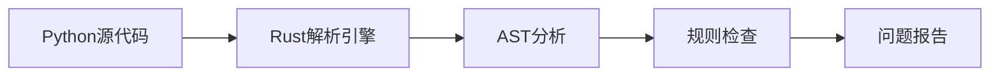

## 今日热点

今日GitHub热榜项目精彩纷呈。

---

## 热门项目一览

| 排名 | 项目 | 语言 | 今日 | 总计 | 简介 |
|:---:|------|:----:|------:|-----:|------|
| 1 | [cloudflare/security-audit-skill](https://github.com/cloudflare/security-audit-skill) | JavaScript | +2,085 | 65,888 | A coding-agent skill for mu... |
| 2 | [milind-soni/OpenMausBot](https://github.com/milind-soni/OpenMausBot) | TypeScript | +1,955 | 17,145 | Open-source Grok Bot altern... |
| 3 | [sherlock-project/sherlock](https://github.com/sherlock-project/sherlock) | Python | +1,766 | 100,756 | Hunt down social media acco... |
| 4 | [zed-industries/zed](https://github.com/zed-industries/zed) | Rust | +1,114 | 94,318 | Code at the speed of though... |
| 5 | [mattpocock/skills](https://github.com/mattpocock/skills) | Shell | +1,100 | 317,820 | Skills for Real Engineers. ... |
| 6 | [google/skills](https://github.com/google/skills) | Python | +443 | 23,470 | Agent Skills for Google pro... |
| 7 | [anthropics/skills](https://github.com/anthropics/skills) | Python | +390 | 188,871 | Public repository for Agent... |
| 8 | [astral-sh/ruff](https://github.com/astral-sh/ruff) | Rust | +350 | 51,003 | An extremely fast Python li... |
| 9 | [prometheus/prometheus](https://github.com/prometheus/prometheus) | Go | +322 | 67,470 | The Prometheus monitoring s... |
| 10 | [ranxianglei/billion-context](https://github.com/ranxianglei/billion-context) | TypeScript | +191 | 4,669 | A context-compression plugi... |
| 11 | [vercel-labs/agent-browser](https://github.com/vercel-labs/agent-browser) | Rust | +190 | 46,919 | Browser automation CLI for ... |
| 12 | [mbillow/localthings](https://github.com/mbillow/localthings) | Python | +186 | 1,082 | Control your Samsung applia... |

---

## 趋势洞察

```
┌─────────────────────────────────────────────────────────────────┐
│  AI/ML 工具         ████████████████████████  8 个项目        │
│  其他               ████████████              4 个项目        │
│  多媒体应用            ███                       1 个项目        │
│  智能家居             ███                       1 个项目        │
│  数据分析             ███                       1 个项目        │
└─────────────────────────────────────────────────────────────────┘
```

---

## 项目深度解读

### 1. cloudflare/security-audit-skill — 安全审计技能

> **一句话总结**：多阶段安全审计工具，提供独立验证的机器可读安全发现结果。

#### 价值主张

| 维度 | 说明 |
|------|------|
| **解决痛点** | 解决安全审计缺乏标准化、机器可读性差的问题 |
| **目标用户** | 安全审计人员、开发团队和DevOps工程师 |
| **核心亮点** | 多阶段安全分析 + 独立验证机制 + 机器可读报告 + 自动化集成 |

#### 技术架构


**技术特色**：
- 基于JavaScript构建，便于集成到各类开发环境
- 多阶段分析流程确保全面检测潜在安全问题
- 独立验证机制提高审计结果可靠性和准确性

#### 热度分析

- 项目获得超高关注度，Star数突破65k，近期增长迅猛，单日新增2k+ Stars
- 作为Cloudflare开源的安全工具，在安全领域具有重要影响力，社区活跃度高

#### 快速上手

```bash
# 安装安全审计技能
npm install @cloudflare/security-audit-skill

# 运行安全审计
npx security-audit-skill --target ./code-directory --output report.json
```

#### 注意事项

- 确保目标代码符合安全审计要求，避免误报
- 定期审查输出结果，验证审计准确性
- 建议在CI/CD流程中集成此工具，实现持续安全审计


### 2. milind-soni/OpenMausBot — AI虚拟机器人平台

> **一句话总结**：开源的Grok替代品，提供虚拟机环境供机器人运行和交互。

#### 价值主张

| 维度 | 说明 |
|------|------|
| **解决痛点** | 提供开源替代方案，让用户能够自主部署和定制Grok类功能 |
| **目标用户** | 开发者、AI爱好者、需要自定义聊天机器人的组织 |
| **核心亮点** | 虚拟机支持 + 开源可定制 + Grok替代品 |

#### 技术架构


**技术特色**：
- 基于TypeScript开发，提供类型安全保障
- 集成虚拟机环境，实现机器人代码隔离执行
- 开源架构，支持社区贡献和功能扩展

#### 热度分析

- 项目Star数达17,145，单日新增近2,000，呈现爆发式增长趋势
- Fork数2,421表明社区积极参与二次开发和功能定制

#### 快速上手

```bash
# 克隆项目
git clone https://github.com/milind-soni/OpenMausBot.git

# 安装依赖
npm install

# 启动项目
npm start
```

#### 注意事项

- 项目许可证未知，商业使用前需确认授权条款
- 虚拟机环境可能需要特定配置才能正常运行
- 作为Grok替代品，需关注API兼容性和更新频率


### 3. sherlock-project/sherlock — 社交媒体账号搜索

> **一句话总结**：跨平台社交媒体账号搜索工具，通过用户名快速定位目标在各平台的账号。

#### 价值主张

| 维度 | 说明 |
|------|------|
| **解决痛点** | 解决在多个社交平台查找特定用户账号分散、效率低下的问题 |
| **目标用户** | 数字调查人员、安全研究人员、普通用户进行背景调查 |
| **核心亮点** | 支持400+社交平台 + 多线程并发搜索 + 结果可视化 + API接口 |

#### 技术架构


**技术特色**：
- 使用异步IO和线程池实现高效并发查询
- 采用模块化设计，易于扩展新平台支持
- 提供多种输出格式，包括JSON、CSV等

#### 热度分析

- 项目获得超10万星，近期增长迅速，日均新增约1700星，表明工具广受安全研究人员欢迎
- Fork数约为Star数的12%，表明社区参与度较高，用户不仅使用项目还积极参与二次开发

#### 快速上手

```bash
# 安装Sherlock
pip install sherlock-project

# 基本使用
sherlock "username"

# 查看帮助
sherlock -h
```

#### 注意事项

- 请遵守各平台的使用条款，避免过度查询导致账号被封禁
- 某些平台可能有反爬虫机制，建议合理使用查询频率
- 工具仅用于合法目的，不得用于侵犯他人隐私或进行恶意活动


### 4. zed-industries/zed — 高性能协作编辑器

> **一句话总结**：由 Atom 创作者开发的高性能、多人实时协作代码编辑器，以思维速度编码。

#### 价值主张

| 维度 | 说明 |
|------|------|
| **解决痛点** | 传统编辑器性能瓶颈与协作限制，提供极速响应与实时协作体验 |
| **目标用户** | 专业开发者、团队协作开发者、追求高效工具的软件工程师 |
| **核心亮点** | 高性能编辑引擎 + 多人实时协作 + Tree-sitter 集成 + 跨平台支持 |

#### 技术架构


**技术特色**：
- 基于 Rust 构建，提供卓越性能与内存安全保障
- 集成 Tree-sitter 语法解析器，实现精确语法感知
- 采用现代化架构，比传统 Electron 应用更轻量高效

#### 热度分析

- 项目 Star 数超 9.4 万且日增超 1000，呈现爆发式增长态势
- 由知名开发者团队打造，在开发者社区具有显著影响力与生态潜力

#### 快速上手

```bash
# 官方安装脚本
curl https://zed.dev/install.sh | sh

# 启动 Zed
zed

# 安装扩展
zed extension install <extension-name>
```

#### 注意事项

- Zed 目前处于积极开发阶段，API 和功能可能发生变化
- 虽然性能优越，但某些高级功能仍在完善中
- 跨平台支持良好，但特定平台的体验可能存在差异


### 5. mattpocock/skills — 工程师技能库

> **一句话总结**：汇集实用Shell脚本与命令，提升工程师日常工作效率的技能宝库。

#### 价值主张

| 维度 | 说明 |
|------|------|
| **解决痛点** | 提供工程师日常工作中可直接使用的Shell脚本与命令 |
| **目标用户** | 开发者、系统管理员、DevOps工程师 |
| **核心亮点** | 实用性+即插即用+高质量+持续更新+社区驱动 |

#### 技术架构

**技术特色**：
- 纯Shell脚本实现，跨平台兼容性强
- 单文件脚本设计，即拿即用
- 脚本功能聚焦日常开发痛点问题

#### 热度分析

- 项目Star数超过31万，日增千星，表明工程师群体高度认可其价值
- Fork数与Star数比例合理，说明项目被广泛使用而非仅收藏

#### 快速上手

```bash
# 克隆仓库到本地
git clone https://github.com/mattpocock/skills.git

# 进入项目目录查看可用脚本
cd skills && ls
```

#### 注意事项

- 由于是Shell脚本，在Windows系统上可能需要WSL或其他兼容环境
- 使用前建议先阅读各脚本注释，了解其具体功能和依赖
- 脚本可能需要根据个人环境进行适当调整


### 6. google/skills — Google技能集

> **一句话总结**：提供Google产品和技术交互的智能代理技能框架，简化AI与Google生态的集成。

#### 价值主张

| 维度 | 说明 |
|------|------|
| **解决痛点** | 简化AI代理与Google产品集成，降低开发门槛 |
| **目标用户** | Google产品开发者、AI应用开发者、智能系统构建者 |
| **核心亮点** | 模块化技能设计 + Google产品深度集成 + 易于扩展的技能框架 |

#### 技术架构

**技术特色**：
- 基于Python的模块化技能设计，便于扩展和维护
- 提供与Google产品和API的深度集成接口
- 支持自定义技能开发和贡献，构建丰富的技能生态系统

#### 热度分析

- 高Star增长率(443/天)显示项目热度迅速上升，社区认可度高
- 作为Google官方技能库，在AI代理领域具有重要生态地位

#### 快速上手

```bash
# 安装项目
pip install google-skills

# 初始化技能集
google-skills init

# 列出可用技能
google-skills list
```

#### 注意事项

- 注意依赖的Google API版本兼容性
- 使用前需要配置相应的Google认证和权限
- 部分技能可能需要额外的订阅或付费服务


### 7. anthropics/skills — [智能体技能库]

> **一句话总结**：Anthropic 开源的 AI 智能体技能库，提供可组合的能力模块。

#### 价值主张

| 维度 | 说明 |
|------|------|
| **解决痛点** | 统一智能体技能接口，简化复杂AI功能开发 |
| **目标用户** | AI研究人员、智能体开发者、应用构建者 |
| **核心亮点** | 模块化设计 + 可组合技能 + 标准化接口 + 易于扩展 |

#### 技术架构

**技术特色**：
- 基于Python的模块化技能系统
- 技能可组合和复用机制
- 标准化技能接口定义
- 与Anthropic AI模型深度集成

#### 热度分析

- Star 数量超18万且持续快速增长，显示项目高度受关注
- 作为Anthropic官方开源项目，在AI智能体领域具有生态引领地位

#### 快速上手

```bash
# 克隆仓库
git clone https://github.com/anthropics/skills.git
# 安装依赖
pip install -r requirements.txt
# 导入技能模块
from anthropics.skills import Skill
```

#### 注意事项

- 项目可能需要Anthropic API密钥才能使用某些功能
- 部分技能可能需要特定的环境配置或依赖
- 许可证信息不明确，使用前需确认开源许可条款


### 8. astral-sh/ruff — 极速Python工具

> **一句话总结**：Rust编写的极速Python代码检查与格式化工具，性能远超传统工具。

#### 价值主张

| 维度 | 说明 |
|------|------|
| **解决痛点** | 传统Python linter和formatter速度慢，影响开发效率 |
| **目标用户** | Python开发者、代码审查人员、DevOps团队 |
| **核心亮点** | 极速性能 + 单一工具替代多种工具 + 兼容pycodestyle等工具规则 |

#### 技术架构



**技术特色**：
- 基于Rust实现，提供接近原生代码的执行速度
- 自研解析引擎，不依赖Python AST，减少开销
- 支持并行处理，充分利用多核CPU优势

#### 热度分析

- 项目Star数超过5万，日增350+，表明开发者社区对其性能优势高度认可
- 作为Python生态中的新兴工具，正快速替代传统工具如flake8、black等

#### 快速上手

```bash
# 安装Ruff
pip install ruff

# 检查当前目录下的Python代码
ruff check .

# 格式化Python代码
ruff format .
```

#### 注意事项

- Ruff仍在快速发展中，部分规则可能与传统工具有细微差异
- 对于复杂项目，建议与传统工具并行使用一段时间进行对比验证


### 9. prometheus/prometheus — 云原生监控

> **一句话总结**：开源监控系统和时序数据库，专为云原生环境设计，提供实时多维指标监控能力。

#### 价值主张

| 维度 | 说明 |
|------|------|
| **解决痛点** | 解决分布式系统监控难题，提供实时、多维度的指标收集和分析能力 |
| **目标用户** | 运维工程师、SRE团队、云原生应用开发者 |
| **核心亮点** | 强大的查询语言PromQL + 多维数据模型 + 高效时序存储 + 服务发现 + 告警管理 |

#### 技术架构


**技术特色**：
- 基于Pull模型的监控方式，避免推送延迟和丢失
- 自定义的PromQL查询语言，支持强大的数据聚合和筛选
- 高效的时序数据存储，支持大规模监控数据

#### 热度分析

- 项目持续稳定增长，Star数超6.7万，日均新增300+，成为云原生监控领域事实标准
- 社区活跃度高，已成为CNCF毕业项目，拥有丰富的插件和集成生态

#### 快速上手

```bash
# 下载并启动Prometheus
wget https://github.com/prometheus/prometheus/releases/download/v2.40.0/prometheus-2.40.0.linux-amd64.tar.gz
tar -xvf prometheus-2.40.0.linux-amd64.tar.gz
./prometheus-2.40.0.linux-amd64/prometheus --config.file=prometheus.yml
```

#### 注意事项

- Prometheus默认使用本地存储，长期数据存储需要配置远程存储后端
- 资源消耗与监控目标数量和采集频率相关，大规模部署需要合理规划资源


### 10. ranxianglei/billion-context — 上下文压缩器

> **一句话总结**：月级长会话上下文压缩插件，仅需100K上下文窗口即可实现5倍token节省。

#### 价值主张

| 维度 | 说明 |
|------|------|
| **解决痛点** | 解决大模型处理长会话时上下文窗口限制和高token消耗问题 |
| **目标用户** | 需要处理长时间会话的开发者和AI应用用户 |
| **核心亮点** | 支持月级长会话 + 仅需100K上下文窗口 + 节省5倍token + 插件化设计 |

#### 技术架构

**技术特色**：
- 上下文压缩算法优化
- 插件化架构设计
- TypeScript类型安全实现

#### 热度分析

- 项目近期增长迅猛，单日新增191星，显示社区高度关注
- 零开放问题表明项目维护良好，适合集成到现有AI应用生态

#### 快速上手

```bash
# 安装billion-context插件
npm install billion-context

# 使用示例（假设的API）
const compress = require('billion-context');
const compressed = compress(longContext);
```

#### 注意事项

- 由于项目信息有限，实际使用前需查看官方文档
- 兼容性可能依赖于特定的大模型实现
- Token节省效果可能因具体使用场景而异


### 11. vercel-labs/agent-browser — AI浏览器自动化

> **一句话总结**：为AI代理提供命令行界面的浏览器自动化工具，简化网页交互与数据提取。

#### 价值主张

| 维度 | 说明 |
|------|------|
| **解决痛点** | 解决AI代理无法直接与网页交互的问题，实现自动化浏览与操作 |
| **目标用户** | AI开发者、自动化测试工程师、数据采集专业人员 |
| **核心亮点** | 命令行界面简化 + AI代理集成 + 无头浏览器支持 + 跨平台兼容性 + 高性能Rust实现 |

#### 技术架构


**技术特色**：
- 基于Rust构建，提供高性能无头浏览器自动化能力
- 提供简洁命令行接口，便于AI代理调用
- 支持跨平台部署，兼容主流操作系统
- 内置智能等待与重试机制，确保操作稳定性
- 模块化设计，便于扩展与定制

#### 热度分析

- 项目获得近4.7万星，日增190星，增长势头强劲，表明市场需求旺盛
- 作为Vercel实验室项目，依托知名技术品牌，在AI自动化领域具有较高影响力

#### 快速上手

```bash
# 安装agent-browser
cargo install agent-browser

# 基本使用示例
agent-browser navigate "https://example.com"
agent-browser click "button#submit"
agent-browser extract "h1.title"
```

#### 注意事项

- 项目许可证信息不明确，商业使用前需确认授权条款
- 作为实验室项目，API可能存在不稳定变化
- 需要一定的Rust知识进行深度定制与扩展
- 某些复杂网页可能需要额外配置才能正确解析


### 12. mbillow/localthings — 本地家居控制

> **一句话总结**：通过本地网络直接控制三星家电，无需云账户，实现家庭自动化系统的本地化集成。

#### 价值主张

| 维度 | 说明 |
|------|------|
| **解决痛点** | 解决三星家电依赖云端控制问题，实现真正的本地化智能家居控制 |
| **目标用户** | 使用Home Assistant进行智能家居管理的三星家电用户 |
| **核心亮点** | 本地网络直接控制 + 无需云账户 + Home Assistant集成 + 隐私保护 + 低延迟响应 |

#### 技术架构


**技术特色**：
- 使用Python模拟三星云端API实现本地通信
- 提供Home Assistant自定义组件无缝集成
- 支持多种三星家电设备的本地发现和控制

#### 热度分析

- 单日增长186个Star，显示三星家电本地化控制需求强烈且项目热度持续上升
- 0个Open Issues表明项目维护良好，用户反馈问题及时解决，社区满意度高

#### 快速上手

```bash
# 克隆项目
git clone https://github.com/mbillow/localthings.git
# 安装依赖
pip install -r requirements.txt
# 配置Home Assistant
```

#### 注意事项

- 仅支持特定型号的三星家电，使用前需确认设备兼容性
- 需要了解三星家电支持的本地网络协议和配置要求


### 13. dsx-ai-factory/nvke — GPU集群管理

> **一句话总结**：NVKE是专为裸机环境设计的GPU Kubernetes管理平面，简化GPU集群部署与运维。

#### 价值主张

| 维度 | 说明 |
|------|------|
| **解决痛点** | 解决裸机GPU Kubernetes部署复杂、管理困难的问题 |
| **目标用户** | 需要在裸机上部署GPU Kubernetes的DevOps和AI基础设施团队 |
| **核心亮点** | 裸机优化 + GPU资源管理 + 自动化部署 + 集群监控 |

#### 技术架构


**技术特色**：
- 基于Go语言开发，性能高效
- 专为裸机环境优化，减少虚拟化开销
- 集成NVIDIA GPU技术，提供专业GPU支持

#### 热度分析

- 项目Star数达591，单日增长123，显示社区高度关注和认可
- Fork数91表明有一定程度的二次开发和使用，项目处于活跃发展期

#### 快速上手

```bash
# 克隆仓库
git clone https://github.com/dsx-ai-factory/nvke.git

# 安装NVKE
cd nvke && ./install.sh
```

#### 注意事项

- 项目许可证未知，使用前需确认商业使用条款
- 项目处于早期阶段，可能存在稳定性问题
- 需要NVIDIA GPU硬件支持，非通用解决方案


### 14. tailwindlabs/tailwindcss — 实用优先 CSS 框架

> **一句话总结**：实用优先的 CSS 框架，通过原子类快速构建现代界面，无需编写自定义 CSS。

#### 价值主张

| 维度 | 说明 |
|------|------|
| **解决痛点** | 传统 CSS 开发效率低、样式重复、难以维护的问题 |
| **目标用户** | 前端开发者、UI 设计师、全栈工程师 |
| **核心亮点** | 实用工具优先 + 原子类设计 + 高度可定制 + 响应式设计 |

#### 技术架构


**技术特色**：
- 基于PostCSS的实时处理管道
- 智能树摇技术去除未使用的CSS
- 完整的JIT(Just-In-Time)编译模式

#### 热度分析

- Star 数近10万且持续稳定增长，表明框架获得广泛认可
- 在前端开发生态中占据重要位置，拥有丰富的插件和扩展生态

#### 快速上手

```bash
# 安装Tailwind CSS
npm install -D tailwindcss postcss autoprefixer

# 初始化配置文件
npx tailwindcss init -p

# 在CSS中引入Tailwind
@tailwind base;
@tailwind components;
@tailwind utilities;
```

#### 注意事项

- 需要理解实用工具优先的设计理念，与传统CSS框架不同
- 首次构建可能较慢，但JIT模式已大幅改善此问题
- 配置选项较多，需要一定学习成本


### 15. meta/astryx — 企业级设计系统

> **一句话总结**：完全可定制且AI友好的开源设计系统，助力企业构建一致且智能的用户界面。

#### 价值主张

| 维度 | 说明 |
|------|------|
| **解决痛点** | 解决传统设计系统难以定制和与AI技术集成的问题 |
| **目标用户** | 需要构建一致UI的企业开发团队和设计师 |
| **核心亮点** | 完全可定制 + AI代理就绪 + 开源 + 企业级 + 一致性设计 |

#### 技术架构


**技术特色**：
- 基于TypeScript构建，提供类型安全
- 采用模块化架构，支持灵活扩展
- 内置AI集成能力，支持智能设计助手

#### 热度分析

- 高星增长稳定，表明项目获得广泛认可且持续发展
- 社区参与度高，Fork数量可观，说明项目有良好的可扩展性

#### 快速上手

```bash
# 安装Astryx设计系统
npm install @astryx/core

# 引入样式
import '@astryx/core/dist/styles.css'

# 在组件中使用
import { Button } from '@astryx/core'
```

#### 注意事项

- 由于许可证未知，商业使用前需确认授权条款
- 项目Issue为0，可能意味着项目处于早期阶段或问题处理方式不同
- 作为设计系统，需要确保与现有技术栈兼容性


## 今日推荐

| 主题 | 推荐项目 | 亮点 |
|------|----------|------|
| 今日最热 | [cloudflare/security-audit-skill](https://github.com/cloudflare/security-audit-skill) | A coding-agent sk... |
| 值得关注 | [milind-soni/OpenMausBot](https://github.com/milind-soni/OpenMausBot) | Open-source Grok ... |
| 快速上手 | [sherlock-project/sherlock](https://github.com/sherlock-project/sherlock) | Hunt down social ... |
| 长期潜力 | [zed-industries/zed](https://github.com/zed-industries/zed) | Code at the speed... |

---

<div align="center">

*Generated on 2026-11-08 | Powered by GitHub Trending Reporter*

</div>