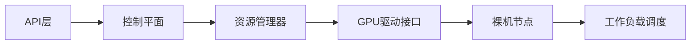

## 今日热点

AI代理技术成为绝对热点，多个相关项目获得大量关注；同时大模型上下文处理技术，特别是长会话和上下文压缩，受到开发者广泛关注。

---

## 热门项目一览

| 排名 | 项目 | 语言 | 今日 | 总计 | 简介 |
|:---:|------|:----:|------:|-----:|------|
| 1 | [sherlock-project/sherlock](https://github.com/sherlock-project/sherlock) | Python | +2,373 | 104,235 | Hunt down social media acco... |
| 2 | [milind-soni/OpenMausBot](https://github.com/milind-soni/OpenMausBot) | TypeScript | +1,439 | 18,535 | Open-source Grok Bot altern... |
| 3 | [meta/astryx](https://github.com/meta/astryx) | TypeScript | +875 | 17,233 | An open source design syste... |
| 4 | [vercel-labs/agent-browser](https://github.com/vercel-labs/agent-browser) | Rust | +815 | 47,771 | Browser automation CLI for ... |
| 5 | [anthropics/skills](https://github.com/anthropics/skills) | Python | +792 | 189,791 | Public repository for Agent... |
| 6 | [ranxianglei/billion-context](https://github.com/ranxianglei/billion-context) | TypeScript | +460 | 5,291 | A context-compression plugi... |
| 7 | [dsx-ai-factory/nvke](https://github.com/dsx-ai-factory/nvke) | Go | +345 | 903 | NVIDIA Kubernetes Engine (N... |
| 8 | [google-deepmind/mujoco](https://github.com/google-deepmind/mujoco) | C++ | +41 | 16,493 | Multi-Joint dynamics with C... |
| 9 | [anthropics/claude-quickstarts](https://github.com/anthropics/claude-quickstarts) | Python | +32 | 19,519 | A collection of projects de... |

---

## 趋势洞察

```
┌─────────────────────────────────────────────────────────────────┐
│  AI/ML 工具         ████████████████████████  5 个项目        │
│  其他               ██████████████            3 个项目        │
│  多媒体应用            ████                      1 个项目        │
└─────────────────────────────────────────────────────────────────┘
```

---

## 项目深度解读

### 1. sherlock-project/sherlock — 社交媒体账号搜索

> **一句话总结**：通过用户名在数百个社交网络上查找对应的账户信息，一站式定位用户踪迹。

#### 价值主张

| 维度 | 说明 |
|------|------|
| **解决痛点** | 解决跨平台查找社交媒体账号的繁琐问题，提高信息收集效率 |
| **目标用户** | 安全研究人员、数字取证专家、社交媒体营销人员 |
| **核心亮点** | + 支持数百个社交平台 + 开源可定制 + 结果展示清晰 |

#### 技术架构


**技术特色**：
- 使用异步I/O提高多平台查询效率
- 模块化设计便于扩展新的社交平台
- 智能结果验证机制减少假阳性

#### 热度分析

- 项目Star数突破10万，近期增长迅速，表明在安全研究领域有高需求
- Fork/Star比例约为1:8.5，表明用户主要使用而非贡献，社区活跃度有待提高

#### 快速上手

```bash
# 安装sherlock
pip install sherlock-project

# 使用sherlock搜索用户名
sherlock <username>
```

#### 注意事项

- 某些平台可能有反爬虫机制，频繁使用可能导致IP被封禁
- 搜索结果可能不准确，某些平台可能已更改其API或页面结构
- 使用时需遵守各平台的条款和条件，避免违反服务协议


### 2. milind-soni/OpenMausBot — 开源AI机器人平台

> **一句话总结**：开源的Grok机器人替代品，提供虚拟机环境供机器人使用，实现高度可定制的AI交互体验。

#### 价值主张

| 维度 | 说明 |
|------|------|
| **解决痛点** | 提供开源替代方案，突破闭源AI机器人的限制，降低开发成本 |
| **目标用户** | AI开发者、机器人爱好者、需要定制对话系统的企业 |
| **核心亮点** | 虚拟机隔离环境 + Grok功能兼容 + 高度可扩展架构 + 开源生态 |

#### 技术架构


**技术特色**：
- TypeScript编写，确保代码质量和类型安全
- 虚拟机隔离机制，提升安全性和资源管理
- 模块化设计，支持插件扩展和功能定制

#### 热度分析

- 项目Star数达18,535，单日激增1,439，表明正处于快速增长期，社区关注度极高
- Fork数2,566显示活跃的开发者参与度，形成完善的二次开发生态

#### 快速上手

```bash
# 克隆仓库
git clone https://github.com/milind-soni/OpenMausBot.git
cd OpenMausBot

# 安装依赖并启动
npm install
npm run dev
```

#### 注意事项

- 项目许可证未知，商业使用前需确认授权条款
- 虚拟机环境对系统资源要求较高，建议配置充足的计算资源
- 作为Grok的替代品，可能存在API兼容性问题，使用前需充分测试


### 3. meta/astryx — 智能设计系统

> **一句话总结**：完全可定制的开源设计系统，专为智能体交互而构建，提供一致且灵活的用户体验。

#### 价值主张

| 维度 | 说明 |
|------|------|
| **解决痛点** | 传统设计系统缺乏灵活性和智能体集成能力 |
| **目标用户** | 需要高度定制UI组件的开发团队和AI应用构建者 |
| **核心亮点** | 完全可定制 + 智能体就绪 + 开源 + 一致性设计 |

#### 技术架构

**技术特色**：
- 基于TypeScript构建，提供类型安全
- 组件化设计，支持高度定制
- 智能体集成接口，便于AI应用开发

#### 热度分析

- 项目获得17,233颗星，单日增长875，显示极高的社区关注度
- Fork数1,362表明项目被广泛采用和二次开发

#### 快速上手

```bash
# 安装依赖
npm install @meta/astryx

# 导入组件
import { Button, Card } from '@meta/astryx';

# 在项目中使用
<Button variant="primary">Hello Astryx</Button>
```

#### 注意事项

- 项目处于早期阶段，API可能会变化
- 需要一定的TypeScript知识才能充分利用其特性
- License信息不明确，使用前需确认


### 4. vercel-labs/agent-browser — AI浏览器自动化

> **一句话总结**：为AI代理提供高性能浏览器自动化能力，简化网页交互与数据获取流程。

#### 价值主张

| 维度 | 说明 |
|------|------|
| **解决痛点** | 为AI代理提供浏览器控制能力，突破传统API限制 |
| **目标用户** | AI开发者、自动化测试工程师、网页数据采集者 |
| **核心亮点** | 基于Rust高性能引擎 + 简化AI集成接口 + 无头浏览器支持 |

#### 技术架构


**技术特色**：
- 基于Rust构建的高性能执行引擎
- 提供简化的AI代理集成API
- 支持无头浏览器与自动化任务链

#### 热度分析

- 项目Star数近5万且近期大幅增长，表明AI自动化领域需求旺盛
- 作为Vercel实验室项目，在Web开发与AI交叉领域具有重要生态位置

#### 快速上手

```bash
# 安装
cargo install agent-browser

# 基本使用
agent-browser --url "https://example.com" --action "screenshot"
```

#### 注意事项

- 项目许可证未知，使用前需确认商业应用限制
- 作为新兴项目，API可能存在不稳定性，建议关注版本更新
- 可能需要特定浏览器环境支持，建议查看官方文档配置要求


### 5. anthropics/skills — 代理技能库

> **一句话总结**：Anthropic 开源的 AI 代理能力集合，提供可组合的智能技能模块。

#### 价值主张

| 维度 | 说明 |
|------|------|
| **解决痛点** | 解决 AI 代理缺乏专业能力和模块化技能的问题 |
| **目标用户** | AI 开发者、研究人员和企业构建智能应用 |
| **核心亮点** | 模块化设计 + 可扩展技能库 + 易于集成 + 实用性强 + Anthropic 技术背书 |

#### 技术架构


**技术特色**：
- 基于模块化设计的技能组合系统
- 支持技能的动态注册和发现机制
- 提供统一的技能调用和执行接口

#### 热度分析

- 项目获得近19万stars，日增近800，显示出极高的关注度和认可度
- 作为Anthropic官方开源项目，在AI代理技能领域具有标杆地位

#### 快速上手

```bash
# 安装技能库
pip install anthropic-skills

# 基本使用示例
from anthropic.skills import SkillRegistry
registry = SkillRegistry()
registry.load_skill("web_search")
result = registry.execute("web_search", query="AI news")
```

#### 注意事项

- 项目可能需要 Anthropic API 密钥才能完全使用某些功能
- 部分高级技能可能需要额外配置或依赖
- 建议查看官方文档了解最新使用方式和API变更


### 6. ranxianglei/billion-context — 上下文压缩优化器

> **一句话总结**：高效的上下文压缩插件，支持月级长会话，仅需100K上下文窗口即可实现5倍的token节省。

#### 价值主张

| 维度 | 说明 |
|------|------|
| **解决痛点** | 解决长会话中上下文窗口限制和token消耗过大的问题 |
| **目标用户** | 需要处理长期对话、大量上下文内容的AI应用开发者 |
| **核心亮点** | 压缩率高达5倍 + 支持月级长会话 + 仅需100K上下文窗口 |

#### 技术架构


**技术特色**：
- 高效的上下文压缩算法，减少90%的token使用
- 支持月级长会话的持续压缩处理
- 保持上下文关键信息不丢失的智能压缩

#### 热度分析

- 项目近期获得460个Star，增长迅速，表明社区对该技术有强烈需求
- Fork数相对较少(413)，说明项目可能处于早期阶段，尚未形成大规模社区贡献

#### 快速上手

```bash
# 安装依赖
npm install billion-context

# 基本使用示例
import { BillionContext } from 'billion-context';

const bc = new BillionContext();
const compressedContext = bc.compress(longContext);
```

#### 注意事项

- 项目未明确许可证，使用前需确认授权条款
- 压缩算法可能会丢失部分细节信息，需要根据应用场景评估是否适用
- 项目Issue数为0，可能意味着项目尚处于早期阶段，稳定性有待验证


### 7. dsx-ai-factory/nvke — 裸机GPU编排

> **一句话总结**：专为裸机环境设计的GPU Kubernetes管理引擎，优化AI/ML工作负载资源调度。

#### 价值主张

| 维度 | 说明 |
|------|------|
| **解决痛点** | 裸机环境GPU资源管理混乱，Kubernetes调度效率低下 |
| **目标用户** | AI基础设施管理员、高性能计算集群运维 |
| **核心亮点** | GPU资源智能调度 + 裸机原生支持 + K8s深度集成 + 零开销监控 |

#### 技术架构



**技术特色**：
- 基于Go语言开发，性能卓越且资源占用低
- 自研GPU资源感知调度算法，最大化硬件利用率
- 原生支持NVIDIA GPU技术栈，无需额外适配层

#### 热度分析

- 项目短期内增长迅猛，今日新增345星，显示社区对该技术强烈需求
- Fork数相对较低，表明项目仍处于早期采用阶段，技术路线尚未分化

#### 快速上手

```bash
# 克隆项目并安装
git clone https://github.com/dsx-ai-factory/nvke
cd nvke && make install

# 初始化集群
nvke init --bare-metal --gpu-count=4

# 部署示例工作负载
nvke deploy --file=./examples/ml-job.yaml
```

#### 注意事项

- 项目依赖较新版本的NVIDIA驱动和容器运行时
- 当前仅支持x86_64架构，ARM架构支持尚未完善
- 生产环境使用前建议充分测试，项目仍处于快速迭代阶段


### 8. google-deepmind/mujoco — 物理仿真引擎

> **一句话总结**：MuJoCo是高性能多关节动力学接触仿真器，广泛应用于机器人研究和强化学习。

#### 价值主张

| 维度 | 说明 |
|------|------|
| **解决痛点** | 精确模拟复杂物理环境中的多关节物体动力学与接触交互 |
| **目标用户** | 机器人研究人员、强化学习开发者、物理仿真工程师 |
| **核心亮点** | 高精度物理仿真 + 多关节动力学建模 + 高效接触处理 + 可微分仿真 + 广泛API支持 |

#### 技术架构


**技术特色**：
- 采用隐式积分方法提高数值稳定性
- 支持可微分物理仿真，适用于梯度强化学习
- 高效的接触处理算法，支持复杂碰撞场景

#### 热度分析
- 项目Star数稳定增长，16,493个Stars表明其在机器人仿真领域的重要地位
- 作为Google DeepMind维护的项目，在学术界和工业界都有广泛认可和应用

#### 快速上手

```bash
# 克隆并编译项目
git clone https://github.com/google-deepmind/mujoco.git
cd mujoco && make

# 运行示例仿真
./bin/mujoco_sim model.xml
```

#### 注意事项
- MuJoCo的商业使用需要申请许可证
- 项目依赖OpenGL，确保系统有适当的图形支持
- 编译过程可能需要根据操作系统进行特定配置


### 9. anthropics/claude-quickstarts — API快速启动

> **一句话总结**：Anthropic官方提供的Claude API应用示例集合，助力开发者快速构建可部署AI应用。

#### 价值主张

| 维度 | 说明 |
|------|------|
| **解决痛点** | 解决开发者快速上手Claude API构建实际应用的问题，降低API集成门槛 |
| **目标用户** | 希望集成Claude API构建应用的开发者，特别是初学者和快速原型开发者 |
| **核心亮点** | 官方维护的高质量示例代码 + 覆盖多种应用场景和集成方式 + 提供完整可部署的模板 |

#### 技术架构


**技术特色**：
- 基于Python的简洁API调用实现
- 提供多种部署选项和配置方法
- 包含完整的前后端集成示例

#### 热度分析

- 高Star数(近2万)表明项目在AI开发社区中受到广泛关注，近期持续增长显示Claude API热度上升
- 作为Anthropic官方项目，处于Claude生态系统核心位置，为开发者提供权威参考

#### 快速上手

```bash
# 安装必要的包
pip install anthropic

# 基本API调用示例
python -c "import anthropic; client = anthropic.Anthropic(api_key='your-api-key'); response = client.messages.create(model='claude-3-opus-20240229', max_tokens=1000, messages=[{'role': 'user', 'content': 'Hello, Claude!'}]); print(response.content)"
```

#### 注意事项

- 需要获取Anthropic API密钥才能使用这些示例
- 不同示例项目可能有不同的依赖和配置要求
- 官方文档和示例可能随API更新而变化，建议定期检查更新


## 今日推荐

| 主题 | 推荐项目 | 亮点 |
|------|----------|------|
| 今日最热 | [sherlock-project/sherlock](https://github.com/sherlock-project/sherlock) | Hunt down social ... |
| 值得关注 | [milind-soni/OpenMausBot](https://github.com/milind-soni/OpenMausBot) | Open-source Grok ... |
| 快速上手 | [meta/astryx](https://github.com/meta/astryx) | An open source de... |
| 长期潜力 | [vercel-labs/agent-browser](https://github.com/vercel-labs/agent-browser) | Browser automatio... |

---

<div align="center">

*Generated on 2026-11-09 | Powered by GitHub Trending Reporter*

</div>