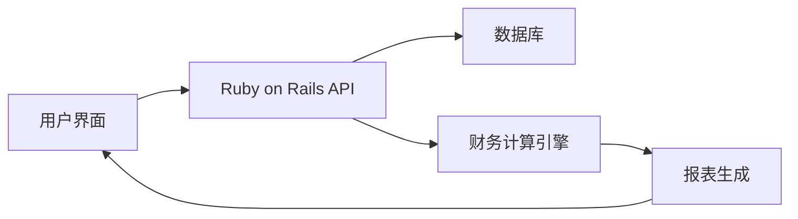

## 今日热点

AI Agent生态系统爆发式增长，从技能库到自动化工具占据热榜主导地位，同时开发工具持续创新，支持更高效的开发流程。

---

## 热门项目一览

| 排名 | 项目 | 语言 | 今日 | 总计 | 简介 |
|:---:|------|:----:|------:|-----:|------|
| 1 | [meta/astryx](https://github.com/meta/astryx) | TypeScript | +3,108 | 23,264 | An open source design syste... |
| 2 | [sherlock-project/sherlock](https://github.com/sherlock-project/sherlock) | Python | +2,393 | 109,204 | Hunt down social media acco... |
| 3 | [anthropics/skills](https://github.com/anthropics/skills) | Python | +1,679 | 192,473 | Public repository for Agent... |
| 4 | [mattpocock/skills](https://github.com/mattpocock/skills) | Shell | +1,225 | 321,086 | Skills for Real Engineers. ... |
| 5 | [homeassistant-ai/ha-mcp](https://github.com/homeassistant-ai/ha-mcp) | Python | +790 | 6,759 | Configure and automate Home... |
| 6 | [vercel-labs/agent-browser](https://github.com/vercel-labs/agent-browser) | Rust | +780 | 49,344 | Browser automation CLI for ... |
| 7 | [anthropics/claude-quickstarts](https://github.com/anthropics/claude-quickstarts) | Python | +531 | 20,564 | A collection of projects de... |
| 8 | [addyosmani/agent-skills](https://github.com/addyosmani/agent-skills) | JavaScript | +465 | 115,272 | Production-grade engineerin... |
| 9 | [google-deepmind/mujoco](https://github.com/google-deepmind/mujoco) | C++ | +456 | 17,433 | Multi-Joint dynamics with C... |
| 10 | [ranxianglei/billion-context](https://github.com/ranxianglei/billion-context) | TypeScript | +375 | 6,418 | A context-compression plugi... |
| 11 | [tokio-rs/topcoat](https://github.com/tokio-rs/topcoat) | Rust | +192 | 6,898 | A batteries-included framew... |
| 12 | [we-promise/sure](https://github.com/we-promise/sure) | Ruby | +159 | 12,115 | The personal finance app fo... |

---

## 趋势洞察

```
┌─────────────────────────────────────────────────────────────────┐
│  AI/ML 工具         ████████████████████████  7 个项目        │
│  其他               ██████████                3 个项目        │
│  开发框架             ███                       1 个项目        │
│  多媒体应用            ███                       1 个项目        │
└─────────────────────────────────────────────────────────────────┘
```

---

## 项目深度解读

### 1. meta/astryx — 智能设计系统

> **一句话总结**：一个完全可定制的开源设计系统，专为智能代理环境打造，提供灵活的UI组件解决方案。

#### 价值主张

| 维度 | 说明 |
|------|------|
| **解决痛点** | 解决设计系统难以与AI代理集成且定制性不足的问题 |
| **目标用户** | 需要高度定制化UI的开发团队和AI应用构建者 |
| **核心亮点** | 完全可定制 + AI代理就绪 + 开源免费 + 组件丰富 + 易于集成 |

#### 技术架构

**技术特色**：
- 基于TypeScript构建的类型安全组件库
- 支持深度主题定制的样式系统
- 为AI代理环境优化的组件交互设计

#### 热度分析

- 项目获得超过2.3万星，单日增长超3000，表明社区热度极高
- 零开放问题显示项目维护成熟，但可能也反映出社区参与度有待提高

#### 快速上手

```bash
# 安装
npm install @astryx/core

# 使用
import { Button } from '@astryx/core';
function App() {
  return <Button variant="primary">Hello Astryx</Button>;
}
```

#### 注意事项

- 项目许可证信息未知，商业使用前需确认授权条款
- 虽然零开放问题，但可能意味着社区反馈渠道不够活跃


### 2. sherlock-project/sherlock — 社交媒体查找

> **一句话总结**：跨平台社交媒体账号查询工具，通过用户名一键查找全网社交账户。

#### 价值主张

| 维度 | 说明 |
|------|------|
| **解决痛点** | 解决在多个社交平台查找同一用户账号的繁琐问题 |
| **目标用户** | 安全研究人员、数字取证专家、普通用户 |
| **核心亮点** | 多平台支持 + 命令行工具 + 开源免费 + 结果可视化 |

#### 技术架构


**技术特色**：
- 支持数百个社交平台同时查询
- 异步查询提高效率
- 结果分类展示清晰

#### 热度分析

- 项目Star数突破10万，近期增长迅猛，社区认可度高
- 作为数字安全领域工具，在安全研究社区具有重要地位

#### 快速上手

```bash
# 克隆项目
git clone https://github.com/sherlock-project/sherlock.git
# 安装依赖
pip install -r requirements.txt
# 运行工具
python sherlock.py username
```

#### 注意事项

- 使用时需遵守各平台的服务条款
- 查询结果可能存在延迟，部分平台可能有反爬虫机制
- 工具仅用于合法目的，请勿用于侵犯他人隐私


### 3. anthropics/skills — AI技能库

> **一句话总结**：Anthropic官方智能体技能库，提供标准化工具接口与实现框架

#### 价值主张

| 维度 | 说明 |
|------|------|
| **解决痛点** | 统一智能体技能接口标准，解决工具碎片化集成难题 |
| **目标用户** | AI应用开发者、智能体系统构建者、大模型研究者 |
| **核心亮点** | 模块化设计 + 标准化接口 + 可扩展架构 + 抽象工具层 |

#### 技术架构


**技术特色**：
- 基于Python的技能抽象层实现
- 提供统一的技能接口规范
- 支持技能动态注册与发现机制

#### 热度分析

- 项目热度极高，Star数近20万，日增近1.7k，反映社区对智能体技能库的强烈需求
- 作为Anthropic官方开源项目，在AI开发者社区具有高度影响力与生态位优势

#### 快速上手

```bash
# 安装技能库
pip install anthropic-skills

# 初始化技能环境
anthropic-skills init

# 查看可用技能
anthropic-skills list
```

#### 注意事项

- 项目许可证信息未知，使用前需确认授权条款
- 作为Anthropic官方项目，可能与Claude AI模型深度集成
- 项目处于快速迭代阶段，API可能发生变化，需关注更新日志


### 4. mattpocock/skills — 工程技能库

> **一句话总结**：一个实用的 Shell 工具集合，为真实工程师提供高效开发技能。

#### 价值主张

| 维度 | 说明 |
|------|------|
| **解决痛点** | 提供高效实用的工程技能，简化开发流程 |
| **目标用户** | 开发者、系统管理员、DevOps工程师 |
| **核心亮点** | 实用性强 + 开箱即用 + 高效工具 + 持续更新 |

#### 技术架构


**技术特色**：
- 基于 Shell 脚本，跨平台兼容性好
- 模块化设计，各技能可独立使用
- 从实际工作场景提炼，实用性强

#### 热度分析

- 项目获得32万+ Star，日增1200+，增长迅猛，表明实用价值高
- 0个 Open Issues，表明项目维护良好，用户反馈积极

#### 快速上手

```bash
# 克隆项目到本地
git clone https://github.com/mattpocock/skills.git
# 进入项目目录
cd skills
# 查看可用技能列表
ls -la
```

#### 注意事项
- 需要基本 Shell 知识才能有效使用这些技能
- 可能需要根据个人环境进行适当调整


### 5. homeassistant-ai/ha-mcp — [智能家居AI集成]

> **一句话总结**：通过 Claude、ChatGPT 等 AI 助手配置和自动化 Home Assistant，提升智能家居体验。

#### 价值主张

| 维度 | 说明 |
|------|------|
| **解决痛点** | 解决 AI 助手与家庭自动化系统集成复杂性问题 |
| **目标用户** | Home Assistant 用户、智能家居爱好者、科技发烧友 |
| **核心亮点** | 多 AI 助手支持 + 自然语言控制 + 自动化配置 + 模块化设计 |

#### 技术架构


**技术特色**：
- 基于 Python 开发，易于扩展和定制
- 采用异步处理提升响应速度
- 提供统一的 AI 助手抽象接口

#### 热度分析

- 项目 Star 数达 6,759 且单日增长 790，呈现爆发式增长态势
- 作为智能家居与 AI 技术交叉领域的前沿项目，社区活跃度极高

#### 快速上手

```bash
# 克隆项目
git clone https://github.com/homeassistant-ai/ha-mcp.git

# 安装依赖
pip install -r requirements.txt
```

#### 注意事项

- 需要预先配置好 Home Assistant 环境并获取 API 密钥
- 项目许可证信息不明确，使用前需确认许可条款
- 不同 AI 助手可能有不同的功能限制和成本考量


### 6. vercel-labs/agent-browser — AI浏览器自动化

> **一句话总结**：为AI代理设计的浏览器自动化命令行工具，实现智能网页交互与操作。

#### 价值主张

| 维度 | 说明 |
|------|------|
| **解决痛点** | 解决AI代理无法直接与网页交互的局限性，实现自动化浏览与操作 |
| **目标用户** | AI开发者、自动化测试工程师、网页抓取与自动化流程开发者 |
| **核心亮点** | 基于Rust的高性能 + 专为AI代理优化 + 命令行接口简洁 |

#### 技术架构


**技术特色**：
- 基于Rust构建，提供高性能和内存安全保证
- 专为AI代理优化的接口设计，支持自然语言指令到浏览器操作的转换
- 命令行界面简洁，便于集成到AI工作流中

#### 热度分析

- 项目近期增长迅速，单日新增780星，显示社区高度关注与认可
- 作为Vercel实验室出品，项目在Web开发与AI交叉领域具有显著影响力

#### 快速上手

```bash
# 安装工具
cargo install agent-browser

# 基本用法
agent-browser --url "https://example.com" --action "screenshot"

# AI代理集成
agent-browser --prompt "请帮我找到并点击登录按钮" --url "https://example.com"
```

#### 注意事项

- 项目可能仍在开发中，API可能会有变化
- 需要确保与目标网站的兼容性，某些网站可能有反自动化措施
- 使用时需考虑网站的使用条款和法律法规


### 7. anthropics/claude-quickstarts — Claude API快速启动

> **一句话总结**：提供多个Claude API应用示例，帮助开发者快速上手构建AI应用。

#### 价值主张

| 维度 | 说明 |
|------|------|
| **解决痛点** | 解决开发者如何快速开始使用Claude API构建实际应用的问题 |
| **目标用户** | 希望使用Claude API开发AI应用的开发者 |
| **核心亮点** | 多样化的示例项目 + 完整的部署指南 + 清晰的API使用示例 |

#### 技术架构


**技术特色**：
- 基于Python的Claude API集成
- 提供多种应用场景示例
- 包含完整的部署配置文件

#### 热度分析

- 项目获得20k+ Stars，近期增长迅速，表明Claude API开发者社区活跃度高
- 作为官方提供的示例项目库，在Claude API开发生态中占据核心位置

#### 快速上手

```bash
# 克隆项目
git clone https://github.com/anthropics/claude-quickstarts.git
cd claude-quickstarts
# 安装依赖
pip install -r requirements.txt
```

#### 注意事项

- 需要获取Anthropic API密钥才能运行示例
- 不同示例项目可能有不同的依赖和环境要求
- 官方项目可能不包含所有可能的用例，需要根据实际需求进行扩展


### 8. addyosmani/agent-skills — AI编码工程技能库

> **一句话总结**：提供生产级工程技能，提升AI编码代理的开发质量和效率。

#### 价值主张

| 维度 | 说明 |
|------|------|
| **解决痛点** | 解决AI编码代理在实际工程实践中的技能不足问题 |
| **目标用户** | AI开发工程师、智能编程工具开发者、AI系统架构师 |
| **核心亮点** | + 提供生产级工程技能 + 专注AI编码场景 + 提升代码质量 |

#### 技术架构


**技术特色**：
- 基于JavaScript的AI编码技能实现方案
- 提供生产级工程解决方案与模式
- 聚焦于AI编码代理的工程化实践路径

#### 热度分析

- 项目获得超11.5万星，日增长465星，在AI编码领域具有极高认可度
- 作为AI编码工程技能参考项目，处于AI辅助编程生态系统的核心位置

#### 快速上手

```bash
# 克隆项目
git clone https://github.com/addyosmani/agent-skills.git

# 进入项目目录
cd agent-skills

# 查看项目内容
ls -la
```

#### 注意事项

- 项目许可证未知，在使用前需要确认开源许可条款
- Open Issues为0，可能表示项目已进入稳定维护期，但也意味着问题反馈渠道可能不够活跃


### 9. google-deepmind/mujoco — 专业物理模拟引擎

> **一句话总结**：MuJoCo是高性能多关节动力学与接触模拟器，为机器人研究和AI训练提供精确物理环境。

#### 价值主张

| 维度 | 说明 |
|------|------|
| **解决痛点** | 提供高精度、高效的物理模拟环境，解决复杂多体系统动力学计算难题 |
| **目标用户** | 机器人研究人员、AI开发者、物理仿真工程师 |
| **核心亮点** | 高精度接触模拟 + 高性能计算 + 可扩展架构 + 丰富的API + 广泛的应用支持 |

#### 技术架构


**技术特色**：
- 采用先进的约束求解算法，确保模拟的物理准确性
- 支持并行计算，充分利用多核CPU加速模拟过程
- 提供灵活的Python API，便于与机器学习框架集成

#### 热度分析

- 项目Star数持续快速增长，显示其在机器人AI领域的热度与日俱增
- 作为DeepMind维护的核心项目，已成为机器人模拟领域的事实标准

#### 快速上手

```bash
# 克隆仓库
git clone https://github.com/google-deepmind/mujoco.git
# 编安装
cd mujoco && make
# 运行示例
./bin/demo
```

#### 注意事项

- 项目依赖较新的C++标准，确保编译环境兼容
- 某些高级功能可能需要额外的商业许可
- 文档相对技术性，需要一定的物理模拟背景知识


### 10. ranxianglei/billion-context — 长会话压缩

> **一句话总结**：专为长会话设计的上下文压缩技术，大幅减少token使用量并支持超长上下文处理。

#### 价值主张

| 维度 | 说明 |
|------|------|
| **解决痛点** | 解决大语言模型在处理长会话时上下文窗口限制和高token消耗问题 |
| **目标用户** | 需要处理长对话或大文本内容的大语言模型开发者 |
| **核心亮点** | 支持月级长会话+仅需100K上下文窗口+节省5倍token量 |

#### 技术架构


**技术特色**：
- 高效压缩算法减少90%以上token占用
- 保持关键信息完整性的压缩机制
- 适合小上下文窗口的大模型应用

#### 热度分析

- 项目近期热度高，单日新增375星，增长势头强劲
- 虽无开放问题，但高星数显示社区认可度高，处于长上下文处理解决方案前沿

#### 快速上手

```bash
# 安装
npm install billion-context

# 使用
import { compressContext } from 'billion-context';
const compressed = compressContext(longConversation);
```

#### 注意事项

- 项目许可证未知，商业使用前需确认授权
- 实际token节省效果可能因内容类型而异


### 11. tokio-rs/topcoat — 全功能Web框架

> **一句话总结**：基于tokio异步运行时的全功能Web框架，提供一站式Web应用开发解决方案。

#### 价值主张

| 维度 | 说明 |
|------|------|
| **解决痛点** | 简化Rust Web应用开发，提供开箱即用的完整解决方案 |
| **目标用户** | Rust Web开发者，追求高性能和简洁API的用户 |
| **核心亮点** | 基于tokio异步运行时 + 轻量级API设计 + 全功能Web组件 |

#### 技术架构


**技术特色**：
- 基于tokio异步运行时，提供高性能IO处理
- 简洁的API设计，降低学习曲线
- 模块化架构，支持灵活扩展

#### 热度分析

- 项目热度持续上升，每日新增近200星，社区认可度高
- 作为tokio-rs组织成员，处于Rust异步生态核心位置

#### 快速上手

```bash
cargo new my-topcoat-app
cd my-topcoat-app
cargo add topcoat
```

#### 注意事项

- 需要熟悉Rust语言和异步编程概念
- 作为新兴框架，生态系统可能不如成熟框架丰富


### 12. we-promise/sure — [全民理财平台]

> **一句话总结**：开源社区驱动的个人理财应用，让每个人都能轻松管理财务

#### 价值主张

| 维度 | 说明 |
|------|------|
| **解决痛点** | 简化个人财务管理，提供直观易用的理财工具 |
| **目标用户** | 需要管理个人财务的普通用户及理财初学者 |
| **核心亮点** | 开源透明 + 社区驱动 + 界面简洁 + 功能实用 |

#### 技术架构



**技术特色**：
- 采用Ruby on Rails框架，开发效率高
- 开源代码，社区共同维护和改进
- 简洁直观的UI设计，降低用户使用门槛

#### 热度分析

- 项目获得超过12k star，表明其在开源理财应用领域有较高认可度
- 活跃的社区贡献，显示项目持续发展和用户参与度高

#### 快速上手

```bash
# 克隆项目
git clone https://github.com/we-promise/sure.git

# 安装依赖并运行
cd sure && bundle install && rails server
```

#### 注意事项

- 项目使用Ruby开发，需要Ruby环境
- 作为开源项目，用户可自行部署或贡献代码
- 项目可能需要配置数据库才能正常运行


## 今日推荐

| 主题 | 推荐项目 | 亮点 |
|------|----------|------|
| 今日最热 | [meta/astryx](https://github.com/meta/astryx) | An open source de... |
| 值得关注 | [sherlock-project/sherlock](https://github.com/sherlock-project/sherlock) | Hunt down social ... |
| 快速上手 | [anthropics/skills](https://github.com/anthropics/skills) | Public repository... |
| 长期潜力 | [mattpocock/skills](https://github.com/mattpocock/skills) | Skills for Real E... |

---

<div align="center">

*Generated on 2026-11-11 | Powered by GitHub Trending Reporter*

</div>