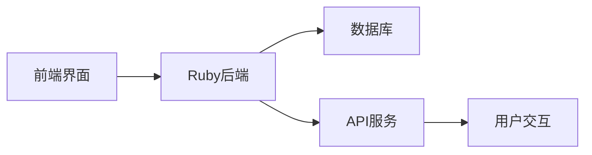
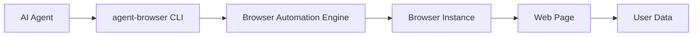
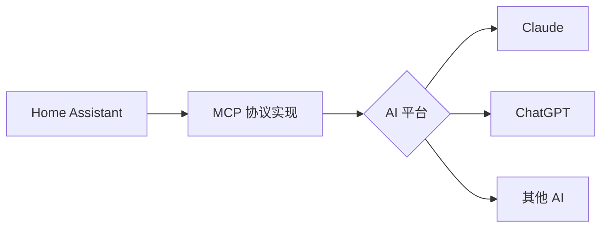

## 今日热点

今日GitHub热榜显示AI代理技术迅速崛起，LLM驱动的工具在金融分析、代码审核和家居自动化等领域广泛应用，同时自动化解决方案与安全工具成为开发者关注焦点。

---

## 热门项目一览

| 排名 | 项目 | 语言 | 今日 | 总计 | 简介 |
|:---:|------|:----:|------:|-----:|------|
| 1 | [meta/astryx](https://github.com/meta/astryx) | TypeScript | +2,776 | 25,354 | An open source design syste... |
| 2 | [we-promise/sure](https://github.com/we-promise/sure) | Ruby | +1,078 | 13,113 | The personal finance app fo... |
| 3 | [addyosmani/agent-skills](https://github.com/addyosmani/agent-skills) | JavaScript | +787 | 116,077 | Production-grade engineerin... |
| 4 | [vercel-labs/agent-browser](https://github.com/vercel-labs/agent-browser) | Rust | +708 | 49,995 | Browser automation CLI for ... |
| 5 | [homeassistant-ai/ha-mcp](https://github.com/homeassistant-ai/ha-mcp) | Python | +645 | 7,473 | Configure and automate Home... |
| 6 | [shadcn/improve](https://github.com/shadcn/improve) | Unknown | +361 | 11,071 | Use your most capable model... |
| 7 | [ZhuLinsen/daily_stock_analysis](https://github.com/ZhuLinsen/daily_stock_analysis) | Python | +278 | 70,521 | LLM 驱动的多市场股票智能分析系统：多源行情、实时新... |
| 8 | [GoogleChrome/modern-web-guidance-src](https://github.com/GoogleChrome/modern-web-guidance-src) | TypeScript | +159 | 1,929 | No description |
| 9 | [openai/codex-security](https://github.com/openai/codex-security) | TypeScript | +52 | 11,869 | OpenAI's Codex Security CLI... |
| 10 | [TheAlgorithms/Java](https://github.com/TheAlgorithms/Java) | Java | +51 | 67,104 | All Algorithms implemented ... |

---

## 趋势洞察

```
┌─────────────────────────────────────────────────────────────────┐
│  AI/ML 工具         ████████████████████████  6 个项目        │
│  其他               ████████████████          4 个项目        │
└─────────────────────────────────────────────────────────────────┘
```

---

## 项目深度解读

### 1. meta/astryx — AI设计系统

> **一句话总结**：一个高度可定制且支持AI代理的开源设计系统，赋能现代UI开发。

#### 价值主张

| 维度 | 说明 |
|------|------|
| **解决痛点** | 解决设计系统与AI集成的鸿沟，提供灵活可扩展的设计解决方案 |
| **目标用户** | 前端开发者、UI设计师、产品团队和企业级应用开发者 |
| **核心亮点** | 高度可定制性 + AI代理就绪 + 开源可扩展 + 设计一致性保证 |

#### 技术架构


**技术特色**：
- 基于TypeScript的类型安全设计系统实现
- 模块化架构支持灵活扩展和定制
- 内置AI代理支持，智能生成和优化设计

#### 热度分析

- 项目获得25,354个星标，单日增长2,776，表明社区高度关注和认可
- 零开放问题显示项目维护良好，可能是成熟稳定的设计系统

#### 快速上手

```bash
# 安装Astryx设计系统
npm install @astryx/core

# 初始化项目配置
npx astryx init

# 启动开发服务器
npm run dev
```

#### 注意事项

- 项目许可证信息未知，商业使用前需确认授权条款
- 作为设计系统，可能需要一定的前端开发基础才能充分利用


### 2. we-promise/sure — 全民理财应用

> **一句话总结**：开源的个人理财应用，为每个人提供简单易用的财务管理工具，强调全民参与和贡献。

#### 价值主张

| 维度 | 说明 |
|------|------|
| **解决痛点** | 简化个人财务管理，提供透明易用的理财工具 |
| **目标用户** | 需要管理个人财务的普通用户 |
| **核心亮点** | 开源透明 + 简单易用 + 社区驱动 + 全民参与 |

#### 技术架构



**技术特色**：
- 使用Ruby语言开发，简洁优雅
- 采用Rails框架快速构建功能
- 开源项目，代码透明可审查

#### 热度分析

- Star数13,113且单日增长千余，显示项目近期热度激增
- Fork数相对较少，表明用户更多作为使用者而非贡献者

#### 快速上手

```bash
# 克隆项目
git clone https://github.com/we-promise/sure.git
# 进入项目目录
cd sure
# 安装依赖
bundle install
```

#### 注意事项

- 项目许可证未知，使用前需确认开源协议
- Open Issues为0，可能意味着社区反馈渠道不活跃
- 项目热度高但社区参与度相对较低，建议关注贡献机制


### 3. addyosmani/agent-skills — AI工程技能

> **一句话总结**：提供生产级AI编码代理的工程技能，提升AI辅助开发能力。

#### 价值主张

| 维度 | 说明 |
|------|------|
| **解决痛点** | AI编码代理缺乏生产级工程技能，无法高效辅助实际开发 |
| **目标用户** | AI开发工具使用者、软件工程师、AI应用开发者 |
| **核心亮点** | 生产级工程能力 + 模块化技能集 + 实用开发模式 |

#### 技术架构


**技术特色**：
- 基于JavaScript的轻量级实现
- 模块化技能架构设计
- 生产环境实用技能集

#### 热度分析

- 项目获得11万+星标，近7天增长787，热度持续上升
- 作为AI开发工具的重要参考，在AI辅助开发领域具有显著影响力

#### 快速上手

```bash
# 克隆项目
git clone https://github.com/addyosmani/agent-skills.git

# 进入目录
cd agent-skills

# 安装依赖
npm install
```

#### 注意事项

- 需要JavaScript环境才能运行
- 建议结合实际开发场景应用技能模块
- 持续关注项目更新，技能集可能随AI技术发展而调整


### 4. vercel-labs/agent-browser — AI浏览器自动化

> **一句话总结**：基于Rust的命令行工具，为AI代理提供浏览器自动化能力，实现智能交互网页。

#### 价值主张

| 维度 | 说明 |
|------|------|
| **解决痛点** | 解决AI代理无法直接与网页交互的问题，实现端到端自动化操作 |
| **目标用户** | AI开发者、自动化测试工程师、网页数据采集人员 |
| **核心亮点** | 高性能Rust实现 + 无头浏览器控制 + AI代理集成 + 命令行友好 + 跨平台支持 |

#### 技术架构



**技术特色**：
- 基于Rust构建，提供高性能和内存安全保证
- 通过CLI接口简化AI代理与浏览器的交互
- 可能使用WebDriver协议或类似技术控制浏览器
- 支持无头模式运行，适合服务器环境
- 提供简洁的API供AI代理调用浏览器功能

#### 热度分析

- 项目获得近5万星，单日增长700+，表明AI浏览器自动化领域需求旺盛
- 作为Vercel实验室项目，在Web开发与AI结合领域具有权威性

#### 快速上手

```bash
# 安装agent-browser
cargo install agent-browser

# 基本使用示例
agent-browser --url https://example.com --action "click button#submit"
```

#### 注意事项

- 由于是AI代理专用工具，可能需要一定的AI代理开发基础
- Rust工具链需要预先安装，增加了上手门槛
- 项目没有明确许可证信息，使用前需确认开源协议
- Open Issues为0，可能表示项目处于早期阶段或问题管理方式特殊


### 5. homeassistant-ai/ha-mcp — AI 智能家居 MCP

> **一句话总结**：通过 MCP 协议实现 Home Assistant 与 Claude、ChatGPT 等 AI 模型的无缝集成。

#### 价值主张

| 维度 | 说明 |
|------|------|
| **解决痛点** | 打破智能家居系统与 AI 助手之间的交互壁垒 |
| **目标用户** | Home Assistant 用户、AI 技术爱好者、智能家居开发者 |
| **核心亮点** | MCP 协议标准化 + 多 AI 平台支持 + 上下文感知自动化 |

#### 技术架构



**技术特色**：
- 基于 MCP (Model Context Protocol) 标准构建，确保兼容性
- 支持多种 AI 平台通过统一接口进行交互
- 实现智能家居上下文与 AI 模型的深度集成

#### 热度分析

- 项目 Star 数高达 7,473 且单日增长 645，显示 AI 与智能家居融合趋势强劲
- 零 Open Issues 反映项目维护良好，社区可能通过其他渠道提供支持

#### 快速上手

```bash
# 克隆项目
git clone https://github.com/homeassistant-ai/ha-mcp.git
# 安装依赖
pip install -r requirements.txt
# 配置 Home Assistant 集成
python setup.py install
```

#### 注意事项

- 需要拥有 Home Assistant 环境才能正常运行
- 使用 AI 服务可能涉及 API 调用成本，需关注使用量和费用
- 项目依赖的 AI 服务提供商可能有地区限制


### 6. shadcn/improve — AI代码审计工具

> **一句话总结**：利用高级AI模型审计代码库，生成优化执行计划供更经济模型使用。

#### 价值主张

| 维度 | 说明 |
|------|------|
| **解决痛点** | 解决代码审计成本高、效率低的问题，优化AI资源利用 |
| **目标用户** | 开发团队、代码审查人员、AI模型优化工程师 |
| **核心亮点** | 多级AI模型协作 + 成本优化策略 + 智能代码分析 |

#### 技术架构


**技术特色**：
- 多级AI模型协同架构，实现能力与成本平衡
- 智能代码分析引擎，生成深度审计报告
- 自适应资源分配机制，优化模型调用成本

#### 热度分析

- 项目Star数突破11,000，日增361，表明开发者对AI代码优化工具高度关注
- 在AI辅助开发领域占据重要位置，有望成为代码审计标准工具

#### 快速上手

```bash
# 克隆项目
git clone https://github.com/shadcn/improve.git

# 安装依赖
npm install

# 运行代码审计
npx improve audit --path ./your-codebase
```

#### 注意事项

- 需要配置API密钥访问AI模型服务
- 不同编程语言支持程度可能存在差异
- 建议先在小型项目上测试效果再应用于大型代码库


### 7. ZhuLinsen/daily_stock_analysis — 智能股票分析系统

> **一句话总结**：基于LLM的多市场股票智能分析系统，整合行情、新闻与决策看板，支持零成本定时运行。

#### 价值主张

| 维度 | 说明 |
|------|------|
| **解决痛点** | 整合分散的股票信息，提供智能化分析与决策支持 |
| **目标用户** | 股票投资者、分析师、金融爱好者 |
| **核心亮点** | 多源数据整合 + LLM智能分析 + 零成本定时运行 + 自动推送 |

#### 技术架构


**技术特色**：
- 多源市场数据整合技术，实现跨平台行情获取
- LLM驱动的智能分析算法，提供深度市场洞察
- 零成本定时运行机制，优化资源利用效率

#### 热度分析

- 项目Star数超7万且持续增长，表明在投资者群体中高度关注
- Fork数高达5.6万，说明项目具有强实用性，被广泛复用和定制

#### 快速上手

```bash
# 克隆项目
git clone https://github.com/ZhuLinsen/daily_stock_analysis.git

# 安装依赖
pip install -r requirements.txt

# 运行分析
python main.py
```

#### 注意事项

- 需要配置API密钥以获取市场数据和新闻
- 定时运行可能需要配置相应的环境变量
- 需要确保网络连接稳定以获取实时数据


### 8. GoogleChrome/modern-web-guidance-src — 现代Web指南

> **一句话总结**：Google Chrome 团队维护的现代 Web 开发最佳实践与技术规范参考库。

#### 价值主张

| 维度 | 说明 |
|------|------|
| **解决痛点** | 提供权威、与时俱进的现代 Web 开发实践指导，规避技术选型误区 |
| **目标用户** | Web 开发者、前端工程师、技术决策者 |
| **核心亮点** | 官方权威性 + 实用案例 + 持续更新 + 跨浏览器兼容 |

#### 技术架构


**技术特色**：
- 基于 TypeScript 确保代码质量和类型安全
- 官方团队维护，确保信息权威性和准确性
- 持续跟进最新 Web 标准和浏览器发展动态

#### 热度分析

- 近2000星且日增159，显示社区对现代Web开发指南的高度关注
- 作为Google官方项目，在Web开发生态中具有权威参考地位

#### 快速上手

```bash
# 克隆项目到本地
git clone https://github.com/GoogleChrome/modern-web-guidance-src.git

# 查看文档
cd modern-web-guidance-src
npm install && npm run dev
```

#### 注意事项

- 项目内容随Web技术发展而更新，需关注最新版本
- 部分建议可能针对特定浏览器环境，跨平台开发时需进行兼容性测试
- 建议结合具体项目需求选择性采纳指南建议


### 9. openai/codex-security — AI安全检测工具

> **一句话总结**：OpenAI的Codex安全CLI和SDK，智能检测与修复代码安全漏洞。

#### 价值主张

| 维度 | 说明 |
|------|------|
| **解决痛点** | 自动化识别代码安全漏洞，减少人工审查成本和遗漏 |
| **目标用户** | 开发者团队、安全工程师、DevOps专业人员 |
| **核心亮点** | AI智能分析 + 多语言支持 + 自动修复建议 |

#### 技术架构


**技术特色**：
- 基于OpenAI Codex模型的智能代码分析引擎
- 提供CLI工具和TypeScript SDK两种使用方式
- 支持多种编程语言的安全漏洞检测

#### 热度分析

- 项目Star数达11,869且持续增长，表明开发者社区对AI安全工具的高度认可
- 作为OpenAI生态系统的重要组成部分，在AI辅助开发领域占据重要位置

#### 快速上手

```bash
# 安装CLI工具
npm install -g @openai/codex-security

# 扫描当前目录代码
codex-security scan

# 扫描特定文件
codex-security scan src/main.js
```

#### 注意事项

- 需要配置OpenAI API密钥才能使用服务
- 自动修复建议需人工审核，不建议直接应用于生产环境
- 可能存在误报情况，建议结合人工安全审查使用


### 10. TheAlgorithms/Java — 算法Java集合

> **一句话总结**：一个全面的Java算法实现库，为开发者提供高质量算法参考与学习资源。

#### 价值主张

| 维度 | 说明 |
|------|------|
| **解决痛点** | 提供多种算法的Java实现，解决算法学习与实现难题 |
| **目标用户** | Java开发者、计算机专业学生、算法学习爱好者 |
| **核心亮点** | 覆盖面广 + 代码质量高 + 实用性强 + 持续更新 |

#### 技术架构


**技术特色**：
- 采用标准Java语法实现，符合Java编码规范
- 每个算法都有独立的类和方法，结构清晰
- 包含详细注释和示例，便于理解

#### 热度分析

- 项目获得6.7万+星标，表明在Java开发者社区中广受欢迎
- Fork数与Star数比例合理，说明项目有良好的社区参与度和二次开发价值

#### 快速上手

```bash
# 克隆项目到本地
git clone https://github.com/TheAlgorithms/Java.git

# 进入项目目录
cd Java

# 查看算法目录结构
ls -la src/main/java
```

#### 注意事项

- 项目包含大量算法实现，建议按需学习，不要一次性全部掌握
- 部分算法可能有多种实现方式，项目中可能只展示了一种，需要根据实际场景选择最优解
- 算法实现可能不是最优解，实际应用时需要根据性能要求进行调整


## 今日推荐

| 主题 | 推荐项目 | 亮点 |
|------|----------|------|
| 今日最热 | [meta/astryx](https://github.com/meta/astryx) | An open source de... |
| 值得关注 | [we-promise/sure](https://github.com/we-promise/sure) | The personal fina... |
| 快速上手 | [addyosmani/agent-skills](https://github.com/addyosmani/agent-skills) | Production-grade ... |
| 长期潜力 | [vercel-labs/agent-browser](https://github.com/vercel-labs/agent-browser) | Browser automatio... |

---

<div align="center">

*Generated on 2026-11-12 | Powered by GitHub Trending Reporter*

</div>