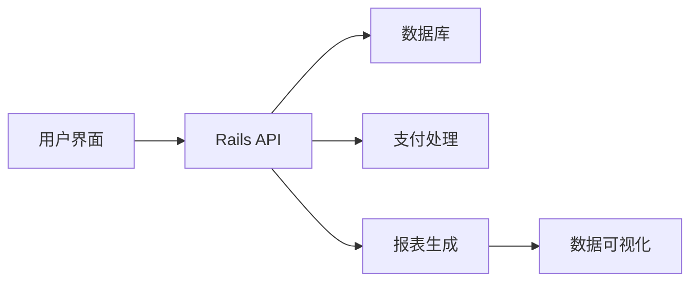
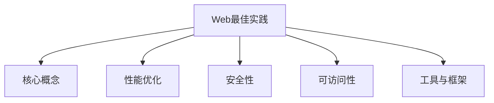
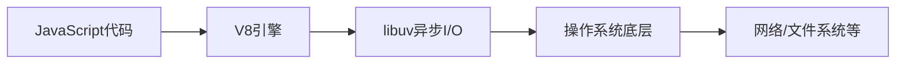

## 今日热点

AI编码助手与开发工具成为今日GitHub热榜主流，OpenAI、Meta等大厂推出的AI辅助编程工具及开源LLM推理引擎获得广泛关注，显示AI赋能开发已成为技术焦点。

---

## 热门项目一览

| 排名 | 项目 | 语言 | 今日 | 总计 | 简介 |
|:---:|------|:----:|------:|-----:|------|
| 1 | [meta/astryx](https://github.com/meta/astryx) | TypeScript | +1,830 | 26,749 | An open source design syste... |
| 2 | [we-promise/sure](https://github.com/we-promise/sure) | Ruby | +967 | 14,063 | The personal finance app fo... |
| 3 | [addyosmani/agent-skills](https://github.com/addyosmani/agent-skills) | JavaScript | +816 | 116,779 | Production-grade engineerin... |
| 4 | [GoogleChrome/modern-web-guidance-src](https://github.com/GoogleChrome/modern-web-guidance-src) | TypeScript | +739 | 3,360 | Keep your coding agent up t... |
| 5 | [openai/codex-security](https://github.com/openai/codex-security) | TypeScript | +643 | 12,564 | OpenAI's Codex Security CLI... |
| 6 | [Alishahryar1/free-claude-code](https://github.com/Alishahryar1/free-claude-code) | Python | +415 | 69,441 | Use Claude Code, Codex, Ant... |
| 7 | [CopilotKit/OpenBot](https://github.com/CopilotKit/OpenBot) | TypeScript | +298 | 11,733 | Open-source AI coworkers th... |
| 8 | [pookjw/HermesEnabler](https://github.com/pookjw/HermesEnabler) | Objective-C | +218 | 1,598 | Enable Hermès Watch Faces o... |
| 9 | [ggml-org/llama.cpp](https://github.com/ggml-org/llama.cpp) | C++ | +176 | 134,632 | LLM inference in C/C++ |
| 10 | [QwenLM/qwen-code](https://github.com/QwenLM/qwen-code) | TypeScript | +151 | 29,905 | An open-source AI coding ag... |
| 11 | [nvm-sh/nvm](https://github.com/nvm-sh/nvm) | Shell | +63 | 96,038 | Node Version Manager - POSI... |
| 12 | [nodejs/node](https://github.com/nodejs/node) | JavaScript | +62 | 123,620 | Node.js JavaScript runtime ... |

---

## 趋势洞察

```
┌─────────────────────────────────────────────────────────────────┐
│  AI/ML 工具         ████████████████████████  9 个项目        │
│  其他               ████████                  3 个项目        │
│  多媒体应用            ██                        1 个项目        │
└─────────────────────────────────────────────────────────────────┘
```

---

## 项目深度解读

### 1. meta/astryx — 智能设计系统

> **一句话总结**：一个高度可定制且支持智能代理的开源设计系统，赋能开发者快速构建一致的用户界面。

#### 价值主张

| 维度 | 说明 |
|------|------|
| **解决痛点** | 解决设计系统难以定制与集成智能功能的挑战 |
| **目标用户** | 需要高度定制设计系统的前端开发团队和产品设计师 |
| **核心亮点** | 完全可定制 + 智能代理支持 + 开源免费 + 组件丰富 + 易于集成 |

#### 技术架构


**技术特色**：
- 基于 TypeScript 构建，提供类型安全
- 模块化设计，支持按需引入
- 提供智能代理接口，便于AI功能集成

#### 热度分析

- 项目Star数增长迅猛，单日增长超1800，表明社区关注度极高
- Fork数相对较低，显示更多用户关注而非二次开发，处于早期采用阶段

#### 快速上手

```bash
# 安装设计系统
npm install @meta/astryx

# 在项目中引入组件
import { Button, Card } from '@meta/astryx';

# 使用组件构建UI
<Button variant="primary">点击我</Button>
```

#### 注意事项

- 项目许可证信息未知，商业使用前需确认授权条款
- 作为新兴项目，API可能仍在快速迭代中
- "agent ready"的具体实现细节需要进一步查阅文档


### 2. we-promise/sure — 个人理财平台

> **一句话总结**：开源个人理财应用，让每个人都能轻松管理财务，实现财务目标。

#### 价值主张

| 维度 | 说明 |
|------|------|
| **解决痛点** | 解决个人财务管理混乱、预算不透明、财务目标难以追踪的问题 |
| **目标用户** | 寻求简单有效理财方法的普通用户，无需金融背景 |
| **核心亮点** | 开源透明 + 跨平台支持 + 数据隐私保护 + 直观界面 + 社区驱动 |

#### 技术架构



**技术特色**：
- Rails框架提供快速开发与稳定后端支持
- 采用RESTful API设计，确保前后端分离
- 数据加密技术保障用户财务信息安全
- 响应式设计适配多设备访问

#### 热度分析

- 项目近期增长迅猛，单日新增Star近千，显示社区高度关注
- 零Open Issues表明问题解决效率高，社区协作成熟

#### 快速上手

```bash
# 克隆项目
git clone https://github.com/we-promise/sure.git
# 安装依赖
bundle install
# 启动开发服务器
rails server
```

#### 注意事项
- 项目License未知，商业使用前需确认授权协议
- 作为财务应用，数据安全需特别注意，建议部署前进行安全审计
- 项目依赖第三方支付服务，需关注相关API变更


### 3. addyosmani/agent-skills — AI代理技能库

> **一句话总结**：为AI编程代理提供生产级工程技能，提升代码质量和开发效率。

#### 价值主张

| 维度 | 说明 |
|------|------|
| **解决痛点** | 解决AI编程代理缺乏生产级工程技能的问题 |
| **目标用户** | AI开发者、AI编程工具使用者、AI辅助编程开发者 |
| **核心亮点** | 生产级代码优化 + AI代理技能集成 + 质量提升方法 + 最佳实践 + 性能优化 |

#### 技术架构


**技术特色**：
- 集成生产级工程技能到AI代理工作流
- 提供代码质量评估与优化方法
- 实现AI代理与最佳实践的有机结合

#### 热度分析
- 项目星数超11万且持续增长，表明AI辅助编程领域需求旺盛
- 作为AI编程代理工程化的重要参考，在开发者社区具有高影响力

#### 快速上手

```bash
# 克隆项目
git clone https://github.com/addyosmani/agent-skills.git

# 安装依赖
npm install

# 运行示例
npm run example
```

#### 注意事项
- 项目许可信息未知，使用前需确认许可协议
- 需要一定的AI和编程基础才能充分利用项目价值
- 建议结合具体AI编程工具进行实践应用


### 4. GoogleChrome/modern-web-guidance-src — 现代Web实践指南

> **一句话总结**：提供最新的Web开发最佳实践，帮助开发者构建高质量的现代Web应用。

#### 价值主张

| 维度 | 说明 |
|------|------|
| **解决痛点** | Web技术迭代快，开发者难以持续掌握最新标准和最佳实践 |
| **目标用户** | Web开发者、前端工程师、全栈开发者和技术团队 |
| **核心亮点** | + Google官方维护 + 结构化知识点 + 实际代码示例 + 持续更新 |

#### 技术架构



**技术特色**：
- 使用TypeScript编写，确保代码质量和类型安全
- 采用模块化文档结构，便于内容维护和扩展
- 包含可运行的代码示例和实际项目案例

#### 热度分析

- 项目近期热度显著增长，单日新增739个star，显示开发者对Web最佳实践有强烈需求
- 作为Google官方维护资源，在Web开发社区具有高度权威性和影响力

#### 快速上手

```bash
# 克隆仓库到本地
git clone https://github.com/GoogleChrome/modern-web-guidance-src.git

# 使用本地服务器预览文档
cd modern-web-guidance-src
npx serve .
```

#### 注意事项

- 内容虽权威，但需结合实际项目需求进行应用调整
- Web技术更新迅速，建议定期查看仓库更新内容
- 部分最佳实践可能依赖浏览器新特性，需注意兼容性测试


### 5. openai/codex-security — 安全漏洞扫描器

> **一句话总结**：基于OpenAI Codex的CLI和SDK工具，智能检测和修复代码安全漏洞。

#### 价值主张

| 维度 | 说明 |
|------|------|
| **解决痛点** | 自动化发现和修复代码安全漏洞，减少人工审计成本 |
| **目标用户** | 开发者团队、安全审计人员、DevOps工程师 |
| **核心亮点** | AI驱动漏洞检测 + 自动修复建议 + 多语言支持 |

#### 技术架构


**技术特色**：
- 基于OpenAI Codex模型的AI安全分析能力
- TypeScript实现的类型安全SDK
- 支持多种编程语言的安全扫描

#### 热度分析

- 项目获得超过12.5K星，单日增长643，显示开发者社区对AI安全工具的高度关注
- 作为OpenAI生态的重要组件，在AI辅助开发领域占据关键位置

#### 快速上手

```bash
# 安装CLI工具
npm install -g @openai/codex-security

# 扫描项目安全漏洞
codex-security scan ./src

# 生成安全报告
codex-security report --output security-report.json
```

#### 注意事项

- 需要OpenAI API密钥才能使用完整功能
- 可能存在误报情况，建议人工审核关键修复建议
- 对于大型项目，可能需要配置适当的扫描范围以提高效率


### 6. Alishahryar1/free-claude-code — AI模型免费接入

> **一句话总结**：提供多种AI模型免费接入终端、IDE和浏览器的开源工具，拥有13亿+免费token。

#### 价值主张

| 维度 | 说明 |
|------|------|
| **解决痛点** | 免费使用Claude、Codex等高价AI模型，降低开发者成本 |
| **目标用户** | 需要免费AI服务的开发者和研究人员 |
| **核心亮点** | 多模型支持 + 跨平台使用 + 13亿+免费token + 语音交互 + 浏览器原生会话 |

#### 技术架构


**技术特色**：
- 统一API接口适配多种AI模型
- 跨平台兼容技术实现
- 浏览器原生会话管理机制

#### 热度分析

- 项目Star数达69,441且每日增长415，表明用户对免费AI模型需求强烈
- Fork数10,778显示社区活跃度高，用户积极参与项目定制和扩展

#### 快速上手

```bash
# 克隆项目
git clone https://github.com/Alishahryar1/free-claude-code.git

# 安装依赖
pip install -r requirements.txt

# 运行程序
python main.py
```

#### 注意事项

- 项目未明确许可证，使用时需注意合规性
- 免费token可能有使用限制，需关注官方更新
- 使用时需遵守各AI模型的服务条款


### 7. CopilotKit/OpenBot — AI智能助手平台

> **一句话总结**：开源AI助手平台，提供独立计算环境，支持自主任务执行与行动记录。

#### 价值主张

| 维度 | 说明 |
|------|------|
| **解决痛点** | 解决AI助手缺乏独立工作环境和自主执行能力的问题 |
| **目标用户** | AI开发者、自动化流程构建者、研究团队 |
| **核心亮点** | 独立计算环境 + 自主任务执行 + 行动全程记录 + AG-UI代理兼容 + 开源可定制 |

#### 技术架构


**技术特色**：
- 基于TypeScript开发，提供类型安全
- 为AI助手提供独立计算环境
- 支持多种AG-UI代理集成
- 完整的行动决策与记录机制
- 开源可定制的架构设计

#### 热度分析

- 项目获得11,733个Star，近期增长迅速，今日新增298个，表明关注度持续上升
- Fork数1,449，显示社区积极参与二次开发和定制，形成活跃的开发者生态

#### 快速上手

```bash
# 克隆项目
git clone https://github.com/CopilotKit/OpenBot.git
# 安装依赖
npm install
# 启动项目
npm start
```

#### 注意事项

- 项目许可证未知，商业使用前需确认授权方式
- 项目可能需要一定的AI代理和自动化技术基础才能充分利用


### 8. pookjw/HermesEnabler — Apple表盘破解

> **一句话总结**：破解Hermès专属表盘限制，让所有Apple Watch用户享受高端定制表盘体验。

#### 价值主张

| 维度 | 说明 |
|------|------|
| **解决痛点** | Apple Watch用户无法在非Hermès机型上使用高端表盘的限制 |
| **目标用户** | 希望使用爱马仕定制表盘的所有Apple Watch用户 |
| **核心亮点** | 破解限制 + 自由安装 + 无需越狱 + 保持原厂功能 |

#### 技术架构


**技术特色**：
- 利用iOS系统漏洞绕过品牌限制
- 保留原厂功能稳定性
- 支持多种Apple Watch型号

#### 热度分析

- Star数快速增长，表明破解高端表盘需求强烈，项目实用价值高
- 社区活跃度高，在Apple Watch定制化领域有重要生态位置

#### 快速上手

```bash
# 克隆项目
git clone https://github.com/pookjw/HermesEnabler.git

# 运行安装脚本
./HermesEnabler/install.sh
```

#### 注意事项

- 可能违反Apple使用条款
- 未来系统更新可能导致功能失效
- 建议在测试设备上先验证效果


### 9. ggml-org/llama.cpp — LLM推理引擎

> **一句话总结**：轻量级C++实现的高效LLM推理框架，支持CPU/GPU加速与模型量化。

#### 价值主张

| 维度 | 说明 |
|------|------|
| **解决痛点** | 解决在资源受限设备上高效运行大型语言模型的难题 |
| **目标用户** | 开发者、研究人员、边缘计算应用开发者 |
| **核心亮点** | 纯C++实现 + 跨平台支持 + GGML张量计算优化 + 量化支持 + 无依赖运行 |

#### 技术架构


**技术特色**：
- GGML张量计算引擎，专为LLM推理优化
- 支持4/5/8bit量化，大幅降低内存需求
- 纯C++实现，无外部依赖，易于移植

#### 热度分析

- 项目呈现稳定高速增长趋势，日均新增170+ stars，表明社区活跃度极高
- 作为边缘计算LLM推理的标杆项目，在开发者社区具有重要影响力

#### 快速上手

```bash
# 克隆项目
git clone https://github.com/ggml-org/llama.cpp
cd llama.cpp

# 编译项目
make

# 运行模型
./main -m ./models/7B/ggml-model-f16.gguf -p "Hello, world!"
```

#### 注意事项
- 项目仍在快速迭代中，API可能会有变化
- 需要自行获取或转换模型为GGML格式
- 不同硬件平台需要调整编译参数以获得最佳性能
- 量化程度会影响模型性能与内存占用之间的平衡


### 10. QwenLM/qwen-code — 终端AI编程助手

> **一句话总结**：开源AI编程助手，直接集成到终端，提供智能代码生成与优化功能。

#### 价值主张

| 维度 | 说明 |
|------|------|
| **解决痛点** | 将AI编程能力直接集成到终端，提升编码效率与准确性 |
| **目标用户** | 开发者、程序员、需要高效编码辅助的技术人员 |
| **核心亮点** | 终端内AI编程助手 + 代码生成与优化 + 自然语言交互 |

#### 技术架构


**技术特色**：
- 基于大语言模型的代码生成与理解能力
- 直接集成到终端的开发环境
- 支持自然语言交互的编程助手

#### 热度分析

- 项目Star数近3万，近期增长稳定，表明社区认可度高
- 作为AI编程助手领域的代表项目，在开发者社区具有重要影响力

#### 快速上手

```bash
# 安装qwen-code
npm install -g qwen-code

# 启动qwen-code
qwen-code

# 在终端中使用自然语言描述编程需求
```

#### 注意事项

- 需要确保终端环境兼容性
- 可能需要配置API密钥或访问权限
- 生成代码需要人工审核和测试


### 11. nvm-sh/nvm — Node版本管理器

> **一句话总结**：轻量级Node版本管理工具，实现多版本共存与快速切换。

#### 价值主张

| 维度 | 说明 |
|------|------|
| **解决痛点** | 解决Node.js版本冲突，实现多版本并存与灵活切换 |
| **目标用户** | Node.js开发者、全栈工程师、DevOps工程师 |
| **核心亮点** | POSIX兼容 + 轻量级实现 + 版本隔离 + 命令行友好 |

#### 技术架构


**技术特色**：
- 纯bash实现，无需额外依赖，兼容性强
- 使用环境变量和shell函数实现版本切换，无侵入性
- 支持从源码或二进制安装Node.js，适应不同场景需求

#### 热度分析

- 高星项目(9.6万+)且持续增长，表明Node.js开发者对其高度认可
- Fork数(1.07万)与Star数的比例适中，表明项目有良好的社区参与度

#### 快速上手

```bash
# 安装nvm
curl -o- https://raw.githubusercontent.com/nvm-sh/nvm/v0.39.0/install.sh | bash

# 安装Node.js
nvm install 18.16.0

# 切换Node版本
nvm use 16.20.0

# 查看已安装版本
nvm list
```

#### 注意事项

- nvm安装后需要重新加载shell配置或重新打开终端才能生效
- 在某些系统上可能需要配置shell初始化文件以自动加载nvm
- nvm安装的Node.js默认安装在用户目录下，不需要sudo权限
- 对于生产环境，建议使用固定版本以确保稳定性


### 12. nodejs/node — 服务器端JS运行时

> **一句话总结**：基于Chrome V8引擎的JavaScript运行时，让JS突破浏览器限制，实现服务器端开发。

#### 价值主张

| 维度 | 说明 |
|------|------|
| **解决痛点** | 解决JavaScript仅能在浏览器运行的限制，实现全栈JavaScript开发 |
| **目标用户** | 前端开发者、全栈工程师、网络应用构建者 |
| **核心亮点** | 事件驱动非阻塞I/O + 轻量级高效 + 丰富的npm生态系统 |

#### 技术架构



**技术特色**：
- 基于V8引擎的高性能JavaScript执行环境
- 事件驱动、非阻塞I/O模型提高并发处理能力
- 跨平台运行能力，支持Windows、Linux、macOS等

#### 热度分析

- 拥有超12万Stars且持续稳定增长，表明其在开发者社区中广受欢迎
- 作为前端向全栈发展的关键技术，在JavaScript生态系统中占据核心位置

#### 快速上手

```bash
# 安装Node.js
curl -o- https://raw.githubusercontent.com/nvm-sh/nvm/v0.39.0/install.sh | bash
nvm install node
# 运行简单的Node.js服务器
echo 'console.log("Hello from Node.js!");' > server.js
node server.js
```

#### 注意事项

- 单线程特性不适合CPU密集型任务，需考虑使用worker threads
- 异步编程模式需要开发者适应回调、Promise或async/await的使用
- 某些Node.js模块可能需要原生编译，在不同平台可能遇到兼容性问题


### 13. ashhart/TensorFold — 高性能推理引擎

> **一句话总结**：跨平台LLM推理引擎，支持Metal/CUDA/Vulkan，提供高性能大语言模型推理能力。

#### 价值主张

| 维度 | 说明 |
|------|------|
| **解决痛点** | 解决大模型在多平台上的高效推理问题，统一接口适配不同硬件 |
| **目标用户** | 需要在不同硬件上部署LLM的应用开发者及研究人员 |
| **核心亮点** | 跨平台支持 + Zig语言性能优势 + 硬件加速优化 |

#### 技术架构


**技术特色**：
- 使用Zig语言编写，提供内存安全和编译时性能优化
- 统一抽象层支持Metal、CUDA和Vulkan三种底层加速
- 可能针对大模型推理进行了特定优化，如量化、批处理等

#### 热度分析

- 项目近2000星，近期增长稳定(+54 today)，显示社区关注度持续上升
- Fork比例约20%，表明项目有一定活跃度和二次开发需求

#### 快速上手

```bash
# 克隆项目
git clone https://github.com/ashhart/TensorFold.git

# 编译项目（假设使用zig构建）
cd TensorFold
zig build
```

#### 注意事项

- 项目许可证未知，使用前需确认开源许可类型
- 无开放Issues，可能意味着项目处于早期阶段或问题通过其他渠道处理
- 作为LLM推理引擎，可能需要较高的硬件资源支持


## 今日推荐

| 主题 | 推荐项目 | 亮点 |
|------|----------|------|
| 今日最热 | [meta/astryx](https://github.com/meta/astryx) | An open source de... |
| 值得关注 | [we-promise/sure](https://github.com/we-promise/sure) | The personal fina... |
| 快速上手 | [addyosmani/agent-skills](https://github.com/addyosmani/agent-skills) | Production-grade ... |
| 长期潜力 | [GoogleChrome/modern-web-guidance-src](https://github.com/GoogleChrome/modern-web-guidance-src) | Keep your coding ... |

---

<div align="center">

*Generated on 2026-11-13 | Powered by GitHub Trending Reporter*

</div>