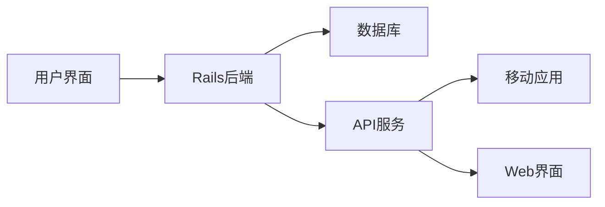
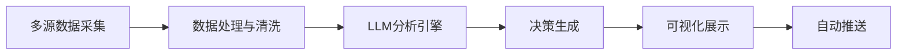
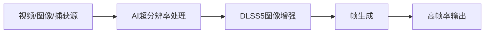
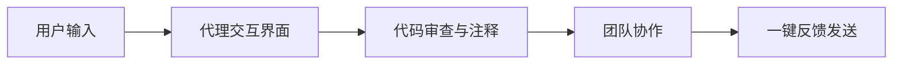
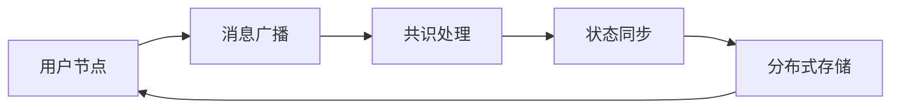
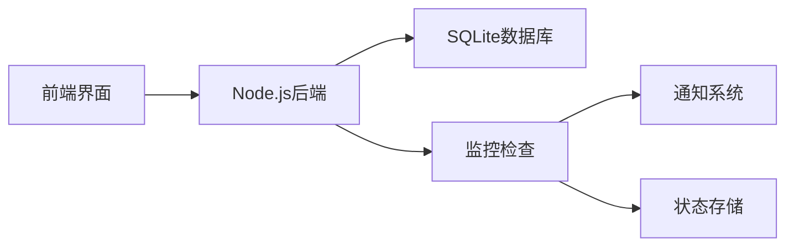
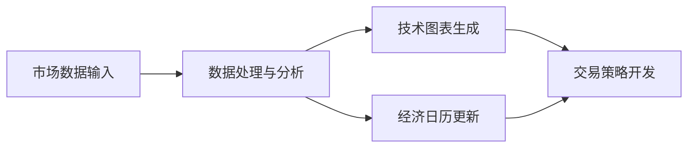

## 今日热点

今日GitHub热榜以AI赋能开发工具为核心，代码审查、安全检测与专业领域应用引领趋势，同时协作平台与开发者工具持续创新，展现AI与软件开发深度融合的发展方向。

---

## 热门项目一览

| 排名 | 项目 | 语言 | 今日 | 总计 | 简介 |
|:---:|------|:----:|------:|-----:|------|
| 1 | [GoogleChrome/modern-web-guidance-src](https://github.com/GoogleChrome/modern-web-guidance-src) | TypeScript | +1,925 | 4,995 | Keep your coding agent up t... |
| 2 | [we-promise/sure](https://github.com/we-promise/sure) | Ruby | +925 | 14,827 | The personal finance app fo... |
| 3 | [openai/codex-security](https://github.com/openai/codex-security) | TypeScript | +751 | 13,211 | OpenAI's Codex Security CLI... |
| 4 | [ZhuLinsen/daily_stock_analysis](https://github.com/ZhuLinsen/daily_stock_analysis) | Python | +256 | 71,758 | LLM 驱动的多市场股票智能分析系统：多源行情、实时新... |
| 5 | [tailscale/tailcat](https://github.com/tailscale/tailcat) | Go | +256 | 9,524 | like netcat, but over Tails... |
| 6 | [Likely7/Veyra-NRVideo](https://github.com/Likely7/Veyra-NRVideo) | C++ | +256 | 1,679 | Bring PS5 GTA6 to 120FPS wi... |
| 7 | [alibaba/open-code-review](https://github.com/alibaba/open-code-review) | Go | +215 | 50,760 | Secure, fast, efficient, ba... |
| 8 | [backnotprop/plannotator](https://github.com/backnotprop/plannotator) | TypeScript | +108 | 10,522 | The workspace to stay in th... |
| 9 | [block/buzz](https://github.com/block/buzz) | Rust | +97 | 37,328 | A hive mind communication p... |
| 10 | [louislam/uptime-kuma](https://github.com/louislam/uptime-kuma) | JavaScript | +71 | 93,919 | A fancy self-hosted monitor... |
| 11 | [tradermonty/claude-trading-skills](https://github.com/tradermonty/claude-trading-skills) | Python | +69 | 4,247 | Claude Code skills for equi... |
| 12 | [ChromeDevTools/chrome-devtools-mcp](https://github.com/ChromeDevTools/chrome-devtools-mcp) | TypeScript | +67 | 55,571 | Chrome DevTools for coding ... |

---

## 趋势洞察

```
┌─────────────────────────────────────────────────────────────────┐
│  AI/ML 工具         ████████████████████████  9 个项目        │
│  其他               █████                     2 个项目        │
│  开发工具             ██                        1 个项目        │
└─────────────────────────────────────────────────────────────────┘
```

---

## 项目深度解读

### 1. GoogleChrome/modern-web-guidance-src — 现代Web实践指南

> **一句话总结**：由Google Chrome团队维护的最新Web开发最佳实践知识库，帮助开发者保持技术更新。

#### 价值主张

| 维度 | 说明 |
|------|------|
| **解决痛点** | Web技术迭代快，开发者难以掌握最新最佳实践 |
| **目标用户** | Web开发人员、前端工程师和全栈开发者 |
| **核心亮点** | + 官方权威指南 + 结构化知识体系 + 实用代码示例 + 持续更新 |

#### 技术架构


**技术特色**：
- 基于TypeScript编写，保证代码质量与可维护性
- 结构化知识体系便于开发者快速定位和学习
- 实用示例代码可直接应用于实际项目
- 由Google官方维护，确保内容权威性和准确性

#### 热度分析

- 项目近期呈爆发式增长，单日新增近2000个Star，反映开发者对最新Web实践强烈需求
- 作为Google官方项目，在Web开发领域具有标杆地位，社区参与度高

#### 快速上手

```bash
# 克隆项目到本地
git clone https://github.com/GoogleChrome/modern-web-guidance-src.git

# 浏览文档目录
cd modern-web-guidance-src && ls
```

#### 注意事项
- 本项目是知识库而非可直接运行的软件，主要通过阅读文档获取最新Web实践
- 内容会随Web技术发展而更新，建议定期关注最新版本
- 指南中的最佳实践应结合实际项目需求灵活应用，避免盲目套用


### 2. we-promise/sure — 个人理财助手

> **一句话总结**：一款面向全民的协作式个人财务应用，让财务管理变得简单可靠。

#### 价值主张

| 维度 | 说明 |
|------|------|
| **解决痛点** | 简化个人财务管理，解决收支混乱、预算控制难的问题 |
| **目标用户** | 需要管理个人财务的普通用户，非专业财务人员 |
| **核心亮点** | 协作式记账 + 简洁界面 + 多设备同步 + 数据安全 + 预算管理 |

#### 技术架构



**技术特色**：
- 基于Ruby on Rails构建的全栈应用
- 采用RESTful API设计，支持多端访问
- 使用现代前端框架提升用户体验
- 强调数据安全和隐私保护
- 支持实时同步和离线使用

#### 热度分析

- 项目获得14,827个星标，近期增长迅速，日增925星，显示社区高度关注
- 开源项目但Issues为0，可能表明项目已成熟稳定或使用其他渠道支持用户

#### 快速上手

```bash
# 克隆项目
git clone https://github.com/we-promise/sure.git

# 安装依赖
bundle install

# 启动开发服务器
rails server
```

#### 注意事项

- 项目开源协议未知，使用前需确认授权条款
- 作为财务应用，数据安全至关重要，建议自行部署并加强安全措施
- 项目可能需要配置数据库和初始数据才能正常运行


### 3. openai/codex-security — AI安全分析工具

> **一句话总结**：基于OpenAI Codex的安全漏洞检测与修复工具，提供TypeScript SDK和CLI接口。

#### 价值主张

| 维度 | 说明 |
|------|------|
| **解决痛点** | 自动化代码安全漏洞检测与修复，减少人工审计成本 |
| **目标用户** | 开发者团队、安全工程师、DevOps人员 |
| **核心亮点** | AI驱动漏洞识别 + 自动修复建议 + 集成CI/CD流水线 + 支持多种编程语言 |

#### 技术架构


**技术特色**：
- 基于OpenAI Codex模型的代码理解与漏洞检测
- TypeScript SDK提供灵活的API集成能力
- 支持批量代码扫描与增量更新
- 生成可执行的安全修复建议

#### 热度分析

- 项目Star数增长迅速，单日新增751个Star，表明开发者社区对其高度关注
- 作为OpenAI生态中的重要安全工具，正在成为开发者安全工作流中的必备组件

#### 快速上手

```bash
# 安装CLI工具
npm install -g @openai/codex-security

# 扫描当前目录
codex-security scan

# 生成修复报告
codex-security report --format json
```

#### 注意事项

- 需要OpenAI API密钥才能使用，可能有使用限制
- AI生成的修复建议需要人工审核，不能完全依赖自动修复
- 隐私问题：代码会被发送到OpenAI服务进行处理，敏感代码需谨慎使用


### 4. ZhuLinsen/daily_stock_analysis — 智能股票分析系统

> **一句话总结**：LLM驱动的多市场股票分析系统，整合多源数据提供智能决策支持。

#### 价值主张

| 维度 | 说明 |
|------|------|
| **解决痛点** | 整合分散的股票信息源，提供智能化、自动化的股票分析 |
| **目标用户** | 个人投资者、金融分析师、量化交易爱好者 |
| **核心亮点** | LLM驱动 + 多市场数据整合 + 实时分析 + 零成本运行 + 自动推送 |

#### 技术架构



**技术特色**：
- 多源数据整合能力，获取多市场行情和实时新闻
- LLM驱动分析，提供智能化的股票决策支持
- 零成本定时运行，降低使用门槛

#### 热度分析

- Star数高达71,758且持续增长，表明项目受到广泛认可
- Fork数与Star数比例接近1:1，显示社区参与度高，用户积极进行二次开发

#### 快速上手

```bash
# 克隆项目
git clone https://github.com/ZhuLinsen/daily_stock_analysis.git

# 安装依赖
pip install -r requirements.txt
```

#### 注意事项

- 需要配置API密钥才能获取完整的市场数据
- 系统依赖多个外部数据源，可能受到网络状况影响
- 仅供参考，投资决策需结合专业知识和市场情况


### 5. tailscale/tailcat — Tailscale 网络工具

> **一句话总结**：基于 Tailscale 数据平面的安全 netcat 替代品，无需控制平面即可实现加密通信。

#### 价值主张

| 维度 | 说明 |
|------|------|
| **解决痛点** | 传统 netcat 缺乏加密且难以穿越防火墙，提供安全点对点连接 |
| **目标用户** | 开发者、系统管理员和网络安全专家 |
| **核心亮点** | 基于 Tailscale WireGuard 加密 + 无需控制平面 + 跨平台支持 |

#### 技术架构


**技术特色**：
- 利用 Tailscale 的 WireGuard 加密实现安全通信
- Go 语言实现，提供跨平台支持和良好性能
- 保持与 netcat 类似的简单命令行接口

#### 热度分析

- 近万星且持续增长，反映网络安全工具需求旺盛
- 零开放问题表明项目成熟度高，社区维护良好

#### 快速上手

```bash
# 安装 tailcat
go install tailscale.com/cmd/tailcat@latest

# 监听端口并转发到远程
tailcat --listen=:8080 --dest=100.100.100.100:80

# 连接到远程服务
tailcat --connect=100.100.100.100:80
```

#### 注意事项

- 需要 Tailscale 网络环境才能正常工作
- 与传统 netcat 不同，它依赖于 Tailscale 的网络拓扑
- 可能需要额外的配置以确保安全访问控制


### 6. Likely7/Veyra-NRVideo — AI视频增强工具

> **一句话总结**：利用AI增强技术和DLSS实现高帧率视频播放与捕获的Windows工具

#### 价值主张

| 维度 | 说明 |
|------|------|
| **解决痛点** | 解决视频低帧率与画质不足问题，提升视觉体验 |
| **目标用户** | 游戏玩家、视频内容创作者、发烧级用户 |
| **核心亮点** | AI超分辨率 + DLSS5增强 + 帧生成技术 |

#### 技术架构



**技术特色**：
- 结合AI技术与DLSS实现画质提升
- 实时处理能力，支持即时预览
- 帧生成技术可将低帧率内容提升至120FPS

#### 热度分析

- 项目获得1679星，单日增长256星，表明社区对其功能高度关注
- 作为小众领域工具，参与度相对较低，但关注度增长迅速

#### 快速上手

```bash
# 克隆项目
git clone https://github.com/Likely7/Veyra-NRVideo.git

# 构建项目（假设使用CMake）
mkdir build && cd build
cmake .. && make
```

#### 注意事项

- 项目许可证未知，使用前需确认授权条款
- 可能需要较新的NVIDIA GPU以支持DLSS功能
- 作为增强工具，可能对系统性能有一定要求


### 7. alibaba/open-code-review — 智能代码审查

> **一句话总结**：阿里巴巴开源的混合架构代码审查工具，结合确定性流水线与LLM代理，提供精确行级注释和多语言安全规则。

#### 价值主张

| 维度 | 说明 |
|------|------|
| **解决痛点** | 提高代码审查效率，降低人工成本，提升代码质量 |
| **目标用户** | 开发团队、代码审查者、DevOps工程师 |
| **核心亮点** | 确定性流水线 + LLM Agent + 多语言规则集 |

#### 技术架构


**技术特色**：
- 混合架构结合确定性流水线和LLM代理
- 内置多语言安全规则集（NPE、线程安全、XSS、SQL注入等）
- 与OpenAI和Anthropic兼容，支持多种LLM模型

#### 热度分析

- 项目获得超过5万星，单日增长215星，表明社区关注度极高，企业级工具需求强烈
- 零开放Issues显示项目维护良好，问题处理机制高效，适合企业级应用

#### 快速上手

```bash
# 克隆项目
git clone https://github.com/alibaba/open-code-review.git

# 安装依赖
cd open-code-review && go mod download

# 配置API密钥
export OPENAI_API_KEY="your_api_key_here"

# 运行服务
go run main.go
```

#### 注意事项

- 项目许可证信息不明确，商业使用前需确认许可证类型
- 作为阿里巴巴内部使用的工具，可能需要适应特定环境才能充分发挥其效能


### 8. backnotprop/plannotator — AI代理工作台

> **一句话总结**：一站式AI代理协作平台，集成代码审查、注释和团队反馈功能，简化AI代理交互流程。

#### 价值主张

| 维度 | 说明 |
|------|------|
| **解决痛点** | AI代理交互分散，反馈流程繁琐，缺乏统一管理界面 |
| **目标用户** | AI开发者、团队负责人和需要与AI代理协作的技术人员 |
| **核心亮点** | 集成化代理管理界面 + 一键反馈发送 + 团队协作支持 + 代码审查注释功能 |

#### 技术架构



**技术特色**：
- 基于TypeScript构建的响应式前端应用
- 可能集成AI API进行代理交互
- 支持实时团队协作功能

#### 热度分析

- 项目星标超万，近期增长稳定，显示AI代理工具领域需求旺盛
- 零开放问题表明项目维护良好，社区参与度高

#### 快速上手

```bash
# 克隆仓库
git clone https://github.com/backnotprop/plannotator.git
# 安装依赖
npm install
# 运行项目
npm run dev
```

#### 注意事项

- 项目许可证未知，使用前需确认
- 可能需要配置AI API密钥才能使用完整功能


### 9. block/buzz — 群体思维通信

> **一句话总结**：基于Rust构建的高性能去中心化通信平台，实现群体思维实时共享与协作。

#### 价值主张

| 维度 | 说明 |
|------|------|
| **解决痛点** | 解决传统中心化通信平台的单点故障和信息孤岛问题 |
| **目标用户** | 分布式团队、去中心化应用开发者和隐私敏感型用户 |
| **核心亮点** | 去中心化架构 + 高性能Rust实现 + 实时通信能力 + 隐私保护 + 高可用性 |

#### 技术架构



**技术特色**：
- 基于Rust的高性能并发处理能力
- 去中心化的消息传递与共识机制
- 分布式存储与状态同步技术
- 强调隐私保护的通信加密
- 高可用性的节点冗余设计

#### 热度分析

- 项目短时间内获得近3.7万星标，表明其解决了通信领域的痛点问题
- 作为Rust生态中的新兴项目，正吸引对去中心化和高性能通信技术感兴趣的开发者

#### 快速上手

```bash
# 安装block/buzz
cargo install block_buzz

# 初始化节点
block-buzz init

# 启动通信服务
block-buzz start --port 8080
```

#### 注意事项

- 项目当前没有公开的issues，可能处于早期阶段或使用其他问题跟踪系统
- 需要关注项目的许可协议，目前显示为Unknown
- 作为去中心化平台，网络配置和节点发现可能需要额外设置
- 由于使用Rust开发，需要确保系统兼容性和依赖管理


### 10. louislam/uptime-kuma — 自托管监控工具

> **一句话总结**：轻量级自托管监控工具，提供多站点状态监测与通知功能，界面美观易用。

#### 价值主张

| 维度 | 说明 |
|------|------|
| **解决痛点** | 替代传统付费监控服务，提供自托管的全功能网站状态监测方案。 |
| **目标用户** | DevOps团队、网站管理员、小型企业IT负责人。 |
| **核心亮点** | 轻量级+可视化界面+多协议监控+多通知渠道+多语言支持 |

#### 技术架构



**技术特色**：
- 基于 Node.js 构建，前端使用 Vue.js，提供流畅的用户体验
- 使用 SQLite 作为默认数据库，简化部署和备份
- 支持多种监控协议（HTTP/HTTPS、TCP、Ping、DNS等）

#### 热度分析

- Star 数接近10万，日增70+，表明项目处于快速增长期，社区认可度高。
- 作为自托管监控工具的代表项目，在同类工具中处于领先地位，社区贡献活跃。

#### 快速上手

```bash
# 使用 Docker 运行
docker run -d --name uptime-kuma -p 3001:3001 louislam/uptime-kuma

# 或直接使用 Node.js
git clone https://github.com/louislam/uptime-kuma.git
cd uptime-kuma
npm install
node server/server.js
```

#### 注意事项

- 需要确保服务器有足够的资源来运行监控服务
- 默认端口是3001，部署时注意端口冲突
- 定期备份数据库以保存监控历史记录
- 配置适当的通知渠道以确保及时收到警报


### 11. tradermonty/claude-trading-skills — 股票交易技能库

> **一句话总结**：集市场分析、技术图表和交易策略开发于一体的Claude交易技能库，提升投资决策效率。

#### 价值主张

| 维度 | 说明 |
|------|------|
| **解决痛点** | 解决投资者市场分析、技术图表绘制和策略开发的一体化需求 |
| **目标用户** | 股票投资者、交易员、金融分析师等专业市场参与者 |
| **核心亮点** | 多功能市场分析工具 + 技术图表绘制 + 经济日历集成 + 策略筛选器 + AI辅助决策 |

#### 技术架构



**技术特色**：
- 基于Python的交易分析工具集，支持多种金融数据源
- 集成Claude AI能力进行市场分析和策略优化
- 提供完整的技术分析功能包和自定义策略框架

#### 热度分析
- 项目获得4,247个星标且持续增长(+69/天)，显示其在交易社区中高度关注
- 874个Fork数表明开发者社区积极参与，项目具有良好的生态位置和扩展性

#### 快速上手

```bash
# 克隆项目
git clone https://github.com/tradermonty/claude-trading-skills.git

# 安装依赖
pip install -r requirements.txt

# 基本使用示例
python claude_trading_skills.py --market-analysis --symbol=AAPL
```

#### 注意事项
- 项目可能需要金融数据API访问权限才能正常运行，需自行配置API密钥
- 使用前应确保有足够的市场数据访问权限，部分功能可能需要付费订阅
- 交易决策应结合专业知识和风险评估，不应完全依赖自动化工具


### 12. ChromeDevTools/chrome-devtools-mcp — 浏览器调试代理

> **一句话总结**：将Chrome开发者工具功能扩展并适配，使AI编码代理能够利用强大的浏览器调试能力。

#### 价值主张

| 维度 | 说明 |
|------|------|
| **解决痛点** | 解决AI编码代理无法直接使用浏览器调试工具的问题，增强网页开发调试能力 |
| **目标用户** | AI编码工具开发者、需要AI辅助进行网页开发的程序员 |
| **核心亮点** | Chrome DevTools深度集成 + 编码代理专用API + 调试能力自动化 |

#### 技术架构


**技术特色**：
- Chrome DevTools功能API封装与扩展
- 编码代理专用通信协议设计
- 调试流程自动化与智能化

#### 热度分析

- 高星项目(55k+)且持续增长(+67 today)，显示其在开发者社区中有很高认可度
- 零开放问题表明项目维护成熟，或问题解决流程高效

#### 快速上手

```bash
# 安装依赖
npm install chrome-devtools-mcp

# 初始化配置
chrome-devtools-mcp init

# 启动服务
chrome-devtools-mcp start
```

#### 注意事项

- 可能需要最新版本的Chrome浏览器
- 与特定编码代理工具的集成可能需要额外配置
- 项目许可证信息不明确，使用前需确认开源许可


## 今日推荐

| 主题 | 推荐项目 | 亮点 |
|------|----------|------|
| 今日最热 | [GoogleChrome/modern-web-guidance-src](https://github.com/GoogleChrome/modern-web-guidance-src) | Keep your coding ... |
| 值得关注 | [we-promise/sure](https://github.com/we-promise/sure) | The personal fina... |
| 快速上手 | [openai/codex-security](https://github.com/openai/codex-security) | OpenAI's Codex Se... |
| 长期潜力 | [ZhuLinsen/daily_stock_analysis](https://github.com/ZhuLinsen/daily_stock_analysis) | LLM 驱动的多市场股票智能分析系... |

---

<div align="center">

*Generated on 2026-11-14 | Powered by GitHub Trending Reporter*

</div>