## 今日热点

AI编码助手与代理工具持续引领GitHub趋势，Chrome DevTools与AI结合项目大受欢迎，同时AI在金融和个人办公领域的应用也呈现快速增长态势。

---

## 热门项目一览

| 排名 | 项目 | 语言 | 今日 | 总计 | 简介 |
|:---:|------|:----:|------:|-----:|------|
| 1 | [GoogleChrome/modern-web-guidance-src](https://github.com/GoogleChrome/modern-web-guidance-src) | TypeScript | +1,231 | 6,182 | Keep your coding agent up t... |
| 2 | [alibaba/open-code-review](https://github.com/alibaba/open-code-review) | Go | +893 | 51,504 | Secure, fast, efficient, ba... |
| 3 | [ChromeDevTools/chrome-devtools-mcp](https://github.com/ChromeDevTools/chrome-devtools-mcp) | TypeScript | +664 | 56,378 | Chrome DevTools for coding ... |
| 4 | [we-promise/sure](https://github.com/we-promise/sure) | Ruby | +659 | 15,377 | The personal finance app fo... |
| 5 | [tradermonty/claude-trading-skills](https://github.com/tradermonty/claude-trading-skills) | Python | +553 | 4,911 | Claude Code skills for equi... |
| 6 | [dream-num/univer](https://github.com/dream-num/univer) | TypeScript | +495 | 24,996 | Build your own AI office wi... |
| 7 | [louislam/uptime-kuma](https://github.com/louislam/uptime-kuma) | JavaScript | +430 | 94,294 | A fancy self-hosted monitor... |
| 8 | [Likely7/Veyra-NRVideo](https://github.com/Likely7/Veyra-NRVideo) | C++ | +420 | 2,342 | Bring PS5 GTA6 to 120FPS wi... |
| 9 | [backnotprop/plannotator](https://github.com/backnotprop/plannotator) | TypeScript | +408 | 11,240 | The workspace to stay in th... |
| 10 | [martin-olivier/airgorah](https://github.com/martin-olivier/airgorah) | Rust | +270 | 5,951 | A WiFi security auditing so... |
| 11 | [JuliusBrussee/caveman](https://github.com/JuliusBrussee/caveman) | Go | +227 | 120,126 | 🪨 why use many token when f... |
| 12 | [QwenLM/qwen-code](https://github.com/QwenLM/qwen-code) | TypeScript | +64 | 30,392 | An open-source AI coding ag... |

---

## 趋势洞察

```
┌─────────────────────────────────────────────────────────────────┐
│  AI/ML 工具         ████████████████████████  13 个项目        │
│  开发工具             █                         1 个项目        │
│  其他               █                         1 个项目        │
└─────────────────────────────────────────────────────────────────┘
```

---

## 项目深度解读

### 1. GoogleChrome/modern-web-guidance-src — [现代Web指南]

> **一句话总结**：Google官方维护的最新Web开发最佳实践指南，提供权威的前端技术规范与实现方案

#### 价值主张

| 维度 | 说明 |
|------|------|
| **解决痛点** | Web技术迭代快，开发者难以获取最新最佳实践和规范标准 |
| **目标用户** | Web开发者、前端工程师、全栈开发者和技术决策者 |
| **核心亮点** | 官方权威性 + 实时更新 + 结构化知识体系 + 实用示例 + 代码规范 |

#### 技术架构

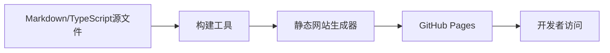

**技术特色**：
- 采用TypeScript编写源码，确保类型安全
- 使用模块化内容组织，便于维护和扩展
- 集成CI/CD流程，自动化构建和部署

#### 热度分析
- 项目Star数达6,182且单日增长1,231，显示社区对该内容的高度认可
- 作为Google官方维护项目，在Web开发领域具有权威性和影响力

#### 快速上手

```bash
# 克隆仓库
git clone https://github.com/GoogleChrome/modern-web-guidance-src.git

# 本地预览
cd modern-web-guidance-src
npm install && npm start
```

#### 注意事项
- 内容定期更新，建议关注项目变更以获取最新Web技术规范
- 实施最佳实践时需考虑项目特定需求和浏览器兼容性
- 贡献内容应遵循项目的贡献指南和内容规范


### 2. alibaba/open-code-review — 企业级代码审查工具

> **一句话总结**：结合确定性与AI的企业级代码审查工具，提供多语言安全检测和精确行级评论。

#### 价值主张

| 维度 | 说明 |
|------|------|
| **解决痛点** | 解决大规模代码审查中的效率和准确性问题，同时保障代码安全性 |
| **目标用户** | 企业级开发团队、需要高质量代码审查的组织 |
| **核心亮点** | 混合架构设计 + 多语言内置规则集 + 精确行级评论 + LLM智能代理 |

#### 技术架构

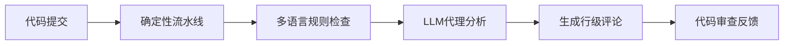

**技术特色**：
- 确定性流水线与LLM代理的混合架构
- 支持多语言的安全规则集(NPE、线程安全、XSS、SQL注入等)
- 兼容OpenAI和AnthropicAPI，提供灵活的AI集成选项

#### 热度分析

- 项目获得5万+星标，单日增长近900，表明在企业级代码审查领域有极高认可度
- 零开放问题反映项目成熟度高，维护良好，适合企业级生产环境使用

#### 快速上手

```bash
# 安装工具
go install github.com/alibaba/open-code-review/cmd/cr

# 初始化配置
cr init --provider=openai

# 开始代码审查
cr review --path=/path/to/code
```

#### 注意事项

- 项目需要配置OpenAI或Anthropic的API密钥才能使用LLM功能
- 作为阿里巴巴内部使用的工具，可能需要适应大规模代码库的审查需求
- 虽然支持多语言，但某些特定语言的规则集可能需要额外配置


### 3. ChromeDevTools/chrome-devtools-mcp — [AI开发工具]

> **一句话总结**：Chrome DevTools扩展，为AI编码代理提供浏览器环境深度集成能力。

#### 价值主张

| 维度 | 说明 |
|------|------|
| **解决痛点** | 为AI代理提供浏览器开发环境无缝集成与调试能力 |
| **目标用户** | AI编码工具开发者、智能IDE构建者、浏览器自动化测试者 |
| **核心亮点** | 浏览器环境深度集成 + AI代理专用接口 + DevTools扩展能力 |

#### 技术架构

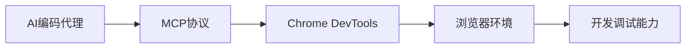

**技术特色**：
- 基于TypeScript实现类型安全开发
- 提供专门的AI代理通信接口
- 与Chrome DevTools原生API深度集成

#### 热度分析

- 高关注度项目，日增星数664，表明开发者社区对其需求强烈
- 作为Chrome DevTools官方项目，在浏览器开发工具生态中占据核心地位

#### 快速上手

```bash
# 克隆项目
git clone https://github.com/ChromeDevTools/chrome-devtools-mcp.git

# 安装依赖
npm install

# 构建项目
npm run build
```

#### 注意事项

- 需要Chrome浏览器环境支持
- 需要具备Chrome扩展开发相关知识
- 项目可能需要Chrome特定版本的API支持


### 4. we-promise/sure — 开源理财应用

> **一句话总结**：一款面向大众的开源个人理财应用，由社区共同打造，提供全面的财务管理功能。

#### 价值主张

| 维度 | 说明 |
|------|------|
| **解决痛点** | 简化个人财务管理，提供直观的收支追踪与分析 |
| **目标用户** | 需要管理个人财务的普通用户及开发者 |
| **核心亮点** | 开源协作 + 跨平台支持 + 数据可视化 + 隐私保护 + 社区驱动 |

#### 技术架构

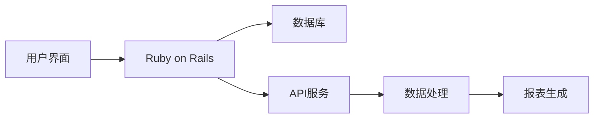

**技术特色**：
- 采用Ruby on Rails框架构建稳定后端
- 开源协作模式促进功能迭代与优化
- 模块化设计便于功能扩展与定制

#### 热度分析
- 项目Star数持续增长，单日新增近700，显示社区高度关注
- 高Fork比例表明项目可作为基础模板进行二次开发
- 零Open Issues反映问题处理高效，项目维护良好

#### 快速上手
```bash
# 克隆项目
git clone https://github.com/we-promise/sure.git

# 安装依赖
bundle install

# 启动开发服务器
rails server
```

#### 注意事项
- 项目许可证信息不明确，使用前需确认开源协议
- 作为开源项目，可能需要自行部署和维护服务器
- 项目可能需要一定的Ruby开发经验进行定制化修改


### 5. tradermonty/claude-trading-skills — AI交易助手

> **一句话总结**：基于Claude的AI交易技能集，为股民提供市场分析、技术图表和策略开发支持。

#### 价值主张

| 维度 | 说明 |
|------|------|
| **解决痛点** | 将Claude AI专业知识集成到股票交易工作流，提升决策效率 |
| **目标用户** | 股票投资者、交易员、金融分析师 |
| **核心亮点** | 市场分析 + 技术图表绘制 + 经济日历 + 股票筛选器 + 策略开发 |

#### 技术架构

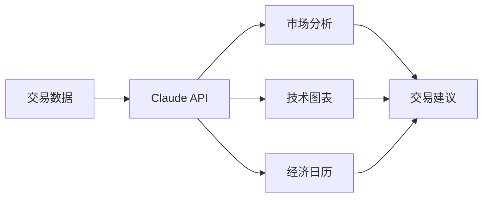

**技术特色**：
- 基于Claude大语言模型的专业金融知识处理
- Python实现的交易数据可视化与分析工具集
- 模块化设计支持多种交易场景定制

#### 热度分析

- 单日新增553个Star，项目热度呈指数级增长，反映AI+交易领域需求激增
- 高Fork比例(21%)表明开发者积极参与功能扩展和二次开发

#### 快速上手

```bash
# 安装依赖
pip install -r requirements.txt

# 初始化配置
python setup.py --configure

# 启动Claude交易技能
claude --skill trading-skills
```

#### 注意事项

- 项目许可证未知，商业使用前需确认授权条款
- AI交易建议仅供参考，实际决策需结合专业判断和市场情况
- 使用前需确保已获得相关金融数据源的访问权限


### 6. dream-num/univer — AI办公套件SDK

> **一句话总结**：基于开源核心的AI办公SDK，提供编辑、计算、协作和文件处理功能，支持人类和AI代理使用。

#### 价值主张

| 维度 | 说明 |
|------|------|
| **解决痛点** | 传统办公软件与AI集成不足，缺乏一站式办公开发解决方案 |
| **目标用户** | 需要将AI办公能力集成到产品中的应用开发者 |
| **核心亮点** | AI办公能力 + 全面的编辑计算协作功能 + 强大的文件处理能力 + 可扩展架构 + 开源核心 |

#### 技术架构

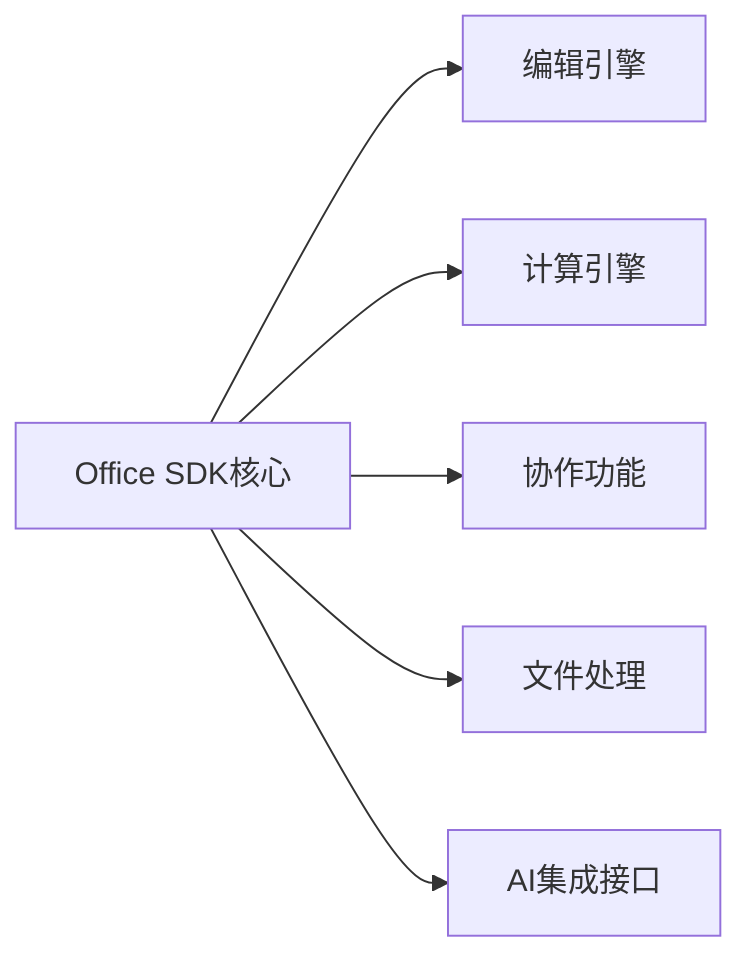

**技术特色**：
- 基于TypeScript开发，类型安全，易于集成
- 提供完整的办公功能模块化架构
- 支持人类和AI双重使用场景

#### 热度分析

- Star数近2.5万且持续快速增长，表明项目获得广泛认可
- 社区活跃度高，Fork比例合理，显示健康的项目生态

#### 快速上手

```bash
# 安装Univer
npm install @univer/core @univer/sheets @univer/docs

# 初始化Univer实例
import { Univer } from '@univer/core';
const univer = new Univer();
```

#### 注意事项

- 项目License信息不明确，使用前需确认开源协议
- AI集成功能可能需要额外的配置和学习成本
- 项目仍在积极开发中，API可能会有变动


### 7. louislam/uptime-kuma — 自托管监控工具

> **一句话总结**：功能丰富的自托管监控工具，提供多种监控类型和通知方式，全面监控在线服务状态。

#### 价值主张

| 维度 | 说明 |
|------|------|
| **解决痛点** | 解决传统监控服务依赖第三方、数据隐私和成本高昂问题 |
| **目标用户** | 需要监控网站、API、服务器状态的DevOps团队和系统管理员 |
| **核心亮点** | 自托管部署 + 多种监控类型 + 直观仪表板 + 丰富通知渠道 + 轻量级部署 |

#### 技术架构

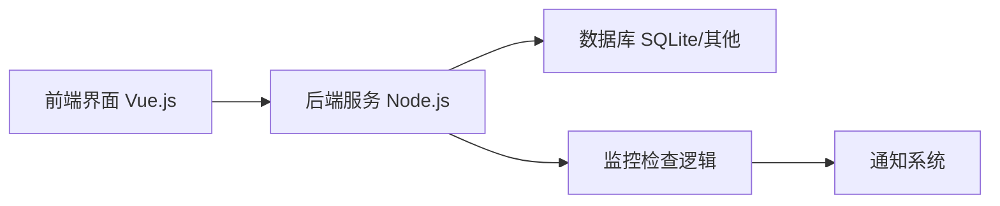

**技术特色**：
- 基于 Node.js + Vue.js 的全栈架构，确保性能和开发效率
- 使用 SQLite 作为默认数据库，简化部署流程
- WebSocket 实现实时更新，提供流畅的用户体验
- 轻量级设计，资源占用低，适合各种规模部署

#### 热度分析

- 项目 Star 数高达 94,294，表明在自托管监控工具领域具有极高认可度
- Fork 数 8,832，社区活跃度高，贡献者众多，项目生态完善

#### 快速上手

```bash
# 克隆项目
git clone https://github.com/louislam/uptime-kuma.git
# 安装依赖
cd uptime-kuma && npm install
# 启动服务
npm run dev
```

#### 注意事项

- 需要安装 Node.js 环境（推荐 v16+）
- 默认使用 SQLite，生产环境可考虑使用 PostgreSQL 或 MySQL
- 首次使用需要设置管理员账户和密码
- 建议定期备份数据库，防止数据丢失


### 8. Likely7/Veyra-NRVideo — 视频增强工具

> **一句话总结**：利用AI技术与DLSS 5实现视频超分辨率、帧生成和图像增强，提升视觉体验至120FPS。

#### 价值主张

| 维度 | 说明 |
|------|------|
| **解决痛点** | 提升游戏和视频帧率与画质，解决高帧率与高质量难以兼得的问题 |
| **目标用户** | 游戏玩家、视频内容创作者、流媒体主播 |
| **核心亮点** | AI超分辨率 + DLSS5图像增强 + 实时帧生成 |

#### 技术架构

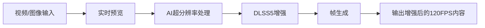

**技术特色**：
- 基于AI的超分辨率技术提升原始画质
- 集成DLSS 5实现高级图像增强
- 实时帧生成技术将内容提升至120FPS
- 支持多种输入源（视频、图像、采集卡）

#### 热度分析

- 项目在短时间内获得大量关注，单日新增420星显示其技术价值受到广泛认可
- 相对较少的Issues表明项目可能处于早期稳定阶段，或社区反馈主要通过其他渠道

#### 快速上手

```bash
# 下载最新版本安装包
# 运行安装程序
# 启动应用程序并配置输入源
```

#### 注意事项

- 项目许可证信息未知，使用前需确认授权条款
- 项目可能需要较新的硬件支持，特别是NVIDIA显卡以实现DLSS功能
- 作为增强工具，可能会对系统资源有较高要求


### 9. backnotprop/plannotator — AI代理协作平台

> **一句话总结**：一站式AI代理工作空间，帮助团队规划、标注和反馈AI代理工作流程。

#### 价值主张

| 维度 | 说明 |
|------|------|
| **解决痛点** | 解决AI代理协作管理困难，反馈分散的问题 |
| **目标用户** | AI开发团队、产品经理和AI代理使用者 |
| **核心亮点** | 统一工作空间 + 团队协作 + 一键反馈 + 代码审查 + 流程规划 |

#### 技术架构

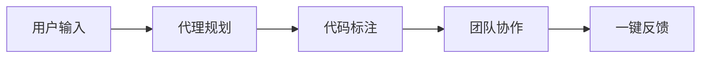

**技术特色**：
- 使用TypeScript构建，提供类型安全
- 模块化设计支持多种AI代理交互
- 实时协作和反馈机制
- 代码审查与AI代理功能集成
- 统一的工作空间管理界面

#### 热度分析

- 项目获得11k+星标且每日增长400+，显示AI代理协作工具需求旺盛
- 零未解决问题表明项目维护良好，社区参与度高

#### 快速上手

```bash
# 克隆仓库
git clone https://github.com/backnotprop/plannotator.git

# 安装依赖
npm install

# 启动开发服务器
npm run dev
```

#### 注意事项

- 项目许可证未知，商业使用前需确认授权条款
- 作为新兴领域工具，API和功能可能快速迭代
- 需要配置AI代理服务才能发挥完整功能


### 10. martin-olivier/airgorah — WiFi安全审计

> **一句话总结**：一款功能强大的Rust编写的WiFi安全审计工具，支持多种攻击向量检测。

#### 价值主张

| 维度 | 说明 |
|------|------|
| **解决痛点** | 提供专业WiFi网络安全审计能力，发现潜在安全漏洞 |
| **目标用户** | 网络安全专家、渗透测试人员、系统管理员 |
| **核心亮点** | 支持多种WiFi攻击检测 + 高性能Rust实现 + 便携式设计 |

#### 技术架构

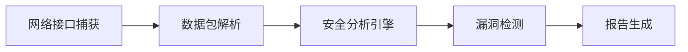

**技术特色**：
- 基于Rust构建，提供高性能内存安全保证
- 支持多种WiFi协议和加密方式的深度分析
- 实时监控和检测能力，快速识别安全威胁

#### 热度分析

- 项目近期关注度快速上升，单日增长270 stars，表明工具受到安全社区高度关注
- 高star与fork比例(5.95:1)反映项目质量高且用户粘性强，在网络安全工具领域具有重要地位

#### 快速上手

```bash
# 克隆项目
git clone https://github.com/martin-olivier/airgorah.git
# 编译安装
cargo build --release
# 运行工具
./target/release/airgorah
```

#### 注意事项

- 仅用于授权网络的安全测试和审计，未经授权使用可能违法
- 需要特定的网络接口和权限才能捕获和分析WiFi流量
- 工具功能强大，建议使用者具备一定的网络安全基础知识


### 11. JuliusBrussee/caveman — 代码token优化器

> **一句话总结**：通过简化语言表达减少AI编程助手65%的token使用量，提高效率。

#### 价值主张

| 维度 | 说明 |
|------|------|
| **解决痛点** | AI编程助手token使用过多导致效率低下和成本增加 |
| **目标用户** | AI编程助手用户、开发者、需要减少API调用成本的用户 |
| **核心亮点** | 减少65%token使用 + 穴居人语言风格 + 代理服务模式 + 保持功能完整性 |

#### 技术架构

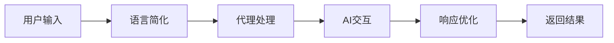

**技术特色**：
- 基于Go语言实现的高效代理服务
- 通过语言重构显著减少token消耗
- 保持与原AI编程助手的完全兼容性

#### 热度分析

- 项目Star数超12万，今日新增227个，显示持续增长的高社区认可度
- Open Issues为0，表明项目维护状况良好，用户反馈渠道畅通

#### 快速上手

```bash
# 安装caveman
go install github.com/JuliusBrussee/caveman@latest

# 配置并启动代理服务
caveman --config config.yaml
```

#### 注意事项

- 需配合特定的AI编程助手使用，确保API兼容性
- 简化语言可能影响某些复杂场景的表达准确性
- 许可证信息不明确，商业使用前需确认授权条款
- 65%的token减少是基于特定测试场景，实际效果可能因使用场景而异


### 12. QwenLM/qwen-code — 终端AI编程助手

> **一句话总结**：开源AI编程助手，嵌入终端，智能辅助代码生成与调试，提升开发者效率。

#### 价值主张

| 维度 | 说明 |
|------|------|
| **解决痛点** | 传统编程效率低，AI辅助开发需求增长 |
| **目标用户** | 开发者、程序员、软件工程师 |
| **核心亮点** | 终端集成 + AI代码生成 + 实时辅助 + 多语言支持 |

#### 技术架构

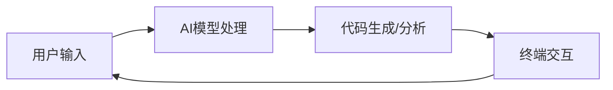

**技术特色**：
- 基于大语言模型的代码理解与生成能力
- 终端环境无缝集成，无需切换上下文
- 多编程语言支持，适应不同开发场景

#### 热度分析

- Star数30,392且持续增长(+64 today)，表明项目受广泛关注且活跃度高
- 作为AI编程助手，处于当前AI赋能开发工具的热点领域，生态位置有利

#### 快速上手

```bash
# 安装
npm install -g qwen-code

# 使用
qwen-code init
qwen-code "帮我写一个快速排序算法"
```

#### 注意事项

- 注意保护代码隐私，不要输入敏感信息
- AI生成代码需要人工审核，确保正确性和安全性
- 可能需要网络连接以访问AI服务


### 13. ashhart/TensorFold — 跨平台LLM推理引擎

> **一句话总结**：高性能跨平台LLM推理引擎，支持Metal/CUDA/Vulkan，提供低延迟大模型部署方案。

#### 价值主张

| 维度 | 说明 |
|------|------|
| **解决痛点** | 解决LLM在不同GPU平台上的高效部署和推理优化问题 |
| **目标用户** | 需要在多硬件平台部署大语言模型的开发者和企业 |
| **核心亮点** | 多后端支持 + Zig内存安全 + 跨平台兼容 + 低延迟优化 |

#### 技术架构

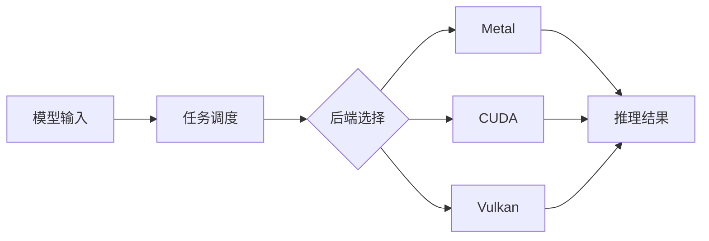

**技术特色**：
- 基于Zig语言实现，提供内存安全保障和编译时优化
- 多GPU后端支持，适配苹果和NVIDIA等不同硬件平台
- 优化的大模型推理流程，降低延迟提高吞吐量

#### 热度分析

- 项目Star数2182且持续增长，表明近期获得较高关注度
- Fork数514，社区处于活跃发展阶段，开发者参与度良好

#### 快速上手

```bash
# 克隆仓库
git clone https://github.com/ashhart/TensorFold.git
# 构建项目
zig build
# 运行示例
zig run examples/simple.zig
```

#### 注意事项

- 项目使用Zig语言，需要开发者熟悉该语言及其工具链
- 许可证信息未知，使用前需确认授权条款
- 项目Issue数为0，可能处于早期阶段，文档和稳定性可能有限


### 14. Tencent/LoopForge — AI编码工作流编排

> **一句话总结**：自托管AI编程代理工作流编排系统，整合多种AI编码助手并通过审批流程。

#### 价值主张

| 维度 | 说明 |
|------|------|
| **解决痛点** | 解决多种AI编码工具分散管理、缺乏统一流程的问题 |
| **目标用户** | 开发团队、技术负责人、需要整合AI编码工具的企业 |
| **核心亮点** | 自托管部署 + 多AI助手编排 + 人工审批流程 + 本地工作流支持 |

#### 技术架构

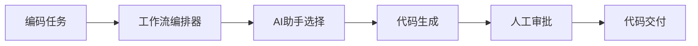

**技术特色**：
- 基于Go语言构建，保证高性能和并发处理能力
- 支持CodeBuddy、Codex和Claude Code等多种AI编程助手
- 提供本地化部署方案，保障数据安全与隐私

#### 热度分析

- 项目Star数为970，今日新增33个Star，表明近期热度上升，关注度较高
- Fork数229，显示有一定程度的二次开发或定制化需求
- Open Issues为0，可能表明项目问题处理及时或处于早期阶段

#### 快速上手

```bash
git clone https://github.com/Tencent/LoopForge.git
cd LoopForge
go install ./cmd/loopforge
```

#### 注意事项

- 项目许可证未知，商业使用前需确认授权方式
- 项目需要配置多种AI编程服务，需提前准备API密钥和相关资源
- 作为自托管系统，可能需要一定的运维知识


### 15. ag-ui-protocol/ag-ui — 前端代理协议

> **一句话总结**：AG-UI是前端代理交互协议，标准化AI代理与用户界面的集成方式。

#### 价值主张

| 维度 | 说明 |
|------|------|
| **解决痛点** | 前端应用中AI代理集成复杂，缺乏标准化交互协议 |
| **目标用户** | 前端开发者、AI应用构建者、智能产品团队 |
| **核心亮点** | 标准化交互协议 + 统一接口规范 + 简化AI集成 |

#### 技术架构

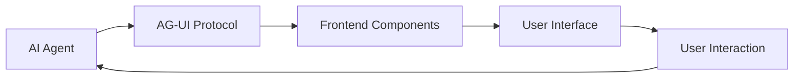

**技术特色**：
- 基于TypeScript的类型安全协议定义
- 模块化的前端组件设计
- 可扩展的交互事件系统

#### 热度分析

- 项目获得17k+ stars，表明其在AI前端集成领域有重要影响力
- 0 open issues可能表明项目成熟度高或问题处理机制高效

#### 快速上手

```bash
# 安装AG-UI协议库
npm install @ag-ui-protocol/core

# 在前端应用中初始化代理交互
import { AgentInteraction } from '@ag-ui-protocol/core';

const agent = new AgentInteraction({
  endpoint: '/api/agent',
  handlers: {
    onMessage: (message) => console.log(message),
    onAction: (action) => handleUserAction(action)
  }
});
```

#### 注意事项

- 项目许可证未知，使用前需确认开源许可条款
- 由于项目没有开放issues，可能社区支持渠道有限
- 需要关注API稳定性，特别是在生产环境中使用时


## 今日推荐

| 主题 | 推荐项目 | 亮点 |
|------|----------|------|
| 今日最热 | [GoogleChrome/modern-web-guidance-src](https://github.com/GoogleChrome/modern-web-guidance-src) | Keep your coding ... |
| 值得关注 | [alibaba/open-code-review](https://github.com/alibaba/open-code-review) | Secure, fast, eff... |
| 快速上手 | [ChromeDevTools/chrome-devtools-mcp](https://github.com/ChromeDevTools/chrome-devtools-mcp) | Chrome DevTools f... |
| 长期潜力 | [we-promise/sure](https://github.com/we-promise/sure) | The personal fina... |

---

<div align="center">

*Generated on 2026-11-15 | Powered by GitHub Trending Reporter*

</div>