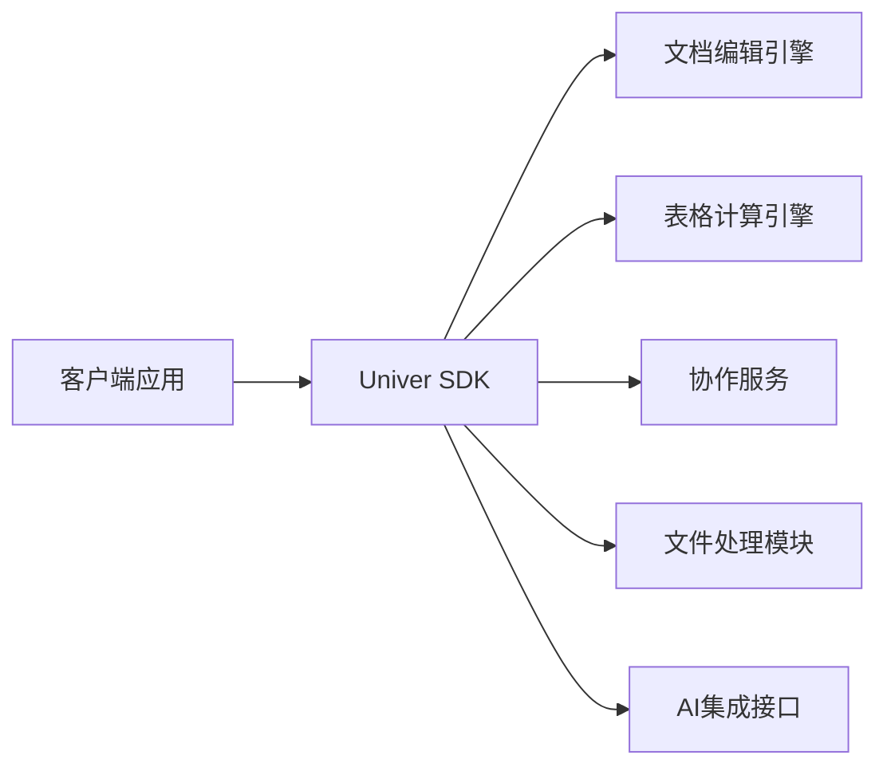
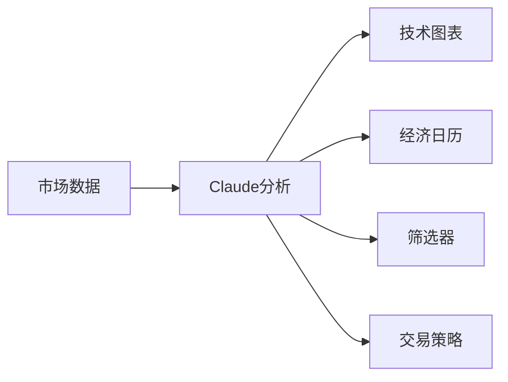
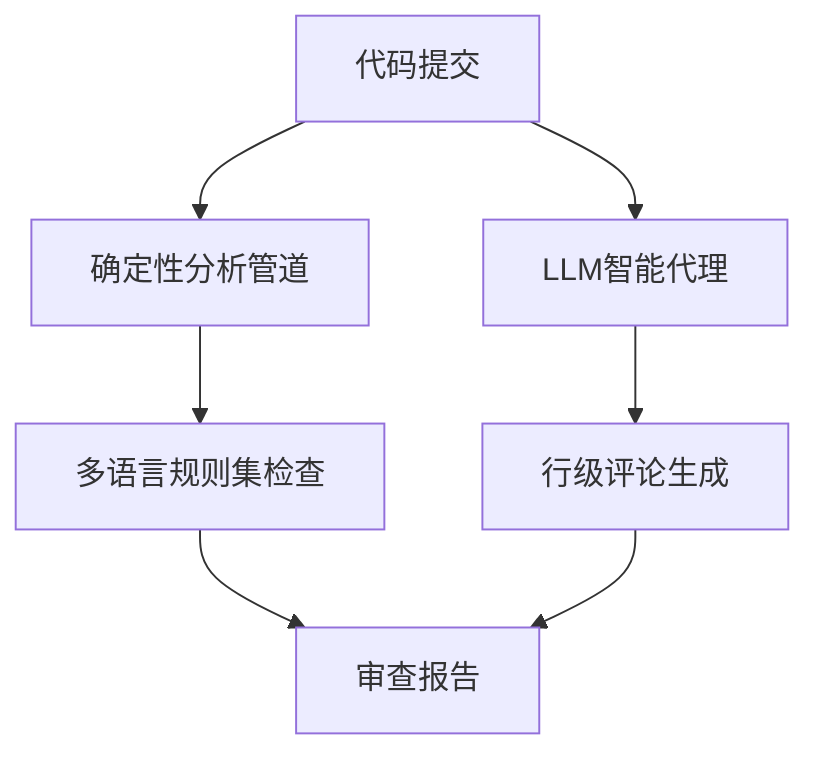

## 今日热点

今日GitHub热榜显示AI代理生态系统爆发式增长，Claude Code技能库与特定领域专业化工具引领趋势，同时AI赋能的办公与开发工具持续升温。

---

## 热门项目一览

| 排名 | 项目 | 语言 | 今日 | 总计 | 简介 |
|:---:|------|:----:|------:|-----:|------|
| 1 | [GoogleChrome/modern-web-guidance-src](https://github.com/GoogleChrome/modern-web-guidance-src) | TypeScript | +1,219 | 7,347 | Keep your coding agent up t... |
| 2 | [dream-num/univer](https://github.com/dream-num/univer) | TypeScript | +988 | 26,441 | Build your own AI office wi... |
| 3 | [backnotprop/plannotator](https://github.com/backnotprop/plannotator) | TypeScript | +866 | 11,973 | The workspace to stay in th... |
| 4 | [ChromeDevTools/chrome-devtools-mcp](https://github.com/ChromeDevTools/chrome-devtools-mcp) | TypeScript | +717 | 57,120 | Chrome DevTools for coding ... |
| 5 | [tradermonty/claude-trading-skills](https://github.com/tradermonty/claude-trading-skills) | Python | +706 | 5,686 | Claude Code skills for equi... |
| 6 | [alibaba/open-code-review](https://github.com/alibaba/open-code-review) | Go | +691 | 52,272 | Secure, fast, efficient, ba... |
| 7 | [Tencent/LoopForge](https://github.com/Tencent/LoopForge) | Go | +423 | 1,713 | Self-hosted workflows for c... |
| 8 | [ag-ui-protocol/ag-ui](https://github.com/ag-ui-protocol/ag-ui) | TypeScript | +355 | 18,050 | AG-UI: the Agent-User Inter... |
| 9 | [google-labs-code/stitch-skills](https://github.com/google-labs-code/stitch-skills) | TypeScript | +247 | 9,404 | A library of Agent Skills d... |
| 10 | [NVIDIA/SkillEvaluator](https://github.com/NVIDIA/SkillEvaluator) | Python | +122 | 1,837 | Multi-tier framework for ev... |
| 11 | [elementalsouls/Claude-BugHunter](https://github.com/elementalsouls/Claude-BugHunter) | Python | +98 | 6,608 | A Claude Code skill bundle ... |
| 12 | [ggml-org/ggml](https://github.com/ggml-org/ggml) | C++ | +43 | 15,963 | Tensor library for machine ... |

---

## 趋势洞察

```
┌─────────────────────────────────────────────────────────────────┐
│  AI/ML 工具         ████████████████████████  12 个项目        │
└─────────────────────────────────────────────────────────────────┘
```

---

## 项目深度解读

### 1. GoogleChrome/modern-web-guidance-src — [Web实践指南]

> **一句话总结**：Google官方最新Web最佳实践指南，为开发者提供前沿的Web开发规范与建议。

#### 价值主张

| 维度 | 说明 |
|------|------|
| **解决痛点** | 帮助开发者跟上快速演进的Web技术标准，避免过时实践 |
| **目标用户** | Web前端开发者、全栈工程师、技术决策者 |
| **核心亮点** | 官方权威性 + 实时更新 + 实用指导 + 代码示例 + 最佳实践集合 |

#### 技术架构


**技术特色**：
- 采用TypeScript编写，确保类型安全和代码质量
- 结构化组织内容，便于导航和查找
- 持续集成流程保证文档及时更新

#### 热度分析

- 项目在短时间内获得大量关注，Star数激增，表明开发者对最新Web实践有强烈需求
- 由Google官方维护，具有行业权威性，成为Web开发领域的重要参考资源

#### 快速上手

```bash
# 克隆项目
git clone https://github.com/GoogleChrome/modern-web-guidance-src.git

# 安装依赖并启动本地服务器
npm install && npm run start
```

#### 注意事项
- 项目内容会随着Web技术发展而更新，需定期查看最新版本
- 部分最佳实践可能需要特定浏览器支持，使用前需考虑兼容性


### 2. dream-num/univer — AI办公SDK

> **一句话总结**：开源AI办公SDK，提供文档编辑、计算协作和文件处理能力，支持人机协作。

#### 价值主张

| 维度 | 说明 |
|------|------|
| **解决痛点** | 解决产品中集成专业办公功能的需求，支持AI与人类协作办公 |
| **目标用户** | 需要集成办公功能的开发者，支持AI协作的应用构建者 |
| **核心亮点** | 文档编辑 + 表格计算 + 实时协作 + AI代理支持 + 开源可扩展 |

#### 技术架构



**技术特色**：
- 基于TypeScript开发，提供类型安全
- 开源可扩展的核心架构
- 支持AI与人类协作办公

#### 热度分析

- Star数增长迅猛，今日新增近千，显示AI办公需求旺盛
- Issues数量为零，可能表明问题处理良好或社区参与度尚在发展

#### 快速上手

```bash
# 安装Univer SDK
npm install @univer/core

# 初始化Univer实例
import { Univer } from '@univer/core';
const univer = new Univer();

# 加载插件
import { UniverDocPlugin } from '@univer/doc-plugin';
univer.installPlugin(UniverDocPlugin);
```

#### 注意事项

- 项目License未知，这在商业应用中可能带来法律风险，建议在使用前确认项目的开源许可证类型
- Open Issues为0可能意味着社区支持或问题反馈渠道不够明显，用户在使用过程中可能遇到困难时难以获得帮助


### 3. backnotprop/plannotator — AI代理工作空间

> **一句话总结**：统一工作空间，让用户高效管理AI代理，实现规划、注释、代码审查和团队协作的一站式体验。

#### 价值主张

| 维度 | 说明 |
|------|------|
| **解决痛点** | 简化多AI代理交互流程，提供统一管理平台 |
| **目标用户** | 开发团队、AI代理使用者、协作型项目组 |
| **核心亮点** | 一键反馈机制 + 团队协作共享 + 代理规划管理 + 代码审查功能 |

#### 技术架构


**技术特色**：
- 基于TypeScript构建，确保代码质量和类型安全
- 模块化架构设计，支持多种AI代理无缝集成
- 反馈闭环系统，实现用户输入到代理执行的无缝衔接

#### 热度分析

- 项目Star数近12k且单日增长866，显示出极高的市场关注度和用户认可度
- Fork数相对较少，表明项目处于早期采用阶段，用户更倾向于直接使用而非二次开发

#### 快速上手

```bash
# 克隆项目
git clone https://github.com/backnotprop/plannotator.git

# 安装依赖
npm install

# 启动应用
npm start
```

#### 注意事项

- 项目许可证未知，使用前需确认开源协议
- Open Issues为0，可能意味着问题在其他渠道跟踪或项目已非常稳定
- 项目描述显示它专注于AI代理的协作管理，可能需要与特定AI服务集成才能发挥最大效用


### 4. ChromeDevTools/chrome-devtools-mcp — AI开发工具

> **一句话总结**：将Chrome DevTools扩展为支持AI编码代理的智能开发环境，提供深度代码分析与调试能力。

#### 价值主张

| 维度 | 说明 |
|------|------|
| **解决痛点** | 为AI编码代理提供原生浏览器开发工具支持，提升智能编程体验 |
| **目标用户** | AI辅助开发者、Chrome DevTools用户、智能编程工具开发者 |
| **核心亮点** | 原生DevTools集成 + AI代理支持 + 实时代码分析 + 调试能力增强 + 可扩展架构 |

#### 技术架构


**技术特色**：
- 基于TypeScript构建，确保类型安全与高质量代码
- 实现MCP协议，提供标准化的AI代理交互接口
- 深度集成Chrome DevTools，扩展原生开发功能

#### 热度分析

- 高关注度项目，近一日增长717 stars，表明开发者社区对其AI辅助编程功能高度认可
- 作为Chrome官方项目，在开发者工具生态中占据核心位置，推动AI与开发工具融合趋势

#### 快速上手

```bash
# 克隆仓库
git clone https://github.com/ChromeDevTools/chrome-devtools-mcp.git

# 安装依赖
npm install

# 构建项目
npm run build
```

#### 注意事项

- 项目许可证未知，商业使用前需确认授权条款
- 需要Chrome浏览器环境，且可能需要特定版本支持
- 作为AI辅助工具，需考虑数据隐私与安全问题


### 5. tradermonty/claude-trading-skills — 交易技能工具集

> **一句话总结**：为股票投资者和交易者提供Claude驱动的市场分析、技术图表、经济日历及交易策略开发工具。

#### 价值主张

| 维度 | 说明 |
|------|------|
| **解决痛点** | 解决交易者在市场分析、技术图表和策略开发中的技术实现问题 |
| **目标用户** | 股票投资者、交易者及金融分析师 |
| **核心亮点** | Claude AI集成 + 多交易工具自动化 + 技术分析功能 + 经济日历管理 + 策略回测 |

#### 技术架构



**技术特色**：
- 基于Claude API的智能交易分析引擎
- Python实现，模块化设计便于扩展
- 集成多种金融数据源和分析库

#### 热度分析

- 项目Star数快速增长，显示交易社区对AI交易工具的高度关注
- 高Fork数表明开发者社区积极贡献和二次开发，形成活跃生态

#### 快速上手

```bash
# 安装依赖
pip install -r requirements.txt

# 配置API密钥
export ANTHROPIC_API_KEY="your_api_key_here"

# 运行交易分析
python claude_trading.py --symbol AAPL --analysis technical
```

#### 注意事项

- 需要Anthropic API密钥才能使用Claude功能
- 交易决策应结合专业建议，不作为投资依据
- 可能需要额外的市场数据源才能完全发挥功能


### 6. alibaba/open-code-review — 智能代码审查工具

> **一句话总结**：结合确定性流水线和LLM代理的代码审查工具，提供精确行级评论和多语言安全规则集。

#### 价值主张

| 维度 | 说明 |
|------|------|
| **解决痛点** | 传统代码审查效率低、覆盖不全，缺乏智能化行级分析能力 |
| **目标用户** | 企业级开发团队、质量保障部门、开源项目维护者 |
| **核心亮点** | 混合架构设计 + 精确行级评论 + 多语言安全规则集 + LLM兼容 + 大规模实战验证 |

#### 技术架构



**技术特色**：
- 确定性流水线与LLM代理混合架构，兼顾可靠性与智能性
- 内置多语言安全规则集，覆盖NPE、线程安全、XSS、SQL注入等
- 支持OpenAI & Anthropic API兼容，提供灵活的LLM集成选项

#### 热度分析

- 项目Star数超5万且日增近700，增长迅猛，表明开发者社区认可度高
- 作为阿里巴巴开源的企业级工具，填补了传统静态分析与AI辅助审查间的市场空白

#### 快速上手

```bash
# 安装工具
go install github.com/alibaba/open-code-review/cmd/ocr

# 配置API密钥
ocr config --api-key=your-api-key

# 运行代码审查
ocr review --path=/path/to/code
```

#### 注意事项

- 需要配置OpenAI或Anthropic的API密钥才能启用LLM代理功能
- 可根据团队需求定制多语言规则集，优化审查针对性
- 作为阿里巴巴内部工具开源，部署时可能需要适应不同规模团队的环境要求


### 7. Tencent/LoopForge — 代码助手编排平台

> **一句话总结**：自托管代码助手工作流平台，协调多种AI编码工具并加入人工审批机制。

#### 价值主张

| 维度 | 说明 |
|------|------|
| **解决痛点** | AI代码助手工具分散，缺乏统一编排和管理机制，难以集成到开发流程 |
| **目标用户** | 开发团队、DevOps工程师、需要集成AI编码工具的技术管理者 |
| **核心亮点** | 支持多种AI编码工具集成 + 自托管部署保障数据安全 + 工作流可视化编排 + 人工审批机制确保代码质量 |

#### 技术架构


**技术特色**：
- 基于Go语言构建，性能高效且并发处理能力强
- 支持CodeBuddy、Codex和Claude Code等多种AI代码助手统一接入
- 提供自托管部署选项，保障企业数据安全与隐私
- 工作流可视化编排能力，简化复杂流程设计

#### 热度分析

- 项目近期Star增长迅速，单日新增423个Star，表明社区关注度极高，技术前瞻性强
- 作为腾讯开源项目，在AI辅助开发领域具有技术影响力，有望成为行业标准工具

#### 快速上手

```bash
# 克隆项目
git clone https://github.com/Tencent/LoopForge.git

# 安装依赖
cd LoopForge && go mod download

# 运行服务
go run cmd/server/main.go
```

#### 注意事项

- 项目许可证未知，商业使用前需确认授权条款
- 目前没有公开的问题报告，可能处于早期阶段，稳定性有待验证
- 需要自行配置AI代码助手的API密钥才能正常使用
- 作为腾讯项目，可能对国内环境有更好的适配性和技术支持


### 8. ag-ui-protocol/ag-ui — 智能代理协议

> **一句话总结**：AG-UI是为前端应用设计的智能代理交互协议，实现AI代理与用户的无缝交互体验。

#### 价值主张

| 维度 | 说明 |
|------|------|
| **解决痛点** | 前端应用缺乏与AI代理交互的标准化协议和组件 |
| **目标用户** | 前端开发者、AI应用集成商、智能产品设计师 |
| **核心亮点** | 标准化协议 + 可复用组件 + 多平台兼容 + 类型安全 + 易于集成 |

#### 技术架构


**技术特色**：
- 基于TypeScript的全类型安全实现
- 协议层与UI层分离，支持多种前端框架
- 提供丰富的预置交互组件和自定义API

#### 热度分析

- 项目增长迅猛，日增Star超过350，表明市场需求旺盛
- 无Open Issues说明问题解决高效，社区维护良好

#### 快速上手

```bash
# 安装AG-UI核心库
npm install @ag-ui-protocol/core

# 初始化代理交互组件
import { AgentProvider, ChatInterface } from '@ag-ui-protocol/react';

function App() {
  return (
    <AgentProvider agentConfig={...}>
      <ChatInterface />
    </AgentProvider>
  );
}
```

#### 注意事项

- 需要配置后端Agent服务才能完全使用
- 不同前端框架的集成方式可能略有差异
- 协议版本更新可能带来API兼容性问题


### 9. google-labs-code/stitch-skills — AI技能库

> **一句话总结**：标准化AI编码助手技能库，实现多平台工具无缝集成与功能扩展

#### 价值主张

| 维度 | 说明 |
|------|------|
| **解决痛点** | 解决AI编码助手间技能不互通，提供统一技能标准 |
| **目标用户** | 使用AI辅助编程的开发者和程序员 |
| **核心亮点** | 遵循Agent Skills开放标准 + 多平台兼容性 + 模块化技能设计 |

#### 技术架构


**技术特色**：
- 基于TypeScript类型安全开发
- 遵循Agent Skills开放标准
- 模块化技能设计便于扩展

#### 热度分析

- Star数近万且持续快速增长，项目受开发者高度认可
- 作为Google Labs项目，在AI编程助手领域具有重要生态地位

#### 快速上手

```bash
# 安装Stitch MCP服务器
npm install -g @stitch-mcp/server

# 初始化技能库
stitch init skills

# 启动服务器
stitch start
```

#### 注意事项

- 需要了解MCP协议和Agent Skills标准
- 兼容性取决于使用的编码助手是否支持该标准
- 需要配置正确的MCP服务器连接


### 10. NVIDIA/SkillEvaluator — AI技能评估

> **一句话总结**：NVIDIA推出的AI代理技能多层评估框架，提供质量门控和实时行为分析能力。

#### 价值主张

| 维度 | 说明 |
|------|------|
| **解决痛点** | 解决AI代理技能评估标准化不足、难以量化技能效果的问题 |
| **目标用户** | AI研究人员、模型开发者、智能体系统工程师 |
| **核心亮点** | 多层评估架构 + 质量门控系统 + 语义重叠检测 + 合成数据集生成 + 实时行为分析 |

#### 技术架构


**技术特色**：
- 多层级评估架构，从基础到全面覆盖技能评估
- 质量门控确保评估结果的可靠性和一致性
- 语义重叠检测避免评估内容重复冗余

#### 热度分析

- 项目Star数达1837，近期增长迅速(+122 today)，表明社区高度关注
- 作为NVIDIA官方项目，在AI评估领域具有较强影响力，但Issues数为0可能表明项目尚处于早期阶段

#### 快速上手

```bash
# 克隆项目
git clone https://github.com/NVIDIA/SkillEvaluator.git
cd SkillEvaluator

# 安装依赖
pip install -r requirements.txt

# 初始化评估器
python -m skill_evaluator init --config default_config.yaml
```

#### 注意事项

- 项目许可证信息不明确，使用前需确认授权条款
- 作为NVIDIA项目，可能需要特定的GPU环境支持某些功能
- 项目文档似乎不完整，可能需要参考源码理解详细用法


### 11. elementalsouls/Claude-BugHunter — AI安全测试工具

> **一句话总结**：Claude AI专业漏洞狩猎技能包，集成82项安全技能与681种漏洞模式，自动化渗透测试工作流。

#### 价值主张

| 维度 | 说明 |
|------|------|
| **解决痛点** | 为安全研究人员提供结构化漏洞检测方法，简化复杂渗透测试流程 |
| **目标用户** | 安全研究人员、渗透测试人员、红队成员 |
| **核心亮点** | 82项专业技能 + 15个斜杠命令 + 681种报告模式 + 24种核心漏洞类覆盖 |

#### 技术架构


**技术特色**：
- 集成AI助手实现自动化安全测试流程
- 预定义企业身份和基础设施攻击矩阵
- 结构化漏洞分类和报告模式库

#### 热度分析

- 项目获6,608个Star且持续增长，显示安全领域对AI辅助工具需求旺盛
- 高Fork数(987)表明社区活跃度高，用户积极尝试和定制该工具

#### 快速上手

```bash
# 安装依赖
pip install -r requirements.txt

# 配置Claude技能包
claude-skill install claude-bughunter
```

#### 注意事项

- 该工具仅适用于授权测试环境，使用前需确保合法合规
- 作为AI辅助工具，结果需要人工验证，不能完全依赖自动化检测


### 12. ggml-org/ggml — 高效张量计算库

> **一句话总结**：轻量级C++张量库，专为机器学习设计，注重性能与资源效率

#### 价值主张

| 维度 | 说明 |
|------|------|
| **解决痛点** | 解决传统深度学习框架资源消耗大、部署难的问题 |
| **目标用户** | 需要在边缘设备或资源受限环境部署ML模型的开发者 |
| **核心亮点** | 轻量级设计 + 高性能计算 + 内存优化 + 无外部依赖 + 跨平台支持 |

#### 技术架构


**技术特色**：
- 纯C++实现，无外部依赖，降低集成复杂度
- 内存高效的张量操作设计，减少资源占用
- 支持多种计算后端，适应不同硬件环境

#### 热度分析

- 项目Star数近16k，近期稳定增长(+43 today)，处于活跃发展阶段
- Fork数较多，表明项目被广泛采用和二次开发，在轻量级ML领域具有重要生态位置

#### 快速上手

```bash
# 克隆仓库
git clone https://github.com/ggml-org/ggml.git
cd ggml

# 编译
mkdir build && cd build
cmake ..
make
```

#### 注意事项

- 项目License信息不明确，商业使用前需确认授权情况
- 作为底层库，使用时需要一定的C++编程基础和内存管理知识
- 文档相对简洁，可能需要阅读源码了解详细用法和API


## 今日推荐

| 主题 | 推荐项目 | 亮点 |
|------|----------|------|
| 今日最热 | [GoogleChrome/modern-web-guidance-src](https://github.com/GoogleChrome/modern-web-guidance-src) | Keep your coding ... |
| 值得关注 | [dream-num/univer](https://github.com/dream-num/univer) | Build your own AI... |
| 快速上手 | [backnotprop/plannotator](https://github.com/backnotprop/plannotator) | The workspace to ... |
| 长期潜力 | [ChromeDevTools/chrome-devtools-mcp](https://github.com/ChromeDevTools/chrome-devtools-mcp) | Chrome DevTools f... |

---

<div align="center">

*Generated on 2026-11-16 | Powered by GitHub Trending Reporter*

</div>