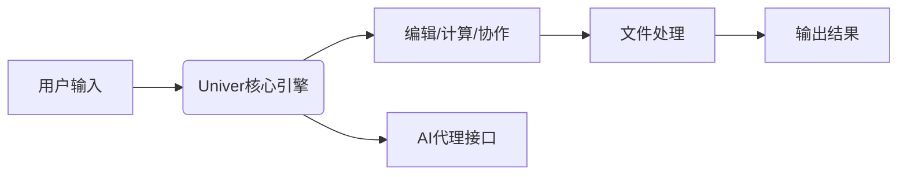
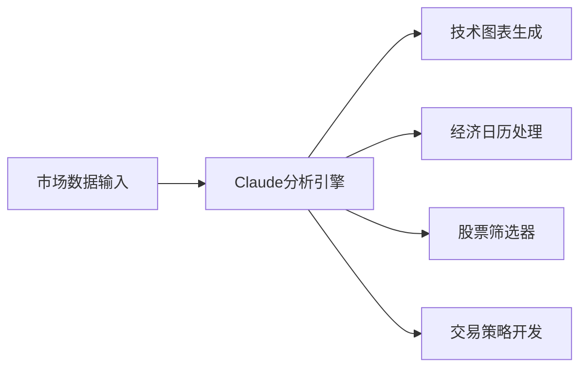
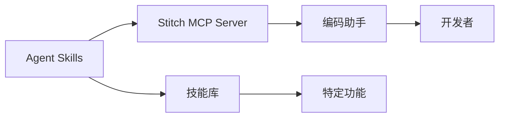
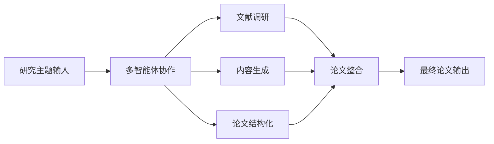
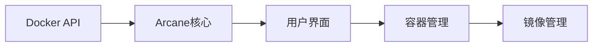

## 今日热点

AI Agent技能生态和开发工具链持续火热，特别是Claude相关的技能包和企业级AI应用工具受到高度关注，同时传统开发工具也在向AI原生方向演进。

---

## 热门项目一览

| 排名 | 项目 | 语言 | 今日 | 总计 | 简介 |
|:---:|------|:----:|------:|-----:|------|
| 1 | [dream-num/univer](https://github.com/dream-num/univer) | TypeScript | +1,828 | 27,950 | Build your own AI office wi... |
| 2 | [elementalsouls/Claude-BugHunter](https://github.com/elementalsouls/Claude-BugHunter) | Python | +1,094 | 7,670 | A Claude Code skill bundle ... |
| 3 | [alibaba/open-code-review](https://github.com/alibaba/open-code-review) | Go | +951 | 53,124 | Secure, fast, efficient, ba... |
| 4 | [NVIDIA/SkillEvaluator](https://github.com/NVIDIA/SkillEvaluator) | Python | +873 | 2,926 | Multi-tier framework for ev... |
| 5 | [ChromeDevTools/chrome-devtools-mcp](https://github.com/ChromeDevTools/chrome-devtools-mcp) | TypeScript | +841 | 57,790 | Chrome DevTools for coding ... |
| 6 | [tradermonty/claude-trading-skills](https://github.com/tradermonty/claude-trading-skills) | Python | +837 | 6,504 | Claude Code skills for equi... |
| 7 | [ag-ui-protocol/ag-ui](https://github.com/ag-ui-protocol/ag-ui) | TypeScript | +791 | 19,350 | AG-UI: the Agent-User Inter... |
| 8 | [backnotprop/plannotator](https://github.com/backnotprop/plannotator) | TypeScript | +696 | 12,729 | The workspace to stay in th... |
| 9 | [google-labs-code/stitch-skills](https://github.com/google-labs-code/stitch-skills) | TypeScript | +529 | 9,814 | A library of Agent Skills d... |
| 10 | [kajisho5/ffmpeg-skill](https://github.com/kajisho5/ffmpeg-skill) | Python | +367 | 7,097 | Local video editor for codi... |
| 11 | [google-research/paper-orchestra](https://github.com/google-research/paper-orchestra) | Python | +313 | 1,761 | PaperOrchestra is a multi-a... |
| 12 | [DeanChensj/jiangshan-map](https://github.com/DeanChensj/jiangshan-map) | JavaScript | +288 | 7,149 | 江山时序 · 中国历史交互地图时间轴 (403 BCE... |

---

## 趋势洞察

```
┌─────────────────────────────────────────────────────────────────┐
│  AI/ML 工具         ████████████████████████  12 个项目        │
│  其他               ████                      2 个项目        │
│  项目管理             ██                        1 个项目        │
└─────────────────────────────────────────────────────────────────┘
```

---

## 项目深度解读

### 1. dream-num/univer — AI办公SDK

> **一句话总结**：基于开源核心的AI办公SDK，提供编辑、计算、协作和文件处理功能。

#### 价值主张

| 维度 | 说明 |
|------|------|
| **解决痛点** | 将专业办公功能集成到产品中，支持人与AI协同办公 |
| **目标用户** | 需要集成办公功能的企业开发者，AI应用开发者 |
| **核心亮点** | 开源核心 + AI协作 + 多功能集成 + 可扩展架构 |

#### 技术架构



**技术特色**：
- 基于TypeScript构建，类型安全
- 开源可扩展的架构设计
- 支持人与AI协同办公场景

#### 热度分析

- 项目获得近2.8万星，单日增长超过1800，显示强劲增长势头
- 零开放问题表明项目维护良好，社区问题解决高效

#### 快速上手

```bash
# 安装Univer
npm install @univer/core @univer/sheets @univer/docs

# 初始化Univer实例
import { Univer } from '@univer/core';
const univer = new Univer();

# 加载插件
univer.loadPlugin(SheetsPlugin);
univer.loadPlugin(DocPlugin);
```

#### 注意事项

- 需要关注项目的开源许可证，当前显示为Unknown
- 项目与AI结合的特性可能需要额外的AI服务配置
- 完整功能可能需要商业授权或额外插件


### 2. elementalsouls/Claude-BugHunter — [AI安全工具包]

> **一句话总结**：Claude AI漏洞狩猎与红队技能包，提供系统化漏洞检测和报告模板

#### 价值主张

| 维度 | 说明 |
|------|------|
| **解决痛点** | 提供结构化漏洞狩猎方法和标准化报告模板，提升安全测试效率 |
| **目标用户** | 安全研究人员、渗透测试人员、红队成员 |
| **核心亮点** | 82个专业技能 + 681个漏洞报告模式 + 24类核心漏洞覆盖 |

#### 技术架构


**技术特色**：
- 通过技能包扩展Claude AI安全测试能力
- 提供结构化漏洞报告模板，标准化安全测试流程
- 覆盖广泛的漏洞类别，适用于多种安全场景

#### 热度分析

- 项目近期Star数显著增长(+1,094 today)，显示AI安全工具需求旺盛
- 高Fork数(1,191)表明社区活跃，用户积极参与定制和扩展

#### 快速上手

```bash
# 克隆项目
git clone https://github.com/elementalsouls/Claude-BugHunter.git

# 按照项目README配置Claude技能
```

#### 注意事项

- 需要Claude AI账号和相关权限才能使用
- 使用前应熟悉相关安全测试法律法规
- 技能包可能需要根据具体环境进行调整和优化


### 3. alibaba/open-code-review — AI代码审查工具

> **一句话总结**：阿里巴巴开源的混合架构代码审查工具，结合确定性流程与LLM智能代理，提供精准行级评论和多语言安全规则。

#### 价值主张

| 维度 | 说明 |
|------|------|
| **解决痛点** | 提高代码审查效率与质量，减少人工审查负担，保障代码安全 |
| **目标用户** | 企业开发团队、代码审查者、质量保障团队 |
| **核心亮点** | 混合架构+LLM智能代理 + 精准行级评论 + 多语言内置安全规则集 |

#### 技术架构


**技术特色**：
- 混合架构结合确定性流程和LLM智能代理
- 内置多语言安全规则集(NPE、线程安全、XSS、SQL注入等)
- 支持OpenAI和Anthropic模型兼容接口

#### 热度分析

- 项目Star数超5.3万，单日新增近千Star，增长势头强劲
- 作为阿里系开源项目，在企业级AI代码审查领域占据重要生态位置

#### 快速上手

```bash
# 克隆仓库
git clone https://github.com/alibaba/open-code-review.git

# 安装依赖
cd open-code-review && make install

# 配置并运行
make config && make run
```

#### 注意事项

- 需要配置OpenAI或Anthropic API密钥以启用LLM功能
- 根据团队实际需求调整内置规则集和审查流程
- 确保与现有代码仓库正确集成以获得最佳效果


### 4. NVIDIA/SkillEvaluator — AI技能评估框架

> **一句话总结**：NVIDIA推出的多层级AI技能评估框架，通过质量门控和语义重叠检测等机制全面评估AI代理能力。

#### 价值主张

| 维度 | 说明 |
|------|------|
| **解决痛点** | AI代理技能缺乏标准化评估体系，难以确保技能质量和实际效果 |
| **目标用户** | AI研究人员、智能体开发者、插件工程师 |
| **核心亮点** | 多层级评估框架 + 质量门控机制 + 语义重叠检测 + 合成数据集生成 + 实时行为影响分析 |

#### 技术架构


**技术特色**：
- 多层级评估架构确保全面覆盖技能质量维度
- 语义重叠检测防止技能冗余和功能冲突
- 合成数据集生成提升评估的全面性和效率

#### 热度分析

- 单日增长873个Star，表明AI评估领域需求旺盛且项目质量受认可
- 作为NVIDIA推出的专业工具，在AI开发社区具有较高权威性和影响力

#### 快速上手

```bash
# 克隆项目
git clone https://github.com/NVIDIA/SkillEvaluator.git

# 安装依赖
pip install -r requirements.txt

# 运行示例评估
python examples/basic_evaluation.py
```

#### 注意事项

- 许可证信息不明确，使用前需确认授权条款
- 作为专业评估工具，需要基本AI代理和技能知识才能有效使用
- 可能需要NVIDIA相关硬件资源以获得最佳性能


### 5. ChromeDevTools/chrome-devtools-mcp — AI开发工具集成

> **一句话总结**：为AI编码代理提供Chrome开发者工具接口，实现智能编程辅助。

#### 价值主张

| 维度 | 说明 |
|------|------|
| **解决痛点** | 简化AI模型与浏览器开发环境的集成，提升智能编程效率 |
| **目标用户** | AI编码助手开发者、智能IDE构建者 |
| **核心亮点** | 完整DevTools API支持 + 类型安全 + 可扩展架构 |

#### 技术架构


**技术特色**：
- 基于TypeScript的全类型定义，确保开发安全
- 模块化设计，支持多种DevTools功能扩展
- 异步通信机制，高效处理浏览器数据交互

#### 热度分析

- 项目高关注度，近期增长迅速，表明AI开发工具领域热度高涨
- 作为Chrome官方项目，在开发者工具与AI融合领域占据生态核心位置

#### 快速上手

```bash
# 安装依赖
npm install chrome-devtools-mcp

# 初始化项目
npx create-chrome-devtools-mcp-app my-agent

# 启动开发服务器
npm run dev
```

#### 注意事项

- 项目依赖较新的Node.js版本，需确保环境兼容性
- 与Chrome版本可能有兼容性问题，建议使用最新版Chrome
- 部分高级功能可能需要额外的权限配置


### 6. tradermonty/claude-trading-skills — 股票技能集

> **一句话总结**：为股票投资者和交易者提供的Claude代码技能集，集成市场分析和技术图表功能。

#### 价值主张

| 维度 | 说明 |
|------|------|
| **解决痛点** | 将Claude AI能力应用于股票交易，提供专业分析工具 |
| **目标用户** | 股票投资者、交易者、金融分析师 |
| **核心亮点** | 市场分析 + 技术图表 + 经济日历 + 策略开发 + 数据筛选 |

#### 技术架构



**技术特色**：
- 基于Claude API的智能分析能力
- Python驱动的金融数据处理
- 多维度市场分析工具集成

#### 热度分析

- 项目Star数6504，单日增长837，显示市场高度认可
- Fork数1362，表明社区积极参与功能扩展和二次开发

#### 快速上手

```bash
# 安装依赖
pip install -r requirements.txt
# 配置API密钥
export ANTHROPIC_API_KEY=your_api_key
# 启动Claude交易技能
python claude_trading_skills.py
```

#### 注意事项

- 需要Anthropic API访问权限才能使用
- 实际交易决策应结合多种因素，不应完全依赖AI分析
- 市场数据源可能需要额外订阅或付费获取


### 7. ag-ui-protocol/ag-ui — 前端代理交互

> **一句话总结**：AG-UI为前端应用提供标准化代理-用户交互协议，使AI代理无缝集成到用户界面中。

#### 价值主张

| 维度 | 说明 |
|------|------|
| **解决痛点** | 前端应用中代理与用户交互缺乏标准化，集成复杂度高 |
| **目标用户** | 前端开发者、AI应用开发者、需要集成AI代理功能的产品团队 |
| **核心亮点** | 标准化交互协议 + 跨平台兼容性 + TypeScript类型安全 + 简化集成流程 |

#### 技术架构


**技术特色**：
- 基于TypeScript的类型安全实现
- 标准化的代理-用户交互协议
- 跨平台兼容的前端集成方案

#### 热度分析

- 项目获得19,350个Star，单日增长791，显示近期关注度极高
- 0个Open Issues表明项目成熟度高，社区可能通过其他渠道交流

#### 快速上手

```bash
# 安装AG-UI
npm install @ag-ui-protocol/ag-ui

# 初始化配置
npx ag-ui init

# 在应用中集成
import { AgentProvider } from '@ag-ui-protocol/ag-ui';
```

#### 注意事项

- 项目许可证未知，使用前需确认开源许可条款
- 需要了解具体的API文档和使用示例以确保正确集成
- 可能需要配合特定的代理服务使用才能发挥完整功能


### 8. backnotprop/plannotator — AI代理协作平台

> **一句话总结**：一站式AI代理工作空间，统一管理代理规划、代码审查和团队反馈。

#### 价值主张

| 维度 | 说明 |
|------|------|
| **解决痛点** | AI代理协作流程分散，反馈机制不统一 |
| **目标用户** | AI开发者、团队负责人、技术协作人员 |
| **核心亮点** | 统一工作空间管理 + 一键反馈机制 + 团队协作功能 + 代码审查支持 + 代理规划工具 |

#### 技术架构


**技术特色**：
- TypeScript开发确保类型安全
- 统一的反馈处理机制
- 集成式代理管理界面

#### 热度分析

- 项目获得12,729个Star，近期增长迅速(+696 today)，表明AI代理协作工具领域需求旺盛
- 作为新兴工具类项目，社区活跃度高，但生态位置尚在形成中

#### 快速上手

```bash
# 克隆项目
git clone https://github.com/backnotprop/plannotator.git

# 安装依赖
npm install
```

#### 注意事项

- 项目许可证未知，使用时需注意授权问题
- 作为新兴项目，API和功能可能还在快速迭代中
- 需要配合特定的AI代理服务使用，可能存在集成门槛


### 9. google-labs-code/stitch-skills — AI代理技能库

> **一句话总结**：提供标准化Agent技能库，使AI编码助手能够执行特定任务并增强其能力。

#### 价值主张

| 维度 | 说明 |
|------|------|
| **解决痛点** | 解决AI编码助手缺乏标准化技能和可复用功能模块的问题 |
| **目标用户** | AI编码助手开发者和使用AI编程工具的开发者 |
| **核心亮点** | 遵循开放标准 + 多平台兼容 + 模块化设计 + 丰富预构建技能 |

#### 技术架构



**技术特色**：
- 基于TypeScript开发，确保类型安全
- 遵循Agent Skills开放标准，保证跨平台兼容性
- 模块化设计，技能易于扩展和维护

#### 热度分析

- Star数近万且近期增长迅速，项目热度高且处于上升趋势
- 社区参与度活跃，已形成完整的技能生态系统

#### 快速上手

```bash
# 安装stitch-skills核心库
npm install @stitch-skills/core

# 初始化技能库
npx stitch-skills init

# 添加特定技能
npx stitch-skills add skill-name
```

#### 注意事项
- 需要理解MCP服务器和Agent Skills标准才能有效使用
- License信息不明确，使用前需确认授权条款
- 技能可能需要根据具体需求进行定制和调整


### 10. kajisho5/ffmpeg-skill — 本地视频编辑工具

> **一句话总结**：本地FFmpeg视频编辑工具，提供42种功能，支持编程代理调用，无需云服务。

#### 价值主张

| 维度 | 说明 |
|------|------|
| **解决痛点** | 为编程代理提供本地视频编辑能力，无需云服务或API密钥 |
| **目标用户** | 使用Claude Code、Cursor和Codex等编程代理的开发者和视频创作者 |
| **核心亮点** | 42种FFmpeg工具集成 + MCP服务器支持 + 完全本地运行 + 机器可读合约 + 无需API密钥 |

#### 技术架构


**技术特色**：
- 集成42种FFmpeg工具
- 提供MCP服务器接口
- 支持机器可读合约

#### 热度分析

- 项目Star数超7000，近期单日新增367，表明社区对该工具需求旺盛
- 作为本地视频编辑工具，在隐私敏感和离线工作场景中有独特价值

#### 快速上手

```bash
# 克隆项目
git clone https://github.com/kajisho5/ffmpeg-skill.git
cd ffmpeg-skill
# 安装依赖
pip install -r requirements.txt
# 启动服务
python mcp_server.py
```

#### 注意事项

- 项目License未知，商业使用前需确认授权
- 需要安装FFmpeg作为依赖
- 可能需要与特定的编程代理环境配合使用


### 11. google-research/paper-orchestra — AI论文写作框架

> **一句话总结**：PaperOrchestra是一个多智能体框架，能够自动化完成AI研究论文的写作流程。

#### 价值主张

| 维度 | 说明 |
|------|------|
| **解决痛点** | 解决AI研究论文写作耗时长、流程繁琐的问题 |
| **目标用户** | AI研究人员、学术作者、科研机构 |
| **核心亮点** | 多智能体协作+自动化写作流程+模块化设计+高质量输出 |

#### 技术架构



**技术特色**：
- 多智能体系统协同处理论文写作各环节
- 模块化设计支持定制化写作流程
- 自动化文献调研与引用生成

#### 热度分析

- 项目近期增长迅速，Star数一周内增加313，显示社区高度关注
- 来自Google Research，在AI自动化研究领域具有重要生态位置

#### 快速上手

```bash
# 安装PaperOrchestra
pip install paper-orchestra

# 初始化论文写作项目
paper-orchestra init --topic "机器学习在医疗诊断中的应用"

# 启动自动化写作流程
paper-orchestra write --style "academic"
```

#### 注意事项

- 项目可能需要大量计算资源，特别是处理大型文献数据集时
- 自动化生成的内容仍需人工审核和修改，确保学术准确性
- 建议在正式发表前对生成内容进行全面检查


### 12. DeanChensj/jiangshan-map — 中国历史地图

> **一句话总结**：跨越2400年的中国历史交互式地图，展示18个朝代疆域变化与古典诗歌路线。

#### 价值主张

| 维度 | 说明 |
|------|------|
| **解决痛点** | 提供直观可视化的历史地理信息，解决历史学习中的时空认知困难 |
| **目标用户** | 历史爱好者、教育工作者、研究人员、文化探索者 |
| **核心亮点** | 18朝代疆域可视化 + 198领土快照 + 古今地名谱系 + 诗歌路线展示 |

#### 技术架构


**技术特色**：
- 采用JavaScript实现流畅的历史地图交互体验
- 结合时间轴技术直观展示历史变迁过程
- 多源数据融合展示地理、历史、文学信息

#### 热度分析

- 项目获7,149个Star，近288日增，表明在历史可视化领域有较高认可度
- 相对较高的Fork数(848)显示社区参与度和二次开发意愿较强

#### 快速上手

```bash
# 克隆项目
git clone https://github.com/DeanChensj/jiangshan-map.git

# 安装依赖
npm install

# 启动开发服务器
npm run dev
```

#### 注意事项

- 项目需要稳定的网络连接以加载地图资源
- 部分功能需要现代浏览器支持，特别是CSS3和JavaScript ES6特性
- 历史地理数据存在学术争议，部分地名和疆域划分仅供参考


### 13. mvanhorn/last30days-skill — 多源AI研究

> **一句话总结**：跨平台AI研究助手，整合社交媒体与网络信息生成主题深度摘要。

#### 价值主张

| 维度 | 说明 |
|------|------|
| **解决痛点** | 信息过载时代，快速获取多平台高质量主题摘要 |
| **目标用户** | 研究人员、投资者、内容创作者、决策者 |
| **核心亮点** | 多源数据整合 + AI智能摘要 + 实时信息获取 + 事实核查 + 主题深度分析 |

#### 技术架构


**技术特色**：
- 多平台API集成技术，实现跨平台数据统一获取
- 大型语言模型驱动的信息筛选与摘要生成
- 实时数据处理与知识图谱构建能力

#### 热度分析

- 项目获得超过6.8万星，近期日增135星，表明社区高度关注和持续增长
- 零开放问题反映项目成熟度高，维护者响应迅速，社区反馈机制完善

#### 快速上手

```bash
# 安装依赖
pip install last30days-skill

# 运行研究
last30days-skill "人工智能发展趋势"
```

#### 注意事项

- 项目许可信息不明确，使用前需确认开源许可条款
- 依赖第三方平台API，需注意各平台的使用限制和更新变化
- AI生成摘要可能存在信息偏差，建议交叉验证重要信息


### 14. sveltejs/svelte — 编译型前端框架

> **一句话总结**：Svelte 通过编译时优化将组件转换为高效原生 JS，提供更小更快的前端应用体验。

#### 价值主张

| 维度 | 说明 |
|------|------|
| **解决痛点** | 消除运行时框架开销，减少应用体积，提升前端性能 |
| **目标用户** | 追求高性能体验的开发者，对应用体积敏感的团队 |
| **核心亮点** | 编译时优化 + 无虚拟DOM + 响应式数据绑定 + 组件化开发 |

#### 技术架构


**技术特色**：
- 编译时优化：将组件在构建时转换为原生 JavaScript，消除运行时开销
- 响应式系统：基于简单赋值的响应式机制，无需复杂的依赖追踪
- 无虚拟 DOM：直接操作 DOM，避免了虚拟 DOM 的性能开销

#### 热度分析

- 拥有近9万星，日均增长约115，表明项目处于高速增长期，受到广泛关注
- 作为新兴前端框架，在主流框架之外开辟了新的技术路线，形成独特生态位置

#### 快速上手

```bash
# 创建新项目
npm create svelte@latest my-app
cd my-app
npm install
npm run dev
```

#### 注意事项

- Svelte 的语法和概念与传统框架有差异，需要一定的学习曲线
- 相比成熟框架，Svelte 的生态系统和第三方库相对较少


### 15. getarcaneapp/arcane — 现代Docker管理

> **一句话总结**：一款为所有人设计的现代化Docker管理工具，简化容器操作流程。

#### 价值主张

| 维度 | 说明 |
|------|------|
| **解决痛点** | 传统Docker管理工具复杂难用，缺乏直观界面 |
| **目标用户** | 开发者、系统管理员、DevOps工程师 |
| **核心亮点** | 简化操作 + 可视化界面 + 跨平台支持 + 高性能Go实现 |

#### 技术架构



**技术特色**：
- 基于Go语言构建，提供高性能的Docker管理体验
- 采用现代化UI设计，提升用户操作直观性
- 跨平台兼容性，支持Windows/macOS/Linux环境

#### 热度分析

- 项目持续增长，近一个月新增数百Star，社区认可度高
- 0 Open Issues表明问题响应及时，项目维护良好

#### 快速上手

```bash
# 下载并安装Arcane
curl -fsSL https://github.com/getarcaneapp/arcane/releases/latest/download/arcane-darwin-amd64.tar.gz | tar -xzv
sudo mv arcane /usr/local/bin/

# 启动Arcane
arcane
```

#### 注意事项

- 由于许可证未知，商业使用前需确认授权条款
- 项目可能处于开发阶段，API和功能可能会有变更


## 今日推荐

| 主题 | 推荐项目 | 亮点 |
|------|----------|------|
| 今日最热 | [dream-num/univer](https://github.com/dream-num/univer) | Build your own AI... |
| 值得关注 | [elementalsouls/Claude-BugHunter](https://github.com/elementalsouls/Claude-BugHunter) | A Claude Code ski... |
| 快速上手 | [alibaba/open-code-review](https://github.com/alibaba/open-code-review) | Secure, fast, eff... |
| 长期潜力 | [NVIDIA/SkillEvaluator](https://github.com/NVIDIA/SkillEvaluator) | Multi-tier framew... |

---

<div align="center">

*Generated on 2026-11-17 | Powered by GitHub Trending Reporter*

</div>