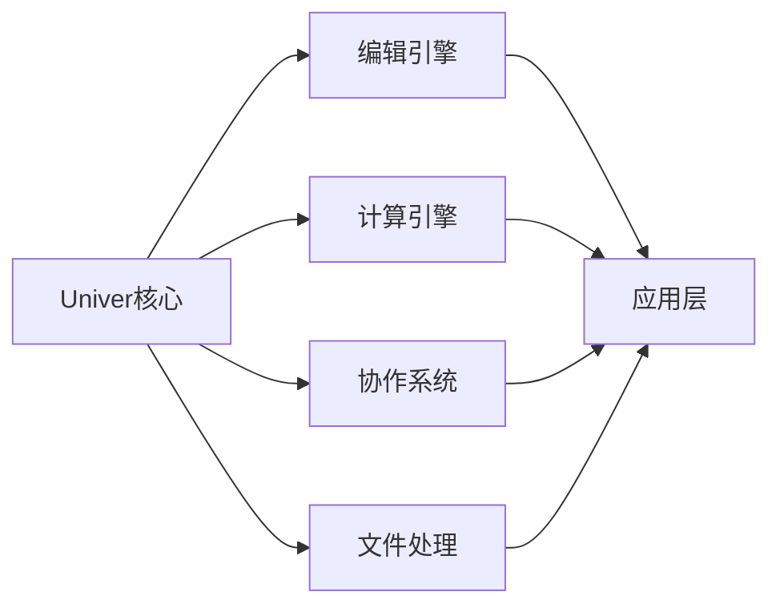
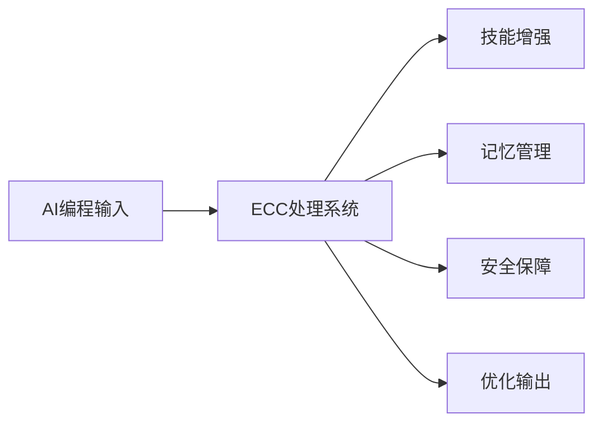
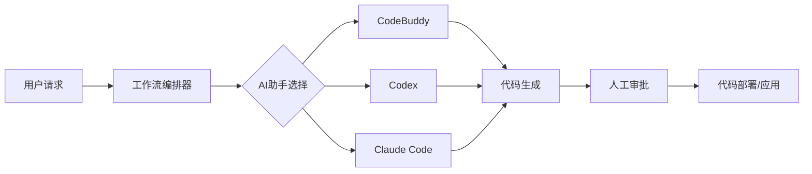

## 今日热点

AI代理技能框架与开发工具集成成为主流趋势，企业级解决方案与轻量级模型并行发展，多模态应用场景持续拓展。

---

## 热门项目一览

| 排名 | 项目 | 语言 | 今日 | 总计 | 简介 |
|:---:|------|:----:|------:|-----:|------|
| 1 | [obra/superpowers](https://github.com/obra/superpowers) | Shell | +1,917 | 319,485 | An agentic skills framework... |
| 2 | [dream-num/univer](https://github.com/dream-num/univer) | TypeScript | +1,774 | 29,179 | Build your own AI office wi... |
| 3 | [ag-ui-protocol/ag-ui](https://github.com/ag-ui-protocol/ag-ui) | TypeScript | +1,445 | 20,112 | AG-UI: the Agent-User Inter... |
| 4 | [google-research/paper-orchestra](https://github.com/google-research/paper-orchestra) | Python | +1,072 | 3,282 | PaperOrchestra is a multi-a... |
| 5 | [elementalsouls/Claude-BugHunter](https://github.com/elementalsouls/Claude-BugHunter) | Python | +1,005 | 9,691 | A Claude Code skill bundle ... |
| 6 | [affaan-m/ECC](https://github.com/affaan-m/ECC) | JavaScript | +883 | 305,715 | The agent harness performan... |
| 7 | [alibaba/open-code-review](https://github.com/alibaba/open-code-review) | Go | +763 | 53,881 | Secure, fast, efficient, ba... |
| 8 | [mvanhorn/last30days-skill](https://github.com/mvanhorn/last30days-skill) | Python | +696 | 69,287 | AI agent skill that researc... |
| 9 | [backnotprop/plannotator](https://github.com/backnotprop/plannotator) | TypeScript | +691 | 13,149 | The workspace to stay in th... |
| 10 | [getarcaneapp/arcane](https://github.com/getarcaneapp/arcane) | Go | +618 | 9,427 | Modern Docker Management, D... |
| 11 | [Tencent/LoopForge](https://github.com/Tencent/LoopForge) | Go | +591 | 3,428 | Self-hosted workflows for c... |
| 12 | [sveltejs/svelte](https://github.com/sveltejs/svelte) | JavaScript | +477 | 89,656 | web development for the res... |

---

## 趋势洞察

```
┌─────────────────────────────────────────────────────────────────┐
│  AI/ML 工具         ████████████████████████  12 个项目        │
│  其他               ████                      2 个项目        │
│  项目管理             ██                        1 个项目        │
└─────────────────────────────────────────────────────────────────┘
```

---

## 项目深度解读

### 1. obra/superpowers — 智能技能框架

> **一句话总结**：提供一套有效的代理技能框架和软件开发方法论，帮助开发者系统化提升能力。

#### 价值主张

| 维度 | 说明 |
|------|------|
| **解决痛点** | 解决开发者技能提升无序、效率低下的问题，提供系统化方法 |
| **目标用户** | 软件开发者、技术团队、希望突破能力瓶颈的个人 |
| **核心亮点** | 代理技能框架 + 实用方法论 + 系统化提升 + 高效实践 + 可落地方法 |

#### 技术架构


**技术特色**：
- 基于Shell脚本实现，轻量级且跨平台兼容
- 提供结构化的技能评估与提升路径
- 强调实践性和可操作性，非纯理论框架

#### 热度分析

- 项目获得31万+星标和近2.8万次fork，呈现稳定增长态势，表明其在开发者社区中有很高的认可度。
- 作为方法论类项目，热度来源于其实用性和系统性，而非特定技术栈的依赖。

#### 快速上手

```bash
# 克隆项目
git clone https://github.com/obra/superpowers.git
cd superpowers
# 运行框架
./superpowers init
```

#### 注意事项

- 项目许可证未知，在使用前需要确认授权条款
- 项目主要基于Shell脚本，可能需要一定的Shell脚本知识才能充分利用
- 作为方法论框架，实际效果需要用户持续实践和调整，非即用型工具


### 2. dream-num/univer — AI办公SDK平台

> **一句话总结**：基于开源核心的AI办公SDK，提供编辑、计算、协作和文件处理功能

#### 价值主张

| 维度 | 说明 |
|------|------|
| **解决痛点** | 解决办公软件集成难题，提供一站式AI办公解决方案 |
| **目标用户** | 需要集成办公功能的企业应用开发者 |
| **核心亮点** | 跨平台支持 + AI集成能力 + 开源可定制 + 协作功能 |

#### 技术架构



**技术特色**：
- 基于TypeScript开发，提供类型安全
- 模块化架构，各功能组件可独立使用
- 支持AI代理集成，增强自动化办公能力
- 开源可扩展，允许深度定制

#### 热度分析

- 近期增长迅猛，单日新增星标1774，显示社区高度关注
- 高星低fork比例，表明项目更受开发者关注而非二次开发

#### 快速上手

```bash
# 安装Univer
npm install @univer/core @univer/sheets @univer/docs

# 初始化Univer实例
import { Univer } from '@univer/core';
const univer = new Univer();
```

#### 注意事项

- 项目许可证信息不明确，商业使用前需确认授权条款
- 集成到现有项目可能需要一定的学习成本
- AI功能可能需要额外的API或服务支持


### 3. ag-ui-protocol/ag-ui — 智能代理协议

> **一句话总结**：为前端应用提供Agent-User交互协议，实现智能代理与用户的无缝对话体验。

#### 价值主张

| 维度 | 说明 |
|------|------|
| **解决痛点** | 解决前端应用中智能代理与用户交互的标准化和集成问题 |
| **目标用户** | 前端开发者、AI应用集成者、交互设计师 |
| **核心亮点** | 统一交互协议 + 跨平台支持 + 可扩展架构 + 模块化设计 |

#### 技术架构


**技术特色**：
- 基于TypeScript实现，提供类型安全
- 模块化设计，便于集成和扩展
- 支持多种前端框架和平台

#### 热度分析

- 项目Star数突破2万，近期增长迅猛，显示开发者高度关注
- 零开放问题表明项目维护良好，社区协作高效

#### 快速上手

```bash
# 克隆项目
git clone https://github.com/ag-ui-protocol/ag-ui.git

# 安装依赖
npm install

# 启动开发服务器
npm run dev
```

#### 注意事项
- 项目许可证信息不明确，使用前需确认
- 需要了解TypeScript和前端开发基础知识
- 可能需要配置API密钥或服务端支持以实现完整功能


### 4. google-research/paper-orchestra — AI论文自动化

> **一句话总结**：多智能体协作的AI研究论文自动化写作框架，提升科研效率。

#### 价值主张

| 维度 | 说明 |
|------|------|
| **解决痛点** | 自动化AI研究论文撰写过程，减少人工写作负担 |
| **目标用户** | AI研究人员、学者、科研机构 |
| **核心亮点** | 多智能体协作 + 自动化论文生成 + 流程优化 + 质量保证 |

#### 技术架构


**技术特色**：
- 多智能体协同写作系统
- 自动化论文结构生成
- 内容质量智能评估机制
- 研究流程智能化管理

#### 热度分析

- 项目在短时间内获得超过1000个Star，显示学术界高度关注AI写作自动化领域
- 作为Google研究项目，具有较高可信度和潜在影响力

#### 快速上手

```bash
# 安装PaperOrchestra
pip install paper-orchestra

# 初始化论文项目
paper-orchestra init --topic "机器学习在医疗诊断中的应用"

# 运行自动化写作流程
paper-orchestra write --output my_paper.md
```

#### 注意事项

- 需要关注论文原创性和学术伦理问题
- 作为自动化工具，仍需人工审核和校对
- 许可证信息不明确，使用前需确认开源协议


### 5. elementalsouls/Claude-BugHunter — [AI安全助手]

> **一句话总结**：Claude AI的安全漏洞检测与渗透测试技能包，提升安全审计效率。

#### 价值主张

| 维度 | 说明 |
|------|------|
| **解决痛点** | 简化安全漏洞检测流程，提供结构化报告模板 |
| **目标用户** | 安全研究员、渗透测试人员、红队成员 |
| **核心亮点** | 82个专业技能 + 15个快捷命令 + 681种报告模式 |

#### 技术架构


**技术特色**：
- 模块化安全技能设计，支持多种漏洞类型检测
- 预定义报告模式，标准化漏洞披露流程
- 企业级身份和基础设施攻击矩阵，覆盖全面攻击面

#### 热度分析

- 项目获得近万星，近期增长迅速，显示安全社区对AI辅助安全工具的高度需求
- 作为AI安全领域的创新工具，填补了AI助手在专业安全测试场景的应用空白

#### 快速上手

```bash
# 安装Claude-BugHunter技能包
# 在Claude界面中导入技能
# 使用 /bughunt 命令开始安全测试
```

#### 注意事项

- 需要配合Claude AI平台使用，不能独立运行
- 仅限授权测试环境使用，未经授权的系统测试可能违反法律
- 输出结果需要人工验证，AI工具可能产生误报


### 6. affaan-m/ECC — AI 编程助手优化系统

> **一句话总结**：一个为多个 AI 编程助手提供性能优化的集成系统，增强其技能、记忆与安全能力。

#### 价值主张

| 维度 | 说明 |
|------|------|
| **解决痛点** | 提升AI编程助手的性能和响应质量，解决代码生成效率低下问题 |
| **目标用户** | 使用AI编程助手的开发者、研究人员和代码生成工具使用者 |
| **核心亮点** | 技能增强 + 本能优化 + 记忆管理 + 安全保障 + 研究驱动开发 |

#### 技术架构



**技术特色**：
- 多AI平台兼容性支持
- 记忆与学习能力集成
- 安全性能优化机制

#### 热度分析

- 项目获得30万+星标，日增近900星，显示极高社区认可度
- 在AI编程辅助工具领域具有显著影响力，成为开发者的热门选择

#### 快速上手

```bash
# 安装ECC系统
npm install -g ecc-system

# 初始化配置
ecc init

# 启动优化服务
ecc start
```

#### 注意事项

- 项目License未知，使用前需确认授权条款
- 可能需要配合特定的AI编程工具使用才能发挥最佳效果
- 项目无公开Issue，可能通过其他渠道进行问题反馈


### 7. alibaba/open-code-review — 智能审查工具

> **一句话总结**：融合确定性管道与LLM代理，提供高效、安全、精确的企业级代码审查体验。

#### 价值主张

| 维度 | 说明 |
|------|------|
| **解决痛点** | 传统代码审查效率低、覆盖有限、难以发现复杂安全问题 |
| **目标用户** | 企业开发团队、质量保障工程师、DevOps实践者 |
| **核心亮点** | 混合架构 + 精确行级评论 + 多语言安全规则 + AI增强 + 企业级规模验证 |

#### 技术架构


**技术特色**：
- 确定性管道与LLM代理的混合架构设计
- 内置多语言安全规则集(NPE、线程安全、XSS等)
- 兼容OpenAI和Anthropic API，灵活部署
- 经过阿里巴巴大规模生产环境验证

#### 热度分析

- 超过5.3万Star且持续增长，在代码审查工具领域具有显著影响力
- 作为阿里巴巴开源的企业级工具，在DevOps生态中占据重要位置

#### 快速上手

```bash
# 克隆项目
git clone https://github.com/alibaba/open-code-review.git

# 安装依赖并运行
cd open-code-review && go install && open-code-review --help
```

#### 注意事项

- 需要配置OpenAI或Anthropic API密钥以启用AI增强功能
- 企业部署建议与现有CI/CD流程集成，实现自动化代码审查


### 8. mvanhorn/last30days-skill — AI多源信息摘要

> **一句话总结**：AI代理技能，跨多平台研究主题并生成基于事实的智能摘要，节省用户大量信息筛选时间。

#### 价值主张

| 维度 | 说明 |
|------|------|
| **解决痛点** | 信息过载时代，用户难以快速获取多平台高质量信息摘要 |
| **目标用户** | 需要快速获取多平台信息的研究人员、投资者和内容创作者 |
| **核心亮点** | 多平台数据整合 + AI智能摘要 + 实时信息获取 + 基于事实的总结 |

#### 技术架构


**技术特色**：
- 多平台API集成与数据抓取技术
- 大语言模型驱动的信息分析与摘要生成
- 结构化数据提取与知识整合方法

#### 热度分析

- 项目获得超过69,000个星标，近期每日增长近700星，显示社区高度关注和认可
- 在AI辅助信息处理领域处于前沿位置，可能是当前AI代理技能的热门代表项目

#### 快速上手

```bash
# 安装依赖
pip install -r requirements.txt

# 运行技能
python last30days-skill.py "研究主题"
```

#### 注意事项

- 项目许可证未知，使用前需确认开源许可条款
- 可能需要各平台API访问权限，需遵守各平台使用政策
- 数据抓取频率可能受到平台限制，需合理使用避免被封禁


### 9. backnotprop/plannotator — AI代理工作空间

> **一句话总结**：一站式AI代理协作平台，支持计划、注释、代码审查与团队反馈集成。

#### 价值主张

| 维度 | 说明 |
|------|------|
| **解决痛点** | 解决AI代理协作分散、反馈传递不畅的问题 |
| **目标用户** | AI开发团队、产品经理和技术决策者 |
| **核心亮点** | + 集成化工作空间 + 一键反馈 + 团队协作 + 代码审查 + 代理管理 |

#### 技术架构


**技术特色**：
- 基于TypeScript构建的类型安全系统
- 支持多代理协作的统一接口
- 集成代码审查与反馈机制

#### 热度分析

- 项目Star数达13k且单日增长近700，显示AI代理工具市场需求旺盛
- 零Open Issues表明项目维护良好，用户问题解决效率高

#### 快速上手

```bash
# 克隆项目
git clone https://github.com/backnotprop/plannotator.git
# 安装依赖
npm install
# 启动开发服务器
npm run dev
```

#### 注意事项

- 许可证信息未知，商业使用前需确认授权条款
- 项目依赖的AI代理服务可能需要额外配置
- 团队协作功能可能需要特定的账户设置


### 10. getarcaneapp/arcane — Docker管理新工具

> **一句话总结**：现代化Docker管理工具，简化容器操作，提升开发运维效率

#### 价值主张

| 维度 | 说明 |
|------|------|
| **解决痛点** | 简化复杂Docker命令，降低容器管理门槛，提升操作效率 |
| **目标用户** | Docker开发者、运维人员及需要容器管理的各类技术用户 |
| **核心亮点** | 直观界面简化操作 + 跨平台支持 + 高效容器管理 |

#### 技术架构


**技术特色**：
- 基于Go语言开发，提供高性能跨平台二进制文件
- 通过Docker API与容器引擎交互，无需修改现有Docker环境
- 采用模块化设计，支持插件扩展功能

#### 热度分析

- 项目Star数达9427且当日新增618个，增长势头强劲，表明社区认可度高
- 0个Open Issues显示问题处理高效，517个Fork反映一定程度的社区参与

#### 快速上手

```bash
# 安装Arcane（以macOS为例）
curl -fsSL https://github.com/getarcaneapp/arcane/releases/latest/download/arcane-darwin-amd64.tar.gz | tar -xzv

# 启动Nginx容器
arcane run nginx
```

#### 注意事项

- 项目License未知，使用前需确认授权条款
- 依赖Docker环境，需确保Docker已正确安装并运行
- 作为较新项目，可能存在稳定性和功能完整性方面的挑战


### 11. Tencent/LoopForge — AI编码工作流

> **一句话总结**：自托管工作流平台，编排多种AI编程助手，支持脚本与人工审批门控。

#### 价值主张

| 维度 | 说明 |
|------|------|
| **解决痛点** | 统一管理多种AI编程助手，实现可控的AI辅助编码流程 |
| **目标用户** | 开发团队、DevOps工程师、AI工具集成管理者 |
| **核心亮点** | 自托管部署 + 多AI助手编排 + 人工审批门控 + 本地工作流支持 |

#### 技术架构



**技术特色**：
- 基于Go语言开发，保证高性能和并发处理能力
- 自托管架构，确保数据安全与隐私保护
- 多AI助手统一编排接口，简化集成复杂度
- 人工审批门控机制，平衡效率与代码质量

#### 热度分析

- 项目近期热度激增，一日内新增591个star，表明社区对该技术方向高度关注
- 作为腾讯开源项目，在企业级AI编码工具领域具有显著影响力，填补了市场空白

#### 快速上手

```bash
# 克隆项目
git clone https://github.com/Tencent/LoopForge.git

# 安装依赖
cd LoopForge && go mod download

# 运行服务
go run cmd/server/main.go
```

#### 注意事项

- 项目许可证未知，商业使用前需确认授权方式
- 项目目前没有开放issue，可能处于早期阶段，社区支持有限
- 需要自行配置和部署，适合有一定技术能力的团队使用


### 12. sveltejs/svelte — 编译型前端框架

> **一句话总结**：Svelte是编译时优化的前端框架，将组件直接编译成高效原生代码，无需虚拟DOM。

#### 价值主张

| 维度 | 说明 |
|------|------|
| **解决痛点** | 传统框架虚拟DOM导致的性能开销，编译时优化提升运行效率 |
| **目标用户** | 追求高性能和小体积的前端开发者，厌倦复杂配置流程的开发者 |
| **核心亮点** | 编译时优化 + 零虚拟DOM + 响应式数据绑定 + 组件即原生DOM |

#### 技术架构


**技术特色**：
- 编译时优化，消除虚拟DOM开销
- 响应式系统基于赋值自动追踪依赖
- 组件编译后体积小，无额外运行时依赖

#### 热度分析

- 项目Star数近9万，日增约500，呈现稳定高速增长态势
- 作为新兴框架，社区活跃度高，生态逐步完善，处于上升期

#### 快速上手

```bash
# 安装Svelte模板
npx degit sveltejs/template my-svelte-app
cd my-svelte-app
npm install && npm run dev
```

#### 注意事项

- Svelte的编译时特性意味着开发体验与传统框架有所不同
- 对于大型应用，需要合理组织组件结构以充分利用编译优化
- 生态系统相对React/Vue较小，某些第三方库支持可能有限


### 13. google-labs-code/stitch-skills — AI助手技能库

> **一句话总结**：Google Labs开发的Agent技能库，为多种AI编码助手提供标准化功能扩展能力。

#### 价值主张

| 维度 | 说明 |
|------|------|
| **解决痛点** | 解决AI编码助手功能分散、不互通的问题，实现技能标准化复用 |
| **目标用户** | AI编码助手开发者、高级程序员、AI工具集成者 |
| **核心亮点** | 遵循Agent Skills开放标准 + 兼容多种主流AI编码助手 + 提供丰富预构建技能库 + Google技术背书 |

#### 技术架构


**技术特色**：
- 基于TypeScript开发，提供类型安全和现代JavaScript特性支持
- 实现MCP协议，确保与多种AI助手的无缝集成
- 模块化技能设计，便于扩展和维护

#### 热度分析

- 项目Star数突破10,000且单日增长350，处于快速增长阶段，显示开发者高度关注
- 作为Google Labs项目，在AI编码助手生态系统中占据核心位置，社区活跃度高

#### 快速上手

```bash
# 安装项目
npm install @google-labs/stitch-skills

# 基本使用
import { stitchSkills } from '@google-labs/stitch-skills';
const skills = stitchSkills();
await skills.initialize();
```

#### 注意事项
- 项目使用TypeScript，需要Node.js环境和相关构建工具
- 需要了解MCP协议和Agent Skills标准以充分利用功能
- 作为实验性项目，API和功能可能会有变化，建议关注更新日志


### 14. cursor/plugins — AI编辑器插件系统

> **一句话总结**：Cursor官方插件规范与实现，为AI代码编辑器提供标准化扩展能力。

#### 价值主张

| 维度 | 说明 |
|------|------|
| **解决痛点** | 标准化AI代码编辑器插件接口，解决功能扩展与兼容性问题 |
| **目标用户** | AI辅助编程开发者和插件系统构建者 |
| **核心亮点** | + TypeScript类型安全 + AI功能增强 + 官方插件示例 |

#### 技术架构


**技术特色**：
- 采用TypeScript确保插件接口类型安全
- 模块化设计支持插件独立开发与维护
- 统一的插件生命周期管理机制

#### 热度分析

- 高Star数(16k+)且持续稳定增长，显示社区高度认可
- 零开放问题反映项目维护质量高，适合生产环境使用

#### 快速上手

```bash
# 克隆项目到本地
git clone https://github.com/cursor/plugins.git

# 安装依赖
npm install

# 开发模式运行
npm run dev
```

#### 注意事项

- 项目许可证信息不明确，商业使用前需进一步确认
- 需配合Cursor编辑器使用，单独使用功能有限


### 15. jingyaogong/minimind — 轻量LLM训练

> **一句话总结**：Minimind是一个高效能的轻量级LLM训练框架，支持在2小时内完成64M参数模型从零开始的训练。

#### 价值主张

| 维度 | 说明 |
|------|------|
| **解决痛点** | 解决大模型训练资源消耗大、周期长的痛点，提供轻量级快速训练方案 |
| **目标用户** | AI研究人员、教育工作者、小型开发团队和LLM初学者 |
| **核心亮点** | 高效训练 + 轻量级实现 + 开箱即用 + 低资源需求 + 完整示例 |

#### 技术架构


**技术特色**：
- 高效训练算法优化，显著缩短训练时间
- 轻量级模型架构设计，适合资源有限环境
- 完整的端到端训练流程，无需额外依赖

#### 热度分析

- Star数高达66k，且持续稳定增长，表明项目在AI社区获得高度认可
- 无Open Issues，显示项目成熟度高，问题管理有效

#### 快速上手

```bash
git clone https://github.com/jingyaogong/minimind.git
cd minimind
python train.py --model_size 64M
```

#### 注意事项

- 训练结果可能受硬件配置影响，建议使用GPU加速以获得最佳性能
- 项目可能需要一定的深度学习基础知识，建议先阅读项目文档
- 许可证信息不明确，使用前需确认授权条款


## 今日推荐

| 主题 | 推荐项目 | 亮点 |
|------|----------|------|
| 今日最热 | [obra/superpowers](https://github.com/obra/superpowers) | An agentic skills... |
| 值得关注 | [dream-num/univer](https://github.com/dream-num/univer) | Build your own AI... |
| 快速上手 | [ag-ui-protocol/ag-ui](https://github.com/ag-ui-protocol/ag-ui) | AG-UI: the Agent-... |
| 长期潜力 | [google-research/paper-orchestra](https://github.com/google-research/paper-orchestra) | PaperOrchestra is... |

---

<div align="center">

*Generated on 2026-11-18 | Powered by GitHub Trending Reporter*

</div>