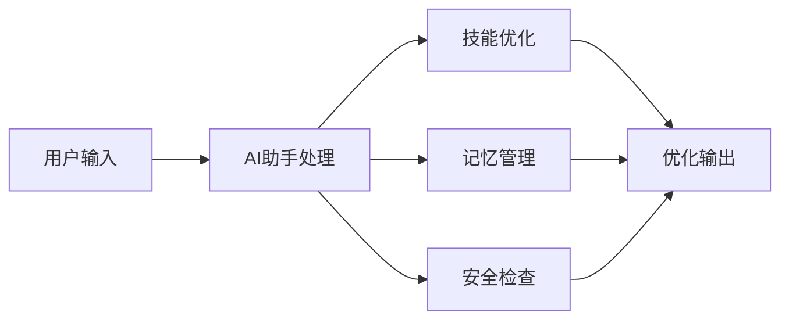
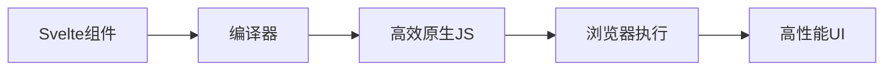
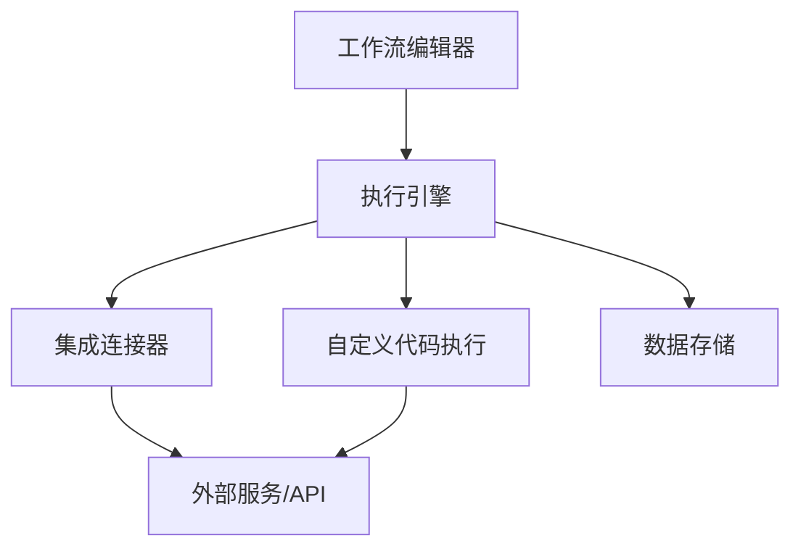
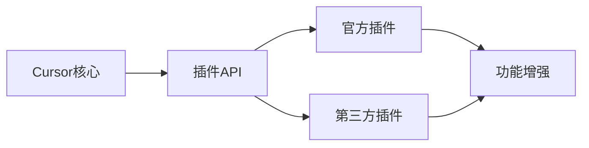
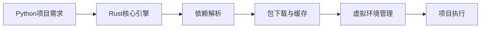
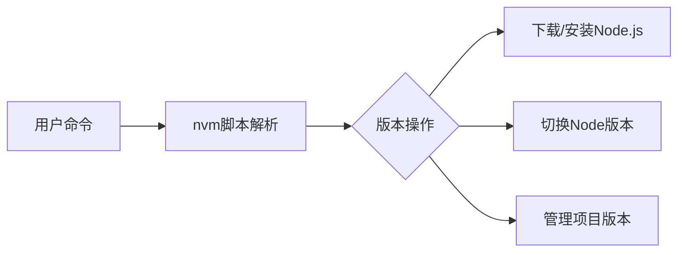
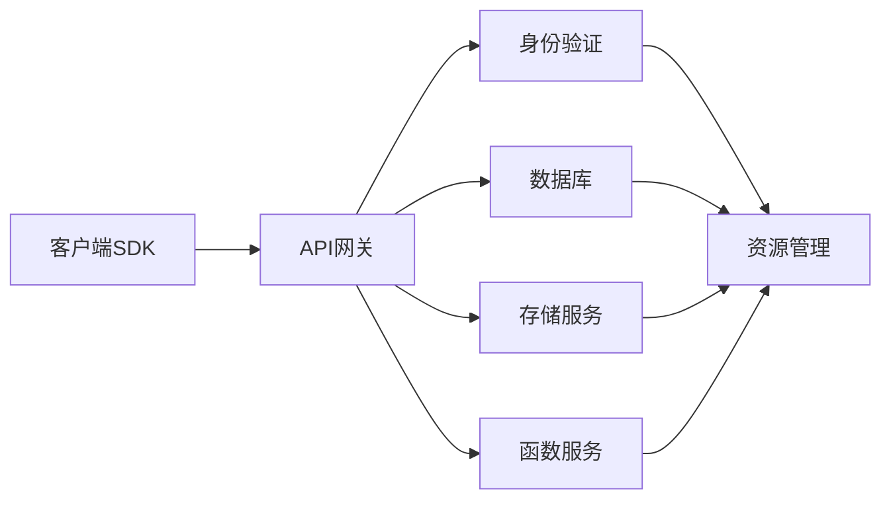

## 今日热点

今日GitHub热榜项目精彩纷呈。

---

## 热门项目一览

| 排名 | 项目 | 语言 | 今日 | 总计 | 简介 |
|:---:|------|:----:|------:|-----:|------|
| 1 | [google-research/paper-orchestra](https://github.com/google-research/paper-orchestra) | Python | +1,524 | 4,463 | PaperOrchestra is a multi-a... |
| 2 | [affaan-m/ECC](https://github.com/affaan-m/ECC) | JavaScript | +1,108 | 306,690 | The agent harness performan... |
| 3 | [mvanhorn/last30days-skill](https://github.com/mvanhorn/last30days-skill) | Python | +1,059 | 70,193 | AI agent skill that researc... |
| 4 | [obra/superpowers](https://github.com/obra/superpowers) | Shell | +822 | 321,438 | An agentic skills framework... |
| 5 | [sveltejs/svelte](https://github.com/sveltejs/svelte) | JavaScript | +692 | 89,663 | web development for the res... |
| 6 | [getarcaneapp/arcane](https://github.com/getarcaneapp/arcane) | Go | +547 | 9,895 | Modern Docker Management, D... |
| 7 | [HKUDS/CLI-Anything](https://github.com/HKUDS/CLI-Anything) | Python | +389 | 59,931 | "CLI-Anything: Making ALL S... |
| 8 | [google-labs-code/stitch-skills](https://github.com/google-labs-code/stitch-skills) | TypeScript | +365 | 10,470 | A library of Agent Skills d... |
| 9 | [n8n-io/n8n](https://github.com/n8n-io/n8n) | TypeScript | +325 | 211,188 | Fair-code workflow automati... |
| 10 | [cursor/plugins](https://github.com/cursor/plugins) | TypeScript | +314 | 17,299 | Cursor plugin specification... |
| 11 | [NVIDIA/SkillEvaluator](https://github.com/NVIDIA/SkillEvaluator) | Python | +312 | 3,830 | Multi-tier framework for ev... |
| 12 | [jquery/jquery](https://github.com/jquery/jquery) | JavaScript | +266 | 60,036 | jQuery JavaScript Library |

---

## 趋势洞察

```
┌─────────────────────────────────────────────────────────────────┐
│  AI/ML 工具         ████████████████████████  10 个项目        │
│  其他               ██████████████            6 个项目        │
│  项目管理             ████                      2 个项目        │
│  多媒体应用            ██                        1 个项目        │
└─────────────────────────────────────────────────────────────────┘
```

---

## 项目深度解读

### 1. google-research/paper-orchestra — AI论文写作框架

> **一句话总结**：多智能体协作框架，自动化完成AI研究论文的撰写流程。

#### 价值主张

| 维度 | 说明 |
|------|------|
| **解决痛点** | 解决AI研究论文撰写效率低、流程繁琐的问题 |
| **目标用户** | AI研究人员、学者、学术机构 |
| **核心亮点** | 多智能体协作 + 自动化流程 + 提高研究效率 + 保持学术质量 |

#### 技术架构


**技术特色**：
- 多智能体协作机制，分工完成论文不同部分
- 自动化内容生成与整合流程
- 智能质量检查与学术规范保障

#### 热度分析

- 项目Star数一日内激增1,524，显示社区对AI自动化写作工具的强烈需求
- 作为Google Research项目，具有较高学术可信度和社区关注度

#### 快速上手

```bash
# 安装PaperOrchestra
pip install paper-orchestra

# 基本使用示例
paper-orchestra --topic "机器学习在医疗诊断中的应用" --output medical_ai_paper.pdf
```

#### 注意事项

- 需要关注AI生成内容的学术伦理问题
- 可能需要根据具体研究领域调整模型参数
- 自动化生成的论文可能需要人工审核和修改


### 2. affaan-m/ECC — AI编程优化

> **一句话总结**：为AI编程助手提供性能优化系统，提升代码生成质量与效率

#### 价值主张

| 维度 | 说明 |
|------|------|
| **解决痛点** | AI编程助手响应慢、代码质量不稳定、上下文理解有限 |
| **目标用户** | 使用Claude、Codex等AI编程助手的开发者 |
| **核心亮点** | + 技能优化 + 本能反应 + 记忆管理 + 安全防护 + 研究优先开发 |

#### 技术架构



**技术特色**：
- 多维度性能优化机制
- 智能上下文管理技术
- 安全防护与代码验证

#### 热度分析

- 项目获超30万星，日均增长千星，社区认可度极高
- Fork数与Star数比例约15%，显示用户积极参与二次开发

#### 快速上手

```bash
# 克隆项目
git clone https://github.com/affaan-m/ECC.git
cd ECC
npm install
```

#### 注意事项

- 项目许可证未知，使用前需确认授权方式
- Open Issues为0，可能表示问题处理良好或社区反馈渠道不明确
- 项目描述较为抽象，实际功能需进一步探索源码确认


### 3. mvanhorn/last30days-skill — AI研究助手

> **一句话总结**：跨多平台信息收集的AI代理技能，智能生成基于事实的主题研究摘要。

#### 价值主张

| 维度 | 说明 |
|------|------|
| **解决痛点** | 解决跨平台信息分散和研究效率低下的问题 |
| **目标用户** | 研究人员、内容创作者、决策者和信息分析师 |
| **核心亮点** | 多平台数据整合 + AI智能摘要 + 实时信息获取 + 结构化输出 |

#### 技术架构


**技术特色**：
- 跨平台API集成技术实现多源数据获取
- 大语言模型智能摘要生成算法
- 信息验证与事实核查机制

#### 热度分析

- 项目获超7万星，近期增长迅猛，日均新增超1000星
- 作为AI研究工具领域标杆项目，社区参与度高，生态位置显著

#### 快速上手

```bash
# 安装依赖
pip install last30days-skill

# 使用示例
last30days-skill "人工智能最新发展"
```

#### 注意事项

- 项目许可证信息缺失，使用前需确认合规性
- 需要配置各平台API密钥以获取数据访问权限
- AI生成内容建议进行事实核查，避免信息偏差


### 4. obra/superpowers — 高效开发框架

> **一句话总结**：一个实用的代理技能框架和软件开发方法论，提升开发效率与质量。

#### 价值主张

| 维度 | 说明 |
|------|------|
| **解决痛点** | 软件开发中缺乏系统化的技能框架和有效方法论的问题 |
| **目标用户** | 软件开发者、技术团队和追求高效工作流程的专业人士 |
| **核心亮点** | 提供结构化的技能框架 + 实用有效的软件开发方法论 + 强调结果导向 |

#### 技术架构


**技术特色**：
- 基于Shell脚本构建，跨平台兼容性强
- 模块化设计，便于扩展和维护
- 提供完整的开发工具链和自动化流程

#### 热度分析

- 项目拥有超过32万星标，日增800+，表明开发者社区高度认可和活跃使用
- Fork数接近2.9万，反映社区参与度高，项目被广泛定制和扩展

#### 快速上手

```bash
# 克隆项目
git clone https://github.com/obra/superpowers.git
# 进入目录
cd superpowers
# 初始化框架
./superpowers init
```

#### 注意事项

- 项目许可证未知，商业使用前需确认授权条款
- 由于是Shell脚本项目，可能在Windows系统上兼容性有限
- 缺少Issues可能意味着项目已成熟稳定或社区使用其他渠道反馈问题


### 5. sveltejs/svelte — 前端编译框架

> **一句话总结**：Svelte是一种编译式UI框架，将组件转换为高效原生JS，无需虚拟DOM实现高性能。

#### 价值主张

| 维度 | 说明 |
|------|------|
| **解决痛点** | 解决传统框架运行时性能差、应用体积大的问题 |
| **目标用户** | 追求性能和简洁代码的现代Web开发者 |
| **核心亮点** | 编译时优化 + 无虚拟DOM + 响应式编程 + 组件化 + 小体积 |

#### 技术架构



**技术特色**：
- 响应式系统基于赋值操作，无需特殊API
- 编译时分析组件依赖，生成最小化代码
- 组件样式封装，避免全局样式污染

#### 热度分析

- Svelte近年来增长迅猛，Star数近9万，日均增长约700，表明社区高度认可
- 相比React和Vue，Svelte生态较小但增长迅速，适合中小型项目快速开发

#### 快速上手

```bash
# 创建新项目
npm create svelte@latest my-app
cd my-app
npm install
npm run dev
```

#### 注意事项

- Svelte的生态系统相比React和Vue还不够成熟，某些第三方库可能缺失
- 对于大型复杂应用，Svelte的组织方式和状态管理模式需要特别设计
- 学习曲线相对平缓，但掌握高级特性需要一定时间


### 6. getarcaneapp/arcane — 现代Docker管理工具

> **一句话总结**：Arcane是一款面向所有人的现代化Docker容器管理工具，简化Docker操作体验。

#### 价值主张

| 维度 | 说明 |
|------|------|
| **解决痛点** | 简化Docker管理复杂性，降低容器化技术使用门槛 |
| **目标用户** | 开发者、运维人员、DevOps工程师及Docker新手 |
| **核心亮点** | 直观的用户界面 + 统一的容器管理体验 + 跨平台支持 |

#### 技术架构


**技术特色**：
- 基于Go语言构建，性能优异且内存占用低
- 提供统一的Docker操作接口，抽象底层复杂性
- 跨平台兼容性好，支持主流操作系统

#### 热度分析

- 项目近期Star增长迅速，单日新增547个Star，社区关注度持续攀升
- 高Star数与低Issues比例表明项目成熟度高，用户体验良好

#### 快速上手

```bash
# 安装Arcane
curl -fsSL https://github.com/getarcaneapp/arcane/releases/latest/download/arcane-$(uname -s)-$(uname -m).tar.gz | tar -xzv
sudo mv arcane /usr/local/bin/

# 基本使用
arcane containers
arcane images
arcane run <image-name>
```

#### 注意事项

- 项目License信息不明确，商业使用前需确认许可协议
- 建议在使用前查阅项目文档，了解完整功能列表和最佳实践


### 7. HKUDS/CLI-Anything — 全软件代理化

> **一句话总结**：将各类软件转化为可通过命令行统一控制的代理，实现操作界面标准化。

#### 价值主张

| 维度 | 说明 |
|------|------|
| **解决痛点** | 软件操作碎片化，缺乏统一的命令行控制接口 |
| **目标用户** | 开发者、系统管理员、自动化脚本编写者 |
| **核心亮点** | 软件代理化封装 + 统一命令接口 + 跨平台支持 + 易集成扩展 |

#### 技术架构


**技术特色**：
- 软件代理化技术，将非CLI软件转化为可命令行控制
- 统一的命令行接口规范，简化跨软件操作流程
- 模块化插件架构，支持快速扩展新软件适配器

#### 热度分析

- 项目Star数近6万且持续增长(+389 today)，表明项目备受关注
- Fork数5,440，显示社区活跃度高，有大量用户进行二次开发

#### 快速上手

```bash
# 安装CLI-Anything
pip install cli-anything

# 使用控制软件
cli-anything <software-name> <command>
```

#### 注意事项

- 项目许可证未知，使用前需确认授权条款
- 部分复杂软件可能需要额外安装适配器才能完全支持
- 可能存在某些软件API限制，无法实现全部功能


### 8. google-labs-code/stitch-skills — AI 编程技能库

> **一句话总结**：提供标准化 Agent Skills 库，兼容多种编程助手工具，提升 AI 辅助编程效率

#### 价值主张

| 维度 | 说明 |
|------|------|
| **解决痛点** | 解决 AI 编程助手缺乏统一标准和技能扩展性问题 |
| **目标用户** | 使用 AI 编程助手的开发者、编码助手工具使用者 |
| **核心亮点** | 遵循 Agent Skills 开放标准 + 模块化设计 + 多工具兼容性 + 类型安全实现 + 可扩展架构 |

#### 技术架构


**技术特色**：
- 基于 TypeScript 开发，确保类型安全和代码质量
- 遵循 Agent Skills 开放标准，保证跨工具互操作性
- 模块化技能架构，便于独立开发和维护

#### 热度分析

- 项目获得 10,470 个 Star，单日增长 365，表明社区关注度极高且增长迅速
- Fork 数 1,371 显示社区积极参与二次开发和定制，生态活跃度高

#### 快速上手

```bash
# 克隆项目到本地
git clone https://github.com/google-labs-code/stitch-skills.git

# 安装依赖并运行
cd stitch-skills
npm install
npm run dev
```

#### 注意事项

- 需要熟悉 Agent Skills 标准才能有效贡献和使用
- 使用前需确保与目标编程助手的兼容性配置
- 项目依赖 Node.js 环境，建议使用最新 LTS 版本


### 9. n8n-io/n8n — 工作流自动化平台

> **一句话总结**：n8n是结合可视化构建与自定义代码的公平代码工作流自动化平台，支持400+集成，提供AI原生能力。

#### 价值主张

| 维度 | 说明 |
|------|------|
| **解决痛点** | 复杂业务流程自动化问题，统一连接各种服务和应用 |
| **目标用户** | 需要自动化业务流程的开发者、IT运维人员和业务分析师 |
| **核心亮点** | 可视化工作流编辑器 + 丰富的集成生态系统 + 自定义代码支持 + 自托管与云部署选项 |

#### 技术架构



**技术特色**：
- 基于TypeScript构建，提供类型安全和良好的开发体验
- 插件化架构，支持400+集成扩展，高度可定制
- 支持JavaScript和TypeScript自定义节点，实现复杂逻辑

#### 热度分析

- 项目Star数超21万，日均增长300+，表明项目受到广泛关注和认可
- 高Fork数(6万+)说明社区活跃度高，用户二次开发和定制需求强烈

#### 快速上手

```bash
# 使用Docker快速启动n8n
docker run -it --rm --name n8n -p 5678:5678 n8nio/n8n

# 启动后访问 http://localhost:5678
```

#### 注意事项

- 项目使用"fair-code"许可模式，具体授权条款需查看项目LICENSE文件
- 自托管版本需要用户自行维护服务器和更新，而云版本提供托管服务但可能有成本
- 某些特定服务的集成可能需要额外配置或付费


### 10. cursor/plugins — AI编辑器插件集

> **一句话总结**：Cursor官方插件规范与插件集合，为AI代码编辑器提供扩展能力。

#### 价值主张

| 维度 | 说明 |
|------|------|
| **解决痛点** | 解决AI编辑器原生功能有限，需通过插件扩展的问题 |
| **目标用户** | Cursor编辑器用户、AI辅助开发者、效率工具爱好者 |
| **核心亮点** | 官方插件规范 + AI能力集成 + TypeScript类型安全 + 模块化设计 |

#### 技术架构



**技术特色**：
- 基于TypeScript的类型安全插件系统
- 与AI能力深度集成的插件架构
- 模块化设计支持功能独立开发和维护

#### 热度分析

- Star数超1.7万且持续增长，表明AI编辑器插件需求旺盛
- 高Fork数显示社区积极参与插件生态建设，形成活跃开发者社区

#### 快速上手

```bash
# 安装Cursor编辑器
# 克隆插件仓库
git clone https://github.com/cursor/plugins.git
# 按照文档配置开发环境
```

#### 注意事项

- 插件开发需要遵循Cursor官方API规范
- 部分插件可能需要Cursor订阅版才能使用全部功能
- 插件与AI功能的集成是核心优势，也是开发重点


### 11. NVIDIA/SkillEvaluator — AI技能评估框架

> **一句话总结**：多层级AI技能评估框架，提供质量门控、安全扫描和兼容性检查，可集成到任何仓库的CI流程中。

#### 价值主张

| 维度 | 说明 |
|------|------|
| **解决痛点** | 解决AI技能和插件缺乏标准化评估方法的问题 |
| **目标用户** | AI模型开发者、插件架构师和DevOps团队 |
| **核心亮点** | 多层级评估体系 + CI集成模板 + 实时行为影响分析 |

#### 技术架构


**技术特色**：
- 多维度评估体系，确保AI技能全面质量把控
- 可复用的CI模板，便于快速集成到现有工作流
- 实时行为影响分析，量化技能对AI代理的实际影响

#### 热度分析
- 项目近期增长迅速，单日新增312个Star，表明社区高度关注
- 作为NVIDIA官方项目，在AI评估领域具有生态引领地位

#### 快速上手

```bash
# 克隆项目
git clone https://github.com/NVIDIA/SkillEvaluator.git
# 安装依赖
pip install -r requirements.txt
# 运行示例评估
python evaluate.py --skill <skill_path> --config config.yaml
```

#### 注意事项
- 项目目前没有明确说明许可证信息，使用前需确认
- 作为评估框架，可能需要根据具体场景定制评估标准
- 项目依赖可能需要特定版本的Python和NVIDIA工具包


### 12. jquery/jquery — 轻量级JS库

> **一句话总结**：简化HTML文档遍历、事件处理、动画和AJAX交互的强大JavaScript库。

#### 价值主张

| 维度 | 说明 |
|------|------|
| **解决痛点** | 解决JavaScript原生API复杂、跨浏览器兼容性差的问题 |
| **目标用户** | Web开发者、前端工程师、需要快速实现交互效果的网站建设者 |
| **核心亮点** | 简化DOM操作 + 跨浏览器兼容 + 强大的选择器 + 丰富的插件生态 + 轻量级 |

#### 技术架构


**技术特色**：
- 链式调用设计模式，使代码更简洁流畅
- 模块化的架构设计，支持插件扩展
- 优雅的降级处理，确保跨浏览器兼容性

#### 热度分析

- jQuery虽已进入成熟期，但仍保持稳定的高星关注，表明其在Web开发领域的重要地位。
- 拥有庞大的用户基础和丰富的插件生态系统，是前端开发中不可或缺的工具。

#### 快速上手

```bash
# 引入jQuery库
<script src="https://code.jquery.com/jquery-3.6.0.min.js"></script>

# 基本使用示例
<script>
$(document).ready(function(){
  $("button").click(function(){
    $("p").toggle();
  });
});
</script>
```

#### 注意事项

- 随着现代JavaScript框架的兴起，jQuery在新项目中使用有所减少
- 对于性能要求极高的场景，直接使用原生JavaScript可能更高效
- 维护大型项目时，jQuery的隐式迭代可能导致性能问题


### 13. astral-sh/uv — 极速Python管理器

> **一句话总结**：用Rust编写的极速Python包和项目管理器，显著提升依赖安装和项目构建速度。

#### 价值主张

| 维度 | 说明 |
|------|------|
| **解决痛点** | 解决Python包管理速度慢、依赖冲突问题 |
| **目标用户** | Python开发者、数据科学家、DevOps工程师 |
| **核心亮点** | 极速执行 + 兼容pip + 跨平台支持 + 最小化依赖 |

#### 技术架构



**技术特色**：
- 使用Rust重写核心组件，提供原生性能
- 采用并行下载和缓存机制加速依赖安装
- 兼容现有Python生态系统，无需改变工作流

#### 热度分析

- 项目Star数超9万且持续快速增长，表明社区对其性能优势高度认可
- 作为Python生态的新兴工具，正逐步成为pip和venv的强力替代选择

#### 快速上手

```bash
# 安装uv
curl -LsSf https://astral.sh/uv/install.sh | sh

# 创建项目并安装依赖
uv init my-project
cd my-project
uv add requests
```

#### 注意事项

- uv仍处于快速发展阶段，API可能会有变化
- 某些Python生态中的特殊工具可能不完全兼容
- 需要学习新的命令行工具，但与pip命令相似度高


### 14. nvm-sh/nvm — Node版本管理器

> **一句话总结**：POSIX兼容的bash脚本工具，实现多Node.js版本灵活切换与管理。

#### 价值主张

| 维度 | 说明 |
|------|------|
| **解决痛点** | 解决Node.js版本冲突与项目环境隔离难题 |
| **目标用户** | Node.js开发者、全栈工程师、DevOps工程师 |
| **核心亮点** | 版本快速切换 + 环境隔离 + 简单易用 + 跨平台支持 |

#### 技术架构



**技术特色**：
- 纯Shell脚本实现，无需依赖复杂环境
- 通过环境变量和符号链接管理Node版本
- 支持自动检测项目目录下的.nvmrc文件

#### 热度分析

- 项目获得9.6万+星标，日增237星，表明持续活跃的社区认可
- 作为Node.js生态必备工具，拥有稳定且庞大的用户群体

#### 快速上手

```bash
# 安装nvm
curl -o- https://raw.githubusercontent.com/nvm-sh/nvm/v0.39.0/install.sh | bash

# 使用nvm安装Node.js
nvm install 18

# 切换Node版本
nvm use 16
```

#### 注意事项

- 安装后需要重新加载shell配置或新开终端
- 在某些系统上可能需要配置额外的环境变量
- 使用nvm时，全局npm包会与当前Node版本绑定，切换版本后需重新安装


### 15. appwrite/appwrite — 全栈云服务平台

> **一句话总结**：开源云后端平台，为开发者和AI代理提供完整的基础服务套件。

#### 价值主张

| 维度 | 说明 |
|------|------|
| **解决痛点** | 简化后端开发，提供一体化解决方案，避免重复构建基础服务 |
| **目标用户** | 全栈开发者、DevOps工程师、AI应用开发者、中小型团队 |
| **核心亮点** | 开源+多云部署+多语言SDK+完整API服务+开发者友好界面 |

#### 技术架构



**技术特色**：
- 多语言SDK支持，降低集成门槛
- 提供完整的API和UI界面，简化开发流程
- 支持多云部署，避免厂商锁定

#### 热度分析

- Star 数量超5.8万，日增232星，表明项目正经历快速增长期，社区认可度高
- Fork 数量近6000，显示开发者积极参与项目贡献和二次开发，社区活跃

#### 快速上手

```bash
# 克隆项目
git clone https://github.com/appwrite/appwrite.git

# 安装依赖
cd appwrite && composer install

# 启动开发服务器
./up
```

#### 注意事项

- Appwrite 需要一定的服务器资源，特别是对于生产环境
- 虽然项目描述中提到支持多种服务，但某些高级功能可能需要额外配置或付费计划
- 项目采用开源许可，但具体许可类型需要进一步确认


### 16. DeanChensj/jiangshan-map — 历史地理可视化

> **一句话总结**：交互式中国历史地图时间轴，跨越18个朝代，展示疆域变迁与文化路线。

#### 价值主张

| 维度 | 说明 |
|------|------|
| **解决痛点** | 解决中国历史地理信息分散、难以直观理解疆域变迁的问题 |
| **目标用户** | 历史爱好者、教育工作者、学生及文化研究者 |
| **核心亮点** | 18个朝代完整展示 + 198个领土快照 + 古今地名关系可视化 + 交互式时间轴 |

#### 技术架构


**技术特色**：
- 基于JavaScript的交互式地图实现
- 时间轴与地理信息的动态关联系统
- 古今地名映射与转换技术
- 大规模历史数据的高效组织与检索

#### 热度分析

- 项目获8,115个Star且持续增长(+218 today)，表明在中国历史文化爱好者群体中高度受欢迎
- 近千Fork数反映开发者社区积极参与，可能用于教育或研究二次开发

#### 快速上手

```bash
# 克隆项目
git clone https://github.com/DeanChensj/jiangshan-map.git

# 安装依赖
cd jiangshan-map
npm install

# 启动开发服务器
npm run dev
```

#### 注意事项

- 项目需要现代浏览器支持，部分功能可能需要较新的Web API
- 初次加载可能需要较长时间，因包含大量历史地理数据资源
- 古今地名对照可能需要一定的历史文化背景知识以更好理解
- 建议在稳定网络环境下使用，以确保地图资源正常加载


### 17. punkpeye/awesome-mcp-servers — MCP服务器资源库

> **一句话总结**：精选的MCP服务器集合，帮助开发者扩展AI模型与外部工具的交互能力。

#### 价值主张

| 维度 | 说明 |
|------|------|
| **解决痛点** | 解决AI模型与外部工具集成的复杂性，提供标准化接口方案 |
| **目标用户** | AI开发者、系统集成工程师、AI应用构建者 |
| **核心亮点** | 精选资源库 + 丰富服务器选项 + 持续更新 + 社区贡献 + 分类清晰 |

#### 技术架构

**技术特色**：
- 基于Markdown的资源组织方式，便于阅读和维护
- 分类清晰的资源结构，便于用户快速查找所需工具
- 社区驱动的更新机制，保持资源新鲜度和完整性

#### 热度分析

- 项目获得近10万星标，每周稳定增长50+，表明MCP生态正在快速发展
- 作为MCP生态的核心资源库，在AI模型与工具集成领域具有重要影响力

#### 快速上手

```bash
# 克隆项目到本地
git clone https://github.com/punkpeye/awesome-mcp-servers.git

# 查看README了解资源分类
cat README.md
```

#### 注意事项

- 项目依赖社区贡献，内容更新可能存在延迟
- 部分MCP服务器可能仍在开发中，稳定性需自行评估
- 使用前应确认服务器的兼容性和安全性


### 18. solidjs/solid — 响应式UI框架

> **一句话总结**：基于细粒度响应式的现代前端框架，无需虚拟DOM即可实现高性能UI。

#### 价值主张

| 维度 | 说明 |
|------|------|
| **解决痛点** | 解决虚拟DOM带来的性能开销和状态管理复杂性 |
| **目标用户** | 寻求高性能和灵活性的现代Web应用开发者 |
| **核心亮点** | 细粒度响应式系统 + 无虚拟DOM架构 + 类似React的API + TypeScript支持 + 高度可组合性 |

#### 技术架构


**技术特色**：
- 基于信号(Signal)的细粒度响应式系统，无需虚拟DOM
- 编译时优化，将组件转换为高效JavaScript
- 支持JSX和模板两种渲染方式，提供完整TypeScript支持
- 轻量级核心，仅3KB大小，提供高性能渲染

#### 热度分析

- Star数持续稳定增长，单日新增40+，表明项目活跃度高且受到开发者认可
- 在现代前端框架中占据独特位置，社区生态正在快速发展，介于传统框架与新兴框架之间

#### 快速上手

```bash
# 使用npm创建新项目
npm create solid@latest
# 进入项目目录
cd my-solid-app
# 启动开发服务器
npm run dev
```

#### 注意事项

- 学习曲线较陡峭，需要理解响应式原理和信号系统
- 相比React生态，第三方库和工具支持相对较少
- 需要使用SolidJS特定的语法和模式，与React模式不完全兼容


### 19. openvinotoolkit/openvino — AI推理优化工具

> **一句话总结**：OpenVINO提供高性能AI模型优化与部署能力，加速跨平台推理性能。

#### 价值主张

| 维度 | 说明 |
|------|------|
| **解决痛点** | 解决AI模型在边缘设备和云端部署时性能优化和跨平台兼容性问题 |
| **目标用户** | AI开发者、深度学习工程师、嵌入式系统开发者、边缘计算解决方案提供商 |
| **核心亮点** | 模型优化加速 + 硬件加速支持 + 跨平台部署 + 推理性能优化 + 工具链完整 |

#### 技术架构


**技术特色**：
- 支持多种深度学习框架模型转换
- 优化的中间表示(IR)提升推理效率
- 硬件感知优化技术充分利用计算资源
- 提供丰富的预优化模型和插件支持
- 低延迟高吞吐量的推理执行引擎

#### 热度分析

- 项目Star数持续稳定增长，表明在AI部署领域有持续吸引力
- 社区活跃度高，拥有完善的文档和丰富的示例，企业采用广泛

#### 快速上手

```bash
# 克隆仓库
git clone https://github.com/openvinotoolkit/openvino.git
# 安装依赖
cd openvino && scripts/install_build_dependencies.sh
# 构建项目
mkdir build && cd build && cmake .. && make -j8
```

#### 注意事项

- 确保系统满足OpenVINO的硬件要求，特别是对于硬件加速功能
- 注意不同操作系统的兼容性问题，Linux是主要支持平台
- 模型转换过程可能需要针对特定应用进行调整，不是所有模型都能完美转换
- 对于生产环境使用，建议参考官方文档进行详细配置


## 今日推荐

| 主题 | 推荐项目 | 亮点 |
|------|----------|------|
| 今日最热 | [google-research/paper-orchestra](https://github.com/google-research/paper-orchestra) | PaperOrchestra is... |
| 值得关注 | [affaan-m/ECC](https://github.com/affaan-m/ECC) | The agent harness... |
| 快速上手 | [mvanhorn/last30days-skill](https://github.com/mvanhorn/last30days-skill) | AI agent skill th... |
| 长期潜力 | [obra/superpowers](https://github.com/obra/superpowers) | An agentic skills... |

---

<div align="center">

*Generated on 2026-11-19 | Powered by GitHub Trending Reporter*

</div>