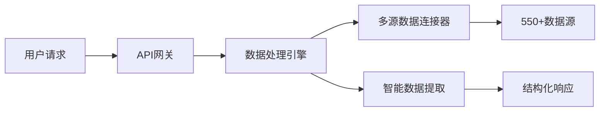
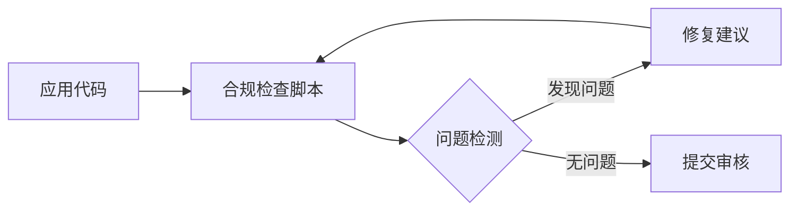

## 今日热点

AI代理技术与应用工具爆发式增长，CLI Anything、Superpowers等项目引领"软件代理原生"革命，同时AI安全、知识管理和多媒体处理工具持续创新。

---

## 热门项目一览

| 排名 | 项目 | 语言 | 今日 | 总计 | 简介 |
|:---:|------|:----:|------:|-----:|------|
| 1 | [obra/superpowers](https://github.com/obra/superpowers) | Shell | +2,028 | 322,225 | An agentic skills framework... |
| 2 | [elementalsouls/Claude-BugHunter](https://github.com/elementalsouls/Claude-BugHunter) | Python | +1,349 | 12,808 | A Claude Code skill bundle ... |
| 3 | [mvanhorn/last30days-skill](https://github.com/mvanhorn/last30days-skill) | Python | +954 | 70,933 | AI agent skill that researc... |
| 4 | [HKUDS/CLI-Anything](https://github.com/HKUDS/CLI-Anything) | Python | +898 | 60,705 | "CLI-Anything: Making ALL S... |
| 5 | [firecrawl/firecrawl](https://github.com/firecrawl/firecrawl) | TypeScript | +825 | 204,432 | Knowledge infrastructure to... |
| 6 | [cursor/plugins](https://github.com/cursor/plugins) | TypeScript | +384 | 17,613 | Cursor plugin specification... |
| 7 | [mjmirza/app-store-compliance](https://github.com/mjmirza/app-store-compliance) | Shell | +377 | 1,996 | Avoid common App Store and ... |
| 8 | [XiaoYouChR/Ghost-Downloader-3](https://github.com/XiaoYouChR/Ghost-Downloader-3) | Python | +341 | 12,961 | The only downloader you nee... |
| 9 | [google-labs-code/stitch-skills](https://github.com/google-labs-code/stitch-skills) | TypeScript | +302 | 10,785 | A library of Agent Skills d... |
| 10 | [cathrynlavery/diagram-design](https://github.com/cathrynlavery/diagram-design) | HTML | +271 | 68,775 | Editorial diagram design fo... |
| 11 | [openvinotoolkit/openvino](https://github.com/openvinotoolkit/openvino) | C++ | +246 | 11,601 | OpenVINO™ is an open source... |
| 12 | [jingyaogong/minimind](https://github.com/jingyaogong/minimind) | Python | +238 | 67,083 | 🧠 两小时从 0 训出你的 64M 大模型。Train... |

---

## 趋势洞察

```
┌─────────────────────────────────────────────────────────────────┐
│  AI/ML 工具         ████████████████████████  13 个项目        │
│  其他               █████                     3 个项目        │
└─────────────────────────────────────────────────────────────────┘
```

---

## 项目深度解读

### 1. obra/superpowers — 开发方法论

> **一句话总结**：一个基于Shell的代理技能框架和实用软件开发方法论，强调实践有效性。

#### 价值主张

| 维度 | 说明 |
|------|------|
| **解决痛点** | 解决软件开发中方法论与实践脱节的问题 |
| **目标用户** | 软件开发者和团队，寻求高效工作方法 |
| **核心亮点** | 实用主义方法论 + 技能框架 + 代理模式 + 可执行性 + 高效工作流 |

#### 技术架构

**技术特色**：
- 基于Shell脚本实现，便于跨平台执行
- 强调实用性和可操作性
- 采用代理模式增强开发效率

#### 热度分析

- 项目获得32万+星标，近期增长迅速，日增2000+，表明方法论受到广泛认可
- Fork数接近3万，说明社区积极参与和贡献，方法论具有实践价值

#### 快速上手

```bash
# 克隆仓库
git clone https://github.com/obra/superpowers.git
# 进入目录
cd superpowers
# 查看使用说明
./superpowers.sh
```

#### 注意事项

- 项目License未知，使用前需确认授权条款
- 项目方法论可能需要一定时间适应和实践
- Shell脚本执行环境需确保兼容性


### 2. elementalsouls/Claude-BugHunter — AI安全工具集

> **一句话总结**：Claude AI漏洞狩猎专用技能包，提供82种专业技能和681种报告模式，助力安全测试与红队工作。

#### 价值主张

| 维度 | 说明 |
|------|------|
| **解决痛点** | 为安全研究人员提供系统化漏洞检测和标准化报告工具 |
| **目标用户** | 安全研究员、渗透测试人员、红队队员、企业安全团队 |
| **核心亮点** | Claude深度集成 + 24类漏洞全覆盖 + 企业级攻击矩阵 + 标准化报告模板 |

#### 技术架构


**技术特色**：
- 基于提示工程的技能扩展系统
- 结构化漏洞分类与检测流程
- 多维度企业攻击矩阵映射

#### 热度分析

- 单日增长1349星，显示AI安全工具需求激增，社区认可度高
- 零开放问题表明项目维护质量高，社区问题通过其他渠道高效解决

#### 快速上手

```bash
# 克隆项目
git clone https://github.com/elementalsouls/Claude-BugHunter.git

# 导入Claude技能集
claude import skills/bug_hunter_skills.json
```

#### 注意事项

- 仅授权用于合法的安全测试活动，禁止未授权使用
- 需要具备基础安全知识背景才能有效利用工具功能
- 定期更新技能集以获取最新的漏洞检测模式和报告模板


### 3. mvanhorn/last30days-skill — 多平台信息聚合

> **一句话总结**：AI智能体技能，聚合Reddit、X、YouTube等多平台信息并生成基于事实的总结。

#### 价值主张

| 维度 | 说明 |
|------|------|
| **解决痛点** | 解决信息分散难以整合、获取全面资讯困难的问题 |
| **目标用户** | 需要快速获取多平台最新信息的分析师、研究者和决策者 |
| **核心亮点** | 多平台数据聚合 + AI智能总结 + 实时信息获取 + 基于事实的总结 |

#### 技术架构


**技术特色**：
- 多平台API集成与数据抓取技术
- 大语言模型驱动的信息提炼与总结
- 实时数据流处理与分析能力

#### 热度分析

- 项目获得7万+星标，单日增长近千，表明项目具有极高的实用价值和吸引力
- 作为AI agent技能项目，处于AI应用开发前沿，社区活跃度高

#### 快速上手

```bash
# 安装依赖
pip install -r requirements.txt

# 运行项目
python main.py --topic "人工智能最新发展"
```

#### 注意事项

- 项目依赖多个外部API，可能存在访问限制或变更
- 由于数据来自多个平台，需注意各平台的数据使用政策
- AI总结可能存在信息偏差，建议交叉验证关键信息


### 4. HKUDS/CLI-Anything — 智能CLI转换

> **一句话总结**：将任意软件转化为智能命令行原生应用的通用转换框架。

#### 价值主张

| 维度 | 说明 |
|------|------|
| **解决痛点** | 非CLI软件难以通过命令行实现自动化操作 |
| **目标用户** | 开发者、自动化工程师、DevOps团队 |
| **核心亮点** | UI元素智能识别 + 自动命令生成 + 跨平台适配 |

#### 技术架构


**技术特色**：
- 基于计算机视觉的界面元素自动识别
- 动态生成与应用交互的命令行接口
- 支持复杂操作流程的编排与执行

#### 热度分析

- 项目Star数超6万，日均增长近900，表明社区高度认可与活跃
- Fork数适中，显示项目已进入稳定使用阶段，用户更倾向于直接使用

#### 快速上手

```bash
# 安装CLI-Anything
pip install cli-anything

# 基本使用
cli-anything <应用名称> <操作指令>
```

#### 注意事项

- 项目License未知，商业使用前需确认授权方式
- 可能需要额外依赖特定操作系统环境
- 对复杂UI界面或动态加载元素的支持可能有限


### 5. firecrawl/firecrawl — 智能知识基础设施

> **一句话总结**：统一550+数据源的知识基础设施，通过单一API为智能体提供全面数据访问能力。

#### 价值主张

| 维度 | 说明 |
|------|------|
| **解决痛点** | 解决多源数据分散访问难、智能体知识获取效率低的问题 |
| **目标用户** | AI开发者、智能体构建者、企业数据分析团队 |
| **核心亮点** | 统一API接口 + 550+数据源集成 + 智能数据提取 + 高可扩展性 |

#### 技术架构



**技术特色**：
- 统一API抽象层，简化多源数据访问复杂度
- 智能数据提取与结构化处理能力
- 高可扩展的连接器架构，支持550+数据源

#### 热度分析

- 项目Star数突破20万，单日增长800+，呈现高速增长态势
- 作为AI智能体基础设施，处于AI工具生态核心位置，社区活跃度高

#### 快速上手

```bash
# 安装Firecrawl CLI
npm install -g firecrawl

# 使用API进行数据搜索
firecrawl search "your query" --providers openai,google,bing

# 或直接使用API
curl -X POST "https://api.firecrawl.dev/scrape" \
  -H "Content-Type: application/json" \
  -d '{"url": "https://example.com"}'
```

#### 注意事项

- 项目许可证信息未知，商业使用前需确认授权条款
- 依赖550+数据源，需注意各源的使用限制和合规要求
- 高频调用可能需要考虑API配额和成本问题


### 6. cursor/plugins — Cursor插件生态

> **一句话总结**：Cursor官方插件规范与集合，提供AI增强代码编辑功能

#### 价值主张

| 维度 | 说明 |
|------|------|
| **解决痛点** | 为Cursor编辑器提供AI增强功能，扩展代码编辑与智能辅助能力 |
| **目标用户** | AI辅助编程开发者，Cursor编辑器用户，插件开发者 |
| **核心亮点** | 官方插件规范 + AI深度集成 + TypeScript强类型 + 扩展性强 |

#### 技术架构


**技术特色**：
- 基于TypeScript的强类型插件开发系统
- 与Cursor AI功能无缝集成的插件架构
- 标准化的插件接口和开发文档

#### 热度分析

- 高增长项目，日增384星，表明社区对AI编程工具需求旺盛
- 作为官方插件库，处于AI编程工具生态的核心位置，引领行业发展

#### 快速上手

```bash
# 克隆项目
git clone https://github.com/cursor/plugins.git

# 安装依赖
cd plugins
npm install

# 开发插件
npm run dev
```

#### 注意事项

- 插件开发需遵循Cursor官方插件规范，确保兼容性
- 插件应充分利用Cursor的AI能力，提供智能辅助功能
- 项目API可能随版本更新变化，需关注更新日志


### 7. mjmirza/app-store-compliance — 应用合规指南

> **一句话总结**：应用商店合规指南，收录117种拒绝原因及解决方案，助力开发者顺利通过应用审核。

#### 价值主张

| 维度 | 说明 |
|------|------|
| **解决痛点** | 解决应用因合规问题被App Store和Google Play拒绝的核心问题 |
| **目标用户** | 移动应用开发者和发布者 |
| **核心亮点** | 117种拒绝模式及修复 + 隐私清单检查 + 95个法规截止日期跟踪 |

#### 技术架构



**技术特色**：
- Shell脚本实现跨平台兼容性检查
- 集成隐私清单和数据安全自动验证
- 法规截止日期跟踪系统提醒

#### 热度分析

- 项目获得近2000个Star，单日增长377，显示开发社区对应用合规需求的强烈关注
- 作为垂直领域的实用工具，在移动开发生态中占据重要位置，帮助开发者减少审核被拒风险

#### 快速上手

```bash
# 克隆项目
git clone https://github.com/mjmirza/app-store-compliance.git

# 运行合规检查
cd app-store-compliance
./check-compliance.sh
```

#### 注意事项

- 使用前需确保已安装必要的Shell环境依赖
- 定期更新以获取最新的合规要求和法规变化
- 虽然项目提供了大量常见拒绝原因的解决方案，但仍需关注官方最新政策变化


### 8. XiaoYouChR/Ghost-Downloader-3 — 全能下载工具

> **一句话总结**：集成多种下载功能的全能工具，支持多网站资源一键下载。

#### 价值主张

| 维度 | 说明 |
|------|------|
| **解决痛点** | 解决用户需安装多个下载器的问题，提供一站式下载解决方案 |
| **目标用户** | 需要下载多种网络资源的普通用户和开发者 |
| **核心亮点** | 多网站支持 + 命令行界面 + 跨平台兼容 + 批量下载功能 |

#### 技术架构


**技术特色**：
- 模块化设计，支持多种下载协议和网站
- 命令行界面友好，支持批量操作
- 异步下载技术，提高下载效率

#### 热度分析

- 项目获近1.3万星，近期增长迅速，表明功能实用且受欢迎
- Fork数量适中，社区参与度良好，但可能不是高度协作型项目

#### 快速上手

```bash
# 安装依赖
pip install -r requirements.txt

# 基本使用
python ghost.py -u "https://example.com/video.mp4"

# 批量下载
python ghost.py -f urls.txt -o downloads/
```

#### 注意事项

- 使用前需要确认项目的许可协议
- 某些网站可能有反爬虫机制，下载时需遵守相关网站的使用条款
- 部分功能可能需要额外配置或依赖


### 9. google-labs-code/stitch-skills — AI编程技能库

> **一句话总结**：为Stitch MCP服务器设计的Agent技能库，遵循开放标准，兼容多种编程助手工具。

#### 价值主张

| 维度 | 说明 |
|------|------|
| **解决痛点** | 为AI编程助手提供可复用技能模块，增强功能性与互操作性 |
| **目标用户** | 使用AI编程助手的开发者、研究人员和AI工具集成者 |
| **核心亮点** | 遵循开放标准 + 多平台兼容 + 模块化设计 + 可扩展性 |

#### 技术架构


**技术特色**：
- 基于TypeScript开发，确保类型安全与代码质量
- 遵循Agent Skills开放标准，保证跨平台互操作性
- 模块化设计，便于扩展和维护新技能

#### 热度分析

- 项目获得10k+星且持续增长，显示开发者社区对AI辅助编程工具的高度关注
- 作为Google Labs项目，在AI编程助手生态中占据重要位置，与主流工具形成良好兼容

#### 快速上手

```bash
# 安装Stitch MCP服务器
npm install -g @stitch-mcp/server

# 克隆stitch-skills库
git clone https://github.com/google-labs-code/stitch-skills.git
cd stitch-skills && npm install
```

#### 注意事项

- 项目需要配合Stitch MCP服务器使用，无法独立运行
- 需要了解Agent Skills标准以充分利用库功能
- 项目许可证信息不明确，使用时需注意版权问题


### 10. cathrynlavery/diagram-design — AI图表工具

> **一句话总结**：为AI代码助手提供45种编辑图表的纯HTML+SVG实现，无需阴影或Mermaid。

#### 价值主张

| 维度 | 说明 |
|------|------|
| **解决痛点** | 为AI代码助手提供高质量、简洁的图表设计，避免Mermaid的局限性 |
| **目标用户** | AI代码开发者、文档编写者、技术内容创作者 |
| **核心亮点** | 45种图表类型 + 纯HTML+SVG实现 + 无阴影设计 + 自包含单文件 |

#### 技术架构

**技术特色**：
- 纯HTML+SVG实现，无需额外依赖
- 45种专业图表类型，覆盖技术文档需求
- 简洁设计风格，避免视觉干扰

#### 热度分析

- 高星项目(68k+)且持续增长(+271/天)，表明技术社区高度认可
- Fork数适中，表明项目处于稳定使用阶段，社区活跃但未进入大规模二次开发阶段

#### 快速上手

```bash
# 直接在浏览器中打开index.html即可使用
# 或通过以下命令克隆到本地
git clone https://github.com/cathrynlavery/diagram-design.git
```

#### 注意事项

- 项目使用Unknown许可证，商用前需确认授权方式
- 纯前端实现，无后端服务支持
- 主要针对AI代码助手场景，其他用途可能需要适配


### 11. openvinotoolkit/openvino — AI推理优化工具

> **一句话总结**：OpenVINO是Intel开发的开源工具包，专为优化和加速AI模型在Intel硬件上的推理性能。

#### 价值主张

| 维度 | 说明 |
|------|------|
| **解决痛点** | 解决AI模型在边缘设备和服务器上推理性能低、兼容性差的问题 |
| **目标用户** | AI开发者、数据科学家、嵌入式系统工程师、IoT解决方案提供商 |
| **核心亮点** | 硬件加速优化 + 多框架支持 + 跨平台部署 + 模型压缩 + 低延迟推理 |

#### 技术架构


**技术特色**：
- 支持多种深度学习框架的模型转换和优化
- 提供专用推理引擎，充分利用Intel硬件加速
- 包含模型量化、剪枝等压缩技术，提高推理效率
- 支持CPU、GPU、VPU、FPGA等多种硬件平台
- 提供丰富的API和工具，简化AI部署流程

#### 热度分析

- 项目Star数持续稳定增长，近24小时增加246个Star，表明社区活跃度高
- 作为Intel官方AI工具包，在企业级AI部署领域具有重要影响力，与PyTorch、TensorFlow等主流框架形成互补生态

#### 快速上手

```bash
# 安装OpenVINO工具包
pip install openvino-dev

# 下载预训练模型
omz_downloader --name mobilenet-v2-pytorch

# 转换模型
omz_converter --name mobilenet-v2-pytorch

# 运行推理
benchmark_app -m mobilenet-v2-pytorch/FP32/mobilenet-v2-pytorch.xml
```

#### 注意事项

- OpenVINO主要优化Intel硬件，在其他硬件平台上的性能可能有限
- 模型转换过程中可能会出现精度损失，特别是在量化时
- 某些新型神经网络层可能不被支持，需要自定义插件
- 官方文档和示例代码主要针对Python，C++ API支持相对有限
- 对于非Intel硬件，可能需要额外配置或使用CPU后端


### 12. jingyaogong/minimind — [轻量级LLM训练]

> **一句话总结**：简化LLM训练流程，让普通用户在两小时内完成64M模型从零到一的训练。

#### 价值主张

| 维度 | 说明 |
|------|------|
| **解决痛点** | 降低大模型训练门槛，无需专业知识即可训练自己的小规模LLM |
| **目标用户** | AI研究人员、开发爱好者、教育工作者和小型企业 |
| **核心亮点** | 极简训练流程 + 低硬件要求 + 快速部署能力 + 完整教程指导 |

#### 技术架构


**技术特色**：
- 高效的分布式训练优化
- 轻量级模型架构设计
- 资源消耗最小化策略

#### 热度分析

- 项目近期热度显著增长，日增Star数238，表明社区高度关注和认可
- 作为轻量级LLM训练工具，在AI民主化浪潮中占据重要位置，吸引了大量AI实践者参与

#### 快速上手

```bash
git clone https://github.com/jingyaogong/minimind.git
cd minimind
pip install -r requirements.txt
python train.py --model_size 64M
```

#### 注意事项

- 需要一定的计算资源，可能需要GPU支持
- 训练结果可能受数据质量和数量影响
- 模型规模有限，适合学习和小型应用


### 13. toeverything/AFFiNE — 全功能知识库

> **一句话总结**：隐私优先的开源知识管理平台，整合规划、整理与创作功能，提供类似Notion的全能体验。

#### 价值主张

| 维度 | 说明 |
|------|------|
| **解决痛点** | 打破传统知识工具功能壁垒，提供一体化的隐私保护知识管理方案 |
| **目标用户** | 知识工作者、创意团队、教育机构及注重隐私的个人用户 |
| **核心亮点** | 隐私优先 + 开源可定制 + 跨平台支持 + 全功能整合 + 类似Notion体验 |

#### 技术架构


**技术特色**：
- 基于TypeScript构建，确保类型安全和代码质量
- 采用模块化架构设计，支持高度可扩展性
- 实现本地优先的数据存储，保障用户隐私安全

#### 热度分析

- Star数超7.5万且持续稳定增长，日增约180，表明项目受社区高度认可
- Fork数近5.6千，显示开发者活跃度高，二次开发意愿强烈

#### 快速上手

```bash
# 克隆项目
git clone https://github.com/toeverything/AFFiNE.git
# 安装依赖
npm install
# 启动开发环境
npm run dev
```

#### 注意事项

- 项目许可证信息未明确标注，商业使用前需进一步确认
- Open Issues数量为0，可能采用其他问题管理方式或项目处于早期阶段


### 14. zhouxiaoka/autoclip — AI视频剪辑

> **一句话总结**：AI驱动的长视频自动剪辑工具，一键生成短视频、字幕和发布文案。

#### 价值主张

| 维度 | 说明 |
|------|------|
| **解决痛点** | 解决内容创作者手动剪辑长视频耗时耗力的问题，实现一键自动化视频剪辑 |
| **目标用户** | 内容创作者、自媒体人、播客主、教育工作者等需要将长内容转为短视频的人群 |
| **核心亮点** | AI自动剪辑 + 多平台适配 + 字幕封面自动生成 + 发布文案创作 + 开源可定制 |

#### 技术架构


**技术特色**：
- 基于AI的视频内容分析和关键片段识别
- 自动化字幕生成和封面创建
- 多平台适配和发布文案创作

#### 热度分析

- 项目获得11458个Star，且仍在持续增长(+126 today)，显示社区高度关注
- 1954个Fork表明开发者积极参与二次开发和定制

#### 快速上手

```bash
# 克隆项目
git clone https://github.com/zhouxiaoka/autoclip.git
# 安装依赖
pip install -r requirements.txt
# 运行主程序
python autoclip.py
```

#### 注意事项

- 项目许可证未知，可能存在商业使用限制
- 作为AI工具，可能需要一定的计算资源支持
- 多平台适配可能需要针对不同平台进行额外配置


### 15. nginx/nginx — 高性能Web服务器

> **一句话总结**：nginx以其异步非阻塞架构和卓越性能，成为Web服务和反向代理的首选解决方案。

#### 价值主张

| 维度 | 说明 |
|------|------|
| **解决痛点** | 解决高并发场景下传统Web服务器的性能瓶颈问题 |
| **目标用户** | 需处理高流量网站的DevOps和系统管理员 |
| **核心亮点** | 异步非阻塞架构 + 模块化设计 + 低资源消耗 + 高并发处理 |

#### 技术架构


**技术特色**：
- 基于事件驱动的异步非阻塞架构，实现高并发处理
- 模块化设计，支持动态加载和扩展功能
- 采用多进程模型，主进程管理worker进程，提高稳定性

#### 热度分析

- nginx作为Web服务器领域领导者，持续稳定增长，社区活跃度高
- 在全球网站服务器市场占有率超过35%，成为基础设施核心组件

#### 快速上手

```bash
# 安装nginx
sudo apt install nginx  # Ubuntu/Debian
sudo systemctl start nginx  # 启动服务
```

#### 注意事项

- nginx配置语法严格，缩进和分号错误会导致服务无法启动
- 处理高并发场景时，需合理配置worker进程数和连接数限制


### 16. Tracer-Cloud/opensre — CI/CD可靠性代理

> **一句话总结**：开源CI/CD流程可靠性监控代理，实时检测构建与部署问题，提升软件交付质量。

#### 价值主张

| 维度 | 说明 |
|------|------|
| **解决痛点** | 解决CI/CD流程中的可靠性问题，减少构建和部署失败 |
| **目标用户** | DevOps工程师、CI/CD流程管理者、软件开发团队 |
| **核心亮点** | + 实时监控CI/CD流程 + 自动故障检测 + 提供可靠性洞察 + 与主流CI/CD工具集成 |

#### 技术架构


**技术特色**：
- 轻量级Python代理，易于集成
- 实时监控和分析CI/CD流程
- 提供详细的可靠性指标和洞察
- 支持多种CI/CD工具的插件化架构

#### 热度分析

- 项目获得13k+星星且持续增长，表明在DevOps领域有较高认可度
- 作为CI/CD可靠性工具，填补了市场空白，社区活跃度高

#### 快速上手

```bash
# 安装OpenSRE代理
pip install opensre

# 配置代理与CI/CD工具集成
opensre init --platform=github_actions

# 启动监控
opensre start
```

#### 注意事项

- 许可证信息不明确，使用前需确认
- 项目可能需要与特定CI/CD工具的额外配置才能完全发挥作用
- 建议在使用前阅读项目文档了解完整功能集和限制


## 今日推荐

| 主题 | 推荐项目 | 亮点 |
|------|----------|------|
| 今日最热 | [obra/superpowers](https://github.com/obra/superpowers) | An agentic skills... |
| 值得关注 | [elementalsouls/Claude-BugHunter](https://github.com/elementalsouls/Claude-BugHunter) | A Claude Code ski... |
| 快速上手 | [mvanhorn/last30days-skill](https://github.com/mvanhorn/last30days-skill) | AI agent skill th... |
| 长期潜力 | [HKUDS/CLI-Anything](https://github.com/HKUDS/CLI-Anything) | "CLI-Anything: Ma... |

---

<div align="center">

*Generated on 2026-11-20 | Powered by GitHub Trending Reporter*

</div>