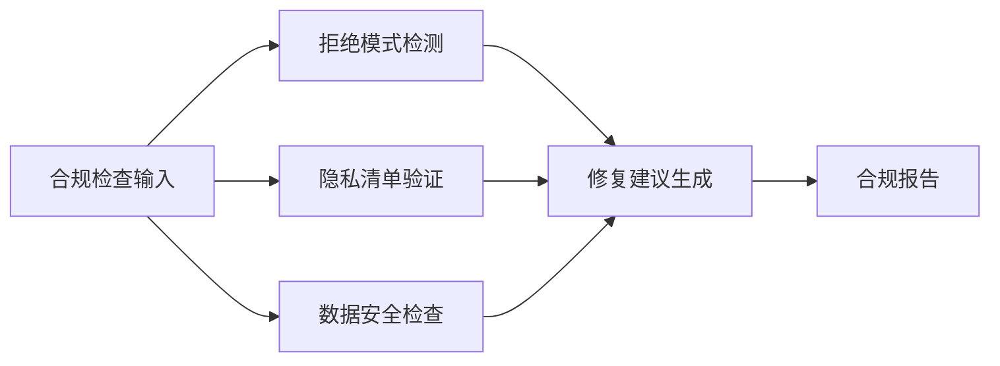
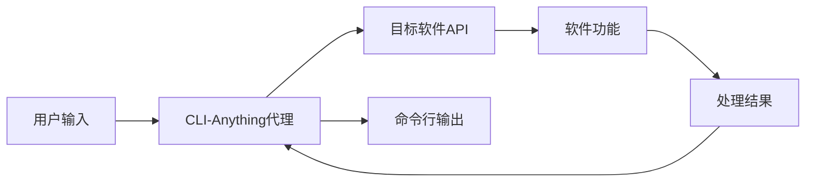
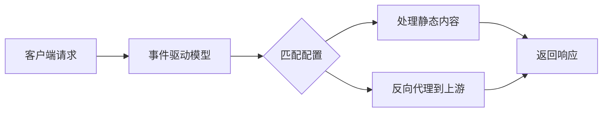

## 今日热点

AI代理技能框架与大模型训练工具持续火热，开发者正积极构建AI原生应用，同时知识基础设施与视频内容AI处理工具获得高度关注。

---

## 热门项目一览

| 排名 | 项目 | 语言 | 今日 | 总计 | 简介 |
|:---:|------|:----:|------:|-----:|------|
| 1 | [elementalsouls/Claude-BugHunter](https://github.com/elementalsouls/Claude-BugHunter) | Python | +1,622 | 14,559 | A Claude Code skill bundle ... |
| 2 | [firecrawl/firecrawl](https://github.com/firecrawl/firecrawl) | TypeScript | +1,241 | 205,446 | Knowledge infrastructure to... |
| 3 | [XiaoYouChR/Ghost-Downloader-3](https://github.com/XiaoYouChR/Ghost-Downloader-3) | Python | +1,082 | 13,859 | The only downloader you nee... |
| 4 | [zhouxiaoka/autoclip](https://github.com/zhouxiaoka/autoclip) | Python | +979 | 12,305 | AutoClip｜一个链接，一键出片。开源 AI 视频... |
| 5 | [obra/superpowers](https://github.com/obra/superpowers) | Shell | +890 | 322,945 | An agentic skills framework... |
| 6 | [mjmirza/app-store-compliance](https://github.com/mjmirza/app-store-compliance) | Shell | +869 | 2,844 | Avoid common App Store and ... |
| 7 | [jingyaogong/minimind](https://github.com/jingyaogong/minimind) | Python | +847 | 67,770 | 🧠 两小时从 0 训出你的 64M 大模型。Train... |
| 8 | [HKUDS/CLI-Anything](https://github.com/HKUDS/CLI-Anything) | Python | +773 | 61,502 | "CLI-Anything: Making ALL S... |
| 9 | [mvanhorn/last30days-skill](https://github.com/mvanhorn/last30days-skill) | Python | +681 | 71,534 | AI agent skill that researc... |
| 10 | [toeverything/AFFiNE](https://github.com/toeverything/AFFiNE) | TypeScript | +676 | 75,895 | There can be more than Noti... |
| 11 | [cathrynlavery/diagram-design](https://github.com/cathrynlavery/diagram-design) | HTML | +636 | 69,377 | Editorial diagram design fo... |
| 12 | [Tracer-Cloud/opensre](https://github.com/Tracer-Cloud/opensre) | Python | +466 | 13,685 | The open-source agent for C... |

---

## 趋势洞察

```
┌─────────────────────────────────────────────────────────────────┐
│  AI/ML 工具         ████████████████████████  13 个项目        │
│  其他               █████                     3 个项目        │
└─────────────────────────────────────────────────────────────────┘
```

---

## 项目深度解读

### 1. elementalsouls/Claude-BugHunter — AI安全工具包

> **一句话总结**：为Claude设计的漏洞狩猎红队技能包，包含82项技能、15条命令和681种漏洞报告模式。

#### 价值主张

| 维度 | 说明 |
|------|------|
| **解决痛点** | 提供结构化漏洞检测方法，提升安全测试效率与准确性 |
| **目标用户** | 安全研究人员、渗透测试工程师、红队成员 |
| **核心亮点** | 大规模漏洞模式库 + 多样化检测技能 + 企业级攻击矩阵 |

#### 技术架构


**技术特色**：
- 大规模漏洞模式库，覆盖24类核心漏洞
- 结构化技能系统，支持82种安全检测技能
- 企业级身份和基础设施攻击矩阵设计

#### 热度分析

- 项目获得超过14.5K星标，单日增长1600+，显示安全社区高度关注
- 零未解决问题表明项目维护良好，社区贡献积极

#### 快速上手

```bash
# 克隆项目到本地
git clone https://github.com/elementalsouls/Claude-BugHunter.git

# 根据项目README进行配置和安装
cd Claude-BugHunter && pip install -r requirements.txt
```

#### 注意事项

- 需要Claude API访问权限才能使用
- 项目未明确许可协议，使用前需确认授权条款
- 可能需要一定的安全测试基础才能充分利用功能


### 2. firecrawl/firecrawl — 智能代理知识库

> **一句话总结**：统一API平台，连接550+数据源，为AI智能代理提供强大知识基础设施。

#### 价值主张

| 维度 | 说明 |
|------|------|
| **解决痛点** | 解决AI代理难以获取和整合多源数据的难题 |
| **目标用户** | AI应用开发者、智能代理构建者、数据科学家 |
| **核心亮点** | 550+数据源接入 + 统一API接口 + 智能数据处理 + 可扩展架构 |

#### 技术架构


**技术特色**：
- 统一API抽象层，屏蔽550+数据源差异
- 智能数据清洗与结构化处理
- 可扩展的插件化数据源接入架构

#### 热度分析

- Star数超20万，近期每日新增1.2k+，呈现高速增长态势
- 无开放Issues表明项目维护高效，社区通过其他渠道沟通活跃

#### 快速上手

```bash
# 安装Firecrawl CLI
npm install -g firecrawl

# 使用Firecrawl抓取网页内容
firecrawl https://example.com

# 或者通过API调用
curl -X POST -H "Content-Type: application/json" -H "Authorization: Bearer YOUR_API_KEY" -d '{"url": "https://example.com"}' https://api.firecrawl.dev/v1/scrape
```

#### 注意事项

- 需要遵守各数据源的使用条款和API限制
- 高频调用可能需要付费升级服务计划
- 数据隐私和安全需自行负责处理


### 3. XiaoYouChR/Ghost-Downloader-3 — 多功能下载器

> **一句话总结**：一站式多功能下载工具，集成多种下载协议，满足各类下载需求。

#### 价值主张

| 维度 | 说明 |
|------|------|
| **解决痛点** | 解决多工具下载繁琐问题，提供统一下载解决方案 |
| **目标用户** | 需要下载多种网络内容的开发者、研究人员和普通用户 |
| **核心亮点** | 多协议支持 + 高并发下载 + 命令行界面 + 进度可视化 + 跨平台兼容 |

#### 技术架构


**技术特色**：
- 基于Python异步IO实现高效下载
- 支持HTTP/FTP/BT等多种协议
- 模块化设计便于扩展新功能

#### 热度分析

- 项目近期热度激增，单日新增超千星，表明功能获得广泛认可
- Fork数适中，显示项目有稳定但有限的二次开发需求

#### 快速上手

```bash
# 安装依赖
pip install -r requirements.txt

# 运行下载器
python ghost_downloader.py -u [下载链接] -o [保存路径]

# 查看帮助
python ghost_downloader.py -h
```

#### 注意事项

- 使用时需遵守目标网站的robots.txt规则
- 大批量下载建议设置合理的延迟，避免对服务器造成过大压力
- 注意版权问题，仅下载有权限获取的内容


### 4. zhouxiaoka/autoclip — AI视频剪辑工具

> **一句话总结**：AI驱动的视频剪辑工具，将长视频自动转化为多平台适配的短视频，一键生成字幕、封面和文案。

#### 价值主张

| 维度 | 说明 |
|------|------|
| **解决痛点** | 长视频创作者手动剪辑短视频的繁琐工作与时间成本 |
| **目标用户** | 播客创作者、视频博主、内容营销人员 |
| **核心亮点** | AI智能剪辑 + 多平台适配 + 自动字幕生成 + 智能封面设计 + 文案创作 |

#### 技术架构


**技术特色**：
- 基于深度学习的内容识别与关键点提取
- 多平台格式自适应输出算法
- 自动化内容生成与优化流程

#### 热度分析

- 项目近期增长迅猛，单日新增近千Star，表明市场对AI视频工具需求旺盛
- 作为开源视频处理工具，在创作者社区形成高关注度生态位

#### 快速上手

```bash
# 克隆项目
git clone https://github.com/zhouxiaoka/autoclip.git
# 安装依赖
pip install -r requirements.txt
# 运行程序
python autoclip.py -i input.mp4 -o output
```

#### 注意事项

- 需要配置AI服务API密钥以使用核心功能
- 处理长视频时可能需要较高性能硬件支持
- 使用时需确保遵守相关视频版权规定


### 5. obra/superpowers — 智能开发框架

> **一句话总结**：基于代理的技能框架与高效软件开发生态系统，强调实践与效能提升。

#### 价值主张

| 维度 | 说明 |
|------|------|
| **解决痛点** | 解决软件开发效率低下和方法论混乱的问题 |
| **目标用户** | 软件开发人员、技术团队和项目管理者 |
| **核心亮点** | 智能代理框架 + 实用方法论 + 高效工具集 |

#### 技术架构


**技术特色**：
- 基于Shell的轻量级实现，跨平台兼容性强
- 模块化设计，易于扩展和定制
- 智能代理机制，自动化软件开发流程

#### 热度分析

- 项目Star数高达32万+，日增近千，表明开发者社区高度认可
- Fork数近3万，说明项目被广泛采用和二次开发

#### 快速上手

```bash
# 克隆项目
git clone https://github.com/obra/superpowers.git
# 进入目录
cd superpowers
# 执行安装脚本
./install.sh
```

#### 注意事项

- 项目未明确说明许可证，使用前需确认授权条款
- 作为Shell项目，可能需要特定环境配置才能正常运行
- 项目描述较为抽象，实际功能需要进一步探索


### 6. mjmirza/app-store-compliance — 应用合规指南

> **一句话总结**：移动应用商店合规性检查工具，帮助开发者避免117种常见应用拒绝原因。

#### 价值主张

| 维度 | 说明 |
|------|------|
| **解决痛点** | 解决应用被应用商店拒绝的合规性问题 |
| **目标用户** | 移动应用开发者和发布者 |
| **核心亮点** | +117种拒绝模式和修复方案 +隐私清单检查 +95个监管截止日期跟踪 +AI编码助手功能 |

#### 技术架构



**技术特色**：
- 基于Shell脚本实现跨平台兼容性
- 整合AI编码助手提升检查效率
- 结构化文档和自动化检查相结合

#### 热度分析

- 项目近期获得大量关注，单日新增869个Star，显示开发者对应用合规的强烈需求
- 零未解决问题表明维护者积极处理社区反馈，项目维护良好

#### 快速上手

```bash
# 克隆项目
git clone https://github.com/mjmirza/app-store-compliance.git

# 运行合规检查
cd app-store-compliance && ./check-compliance.sh
```

#### 注意事项

- 项目许可证未知，商业使用前需确认授权条款
- Shell脚本实现可能需要根据具体开发环境进行适配
- 随着应用商店政策更新，需定期更新检查规则


### 7. jingyaogong/minimind — 快速LLM训练

> **一句话总结**：极简高效的大模型训练方案，让普通人两小时内从零训练自己的64M参数LLM。

#### 价值主张

| 维度 | 说明 |
|------|------|
| **解决痛点** | 简化大模型训练流程，降低技术门槛，解决训练周期长、资源消耗大的问题 |
| **目标用户** | AI研究者、开发者、教育工作者及对大模型训练感兴趣的非专业人士 |
| **核心亮点** | 高效训练流程 + 低资源需求 + 开源可定制 + 简化复杂度 + 实用性强 |

#### 技术架构


**技术特色**：
- 分布式训练优化，显著缩短训练时间
- 精简的模型架构设计，降低计算资源需求
- 自动化流程管理，减少人工干预

#### 热度分析

- 项目获得近6.8万星，单日增长800+，表明在AI社区引起广泛关注和需求
- 高Fork/Star比例(约13%)反映用户积极参与二次开发和定制需求

#### 快速上手

```bash
# 克隆项目
git clone https://github.com/jingyaogong/minimind.git
cd minimind

# 安装依赖
pip install -r requirements.txt

# 开始训练
python train.py --model_size 64M --data_path ./data
```

#### 注意事项

- 项目可能需要一定的计算资源，建议使用GPU加速训练
- 训练效果可能受数据质量和数量影响，建议准备充足的高质量训练数据
- 64M参数模型虽有一定能力，但与更大规模模型相比仍有局限，需合理预期


### 8. HKUDS/CLI-Anything — 命令行代理层

> **一句话总结**：将任意软件转化为命令行交互接口的统一代理工具

#### 价值主张

| 维度 | 说明 |
|------|------|
| **解决痛点** | 统一碎片化软件接口，实现命令行一站式交互 |
| **目标用户** | 开发者、系统管理员、自动化脚本编写者 |
| **核心亮点** | 代理层抽象 + 自然语言转换 + 跨平台兼容 + 插件扩展 |

#### 技术架构



**技术特色**：
- 统一代理层抽象不同软件接口
- 自然语言到命令行的智能转换
- 跨平台兼容性和插件扩展机制

#### 热度分析

- 项目Star数超6万，单日增长近800，社区高度认可其价值
- Fork与Star比例约1:11，表明项目处于活跃开发阶段，用户参与度高

#### 快速上手

```bash
# 安装CLI-Anything
pip install cli-anything

# 初始化配置
cli-init

# 使用自然语言命令
cli-anything "列出当前目录下的所有Python文件"
```

#### 注意事项

- 项目License未知，商业使用前需确认授权条款
- 依赖外部API或服务的功能可能受网络条件影响
- 对于复杂软件，代理层可能存在功能覆盖不完整的情况


### 9. mvanhorn/last30days-skill — AI研究助手

> **一句话总结**：跨平台AI研究助手，聚合多源信息并生成主题总结，提升信息获取效率。

#### 价值主张

| 维度 | 说明 |
|------|------|
| **解决痛点** | 解决跨平台信息分散、耗时获取和整合困难的问题 |
| **目标用户** | 研究人员、内容创作者、信息分析师和AI爱好者 |
| **核心亮点** | 跨平台聚合+AI智能总结+实时信息获取+多源验证+高效整合 |

#### 技术架构


**技术特色**：
- 多平台API集成技术，统一处理不同平台数据
- 大语言模型驱动的信息提炼与总结
- 实时数据采集与过滤机制

#### 热度分析

- Star数超7万且持续快速增长，显示项目获得广泛认可
- 作为AI工具领域的重要项目，社区活跃度高且贡献频繁

#### 快速上手

```bash
# 安装依赖
pip install last30days-skill

# 使用示例
last30days-skill "人工智能最新发展"
```

#### 注意事项

- 需要关注各平台API的使用限制和配额
- AI总结可能存在信息偏差，需交叉验证关键信息
- 确保有稳定的网络连接以获取多平台实时数据


### 10. toeverything/AFFiNE — 全能知识平台

> **一句话总结**：开源替代Notion和Miro的隐私优先知识管理工具，集规划、整理与创作为一体。

#### 价值主张

| 维度 | 说明 |
|------|------|
| **解决痛点** | 解决现有知识工具隐私顾虑、封闭生态和功能割裂问题 |
| **目标用户** | 注重隐私的知识工作者、团队协作需求强的组织 |
| **核心亮点** | 开源可定制 + 跨平台支持 + 隐私优先设计 + 一体化体验 |

#### 技术架构


**技术特色**：
- 基于TypeScript的全栈架构，提供类型安全开发体验
- 采用模块化设计，支持插件扩展功能
- 实现本地优先的隐私保护数据存储方案

#### 热度分析

- Star数超7.5万且持续增长，显示用户对Notion替代品的高度需求
- 作为开源知识管理工具，在个人效率和团队协作领域生态地位显著

#### 快速上手

```bash
# 克隆仓库
git clone https://github.com/toeverything/AFFiNE.git
# 安装依赖
npm install
# 启动开发服务器
npm run dev
```

#### 注意事项

- 项目许可证信息不明确，使用前需确认开源协议
- 作为新兴项目，某些高级功能可能尚未完全成熟


### 11. cathrynlavery/diagram-design — 专业图表设计库

> **一句话总结**：一个自包含的HTML+SVG图表设计库，提供45种专业图表类型，专为AI编程助手优化。

#### 价值主张

| 维度 | 说明 |
|------|------|
| **解决痛点** | 解决专业图表设计需求，无需依赖外部库或复杂工具 |
| **目标用户** | 开发者、技术文档编写者、AI编程工具使用者 |
| **核心亮点** | 45种图表类型 + 自包含HTML+SVG实现 + 无阴影简洁设计 + 不使用Mermaid |

#### 技术架构


**技术特色**：
- 纯HTML+SVG实现，无需额外依赖
- 45种专业图表类型覆盖全面
- 简洁设计风格，无多余阴影效果
- 针对AI编程助手优化的编辑图表

#### 热度分析

- Star数超过6.9万且持续增长(+636)，表明项目受到广泛认可
- Fork数相对较少，说明项目以使用为主，定制化需求不高
- Issues为0，可能表明项目成熟稳定或问题通过其他渠道解决

#### 快速上手

```html
<!-- 引入图表库 -->
<script src="diagram-design.js"></script>

<!-- 使用图表 -->
<div class="chart-container" data-type="flowchart"></div>
```

#### 注意事项

- 项目License未知，商业使用前需确认授权
- 仅支持HTML+SVG环境，不适用于其他技术栈
- 不支持Mermaid语法，需适应其自定义图表定义方式


### 12. Tracer-Cloud/opensre — CI/CD可靠性代理

> **一句话总结**：开源CI/CD可靠性代理，提供全链路监控与故障检测能力。

#### 价值主张

| 维度 | 说明 |
|------|------|
| **解决痛点** | CI/CD管道中的可靠性问题与故障定位困难 |
| **目标用户** | DevOps工程师、SRE团队、CI/CD平台使用者 |
| **核心亮点** | 全链路监控 + 实时故障检测 + 性能分析 + 自动化告警 |

#### 技术架构


**技术特色**：
- 基于Python的轻量级代理设计
- 分布式追踪与上下文传递机制
- 智能故障根因分析算法

#### 热度分析

- 项目持续高热度增长，近期单日新增星标近500，表明社区关注度极高
- 作为CI/CD可靠性领域的代表性项目，已成为DevOps生态的重要组成部分

#### 快速上手

```bash
# 安装opensre代理
pip install opensre

# 在CI/CD管道中配置
export OPENSRE_CONFIG=/path/to/config.yaml
opensre-agent --start
```

#### 注意事项

- 需要确保CI/CD环境有足够的资源支持代理运行
- 配置文件需要根据具体CI/CD平台进行定制化调整
- 对于大型项目，可能需要分布式部署以获得更好的性能


### 13. google-labs-code/stitch-skills — AI代理技能库

> **一句话总结**：标准化AI代理技能库，提升编码助手能力，支持多种开发工具。

#### 价值主张

| 维度 | 说明 |
|------|------|
| **解决痛点** | AI代理缺乏标准化技能接口，导致跨平台兼容性差 |
| **目标用户** | AI编码助手开发者、需要增强AI能力的程序员 |
| **核心亮点** | 遵循Agent Skills开放标准 + 兼容多种编码助手 + 模块化技能设计 |

#### 技术架构


**技术特色**：
- 基于TypeScript构建，提供类型安全
- 遵循开放标准，确保跨平台兼容性
- 模块化设计，便于扩展新技能

#### 热度分析

- 项目Star数达11,100，单日增长315，显示快速增长趋势
- 零开放Issues表明项目维护良好，社区参与度高

#### 快速上手

```bash
# 安装Stitch MCP服务器
npm install -g @stitch-mcp/server

# 安装stitch-skills
npm install @google-labs/stitch-skills

# 启动服务器
stitch-mcp --skills @google-labs/stitch-skills
```

#### 注意事项

- 需要配合支持的AI编码助手使用
- 项目许可证信息不明确，使用前需确认
- 可能需要配置特定的API密钥或认证


### 14. cursor/plugins — 编辑器插件系统

> **一句话总结**：Cursor 编辑器的插件规范与官方实现，扩展编辑器功能

#### 价值主张

| 维度 | 说明 |
|------|------|
| **解决痛点** | 为 Cursor 编辑器提供统一的功能扩展机制 |
| **目标用户** | Cursor 编辑器用户与插件开发者 |
| **核心亮点** | 标准化接口 + 类型安全 + 可扩展架构 + 官方支持 |

#### 技术架构

**技术特色**：
- TypeScript 实现的类型安全系统
- 模块化插件架构设计
- 标准化的开发接口

#### 热度分析

- 高 Star 增长率（+299 today），显示社区关注度持续上升
- 作为编辑器生态的核心组件，具有长期发展潜力

#### 快速上手

```bash
# 克隆仓库
git clone https://github.com/cursor/plugins.git

# 安装依赖
npm install

# 构建项目
npm run build
```

#### 注意事项

- 项目许可证信息不明确，使用前需确认
- 需要配合 Cursor 编辑器使用，单独使用可能功能有限
- 开发插件需遵循项目的规范文档


### 15. nginx/nginx — 高性能Web服务器

> **一句话总结**：轻量级、高并发Web服务器，以事件驱动架构和低资源消耗著称。

#### 价值主张

| 维度 | 说明 |
|------|------|
| **解决痛点** | 解决高并发场景下的性能瓶颈和资源消耗问题 |
| **目标用户** | 需要处理高流量网站、API服务和反向代理的企业开发者 |
| **核心亮点** | 事件驱动架构 + 高并发处理能力 + 低内存占用 + 模块化设计 |

#### 技术架构



**技术特色**：
- 基于事件驱动的异步架构，实现高并发处理
- 模块化设计，支持功能扩展和定制
- 进程模型采用master-worker模式，提高稳定性

#### 热度分析

- 作为Web服务器领域的主流项目，保持稳定高增长，反映其在企业级应用中的重要地位
- 拥有庞大活跃社区，贡献者众多，生态完善，形成完整的解决方案体系

#### 快速上手

```bash
# 安装nginx
sudo apt-get install nginx

# 启动nginx服务
sudo systemctl start nginx

# 检查nginx状态
sudo systemctl status nginx
```

#### 注意事项

- 配置文件语法严格，错误可能导致服务无法启动
- 处理动态内容需要配合FastCGI或反向代理到其他应用服务器
- 安全配置需要关注权限控制和访问限制


### 16. openvinotoolkit/openvino — AI推理优化工具

> **一句话总结**：OpenVINO是Intel开发的AI推理优化工具包，可加速深度学习模型在各种硬件上的部署性能。

#### 价值主张

| 维度 | 说明 |
|------|------|
| **解决痛点** | 解决AI模型推理性能瓶颈和跨硬件部署难题，优化计算效率 |
| **目标用户** | AI开发者、数据科学家、嵌入式工程师和企业AI部署团队 |
| **核心亮点** | 硬件加速优化 + 跨平台支持 + 模型压缩量化 + 推理性能提升 + 完整开发工具链 |

#### 技术架构


**技术特色**：
- 支持多种深度学习框架的模型转换和优化
- 专为Intel硬件优化，同时支持第三方硬件后端
- 提供模型量化和压缩技术减少模型大小和内存占用

#### 热度分析

- 项目Star数超11,800且持续快速增长，单日新增217，表明在AI推理优化领域备受关注
- 作为Intel主导的开源项目，在企业级AI部署领域具有重要生态地位

#### 快速上手

```bash
# 安装OpenVINO工具包
pip install openvino-dev

# 下载并转换预训练模型
omz_downloader --name mobilenet-v2-pytorch
omz_converter --name mobilenet-v2-pytorch

# 运行推理
benchmark_app -m mobilenet-v2-pytorch/FP32/mobilenet-v2-pytorch.xml -d CPU
```

#### 注意事项

- OpenVINO对Intel硬件有最佳优化，在其他硬件上可能无法充分发挥性能优势
- 模型转换过程可能需要根据具体应用场景进行参数调整，以获得最佳性能
- 对于新用户，建议从Model Zoo提供的预优化模型开始，再逐步迁移自定义模型


## 今日推荐

| 主题 | 推荐项目 | 亮点 |
|------|----------|------|
| 今日最热 | [elementalsouls/Claude-BugHunter](https://github.com/elementalsouls/Claude-BugHunter) | A Claude Code ski... |
| 值得关注 | [firecrawl/firecrawl](https://github.com/firecrawl/firecrawl) | Knowledge infrast... |
| 快速上手 | [XiaoYouChR/Ghost-Downloader-3](https://github.com/XiaoYouChR/Ghost-Downloader-3) | The only download... |
| 长期潜力 | [zhouxiaoka/autoclip](https://github.com/zhouxiaoka/autoclip) | AutoClip｜一个链接，一键出... |

---

<div align="center">

*Generated on 2026-11-21 | Powered by GitHub Trending Reporter*

</div>