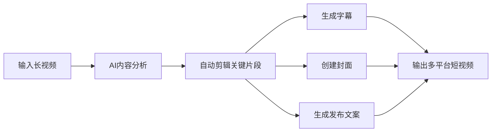

## 今日热点

AI代理技能框架与工具链成为主流趋势，同时AI原生应用和开发工具集成加速，反映了AI从单一模型向全面生态系统发展的转变。

---

## 热门项目一览

| 排名 | 项目 | 语言 | 今日 | 总计 | 简介 |
|:---:|------|:----:|------:|-----:|------|
| 1 | [elementalsouls/Claude-BugHunter](https://github.com/elementalsouls/Claude-BugHunter) | Python | +1,803 | 16,263 | A Claude Code skill bundle ... |
| 2 | [firecrawl/firecrawl](https://github.com/firecrawl/firecrawl) | TypeScript | +1,006 | 206,325 | Knowledge infrastructure to... |
| 3 | [obra/superpowers](https://github.com/obra/superpowers) | Shell | +883 | 323,816 | An agentic skills framework... |
| 4 | [XiaoYouChR/Ghost-Downloader-3](https://github.com/XiaoYouChR/Ghost-Downloader-3) | Python | +779 | 14,539 | The only downloader you nee... |
| 5 | [HKUDS/CLI-Anything](https://github.com/HKUDS/CLI-Anything) | Python | +769 | 62,158 | "CLI-Anything: Making ALL S... |
| 6 | [mjmirza/app-store-compliance](https://github.com/mjmirza/app-store-compliance) | Shell | +720 | 3,479 | Avoid common App Store and ... |
| 7 | [zhouxiaoka/autoclip](https://github.com/zhouxiaoka/autoclip) | Python | +683 | 12,943 | AutoClip｜一个链接，一键出片。开源 AI 视频... |
| 8 | [cathrynlavery/diagram-design](https://github.com/cathrynlavery/diagram-design) | HTML | +583 | 69,863 | Editorial diagram design fo... |
| 9 | [toeverything/AFFiNE](https://github.com/toeverything/AFFiNE) | TypeScript | +574 | 76,365 | There can be more than Noti... |
| 10 | [mvanhorn/last30days-skill](https://github.com/mvanhorn/last30days-skill) | Python | +560 | 72,094 | AI agent skill that researc... |
| 11 | [jingyaogong/minimind](https://github.com/jingyaogong/minimind) | Python | +488 | 68,219 | 🧠 两小时从 0 训出你的 64M 大模型。Train... |
| 12 | [Tracer-Cloud/opensre](https://github.com/Tracer-Cloud/opensre) | Python | +450 | 14,042 | The open-source agent for C... |

---

## 趋势洞察

```
┌─────────────────────────────────────────────────────────────────┐
│  AI/ML 工具         ████████████████████████  13 个项目        │
│  其他               █████                     3 个项目        │
└─────────────────────────────────────────────────────────────────┘
```

---

## 项目深度解读

### 1. elementalsouls/Claude-BugHunter — AI安全工具

> **一句话总结**：Claude AI漏洞狩猎专用技能包，提供82项安全技能与681种报告模式，覆盖24类核心漏洞。

#### 价值主张

| 维度 | 说明 |
|------|------|
| **解决痛点** | 为AI助手提供专业漏洞检测能力，提升安全测试效率 |
| **目标用户** | 安全研究员、红队测试人员、渗透测试工程师 |
| **核心亮点** | 82项专业技能 + 15个斜杠命令 + 681种报告模式 |

#### 技术架构


**技术特色**：
- 基于Claude AI的技能扩展系统
- 覆盖24类核心漏洞的专业检测能力
- 企业级身份与基础设施攻击矩阵

#### 热度分析

- 项目Star数高达16,263，单日增长1,803，显示安全社区高度关注
- Fork数1,842表明项目被广泛采用和二次开发
- Open Issues为0，说明项目维护良好，问题得到及时解决

#### 快速上手

```bash
# 安装Claude Code
npm install -g claude-code

# 导入BugHunter技能包
claude-code import elementalsouls/Claude-BugHunter

# 使用斜杠命令
/bughunt <目标>
```

#### 注意事项

- 需要Claude Code环境支持
- 仅适用于合法的安全测试场景
- 使用前需了解相关法律法规
- 企业级功能可能需要额外配置


### 2. firecrawl/firecrawl — 智能数据获取

> **一句话总结**：统一API接入550+数据源，为AI智能体提供强大的知识基础设施。

#### 价值主张

| 维度 | 说明 |
|------|------|
| **解决痛点** | 解决多数据源分散接入困难，统一获取结构化数据 |
| **目标用户** | AI开发者、智能体构建者、数据分析师 |
| **核心亮点** | 统一API接入 + 550+数据源 + 结构化数据输出 + 高效爬取 |

#### 技术架构


**技术特色**：
- 统一API接口层，简化多数据源接入
- 智能数据源选择与路由机制
- 自动数据清洗与结构化处理

#### 热度分析

- 项目热度持续上升，日增星数超过1000，表明项目受关注度高
- 作为AI知识基础设施领域的领先项目，社区活跃度极高

#### 快速上手

```bash
# 安装Firecrawl CLI
npm install -g firecrawl

# 使用Firecrawl爬取网站
firecrawl crawl https://example.com

# 或使用API
curl -X POST -H "Content-Type: application/json" -H "Authorization: Bearer YOUR_API_KEY" -d '{"url": "https://example.com"}' https://api.firecrawl.dev/v1/scrape
```

#### 注意事项

- 需要遵守目标网站的使用条款和robots.txt规定
- 大量请求可能需要付费订阅，免费版有使用限制
- 部分数据源可能存在访问限制或需要特殊认证


### 3. obra/superpowers — 智能技能框架

> **一句话总结**：提供高效智能的技能框架和软件开发方法论，提升个人和团队生产力。

#### 价值主张

| 维度 | 说明 |
|------|------|
| **解决痛点** | 解决软件开发效率低下和技能分散问题 |
| **目标用户** | 软件开发者和技术团队 |
| **核心亮点** | 代理技能框架 + 实用方法论 + 高效实践 |

#### 技术架构


**技术特色**：
- 基于Shell的轻量级实现
- 模块化的技能框架设计
- 实践导向的方法论体系

#### 热度分析

- 项目获得32万+ Star，日增近900，增长势头强劲
- 高度活跃的开发社区，无开放问题表明维护良好

#### 快速上手

```bash
# 克隆仓库并查看基本用法
git clone https://github.com/obra/superpowers.git
cd superpowers && ls
```

#### 注意事项

- 项目许可信息未知，使用前需确认授权条款
- 作为方法论框架，实际应用需要根据具体场景调整


### 4. XiaoYouChR/Ghost-Downloader-3 — [全能下载器]

> **一句话总结**：整合多平台下载功能的Python工具，提供一站式资源下载解决方案。

#### 价值主张

| 维度 | 说明 |
|------|------|
| **解决痛点** | 分散下载工具不统一，管理复杂，效率低下 |
| **目标用户** | 需要从多平台下载资源的普通用户和开发者 |
| **核心亮点** | 多协议支持 + 批量下载 + 断点续传 + 跨平台支持 |

#### 技术架构


**技术特色**：
- 基于Python异步IO实现，提高下载效率
- 插件化架构设计，便于扩展新下载源
- 智能分块下载，支持大文件高效下载

#### 热度分析

- 项目获14.5K stars，近期增长迅速，表明功能完善且受欢迎
- 880 forks显示社区积极参与，项目有良好的可扩展性

#### 快速上手

```bash
# 克隆项目
git clone https://github.com/XiaoYouChR/Ghost-Downloader-3.git

# 安装依赖并运行
pip install -r requirements.txt
python ghost_downloader.py
```

#### 注意事项

- 项目许可证未知，商业使用前需确认授权
- 部分网站可能有反爬虫机制，使用时需遵守网站规则
- 定期更新以保持对新网站/协议的支持


### 5. HKUDS/CLI-Anything — [命令代理中枢]

> **一句话总结**：将各类软件转化为命令行原生工具，提供统一的命令行访问入口。

#### 价值主张

| 维度 | 说明 |
|------|------|
| **解决痛点** | 统一分散软件工具命令，简化跨工具操作流程 |
| **目标用户** | 开发者、系统管理员、命令行爱好者 |
| **核心亮点** | 软件命令代理 + 统一接口 + 工具集成 + 可扩展架构 + 跨平台支持 |

#### 技术架构


**技术特色**：
- 命令行工具代理层，无缝连接各种软件
- 统一的命令接口，降低学习成本
- 插件化架构，支持扩展新工具

#### 热度分析

- Star数超6万且日增近800，表明项目受到开发者社区高度关注
- 零开放问题反映项目维护良好，用户反馈问题得到及时解决

#### 快速上手

```bash
# 安装CLI-Anything
pip install cli-anything

# 使用示例
cli-anything <tool> <command> [options]
```

#### 注意事项

- 项目许可证未知，商业使用前需确认授权条款
- 依赖第三方工具可能带来兼容性问题
- 安全性需关注，特别是涉及敏感命令执行时


### 6. mjmirza/app-store-compliance — 应用合规指南

> **一句话总结**：收录124种应用商店拒绝模式与修复方案，助力开发者顺利通过审核。

#### 价值主张

| 维度 | 说明 |
|------|------|
| **解决痛点** | 解决应用在App Store和Google Play审核过程中被拒的常见问题 |
| **目标用户** | 移动应用开发者和发布者 |
| **核心亮点** | 124种拒绝模式与修复方案 + 隐私清单检查 + 111个监管截止日期跟踪 |

#### 技术架构


**技术特色**：
- Shell脚本实现跨平台合规检查
- 针对苹果和谷歌应用商店的特定要求
- 集成AI辅助编码功能，提供自动修复方案

#### 热度分析

- 项目近期获得大量关注，单日增加720个Star，反映开发者对合规指南的迫切需求
- 零开放Issues表明项目维护质量高，问题处理及时

#### 快速上手

```bash
# 克隆项目到本地
git clone https://github.com/mjmirza/app-store-compliance.git

# 进入项目目录并运行检查脚本
cd app-store-compliance && ./check-compliance.sh
```

#### 注意事项
- 项目许可证未知，商业使用前需确认授权方式
- 需要定期更新以跟上各平台政策变化
- 某些检查可能需要额外配置或依赖工具


### 7. zhouxiaoka/autoclip — AI视频剪辑工具

> **一句话总结**：AI驱动的自动化视频剪辑工具，一键将长视频转化为多平台适配的短视频内容。

#### 价值主张

| 维度 | 说明 |
|------|------|
| **解决痛点** | 解决长视频转短视频的繁琐工作，实现一键多平台内容适配 |
| **目标用户** | 播客主、教育工作者、内容营销人员 |
| **核心亮点** | AI自动剪辑 + 多平台适配 + 字幕封面生成 + 发布文案创作 |

#### 技术架构



**技术特色**：
- 基于AI的智能内容识别与剪辑
- 多平台格式自动适配技术
- 字幕与封面自动生成系统

#### 热度分析

- 项目Star数近13K，单日新增683，处于快速增长期，受到社区高度关注
- 作为AIGC与内容创作交叉领域工具，具有明确的工具属性和扩展潜力

#### 快速上手

```bash
# 克隆项目
git clone https://github.com/zhouxiaoka/autoclip.git

# 安装依赖
pip install -r requirements.txt
```

#### 注意事项

- 确保系统满足视频处理的硬件要求，尤其是GPU资源
- 注意遵守原始视频内容的版权规定，合理使用AI生成内容


### 8. cathrynlavery/diagram-design — 专业编辑图表设计

> **一句话总结**：纯HTML/SVG实现的45种专业图表库，专为AI编程工具提供无阴影的编辑级图表解决方案。

#### 价值主张

| 维度 | 说明 |
|------|------|
| **解决痛点** | 替代Mermaid提供更专业、无阴影的编辑级图表设计 |
| **目标用户** | 使用Claude Code、GitHub Copilot等AI编程工具的开发者 |
| **核心亮点** | 45种图表类型 + 纯HTML/SVG实现 + 无阴影设计 + 自包含解决方案 + 多AI工具支持 |

#### 技术架构


**技术特色**：
- 纯前端实现，无需后端支持
- 使用SVG确保图形可缩放不失真
- 自包含设计，无需外部依赖

#### 热度分析

- 项目获近7万星，单日增长583，社区认可度高
- 零开放问题反映项目成熟度高，维护良好

#### 快速上手

```bash
# 克隆项目
git clone https://github.com/cathrynlavery/diagram-design.git

# 在浏览器中查看
open diagram-design/index.html
```

#### 注意事项
- 项目没有明确许可证，使用时需注意版权问题
- 不支持Mermaid语法，需学习其自定义图表语法
- 需要HTML和SVG基础知识，有一定学习曲线


### 9. toeverything/AFFiNE — 全能知识工作台

> **一句话总结**：AFFiNE是一款隐私优先的开源知识管理平台，融合规划、整理与创作功能。

#### 价值主张

| 维度 | 说明 |
|------|------|
| **解决痛点** | 现有知识工具功能分散，隐私性不足，且多为闭源商业软件 |
| **目标用户** | 知识工作者、创意团队、研究人员及综合信息管理需求者 |
| **核心亮点** | 隐私优先 + 开源可定制 + 全功能一体化 + 跨平台支持 |

#### 技术架构


**技术特色**：
- 基于TypeScript的全栈开发，确保代码质量和类型安全
- 采用模块化架构，支持功能扩展和自定义插件
- 实现实时协作和离线访问能力，数据本地存储优先

#### 热度分析

- 项目Star数高达76,365，近期增长迅猛（每日+574），社区活跃度高
- 作为开源替代Notion的标杆项目，在知识管理领域占据重要生态位置

#### 快速上手

```bash
# 克隆仓库
git clone https://github.com/toeverything/AFFiNE.git

# 安装依赖并启动
cd AFFiNE
npm install && npm run dev
```

#### 注意事项

- 项目采用MIT许可证，但GitHub页面显示为"Unknown"，需确认具体开源协议
- 项目功能复杂，学习曲线较陡，建议预留足够熟悉时间
- 部署要求较高，推荐在性能较好的环境中运行以获得最佳体验


### 10. mvanhorn/last30days-skill — AI研究助手

> **一句话总结**：跨平台AI研究助手，聚合Reddit、X、YouTube等多平台信息并生成结构化总结。

#### 价值主张

| 维度 | 说明 |
|------|------|
| **解决痛点** | 信息碎片化严重，用户难以快速获取多平台最新信息并形成全面了解 |
| **目标用户** | 需要快速获取多平台最新信息的研究人员、内容创作者和决策者 |
| **核心亮点** | 跨平台信息聚合 + AI智能总结 + 实时数据更新 + 结构化输出 + 多源交叉验证 |

#### 技术架构


**技术特色**：
- 多平台API集成与数据提取技术
- 大语言模型内容理解与归纳能力
- 实时信息流处理与去重机制
- 多源信息交叉验证与质量评估
- 结构化内容生成与格式输出

#### 热度分析

- Star数超7万且持续高增长(+560 today)，表明项目具有极高的实用价值和社区认可度
- Fork比例相对较低(约8.8%)，显示项目主要作为工具使用而非二次开发，用户更倾向于直接使用

#### 快速上手

```bash
# 安装依赖
pip install -r requirements.txt

# 运行技能
python last30days-skill.py "研究主题"
```

#### 注意事项

- 项目许可证未知，使用前需确认版权和许可条款
- 可能需要各平台API密钥才能访问完整数据
- 总结内容的准确性依赖于原始数据质量和AI模型能力
- 需注意遵守各平台的数据使用政策，避免过度请求导致封禁


### 11. jingyaogong/minimind — [高效LLM训练]

> **一句话总结**：两小时从零训练64M参数大模型，降低大模型训练门槛，实现个人化AI。

#### 价值主张

| 维度 | 说明 |
|------|------|
| **解决痛点** | 大模型训练门槛高、资源需求大、周期长的问题 |
| **目标用户** | 研究人员、开发者、AI爱好者，希望拥有个人化模型 |
| **核心亮点** | 高效训练流程 + 低资源需求 + 易于实现 + 快速部署 |

#### 技术架构


**技术特色**：
- 高效的分布式训练策略，降低训练时间
- 优化的模型架构，适合低资源环境
- 简化的训练流程，无需专业知识

#### 热度分析

- Star数高达6.8万，且每日新增近500，显示项目热度持续高涨
- 社区活跃度高，Fork数近万，表明开发者积极参与二次开发

#### 快速上手

```bash
# 克隆项目
git clone https://github.com/jingyaogong/minimind.git
cd minimind

# 安装依赖
pip install -r requirements.txt

# 开始训练
python train.py --model_size 64M
```

#### 注意事项

- 项目可能需要一定的计算资源，建议使用GPU加速
- 训练效果可能受数据质量和数量影响
- 需要一定的Python和深度学习基础知识


### 12. Tracer-Cloud/opensre — CI/CD可靠性守护

> **一句话总结**：开源CI/CD可靠性监控代理，提供全链路追踪与故障诊断能力。

#### 价值主张

| 维度 | 说明 |
|------|------|
| **解决痛点** | 解决CI/CD流程中的可靠性问题与故障快速定位 |
| **目标用户** | DevOps团队、SRE工程师、云原生应用开发者 |
| **核心亮点** | 全链路追踪能力 + 实时故障检测 + 可靠性度量分析 |

#### 技术架构


**技术特色**：
- 基于Python开发，易于扩展和集成
- 提供全链路追踪能力，覆盖CI/CD全流程
- 实时监控与故障检测机制

#### 热度分析

- 项目Star数14,042且每日增长450，表明CI/CD可靠性工具需求旺盛
- Fork数1,944显示开发者对项目的二次开发意愿强烈，生态扩展潜力大

#### 快速上手

```bash
# 克隆项目
git clone https://github.com/Tracer-Cloud/opensre.git
cd opensre
# 安装依赖
pip install -r requirements.txt
# 启动代理
python agent.py
```

#### 注意事项

- 项目License未知，商业使用前需确认授权条款
- 作为CI/CD代理工具，需确保与现有工具链的兼容性
- 可能需要根据团队特定需求进行配置调整


### 13. google-labs-code/stitch-skills — AI技能库

> **一句话总结**：为Stitch MCP服务器提供兼容多种AI编码助手的标准化技能库。

#### 价值主张

| 维度 | 说明 |
|------|------|
| **解决痛点** | 统一AI助手技能标准，解决跨平台兼容性问题 |
| **目标用户** | AI开发者、编码助手使用者、MCP服务器用户 |
| **核心亮点** | 遵循Agent Skills开放标准 + 兼容多种主流AI编码助手 + 提供丰富的技能库 |

#### 技术架构


**技术特色**：
- 基于TypeScript开发，确保类型安全和跨平台兼容性
- 遵循Agent Skills开放标准，保证技能的可移植性
- 设计为模块化架构，便于扩展和维护

#### 热度分析

- 项目Star数超过11.5k，近期每日增长300+，显示开发者社区高度关注
- 零Open Issues表明项目维护状态良好，问题响应及时

#### 快速上手

```bash
# 克隆仓库
git clone https://github.com/google-labs-code/stitch-skills.git

# 安装依赖
npm install
```

#### 注意事项

- 需要了解MCP(Model Context Protocol)基础知识
- 使用前需确保目标AI编码助手支持Agent Skills标准
- 项目License信息不明确，商业使用前需确认授权条款


### 14. cursor/plugins — AI编辑器插件

> **一句话总结**：为 Cursor AI 编辑器提供插件规范和官方扩展，增强代码编辑体验

#### 价值主张

| 维度 | 说明 |
|------|------|
| **解决痛点** | 为 AI 代码编辑器提供可扩展插件系统，满足个性化开发需求 |
| **目标用户** | Cursor 编辑器用户和 AI 辅助编程开发者 |
| **核心亮点** | 插件规范标准化 + 官方插件丰富 + AI 功能集成 |

#### 技术架构


**技术特色**：
- 基于 TypeScript 的类型安全插件系统
- 提供统一的插件 API 接口
- 支持官方和第三方插件生态

#### 热度分析

- Star 数量快速增长，18k+ 表明开发者社区高度关注
- Fork 数量适中，说明项目以官方维护为主，社区贡献相对较少
- Issues 为 0，可能表明项目管理良好或问题通过其他渠道解决

#### 快速上手

```bash
# 克隆项目
git clone https://github.com/cursor/plugins.git
# 安装依赖
npm install
# 构建插件
npm run build
```

#### 注意事项

- 项目需要配合 Cursor 编辑器使用
- 插件开发需要遵循特定的规范和 API
- 许可证信息不明确，使用前需确认


### 15. openvinotoolkit/openvino — AI推理优化

> **一句话总结**：OpenVINO是一个优化AI推理性能的开源工具包，支持多种硬件加速和深度学习框架。

#### 价值主张

| 维度 | 说明 |
|------|------|
| **解决痛点** | 解决AI模型部署中性能优化和跨平台兼容性问题，提升推理效率 |
| **目标用户** | AI开发者、深度学习工程师、边缘计算应用开发者 |
| **核心亮点** | 硬件加速优化 + 多框架支持 + 低延迟推理 + 内存优化 |

#### 技术架构


**技术特色**：
- 支持PyTorch、TensorFlow等主流深度学习框架的模型转换
- 专为Intel硬件优化的高性能推理引擎
- 提供模型量化和压缩技术减少推理延迟

#### 热度分析

- 近12k星标且持续稳定增长，在AI推理优化领域备受关注
- 作为Intel生态系统核心工具，社区贡献活跃，生态系统完善

#### 快速上手

```bash
# 安装OpenVINO工具包
pip install openvino-dev

# 下载并转换预训练模型
omz_downloader --name mobilenet-v2-pytorch
omz_converter --name mobilenet-v2-pytorch

# 运行推理
benchmark_app -m mobilenet-v2-pytorch/FP32/mobilenet-v2-pytorch.xml -d CPU
```

#### 注意事项

- OpenVINO主要针对Intel硬件优化，在其他硬件上性能可能受限
- 模型转换过程可能会引入精度损失，需要验证模型准确性
- 某些特殊层或操作可能不完全支持，使用前需检查兼容性


### 16. nginx/nginx — 高性能Web服务器

> **一句话总结**：轻量级、高并发的HTTP服务器和反向代理，以事件驱动架构著称。

#### 价值主张

| 维度 | 说明 |
|------|------|
| **解决痛点** | 解决高并发连接下的低资源消耗和高性能需求 |
| **目标用户** | 需要稳定Web服务的企业和追求性能的开发者 |
| **核心亮点** | 事件驱动架构 + 高并发处理 + 模块化设计 + 低内存占用 |

#### 技术架构


**技术特色**：
- 基于异步非阻塞的事件驱动模型，高效处理数万并发连接
- 模块化设计，支持第三方扩展，功能灵活可定制
- 支持HTTP/2、gRPC等现代协议，提升传输效率

#### 热度分析

- nginx作为Web服务器领域的主流选择，保持稳定高增长，反映其在企业级应用中的不可替代性
- 拥有庞大活跃社区，生态系统丰富，配套工具和文档完善，是构建现代Web架构的基础组件

#### 快速上手

```bash
# 安装nginx
sudo apt-get install nginx  # Ubuntu/Debian
sudo yum install nginx      # CentOS/RHEL

# 启动nginx服务
sudo systemctl start nginx
```

#### 注意事项

- nginx配置文件语法严格，错误可能导致服务无法启动，建议配置前备份
- 在高流量场景下，需适当调整worker_processes和worker_connections参数以优化性能
- 安全配置至关重要，应定期更新版本并遵循安全最佳实践


## 今日推荐

| 主题 | 推荐项目 | 亮点 |
|------|----------|------|
| 今日最热 | [elementalsouls/Claude-BugHunter](https://github.com/elementalsouls/Claude-BugHunter) | A Claude Code ski... |
| 值得关注 | [firecrawl/firecrawl](https://github.com/firecrawl/firecrawl) | Knowledge infrast... |
| 快速上手 | [obra/superpowers](https://github.com/obra/superpowers) | An agentic skills... |
| 长期潜力 | [XiaoYouChR/Ghost-Downloader-3](https://github.com/XiaoYouChR/Ghost-Downloader-3) | The only download... |

---

<div align="center">

*Generated on 2026-11-22 | Powered by GitHub Trending Reporter*

</div>