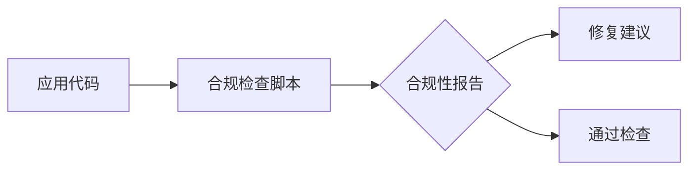
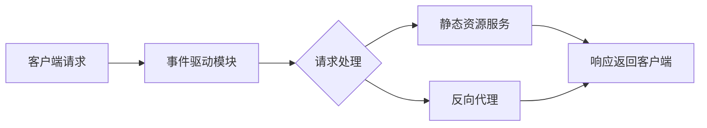

## 今日热点

AI代理技能框架和知识基础设施成为主流趋势，Claude-BugHunter等安全工具和minimind等大模型训练工具受到广泛关注。

---

## 热门项目一览

| 排名 | 项目 | 语言 | 今日 | 总计 | 简介 |
|:---:|------|:----:|------:|-----:|------|
| 1 | [elementalsouls/Claude-BugHunter](https://github.com/elementalsouls/Claude-BugHunter) | Python | +1,716 | 18,175 | A Claude Code skill bundle ... |
| 2 | [firecrawl/firecrawl](https://github.com/firecrawl/firecrawl) | TypeScript | +915 | 207,178 | Knowledge infrastructure to... |
| 3 | [obra/superpowers](https://github.com/obra/superpowers) | Shell | +788 | 324,300 | An agentic skills framework... |
| 4 | [XiaoYouChR/Ghost-Downloader-3](https://github.com/XiaoYouChR/Ghost-Downloader-3) | Python | +701 | 15,421 | The only downloader you nee... |
| 5 | [HKUDS/CLI-Anything](https://github.com/HKUDS/CLI-Anything) | Python | +699 | 62,919 | "CLI-Anything: Making ALL S... |
| 6 | [mvanhorn/last30days-skill](https://github.com/mvanhorn/last30days-skill) | Python | +668 | 72,885 | AI agent skill that researc... |
| 7 | [zhouxiaoka/autoclip](https://github.com/zhouxiaoka/autoclip) | Python | +641 | 13,674 | AutoClip｜一个链接，一键出片。开源 AI 视频... |
| 8 | [mjmirza/app-store-compliance](https://github.com/mjmirza/app-store-compliance) | Shell | +621 | 4,136 | Avoid common App Store and ... |
| 9 | [toeverything/AFFiNE](https://github.com/toeverything/AFFiNE) | TypeScript | +542 | 76,928 | There can be more than Noti... |
| 10 | [cathrynlavery/diagram-design](https://github.com/cathrynlavery/diagram-design) | HTML | +518 | 70,434 | Editorial diagram design fo... |
| 11 | [google-labs-code/stitch-skills](https://github.com/google-labs-code/stitch-skills) | TypeScript | +494 | 11,990 | A library of Agent Skills d... |
| 12 | [jingyaogong/minimind](https://github.com/jingyaogong/minimind) | Python | +473 | 68,873 | 🧠 两小时从 0 训出你的 64M 大模型。Train... |

---

## 趋势洞察

```
┌─────────────────────────────────────────────────────────────────┐
│  AI/ML 工具         ████████████████████████  13 个项目        │
│  其他               █████                     3 个项目        │
└─────────────────────────────────────────────────────────────────┘
```

---

## 项目深度解读

### 1. elementalsouls/Claude-BugHunter — 安全红队工具集

> **一句话总结**：Claude AI专业漏洞挖掘与红队测试技能包，提供系统化安全测试框架。

#### 价值主张

| 维度 | 说明 |
|------|------|
| **解决痛点** | 解决安全测试缺乏高效工具集和系统化方法的问题 |
| **目标用户** | 网络安全研究员、渗透测试人员、红队成员 |
| **核心亮点** | 82个专业安全技能 + 681种漏洞披露模式 + 15个快捷命令 + 24个核心漏洞覆盖 + 企业级攻击矩阵 |

#### 技术架构


**技术特色**：
- 针对Claude优化的安全提示词集合
- 系统化的漏洞分类和检测方法
- 企业级安全测试框架与攻击矩阵

#### 热度分析
- 项目近期增长迅猛，表明安全领域对AI辅助工具有强烈需求
- 作为Claude生态中的专业安全工具，填补了AI辅助安全测试的市场空白

#### 快速上手

```bash
# 如果是通过命令行使用Claude
claude --import-skill elemental-souls/bug-hunter

# 或者通过Claude Web界面导入技能包
```

#### 注意事项
- 需确保在合法授权的环境中使用，避免非法入侵
- 使用前应熟悉相关安全测试法律法规
- 建议配合其他安全工具使用以获得最佳效果
- 定期更新以获取最新的漏洞检测模式


### 2. firecrawl/firecrawl — 智能知识基建

> **一句话总结**：统一API接入550+数据源，为AI智能代理提供结构化知识基础设施。

#### 价值主张

| 维度 | 说明 |
|------|------|
| **解决痛点** | 碎片化数据获取难题，为AI提供统一的知识接入通道 |
| **目标用户** | AI开发者、智能代理构建者、多源数据整合需求企业 |
| **核心亮点** | 多源数据统一接入 + 智能结构化处理 + AI优化API + 高扩展架构 |

#### 技术架构


**技术特色**：
- 分布式数据采集与处理架构
- 智能内容提取与格式转换
- 可扩展的数据源连接器设计

#### 热度分析

- 项目Star数突破20万，日增900+，处于高速增长期
- Fork/Star比例低，表明项目更多作为依赖使用而非二次开发

#### 快速上手

```bash
# 安装 Firecrawl CLI
npm install -g firecrawl

# 使用 Firecrawl 抓取网页
firecrawl https://example.com --output output.json
```

#### 注意事项
- 需遵守各数据源的使用条款和限制
- API调用需要认证密钥，可能有使用频率限制
- 部分网站可能有反爬虫机制，需合理使用


### 3. obra/superpowers — 开发效能方法论

> **一句话总结**：提供智能体技能框架和有效软件开发方法论，显著提升开发效率与能力。

#### 价值主张

| 维度 | 说明 |
|------|------|
| **解决痛点** | 解决软件开发效率低下、方法不系统、技能提升困难的问题 |
| **目标用户** | 寻求提升开发效率与系统化方法的全栈开发者 |
| **核心亮点** | 智能代理技术 + 开发流程自动化 + 技能体系化 + 实践方法论 |

#### 技术架构


**技术特色**：
- Shell脚本实现轻量级自动化工具集
- 模块化设计支持灵活扩展
- 无依赖基础环境，跨平台


### 4. XiaoYouChR/Ghost-Downloader-3 — 全能下载工具

> **一句话总结**：整合多平台资源下载功能，提供一站式高效下载解决方案，满足各类文件获取需求。

#### 价值主张

| 维度 | 说明 |
|------|------|
| **解决痛点** | 统一多种下载需求，避免使用多个专用下载工具的繁琐 |
| **目标用户** | 需要下载视频、音频、文档等多种网络资源的普通用户 |
| **核心亮点** | 多平台支持 + 高速下载 + 批量处理 + 界面简洁 + 智能识别 |

#### 技术架构


**技术特色**：
- 基于Python异步IO实现高并发下载，提升资源获取效率
- 模块化设计支持多种视频网站和云存储平台解析
- 智能识别不同网站的反爬机制，自动调整下载参数

#### 热度分析

- 项目Star数突破15,421且持续高速增长，表明社区认可度高且需求旺盛
- Fork数928显示用户积极参与二次开发，形成活跃的扩展生态

#### 快速上手

```bash
# 克隆项目并安装依赖
git clone https://github.com/XiaoYouChR/Ghost-Downloader-3.git
pip install -r requirements.txt

# 基本使用
python ghost.py -u "https://example.com/video.mp4"
```

#### 注意事项

- 使用时需遵守目标网站的使用条款，避免违反服务协议
- 部分网站可能有反爬机制，建议合理设置下载间隔避免被封禁
- 项目License信息不明确，商用前需进一步确认授权条款


### 5. HKUDS/CLI-Anything — 命令行代理

> **一句话总结**：统一命令行接口，让所有软件具备原生代理能力，简化跨工具操作流程。

#### 价值主张

| 维度 | 说明 |
|------|------|
| **解决痛点** | 统一分散软件的命令行交互，消除多工具切换成本 |
| **目标用户** | 开发者、系统管理员、自动化工程师 |
| **核心亮点** | 统一接口 + 跨平台支持 + 智能解析 + 扩展性强 + 零配置集成 |

#### 技术架构


**技术特色**：
- 基于Python构建，轻量级且跨平台兼容
- 采用智能解析技术，理解自然语言命令意图
- 插件化架构，支持快速扩展新软件集成

#### 热度分析

- Star数超6万且日增近700，呈指数级增长趋势，表明市场认可度高
- Fork数近5700，社区活跃度极高，用户参与贡献意愿强烈

#### 快速上手

```bash
# 安装CLI-Anything
pip install cli-anything

# 基本使用示例
cli-anything "search latest Python papers on arXiv"
cli-anything "summarize my last week's commits"
```

#### 注意事项

- 项目许可证信息不明确，使用前需确认开源条款
- 部分小众软件可能需要手动配置适配器
- 复杂操作可能需要学习特定的命令语法规范


### 6. mvanhorn/last30days-skill — AI跨平台研究

> **一句话总结**：AI代理技能跨多平台研究主题并生成基于事实的摘要，解决信息过载问题。

#### 价值主张

| 维度 | 说明 |
|------|------|
| **解决痛点** | 信息碎片化严重，难以快速获取全面、准确的跨平台信息概览 |
| **目标用户** | 研究人员、投资者、内容创作者、信息分析师 |
| **核心亮点** | 多平台聚合 + AI智能总结 + 实时数据获取 + 事实核查 + 可定制化 |

#### 技术架构


**技术特色**：
- 跨平台API集成技术，支持Reddit, X, YouTube等多平台数据获取
- 大型语言模型驱动的内容理解与摘要生成能力
- 实时数据处理与增量更新机制，确保信息时效性

#### 热度分析

- 项目获得超7万星，单日新增668星，增长势头强劲，显示市场对跨平台AI研究工具的高度需求
- 项目未开放Issues，表明可能已进入稳定维护阶段，或通过其他渠道收集用户反馈

#### 快速上手

```bash
# 克隆项目
git clone https://github.com/mvanhorn/last30days-skill.git

# 安装依赖
pip install -r requirements.txt

# 运行示例
python last30days-skill.py "研究主题"
```

#### 注意事项

- 项目许可证信息未知，商业使用前需确认授权条款
- 多平台数据获取可能受各平台API限制，需遵守使用条款
- AI生成内容可能存在偏见或不准确，关键决策应结合人工验证


### 7. zhouxiaoka/autoclip — AI视频剪辑工具

> **一句话总结**：利用AI技术自动将长视频剪辑为短视频，生成字幕封面，适配多平台发布。

#### 价值主张

| 维度 | 说明 |
|------|------|
| **解决痛点** | 将长视频内容快速转化为适合社交媒体的短视频，节省手动剪辑时间 |
| **目标用户** | 内容创作者、播客主、视频博主、营销人员 |
| **核心亮点** | AI智能剪辑 + 自动字幕生成 + 多平台适配 + 封面设计 + 一键发布 |

#### 技术架构


**技术特色**：
- 基于深度学习的视频内容识别与智能剪辑
- 自动字幕生成与智能封面设计系统
- 多平台格式自动适配与发布支持

#### 热度分析

- 项目Star数13,674且单日增长641，处于快速增长期，备受关注
- Fork数2,150显示开发者社区积极参与，可能已有多个分支或衍生项目

#### 快速上手

```bash
# 克隆项目
git clone https://github.com/zhouxiaoka/autoclip.git
cd autoclip

# 安装依赖
pip install -r requirements.txt

# 运行程序
python autoclip.py --input 视频文件路径
```

#### 注意事项

- 确保系统满足硬件要求，AI处理可能需要较高性能配置
- 注意视频内容的版权问题，避免侵权风险
- 可能需要注册各平台API才能实现完整功能


### 8. mjmirza/app-store-compliance — 应用合规指南

> **一句话总结**：提供全面的App Store和Google Play合规指南，包含124种拒绝模式解决方案和关键法规截止日期跟踪。

#### 价值主张

| 维度 | 说明 |
|------|------|
| **解决痛点** | 解决应用上架被拒绝问题，提供明确修复方案 |
| **目标用户** | 移动应用开发者和发布者 |
| **核心亮点** | 124种拒绝模式解决方案 + 隐私清单检查 + 112个法规截止日期跟踪 + AI编码辅助 |

#### 技术架构



**技术特色**：
- Shell脚本实现，跨平台兼容性强
- 预定义124种拒绝模式，覆盖全面
- 集成AI编码辅助功能，提升效率

#### 热度分析

- 项目获得4,136个Star，单日增长621，表明市场需求旺盛，关注度极高
- 0个Open Issues，250个Fork，显示社区活跃且问题解决效率高

#### 快速上手

```bash
# 克隆项目
git clone https://github.com/mjmirza/app-store-compliance.git

# 运行合规检查
cd app-store-compliance
./check-compliance.sh
```

#### 注意事项

- 项目许可证未知，使用前需确认商业使用权限
- 需要定期更新以应对平台政策变化
- Shell脚本执行环境需要正确配置


### 9. toeverything/AFFiNE — 全能知识库

> **一句话总结**：开源全能知识库，整合规划、排序与创作，注重隐私与可定制性。

#### 价值主张

| 维度 | 说明 |
|------|------|
| **解决痛点** | 打破传统知识工具限制，提供一体化创作与规划体验 |
| **目标用户** | 知识工作者、创意团队、项目管理专业人士 |
| **核心亮点** | 隐私优先 + 开源可定制 + 跨平台支持 + 实时协作 |

#### 技术架构


**技术特色**：
- 基于TypeScript的全栈架构，确保类型安全与开发效率
- 模块化设计支持灵活扩展与功能定制
- 优化的实时同步机制，保障多端协作体验

#### 热度分析

- Star数超7.6万且持续增长，表明项目获得广泛认可与活跃社区支持
- 作为Notion和Miro的替代方案，在知识管理工具领域占据重要生态位置

#### 快速上手

```bash
# 克隆仓库
git clone https://github.com/toeverything/AFFiNE.git

# 安装依赖并运行
cd AFFiNE && npm install && npm run dev
```

#### 注意事项

- 项目尚未明确许可证，在使用前需确认具体开源协议
- 作为新兴项目，部分高级功能可能仍在开发中，稳定性有待观察


### 10. cathrynlavery/diagram-design — AI图表设计库

> **一句话总结**：为AI编程助手提供45种高质量自包含HTML+SVG图表，无需阴影和Mermaid。

#### 价值主张

| 维度 | 说明 |
|------|------|
| **解决痛点** | 为AI编程助手提供专业级图表设计，解决输出质量不一致问题 |
| **目标用户** | AI编程工具开发者、技术文档编写者、代码生成器 |
| **核心亮点** | 45种图表类型 + 自包含HTML+SVG实现 + 无阴影设计 + 专业级编辑质量 |

#### 技术架构


**技术特色**：
- 纯HTML+SVG实现，无需外部依赖
- 45种专业级图表类型，覆盖常见技术场景
- 无阴影设计，保持简洁清晰的视觉效果

#### 热度分析

- 项目Star数超过7万，近期增长迅速，日均新增500+星标，表明市场认可度高
- Fork数相对适中，说明项目更多作为库被使用而非二次开发，符合工具型项目特征

#### 快速上手

```bash
# 克隆项目
git clone https://github.com/cathrynlavery/diagram-design.git

# 在浏览器中打开index.html即可查看所有图表类型
```

#### 注意事项

- 项目未明确许可证，使用前需确认授权条款
- 仅支持静态图表，不支持动态交互或数据绑定
- 专为AI编程助手设计，可能需要适配才能用于其他场景


### 11. google-labs-code/stitch-skills — AI代理技能库

> **一句话总结**：提供遵循开放标准的AI代理技能库，使多种编码工具通过MCP服务器扩展功能。

#### 价值主张

| 维度 | 说明 |
|------|------|
| **解决痛点** | 解决AI编码代理功能扩展和标准化问题，统一技能接口 |
| **目标用户** | 使用AI编码辅助工具的开发者和AI代理开发者 |
| **核心亮点** | 遵循Agent Skills开放标准 + 兼容多种编码代理 + 提供丰富预构建技能 |

#### 技术架构


**技术特色**：
- 基于TypeScript开发，保证类型安全
- 模块化技能设计，便于维护和扩展
- 支持主流AI编码工具的无缝集成

#### 热度分析

- 项目获近12k星，单日增长近500星，表明受到广泛关注和积极采用
- 作为Google支持的项目，在AI编码辅助工具生态中占据重要位置

#### 快速上手

```bash
# 安装Stitch MCP服务器
npm install -g @stitch-mcp/server

# 初始化项目
npx @stitch-mcp/init

# 添加技能
npx @stitch-mcp/add <skill-name>
```

#### 注意事项

- 需要理解MCP协议和Agent Skills标准才能有效使用
- 项目依赖最新的Node.js版本
- 某些技能可能需要额外的API密钥或配置


### 12. jingyaogong/minimind — 轻量级LLM训练

> **一句话总结**：两小时内从零训练64M参数大模型，大幅降低AI模型训练门槛与时间成本。

#### 价值主张

| 维度 | 说明 |
|------|------|
| **解决痛点** | 大模型训练需大量资源与时间，普通人难以快速训练自己的LLM |
| **目标用户** | AI研究人员、开发者、教育工作者及大模型爱好者 |
| **核心亮点** | 高效训练算法 + 低资源需求 + 完整流程指导 + 开源可定制 + 易于上手 |

#### 技术架构


**技术特色**：
- 优化的分布式训练算法，显著缩短训练时间
- 精简的64M参数模型架构，平衡性能与资源需求
- 自动化的数据处理流程，降低技术门槛

#### 热度分析

- 项目获近7万星，单日新增473星，显示社区对轻量级LLM训练工具的强烈需求
- 近9千次fork表明开发者积极参与项目改进和二次开发

#### 快速上手

```bash
# 克隆项目
git clone https://github.com/jingyaogong/minimind.git
cd minimind

# 安装依赖并开始训练
pip install -r requirements.txt
python train.py --model_size 64M
```

#### 注意事项

- 项目需要一定的GPU资源才能实现2小时训练目标
- 用户需具备基础Python和深度学习知识
- 训练效果受数据质量和硬件配置影响较大


### 13. Tracer-Cloud/opensre — CI/CD可靠性代理

> **一句话总结**：开源的CI/CD管道可靠性监控与优化代理工具，提供全方位的DevOps可观测性。

#### 价值主张

| 维度 | 说明 |
|------|------|
| **解决痛点** | CI/CD流程中的可靠性问题难以追踪定位，故障影响范围广 |
| **目标用户** | DevOps工程师、CI/CD流程管理者、软件开发团队负责人 |
| **核心亮点** | 实时监控CI/CD流程 + 可靠性数据收集与分析 + 问题快速定位与预警 |

#### 技术架构


**技术特色**：
- 基于Python开发，轻量级部署，低资源占用
- 采用非侵入式代理设计，无缝集成现有CI/CD流程
- 支持多平台和工具链兼容性，包括Jenkins、GitLab CI等

#### 热度分析

- 项目Star数突破14,000，近期增长迅猛，表明CI/CD可靠性领域需求旺盛
- Fork数近2,000，社区活跃度高，Issues为0显示项目维护良好

#### 快速上手

```bash
# 安装OpenSRE代理
pip install opensre

# 配置代理连接到CI/CD系统
opensre config --system jenkins --url http://jenkins.example.com

# 启动代理监控
opensre start
```

#### 注意事项

- 许可证未知，使用前需确认开源许可类型
- 项目可能处于早期阶段，API和功能可能不稳定
- 需要评估与现有CI/CD工具的兼容性，可能需要额外配置


### 14. cursor/plugins — AI编辑器插件库

> **一句话总结**：Cursor编辑器的官方插件规范与插件集合，提供AI增强的编程体验。

#### 价值主张

| 维度 | 说明 |
|------|------|
| **解决痛点** | 解决AI编辑器功能扩展需求，满足个性化开发场景 |
| **目标用户** | 使用Cursor AI编辑器的开发者，需要增强编程效率的人群 |
| **核心亮点** | TypeScript规范实现 + AI深度集成 + 模块化架构 + 类型安全 + 官方支持 |

#### 技术架构


**技术特色**：
- TypeScript类型系统确保插件开发质量
- 模块化设计支持灵活扩展与维护
- 与AI能力深度集成的插件架构

#### 热度分析

- 高星增长显著(+294 today)，反映AI编程工具社区热度高涨
- 作为官方插件库，处于AI辅助编程工具生态核心位置

#### 快速上手

```bash
# 克隆插件库
git clone https://github.com/cursor/plugins.git
# 安装依赖
npm install
# 构建插件
npm run build
```

#### 注意事项

- 项目许可证未知，商业使用前需确认授权条款
- 需配合Cursor编辑器使用，无法独立运行
- 插件开发可能依赖Cursor的特定AI功能和API版本


### 15. nginx/nginx — 高性能Web服务器

> **一句话总结**：高性能、高并发的HTTP服务器与反向代理，轻量级设计，资源占用少。

#### 价值主张

| 维度 | 说明 |
|------|------|
| **解决痛点** | 高并发场景下Web服务器的性能瓶颈和资源占用问题 |
| **目标用户** | 需要处理高流量网站的系统管理员和开发团队 |
| **核心亮点** | 事件驱动架构 + 高并发处理能力 + 反向代理功能 + 负载均衡 + 模块化设计 |

#### 技术架构



**技术特色**：
- 基于异步事件驱动模型，避免线程阻塞
- 模块化设计，支持功能扩展
- 高效的内存管理，低资源消耗

#### 热度分析

- Star数持续稳定增长，日增163星，表明项目持续受到开发者关注
- 作为Web基础设施关键组件，在DevOps和云原生生态中占据核心地位

#### 快速上手

```bash
# 安装nginx
sudo apt-get install nginx  # Ubuntu/Debian
sudo systemctl start nginx
```

#### 注意事项

- 配置语法严格，错误会导致服务无法启动
- 处理静态文件效率高，但动态内容需要配合FastCGI或反向代理
- 安全配置需要特别注意，避免默认配置带来的风险


### 16. openvinotoolkit/openvino — AI推理优化工具包

> **一句话总结**：OpenVINO是英特尔开源的高性能AI推理优化工具包，支持多种硬件加速。

#### 价值主张

| 维度 | 说明 |
|------|------|
| **解决痛点** | 解决AI模型部署效率低、硬件兼容性差的问题 |
| **目标用户** | AI开发者、数据科学家、部署工程师 |
| **核心亮点** | 硬件加速优化 + 模型压缩 + 跨平台支持 |

#### 技术架构


**技术特色**：
- 提供模型优化器，支持多种深度学习框架
- 支持CPU、GPU、VPU等多种硬件加速
- 量化技术提高推理速度同时保持精度
- 提供丰富的API支持多种编程语言

#### 热度分析

- 项目持续获得高关注度，近一个月增长158个star，表明社区活跃度高
- 作为英特尔主导的AI推理优化项目，在工业界和学术界都有重要影响力

#### 快速上手

```bash
# 安装OpenVINO开发工具包
pip install openvino-dev

# 下载预训练模型
omz_downloader --name mobilenet-v2-pytorch

# 使用模型优化器转换模型
mo --input_model mobilenet-v2-pytorch/model.bin

# 运行推理
benchmark_app -m model.xml -d CPU
```

#### 注意事项

- OpenVINO主要针对推理优化，不提供训练功能
- 对于最新深度学习框架的支持可能存在延迟
- 硬件加速效果因硬件配置不同而有所差异


## 今日推荐

| 主题 | 推荐项目 | 亮点 |
|------|----------|------|
| 想入坑AI

---

<div align="center">

*Generated on 2026-11-23 | Powered by GitHub Trending Reporter*

</div>