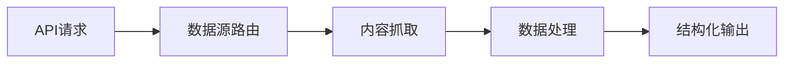
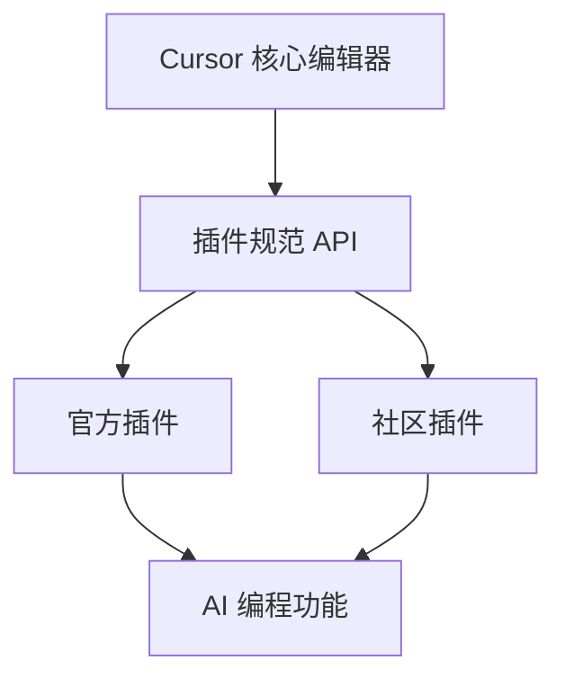
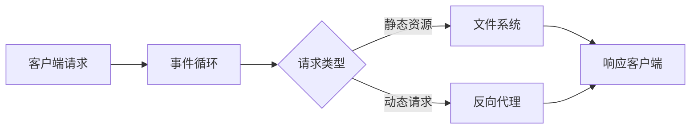

## 今日热点

今日GitHub热榜项目精彩纷呈。

---

## 热门项目一览

| 排名 | 项目 | 语言 | 今日 | 总计 | 简介 |
|:---:|------|:----:|------:|-----:|------|
| 1 | [elementalsouls/Claude-BugHunter](https://github.com/elementalsouls/Claude-BugHunter) | Python | +2,029 | 20,277 | A Claude Code skill bundle ... |
| 2 | [XiaoYouChR/Ghost-Downloader-3](https://github.com/XiaoYouChR/Ghost-Downloader-3) | Python | +1,087 | 16,700 | The only downloader you nee... |
| 3 | [firecrawl/firecrawl](https://github.com/firecrawl/firecrawl) | TypeScript | +924 | 208,213 | Knowledge infrastructure to... |
| 4 | [zhouxiaoka/autoclip](https://github.com/zhouxiaoka/autoclip) | Python | +907 | 14,791 | AutoClip｜一个链接，一键出片。开源 AI 视频... |
| 5 | [obra/superpowers](https://github.com/obra/superpowers) | Shell | +840 | 325,363 | An agentic skills framework... |
| 6 | [jingyaogong/minimind](https://github.com/jingyaogong/minimind) | Python | +828 | 69,743 | 🧠 两小时从 0 训出你的 64M 大模型。Train... |
| 7 | [mvanhorn/last30days-skill](https://github.com/mvanhorn/last30days-skill) | Python | +797 | 73,672 | AI agent skill that researc... |
| 8 | [HKUDS/CLI-Anything](https://github.com/HKUDS/CLI-Anything) | Python | +790 | 64,036 | "CLI-Anything: Making ALL S... |
| 9 | [mjmirza/app-store-compliance](https://github.com/mjmirza/app-store-compliance) | Shell | +761 | 5,235 | Avoid common App Store and ... |
| 10 | [cathrynlavery/diagram-design](https://github.com/cathrynlavery/diagram-design) | HTML | +620 | 71,232 | Editorial diagram design fo... |
| 11 | [toeverything/AFFiNE](https://github.com/toeverything/AFFiNE) | TypeScript | +595 | 77,567 | There can be more than Noti... |
| 12 | [Tracer-Cloud/opensre](https://github.com/Tracer-Cloud/opensre) | Python | +436 | 14,938 | The open-source agent for C... |

---

## 趋势洞察

```
┌─────────────────────────────────────────────────────────────────┐
│  AI/ML 工具         ████████████████████████  13 个项目        │
│  其他               █████                     3 个项目        │
└─────────────────────────────────────────────────────────────────┘
```

---

## 项目深度解读

### 1. elementalsouls/Claude-BugHunter — AI安全测试工具

> **一句话总结**：Claude AI的专业漏洞挖掘与红队工作技能包，提供全面的漏洞检测和攻击矩阵。

#### 价值主张

| 维度 | 说明 |
|------|------|
| **解决痛点** | 提供结构化的漏洞挖掘方法，提高安全测试效率 |
| **目标用户** | 安全研究员、渗透测试人员、红队成员 |
| **核心亮点** | 84个专业技能 + 681个报告模式 + 24类漏洞覆盖 |

#### 技术架构


**技术特色**：
- 基于Claude AI的技能扩展系统
- 涵盖24种核心漏洞类型的结构化检测
- 681种预定义的报告模板和模式
- 企业级身份与基础设施攻击矩阵
- 15个专用斜杠命令提升操作效率

#### 热度分析

- 项目Star数超2万，单日增长2000+，显示安全领域对AI辅助工具的高需求
- Fork数约2000，表明社区积极参与二次开发和定制化应用
- 0个Open Issues，可能表明项目维护良好或问题快速解决

#### 快速上手

```bash
# 安装Claude CLI
npm install -g claude-cli

# 配置BugHunter技能
claude skills install elementalsouls/Claude-BugHunter

# 使用示例
claude /pentest web --target example.com
```

#### 注意事项

- 需要Claude AI账号和权限才能使用
- 使用前应确保获得合法授权，避免进行未经授权的安全测试
- 报告生成可能需要根据具体场景进行调整
- 定期更新技能包以获取最新的漏洞检测模式
- 企业级使用可能需要额外的配置和认证


### 2. XiaoYouChR/Ghost-Downloader-3 — [全能下载工具]

> **一句话总结**：一个集成多种下载协议的Python工具，满足各种下载需求。

#### 价值主张

| 维度 | 说明 |
|------|------|
| **解决痛点** | 整合多种下载协议，解决用户需要安装多个下载工具的麻烦 |
| **目标用户** | 需要从多种来源下载文件的开发者和普通用户 |
| **核心亮点** | 多协议支持 + 命令行界面 + 高并发下载 + 断点续传 + 跨平台支持 |

#### 技术架构


**技术特色**：
- 基于Python异步IO实现高并发下载
- 支持HTTP/HTTPS/FTP/BT等多种协议
- 内置断点续传和下载管理功能

#### 热度分析

- 项目Star数近期激增，日均增长超过1000，表明社区认可度极高
- Fork数相对Star数较低，说明用户更多作为使用者而非贡献者

#### 快速上手

```bash
# 安装Ghost-Downloader
pip install ghost-downloader

# 使用下载命令
ghost-downloader https://example.com/file.zip
```

#### 注意事项

- 可能需要Python 3.6+环境
- 某些高级功能可能需要额外配置
- 大文件下载可能需要足够的磁盘空间


### 3. firecrawl/firecrawl — 智能知识基础设施

> **一句话总结**：通过统一API连接550+数据源，为AI代理提供搜索、抓取和知识基础设施支持。

#### 价值主张

| 维度 | 说明 |
|------|------|
| **解决痛点** | 简化多数据源访问，为AI代理提供统一知识获取接口 |
| **目标用户** | AI应用开发者、智能代理系统构建者、数据集成工程师 |
| **核心亮点** | 550+数据源统一接入 + 多格式内容智能抓取 + 知识结构化处理 + 高扩展API设计 |

#### 技术架构



**技术特色**：
- 统一多源数据接入接口，简化数据获取流程
- 智能内容解析与结构化处理技术
- 高可扩展的插件化架构设计

#### 热度分析

- 项目呈高速增长态势，单日新增近千星，表明市场认可度高
- 作为AI基础设施项目，在智能代理开发领域占据重要生态位置，吸引大量开发者关注

#### 快速上手

```bash
# 安装Firecrawl
npm install firecrawl

# 基本使用示例
const Firecrawl = require('firecrawl');
const firecrawl = new Firecrawl('your-api-key');
const result = await firecrawl.scrapeUrl('https://example.com');
console.log(result);
```

#### 注意事项

- 项目目前未明确开源许可证，商业使用前需确认授权情况
- 高频率调用API可能产生大量数据请求，需注意成本控制和使用限制


### 4. zhouxiaoka/autoclip — AI视频剪辑

> **一句话总结**：AI驱动的长视频转短视频工具，自动生成字幕、封面和发布文案。

#### 价值主张

| 维度 | 说明 |
|------|------|
| **解决痛点** | 长视频内容创作者手动剪辑耗时，难以适应多平台短视频需求 |
| **目标用户** | 播客创作者、教育工作者、内容营销人员、自媒体运营者 |
| **核心亮点** | AI智能剪辑+多平台适配+自动化内容生成+一键发布+开源免费 |

#### 技术架构


**技术特色**：
- 基于AI的智能内容分析与关键片段提取
- 自动生成多平台适配的字幕与封面
- 一键长视频转短视频的内容重构

#### 热度分析

- 项目近期热度激增，单日新增星标近千，表明AI视频剪辑领域需求旺盛
- 作为开源项目，在内容创作者社区具有较高影响力，生态潜力大

#### 快速上手

```bash
# 安装依赖
pip install -r requirements.txt

# 运行应用
python autoclip.py --input "path/to/video.mp4" --platform "tiktok"

# 查看帮助
python autoclip.py --help
```

#### 注意事项

- 项目需要一定的AI计算资源，本地运行可能需要GPU支持
- 需要注意各平台视频尺寸、时长等具体要求
- 开源项目但具体许可证信息不明确，使用前需确认授权条款
- AI生成的内容可能需要人工审核以确保质量和合规性


### 5. obra/superpowers — 智能开发框架

> **一句话总结**：基于代理的智能技能框架与实用软件开发方法论，提升团队协作效率。

#### 价值主张

| 维度 | 说明 |
|------|------|
| **解决痛点** | 传统软件开发方法效率低下，缺乏智能辅助与系统化框架 |
| **目标用户** | 软件开发团队、技术管理者、效率优化者 |
| **核心亮点** | 代理驱动自动化 + 智能技能框架 + 实用方法论 + 协作增强 |

#### 技术架构


**技术特色**：
- Shell脚本实现，轻量级跨平台支持
- 模块化代理架构，灵活扩展功能
- 智能技能匹配系统，优化资源配置

#### 热度分析

- 项目Star数超32万，日增840+，呈现高速增长态势
- Fork数近2.9万，社区活跃度高，应用场景广泛

#### 快速上手

```bash
# 克隆项目
git clone https://github.com/obra/superpowers.git
# 初始化框架
./superpowers init
# 启动开发代理
./superpowers agent start
```

#### 注意事项

- 项目License未知，商业使用前需确认授权条款
- 依赖Shell环境，Windows用户需配置WSL或其他兼容环境
- 建议先阅读文档理解方法论，再进行团队部署


### 6. jingyaogong/minimind — 轻量LLM训练

> **一句话总结**：两小时从零训练64M大模型，降低LLM技术门槛，让普通用户也能构建自己的语言模型。

#### 价值主张

| 维度 | 说明 |
|------|------|
| **解决痛点** | 大模型训练资源门槛高，普通用户难以自行训练模型 |
| **目标用户** | AI研究者、开发者、爱好者，希望低成本训练自己的LLM |
| **核心亮点** | 高效训练流程 + 低资源需求 + 快速部署 + 易于使用 + 完整文档 |

#### 技术架构


**技术特色**：
- 高效训练算法，大幅缩短训练时间
- 低资源需求，可在普通硬件上运行
- 简化的模型架构，适合初学者理解

#### 热度分析

- 项目Star数量高且增长迅速，表明LLM训练工具需求旺盛
- 社区活跃度高，Fork数量多，说明项目被广泛使用和改进

#### 快速上手

```bash
# 克隆项目
git clone https://github.com/jingyaogong/minimind.git
cd minimind

# 安装依赖并开始训练
pip install -r requirements.txt
python train.py --model_size 64M
```

#### 注意事项

- 项目需要一定的机器学习基础知识
- 训练效果可能受硬件条件限制
- 需要准备适当的训练数据集
- 可能需要根据具体需求调整超参数


### 7. mvanhorn/last30days-skill — 多平台AI研究

> **一句话总结**：AI代理技能跨多平台研究任何主题并生成基于事实的摘要

#### 价值主张

| 维度 | 说明 |
|------|------|
| **解决痛点** | 手动搜索整理多平台信息耗时，用户需要快速获取全面信息 |
| **目标用户** | 研究人员、内容创作者、市场分析师、话题关注者 |
| **核心亮点** | 多平台信息整合 + AI智能摘要 + 30天时间限定 + 实时数据收集 + 基于事实总结 |

#### 技术架构


**技术特色**：
- 多平台API集成技术
- 大型语言模型内容分析
- 智能信息过滤与整合算法

#### 热度分析

- 项目获73k+星标且持续增长(+797/天)，显示AI研究工具领域的高需求度
- 零开放问题，表明项目成熟度高，社区维护良好

#### 快速上手

```bash
# 假设安装方式
pip install last30days-skill
last30days-skill "研究主题"
```

#### 注意事项

- 项目许可证未知，可能存在使用限制
- 可能需要各平台API密钥才能正常使用
- 数据收集可能受各平台使用条款限制
- AI摘要可能存在偏见或不准确性


### 8. HKUDS/CLI-Anything — 全能CLI工具

> **一句话总结**：将各类软件统一为命令行接口，实现一键操作所有工具的代理原生能力。

#### 价值主张

| 维度 | 说明 |
|------|------|
| **解决痛点** | 软件工具分散操作繁琐，提供统一命令行入口简化交互 |
| **目标用户** | 开发者、系统管理员、技术用户 |
| **核心亮点** | 统一CLI接口 + 跨工具集成 + 插件扩展性 + 一键自动化 |

#### 技术架构


**技术特色**：
- 采用插件化架构，支持多工具无缝集成
- 实现工具代理层，将图形界面工具转化为CLI命令
- 统一参数处理和结果输出格式

#### 热度分析
- Star数超6万且日增近800，项目增长迅猛，技术社区认可度高
- 零Open Issues反映问题解决高效，用户参与度与满意度俱佳

#### 快速上手

```bash
# 安装CLI-Anything
pip install cli-anything

# 启动并使用
cli-anything --help
```

#### 注意事项
- 需要Python 3.7+环境
- 首次使用可能需要配置工具代理认证
- 部分工具可能需要额外安装依赖


### 9. mjmirza/app-store-compliance — 应用合规指南

> **一句话总结**：开发者必备的应用商店合规指南，提供124种拒绝模式解决方案和112项法规截止日期跟踪。

#### 价值主张

| 维度 | 说明 |
|------|------|
| **解决痛点** | 应用被App Store和Google Play拒绝，开发者难以理解复杂的合规要求 |
| **目标用户** | 移动应用开发者、产品经理、应用发布负责人 |
| **核心亮点** | 124种拒绝模式及修复方案 + 隐私清单和数据安全检查 + 112项法规截止日期跟踪 + AI编程助手技能 |

#### 技术架构


**技术特色**：
- 基于Shell脚本实现的自动化合规检查工具
- 提供详细的拒绝模式数据库和解决方案
- 集成AI编程助手技能辅助修复

#### 热度分析

- 项目获得5,235个Star，单日增长761，表明开发者对应用合规性需求强烈
- Fork数331，说明项目被广泛采用和二次开发，社区活跃度高

#### 快速上手

```bash
# 克隆项目
git clone https://github.com/mjmirza/app-store-compliance.git

# 进入项目目录
cd app-store-compliance

# 运行合规检查脚本
./check-compliance.sh
```

#### 注意事项

- 项目许可证未知，使用前需确认授权条款
- Shell脚本可能需要根据具体开发环境进行调整
- 合规要求会不断更新，需定期检查项目是否同步了最新要求


### 10. cathrynlavery/diagram-design — 专业图表设计

> **一句话总结**：为AI编程工具提供高质量无阴影图表设计，52种类型，纯HTML+SVG实现，避免Mermaid渲染问题。

#### 价值主张

| 维度 | 说明 |
|------|------|
| **解决痛点** | 解决AI编程工具中图表设计不专业、依赖Mermaid导致效果差的问题 |
| **目标用户** | AI编程工具开发者、技术文档编写者、UI设计师 |
| **核心亮点** | 52种专业图表类型 + 完全自包含HTML+SVG实现 + 无阴影设计 + 避免Mermaid渲染问题 |

#### 技术架构


**技术特色**：
- 纯HTML+SVG实现，无需外部依赖
- 52种专业图表类型，覆盖主流技术文档需求
- 精心设计避免阴影效果，保持图表清晰度

#### 热度分析

- 项目获得7万+星标，单日新增620星，显示出极高的社区认可度和活跃增长
- 零开放Issues表明项目维护良好，用户反馈得到及时处理

#### 快速上手

```bash
# 克隆项目到本地
git clone https://github.com/cathrynlavery/diagram-design.git

# 在浏览器中打开index.html查看所有图表类型
open diagram-design/index.html
```

#### 注意事项

- 项目未明确许可证，使用前需确认授权条款
- 虽然项目名称包含"design"，但主要是提供已设计好的图表模板，而非设计工具本身
- 图表风格偏向简洁专业，不适合需要复杂视觉效果的场景


### 11. toeverything/AFFiNE — 全功能知识工作台

> **一句话总结**：隐私优先的下一代知识库工具，整合规划、整理与创作功能。

#### 价值主张

| 维度 | 说明 |
|------|------|
| **解决痛点** | 打破知识工具功能分散、隐私不透明的局限 |
| **目标用户** | 知识工作者、注重隐私的团队和个人用户 |
| **核心亮点** | 隐私优先 + 开源可定制 + 跨平台支持 + 知识工作流整合 |

#### 技术架构


**技术特色**：
- 基于 TypeScript 开发，保证代码质量和类型安全
- 采用本地优先的存储策略，保障用户数据隐私
- 模块化架构设计，支持功能扩展和深度定制

#### 热度分析

- Star 数达 77,567 且单日增长近 600，显示项目获得社区高度认可和快速增长
- 作为 Notion/Miro 替代方案，在开源知识管理领域占据重要生态位置

#### 快速上手

```bash
# 克隆仓库
git clone https://github.com/toeverything/AFFiNE.git

# 安装依赖
npm install

# 启动开发服务器
npm run dev
```

#### 注意事项

- 项目处于活跃开发阶段，API 和功能可能存在较大变化
- 本地部署需要一定的技术能力，建议先使用官方提供的云服务体验
- 文档对新手不够友好，建议通过社区获取更多使用指导


### 12. Tracer-Cloud/opensre — CI/CD可靠性代理

> **一句话总结**：开源CI/CD代理工具，通过智能监控和故障检测提升软件交付可靠性。

#### 价值主张

| 维度 | 说明 |
|------|------|
| **解决痛点** | CI/CD流程中的可靠性问题，如构建失败、部署错误等难以快速定位和解决 |
| **目标用户** | DevOps工程师、SRE团队、CI/CD平台使用者 |
| **核心亮点** | 实时监控 + 智能故障检测 + 可靠性度量 + 开源可定制 |

#### 技术架构


**技术特色**：
- 轻量级Python代理，易于集成
- 实时监控CI/CD流程各环节性能指标
- 智能分析构建和部署失败的根本原因

#### 热度分析

- 近期Star增长迅速(+436)，表明项目受关注度高，处于上升期
- 作为CI/CD可靠性工具，填补了DevOps生态中可靠性监控的空白

#### 快速上手

```bash
# 克隆项目
git clone https://github.com/Tracer-Cloud/opensre.git
cd opensre
# 安装依赖
pip install -r requirements.txt
```

#### 注意事项

- 项目许可证信息不明确，使用前需确认授权条款
- 作为可靠性代理，可能需要配置适当的访问权限以监控CI/CD流程


### 13. google-labs-code/stitch-skills — AI技能库

> **一句话总结**：为AI编程助手提供标准化技能扩展库，支持多平台兼容的模块化功能增强。

#### 价值主张

| 维度 | 说明 |
|------|------|
| **解决痛点** | 解决AI编程助手功能扩展和标准化问题 |
| **目标用户** | 使用AI编程助手的开发者和研究人员 |
| **核心亮点** | 开放标准兼容性 + 多平台支持 + 技能模块化设计 |

#### 技术架构


**技术特色**：
- 基于TypeScript开发，确保类型安全和跨平台兼容
- 遵循Agent Skills开放标准，实现统一接口
- 模块化设计，支持灵活组合和扩展

#### 热度分析

- 高达12k+的Star数及持续增长，表明项目在AI编程助手领域备受关注
- 作为Google Labs项目，在AI工具生态系统中占据重要位置，推动行业标准发展

#### 快速上手

```bash
# 克隆项目
git clone https://github.com/google-labs-code/stitch-skills.git
# 安装依赖
npm install
# 启动Stitch MCP服务器
npm run start
```

#### 注意事项

- 需要了解MCP (Model Context Protocol) 服务器的基本概念
- 使用前需确保兼容的AI编程助手工具（如Antigravity、Gemini CLI等）
- 技能库可能需要与特定版本的AI工具配合使用


### 14. cursor/plugins — AI代码编辑器插件

> **一句话总结**：Cursor 编辑器的官方插件规范与实现，提供 AI 辅助编程的扩展能力。

#### 价值主张

| 维度 | 说明 |
|------|------|
| **解决痛点** | 解决 AI 代码编辑器扩展性问题，使开发者能自定义 AI 编程辅助功能 |
| **目标用户** | AI 辅助编程的开发者，需要扩展编辑器功能的用户 |
| **核心亮点** | + TypeScript 规范实现 + AI 编程能力扩展 + 官方插件支持 |

#### 技术架构



**技术特色**：
- 基于 TypeScript 的插件类型安全
- 提供完整的 AI 编程能力接口
- 支持社区扩展和官方插件并存

#### 热度分析

- 项目获得 18,922 个 Star，近期增长迅速（单日新增 397），显示社区高度关注
- 作为 Cursor 编辑器的核心组件，处于 AI 辅助编程生态的关键位置

#### 快速上手

```bash
# 安装 Cursor 编辑器
# https://cursor.sh

# 克隆官方插件仓库
git clone https://github.com/cursor/plugins.git

# 开发自定义插件
npm install
npm run dev
```

#### 注意事项

- 需要配合 Cursor 编辑器使用，单独使用插件可能无意义
- 项目可能处于早期阶段，API 可能会有变化
- 插件开发需要了解 Cursor 的特定 AI 编程接口


### 15. openvinotoolkit/openvino — AI推理加速

> **一句话总结**：OpenVINO是英特尔开源的AI推理优化工具包，加速深度学习模型在多种硬件上的部署。

#### 价值主张

| 维度 | 说明 |
|------|------|
| **解决痛点** | 解决AI模型部署效率低、跨平台兼容性差的问题 |
| **目标用户** | AI开发者、数据科学家、嵌入式系统工程师 |
| **核心亮点** | 硬件加速优化 + 跨平台支持 + 模型优化 + 推理性能提升 + 开源免费 |

#### 技术架构


**技术特色**：
- 支持多种深度学习框架模型转换
- 专为英特尔硬件优化，支持CPU、GPU、VPU等
- 提供模型量化和压缩技术，减少模型大小
- 异构计算调度，最大化硬件利用率
- 提供丰富的API和工具链，简化开发流程

#### 热度分析
- 项目Star数超过1.2万，近30天增长184，显示持续增长的开发者关注度
- 作为英特尔主导的开源AI工具，在边缘计算和工业AI部署领域具有重要生态地位

#### 快速上手

```bash
# 安装OpenVINO开发包
pip install openvino-dev

# 下载预训练模型
omz_downloader --name mobilenet-v2-pytorch

# 转换模型为OpenVINO格式
omz_converter --name mobilenet-v2-pytorch

# 运行推理
benchmark_app -m mobilenet-v2-pytorch/FP32/mobilenet-v2-pytorch.xml -d CPU
```

#### 注意事项
- 需要了解基本的深度学习概念和模型转换原理
- 在非英特尔硬件上使用时，性能优化效果可能受限
- 模型转换过程中可能需要调整超参数以获得最佳性能
- 不同硬件平台需要特定的运行时配置


### 16. nginx/nginx — 高性能Web服务器

> **一句话总结**：轻量级、高性能的HTTP服务器和反向代理，支持高并发连接，资源占用低。

#### 价值主张

| 维度 | 说明 |
|------|------|
| **解决痛点** | 解决高并发场景下的服务器性能瓶颈，提供高效稳定的Web服务 |
| **目标用户** | 需要高性能Web服务的中大型企业、网站运维人员、开发者 |
| **核心亮点** | 事件驱动架构 + 高并发处理 + 低资源消耗 + 模块化设计 |

#### 技术架构



**技术特色**：
- 基于异步非阻塞的事件驱动模型，实现高并发处理
- 模块化设计，支持丰富的功能扩展和自定义配置
- 采用master-worker进程模式，确保稳定性和性能

#### 热度分析

- 项目持续获得高关注度，日均增长约170个star，表明其在Web服务器领域的领导地位稳固
- 拥有庞大的用户社区和活跃的贡献者，是全球最流行的Web服务器之一，与Apache形成双雄格局

#### 快速上手

```bash
# 安装nginx
sudo apt-get install nginx  # Ubuntu/Debian
sudo yum install nginx      # CentOS/RHEL

# 启动nginx服务
sudo systemctl start nginx
sudo systemctl enable nginx

# 检查nginx状态
sudo systemctl status nginx
```

#### 注意事项
- 配置文件语法较为严格，一个小错误可能导致整个服务无法启动
- 在处理动态内容时需要配合后端服务器使用，本身不处理动态请求
- 需要合理配置worker_processes和worker_connections参数以优化性能


## 今日推荐

| 主题 | 推荐项目 | 亮点 |
|------|----------|------|
| 今日最热 | [elementalsouls/Claude-BugHunter](https://github.com/elementalsouls/Claude-BugHunter) | A Claude Code ski... |
| 值得关注 | [XiaoYouChR/Ghost-Downloader-3](https://github.com/XiaoYouChR/Ghost-Downloader-3) | The only download... |
| 快速上手 | [firecrawl/firecrawl](https://github.com/firecrawl/firecrawl) | Knowledge infrast... |
| 长期潜力 | [zhouxiaoka/autoclip](https://github.com/zhouxiaoka/autoclip) | AutoClip｜一个链接，一键出... |

---

<div align="center">

*Generated on 2026-11-24 | Powered by GitHub Trending Reporter*

</div>