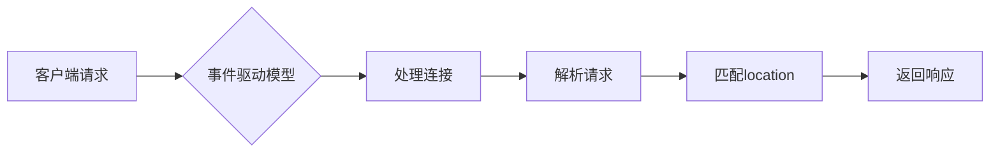

## 今日热点

今日GitHub热榜项目精彩纷呈。

---

## 热门项目一览

| 排名 | 项目 | 语言 | 今日 | 总计 | 简介 |
|:---:|------|:----:|------:|-----:|------|
| 1 | [elementalsouls/Claude-BugHunter](https://github.com/elementalsouls/Claude-BugHunter) | Python | +1,652 | 23,329 | A Claude Code skill bundle ... |
| 2 | [cathrynlavery/diagram-design](https://github.com/cathrynlavery/diagram-design) | HTML | +1,141 | 73,262 | Editorial diagram design fo... |
| 3 | [firecrawl/firecrawl](https://github.com/firecrawl/firecrawl) | TypeScript | +1,135 | 210,273 | Knowledge infrastructure to... |
| 4 | [HKUDS/CLI-Anything](https://github.com/HKUDS/CLI-Anything) | Python | +1,106 | 65,848 | "CLI-Anything: Making ALL S... |
| 5 | [XiaoYouChR/Ghost-Downloader-3](https://github.com/XiaoYouChR/Ghost-Downloader-3) | Python | +951 | 18,480 | The only downloader you nee... |
| 6 | [mvanhorn/last30days-skill](https://github.com/mvanhorn/last30days-skill) | Python | +945 | 75,272 | AI agent skill that researc... |
| 7 | [obra/superpowers](https://github.com/obra/superpowers) | Shell | +903 | 326,803 | An agentic skills framework... |
| 8 | [zhouxiaoka/autoclip](https://github.com/zhouxiaoka/autoclip) | Python | +880 | 16,391 | AutoClip｜一个链接，一键出片。开源 AI 视频... |
| 9 | [mjmirza/app-store-compliance](https://github.com/mjmirza/app-store-compliance) | Shell | +858 | 6,616 | Avoid common App Store and ... |
| 10 | [jingyaogong/minimind](https://github.com/jingyaogong/minimind) | Python | +826 | 71,181 | 🧠 两小时从 0 训出你的 64M 大模型。Train... |
| 11 | [toeverything/AFFiNE](https://github.com/toeverything/AFFiNE) | TypeScript | +574 | 78,617 | There can be more than Noti... |
| 12 | [cursor/plugins](https://github.com/cursor/plugins) | TypeScript | +416 | 19,597 | Cursor plugin specification... |

---

## 趋势洞察

```
┌─────────────────────────────────────────────────────────────────┐
│  AI/ML 工具         ████████████████████████  13 个项目        │
│  其他               █████                     3 个项目        │
└─────────────────────────────────────────────────────────────────┘
```

---

## 项目深度解读

### 1. elementalsouls/Claude-BugHunter — AI安全测试

> **一句话总结**：Claude AI漏洞挖掘工具集，提供85个专业技能与681种报告模板，大幅提升红队工作效率。

#### 价值主张

| 维度 | 说明 |
|------|------|
| **解决痛点** | 安全测试缺乏AI辅助，漏洞报告标准化程度低 |
| **目标用户** | 网络安全研究员、渗透测试人员、漏洞赏金猎人 |
| **核心亮点** | 85个专业安全技能 + 681种漏洞报告模板 + 企业级攻击矩阵 |

#### 技术架构


**技术特色**：
- 将Claude AI能力专业化应用于安全测试领域
- 提供结构化的漏洞分类与报告模板
- 覆盖24类核心漏洞与企业级攻击面

#### 热度分析
- 项目获得23,329个Star且单日增长1,652，显示安全社区对AI辅助工具的高度关注
- 0个Open Issues与2,390个Fork表明项目维护良好且社区积极贡献

#### 快速上手

```bash
# 克隆项目
git clone https://github.com/elementalsouls/Claude-BugHunter.git
cd Claude-BugHunter
# 安装依赖
pip install -r requirements.txt
```

#### 注意事项
- 需要Claude API访问权限才能使用全部功能
- 仅应用于合法的安全测试与授权评估
- 建议具备基础安全知识以充分利用工具功能
- 使用前应熟悉相关法律法规与道德准则


### 2. cathrynlavery/diagram-design — AI编程图表设计

> **一句话总结**：纯HTML/SVG实现的52种专业图表设计，专为AI编程助手打造，无需依赖外部库。

#### 价值主张

| 维度 | 说明 |
|------|------|
| **解决痛点** | 解决AI编程助手缺乏高质量、无依赖图表设计的问题 |
| **目标用户** | AI编程工具使用者(Claude, Copilot等)和前端开发者 |
| **核心亮点** | 52种图表全覆盖 + 纯HTML/SVG实现 + 编辑级设计质量 |

#### 技术架构


**技术特色**：
- 自包含HTML+SVG实现，零外部依赖
- 编辑级专业图表设计，超越传统工具质量
- 针对AI编程场景优化的可视化解决方案

#### 热度分析

- 项目获73k+星，单日增长1.1k+，反映开发者对高质量图表工具的迫切需求
- 零开放问题表明项目成熟度高，维护稳定

#### 快速上手

```html
<!-- 引入样式 -->
<link rel="stylesheet" href="https://unpkg.com/@cathrynlavery/diagram-design@latest/dist/index.css">
<!-- 使用图表 -->
<div class="diagram-container" data-type="flowchart"></div>
```

#### 注意事项

- 项目许可证未知，商业使用前需确认授权条款
- 需要HTML/CSS基础知识才能有效集成和自定义
- 动态交互可能需要额外的JavaScript代码实现


### 3. firecrawl/firecrawl — 智能知识基础设施

> **一句话总结**：通过单一API统一访问550+数据源，为AI代理提供全面知识基础设施支持。

#### 价值主张

| 维度 | 说明 |
|------|------|
| **解决痛点** | 解决AI应用获取多源数据难、接口不统一的痛点 |
| **目标用户** | AI开发者、智能代理构建者、数据密集型应用开发者 |
| **核心亮点** | 统一API接口 + 550+数据源 + 智能数据抓取 + 知识增强 + 代理优化 |

#### 技术架构


**技术特色**：
- 统一API接口抽象多源数据访问复杂性
- 智能数据抓取与处理引擎
- 结构化知识输出与增强机制

#### 热度分析

- 项目热度极高，Stars超过21万且持续快速增长，日均增长超过1000
- 作为AI基础设施项目，处于开发者生态核心位置，社区活跃度高

#### 快速上手

```bash
# 安装Firecrawl CLI
npm install -g firecrawl

# 使用Firecrawl抓取网页
firecrawl scrape https://example.com

# 或者使用API调用
curl -X POST -H "Content-Type: application/json" -H "Authorization: Bearer YOUR_API_KEY" -d '{"url": "https://example.com"}' https://api.firecrawl.dev/v1/scrape
```

#### 注意事项

- 需要遵守各数据源的使用条款和robots.txt规定
- 免费版可能有调用次数限制，商业使用需考虑订阅费用
- 对于实时性要求极高的场景，可能需要考虑数据缓存策略


### 4. HKUDS/CLI-Anything — 命令行智能代理

> **一句话总结**：将任意软件转化为智能命令行工具，实现软件的Agent-Native原生能力。

#### 价值主张

| 维度 | 说明 |
|------|------|
| **解决痛点** | 解决非CLI软件缺乏自动化和智能化交互的问题 |
| **目标用户** | 开发者、系统管理员、自动化工具使用者 |
| **核心亮点** | 智能代理集成 + 跨平台支持 + 无缝软件适配 + 命令行增强 + 自动化能力 |

#### 技术架构


**技术特色**：
- 基于Python的轻量级命令行代理框架
- 支持多种软件的智能适配和自动化
- 采用模块化设计，易于扩展和维护

#### 热度分析

- 项目Star数超65k，单日增长超1k，呈现爆发式增长趋势
- Fork数近6k，社区活跃度高，表明开发者认可度和参与度极高

#### 快速上手

```bash
# 安装CLI-Anything
pip install cli-anything

# 初始化配置
cli-anything init

# 使用智能代理功能
cli-anything "帮我分析这个日志文件"
```

#### 注意事项

- 项目当前未明确开源协议，商业使用前需确认授权方式
- 部分高级功能可能需要额外配置或依赖特定软件环境
- Agent-Native概念较新，初次使用可能需要一定学习曲线


### 5. XiaoYouChR/Ghost-Downloader-3 — 全能下载工具

> **一句话总结**：集成多种下载功能的Python工具，一站式解决各类下载需求。

#### 价值主张

| 维度 | 说明 |
|------|------|
| **解决痛点** | 整合多种下载功能，避免用户安装多个专用下载工具 |
| **目标用户** | 需要下载多种格式资源的普通用户和开发者 |
| **核心亮点** | 多协议支持 + 命令行界面 + 批量下载 + 进度显示 + 错误恢复 |

#### 技术架构


**技术特色**：
- 支持HTTP/FTP/BT等多种协议
- 实现了断点续传功能
- 多线程加速下载速度

#### 热度分析

- 项目星标数持续增长，近期增长迅速，表明社区认可度高
- 作为下载工具类项目，在资源获取需求旺盛的领域具有一定生态位置

#### 快速上手

```bash
# 安装依赖
pip install -r requirements.txt

# 基本下载命令
python ghost_downloader.py [URL]
```

#### 注意事项

- 使用前需确认目标资源的合法性和版权信息
- 某些网站可能有反爬虫机制，需适当调整下载参数
- 长时间大量下载可能被目标网站限制IP


### 6. mvanhorn/last30days-skill — AI研究助手

> **一句话总结**：AI代理技能跨平台研究任何主题并生成基于事实的总结。

#### 价值主张

| 维度 | 说明 |
|------|------|
| **解决痛点** | 解决信息分散难以整合的问题，提供全面的研究总结 |
| **目标用户** | 研究人员、分析师、内容创作者和需要快速了解特定主题的人 |
| **核心亮点** | 多平台信息聚合 + AI智能总结 + 实时数据获取 + 基于事实的合成 |

#### 技术架构


**技术特色**：
- 多平台API集成技术，实现跨平台数据获取
- 大语言模型处理技术，确保信息准确性和相关性
- 信息验证与合成算法，确保总结基于事实

#### 热度分析

- 项目获得75k+星标且持续增长，表明其解决了广泛的研究需求
- 在AI代理技能领域具有显著影响力，成为开源研究工具的标杆

#### 快速上手

```bash
# 安装依赖
pip install -r requirements.txt

# 运行研究
python last30days-skill.py "研究主题"
```

#### 注意事项

- 项目许可证未知，使用时需注意潜在的法律风险
- 依赖外部平台API，可能面临访问限制或变更
- AI总结可能存在偏见或不准确性，需人工验证关键信息


### 7. obra/superpowers — 技能开发框架

> **一句话总结**：一套实用的代理技能框架与软件开发方法论，帮助开发者提升工作效率和能力。

#### 价值主张

| 维度 | 说明 |
|------|------|
| **解决痛点** | 软件开发过程中缺乏系统化技能提升路径和方法论 |
| **目标用户** | 软件开发人员、技术团队和个人学习者 |
| **核心亮点** | 实用框架 + 自动化工具 + 持续改进 + 技能评估 |

#### 技术架构


**技术特色**：
- 基于Shell的轻量级脚本实现
- 模块化的技能框架设计
- 实践导向的渐进式学习

#### 热度分析

- 超32万Star，近期持续增长(+903 today)，反映广泛认可
- 零Open Issues表明项目维护良好，用户问题已通过其他渠道解决

#### 快速上手

```bash
git clone https://github.com/obra/superpowers.git
cd superpowers
./init.sh
```

#### 注意事项

- License信息未知，使用时需注意版权问题
- 建议具备基础Shell知识以充分利用项目价值
- 可能需要根据个人需求调整框架参数


### 8. zhouxiaoka/autoclip — AI视频剪辑工具

> **一句话总结**：AI驱动的自动化视频剪辑工具，一键将长视频转换为多平台短视频。

#### 价值主张

| 维度 | 说明 |
|------|------|
| **解决痛点** | 解决手动剪辑长视频效率低下、多平台适配繁琐的问题 |
| **目标用户** | 内容创作者、播客主、教育工作者、社交媒体运营人员 |
| **核心亮点** | AI自动剪辑 + 智能字幕生成 + 多平台适配 + 自动封面生成 + 发布文案生成 |

#### 技术架构


**技术特色**：
- 基于深度学习的内容智能分析
- 自动识别关键片段和精彩时刻
- 多平台格式自适应转换

#### 热度分析

- 项目获16,391个Star，单日增长880，显示需求旺盛且增长迅速
- Fork数2,346，表明社区参与度高，二次开发意愿强

#### 快速上手

```bash
# 克隆项目
git clone https://github.com/zhouxiaoka/autoclip.git

# 安装依赖
pip install -r requirements.txt

# 运行程序
python autoclip.py
```

#### 注意事项

- 项目许可证未知，使用前需确认授权条款
- 作为AI工具，处理长视频可能需要较高计算资源
- 项目无公开Issue，可能通过其他渠道提供技术支持


### 9. mjmirza/app-store-compliance — 应用合规指南

> **一句话总结**：应用商店合规解决方案，包含124种拒绝模式修复及全球隐私法规追踪。

#### 价值主张

| 维度 | 说明 |
|------|------|
| **解决痛点** | 解决应用商店审核被拒问题，规避常见合规风险 |
| **目标用户** | 移动应用开发者和发布者，尤其是跨平台开发者 |
| **核心亮点** | 124种拒绝模式修复 + 全球隐私法规追踪 + AI编码辅助 + 预提交检查 |

#### 技术架构

**技术特色**：
- 基于Shell脚本实现跨平台检查工具
- 内置124种常见拒绝模式及其解决方案
- 集成AI编码助手功能，提高开发效率
- 定期更新全球隐私法规和截止日期

#### 热度分析

- 项目热度极高，近一日新增858个Star，显示开发者对合规工具的迫切需求
- 无开放Issue，表明项目维护良好，问题解决率高，社区参与度高

#### 快速上手

```bash
# 克隆项目
git clone https://github.com/mjmirza/app-store-compliance.git

# 进入目录
cd app-store-compliance

# 运行检查脚本
./check-compliance.sh
```

#### 注意事项

- 注意不同国家/地区的隐私法规可能有所不同，需根据目标市场进行调整
- 定期更新项目内容，确保获取最新的合规要求和截止日期
- 使用前建议先备份项目，避免对现有代码造成意外修改


### 10. jingyaogong/minimind — 快速LLM训练

> **一句话总结**：简化大模型训练流程，使普通用户能在两小时内完成64M参数模型训练。

#### 价值主张

| 维度 | 说明 |
|------|------|
| **解决痛点** | 降低大模型训练门槛，解决训练周期长、资源消耗大的问题 |
| **目标用户** | AI研究者、开发者、计算机爱好者、教育工作者 |
| **核心亮点** | 快速训练流程 + 低资源需求 + 简化实现步骤 + 即学即用 |

#### 技术架构


**技术特色**：
- 优化训练算法，大幅缩短训练时间
- 精简数据处理流程，减少资源消耗
- 模块化设计，便于理解和修改

#### 热度分析

- 项目Star数持续高速增长，日均增加826，表明社区活跃度高
- 高Fork数显示项目被广泛采用和二次开发，形成活跃社区生态

#### 快速上手

```bash
# 克隆项目
git clone https://github.com/jingyaogong/minimind.git
cd minimind

# 运行训练脚本
python train.py --model_size 64M
```

#### 注意事项

- 项目硬件要求较高，建议至少使用GPU加速训练
- 64M参数模型性能有限，适合学习和实验而非生产环境
- 需要一定的机器学习基础知识才能充分利用项目


### 11. toeverything/AFFiNE — 全能知识库

> **一句话总结**：AFFiNE是一款集规划、整理与创作于一体的下一代知识库工具，注重隐私保护与开源可定制。

#### 价值主张

| 维度 | 说明 |
|------|------|
| **解决痛点** | 打破传统知识工具界限，提供一体化创作与管理体验 |
| **目标用户** | 需要知识管理、协作与创意工作的专业人士和团队 |
| **核心亮点** | 隐私优先 + 开源可定制 + 跨平台支持 + 一体化体验 |

#### 技术架构


**技术特色**：
- 基于TypeScript构建，提供类型安全和高性能
- 采用模块化架构，支持插件扩展
- 跨平台支持，兼容多种操作系统和设备

#### 热度分析

- 项目Star数近8万，日增500+，增长迅速，表明市场认可度高
- Fork数与Star数比例适中，说明社区参与度良好，但活跃贡献者有待观察

#### 快速上手

```bash
# 克隆仓库
git clone https://github.com/toeverything/AFFiNE.git

# 安装依赖
npm install

# 启动开发服务器
npm run dev
```

#### 注意事项

- 项目License未知，商业使用前需确认授权条款
- 作为较新项目，生态系统和插件生态可能尚在发展中


### 12. cursor/plugins — AI编辑器插件生态

> **一句话总结**：Cursor编辑器的官方插件规范与实现，扩展AI辅助编程能力

#### 价值主张

| 维度 | 说明 |
|------|------|
| **解决痛点** | 为Cursor编辑器提供标准化插件机制，增强AI编程功能 |
| **目标用户** | Cursor编辑器用户和AI辅助编程开发者 |
| **核心亮点** | 标准化插件接口 + AI功能集成 + 官方支持 + 社区贡献 |

#### 技术架构


**技术特色**：
- 基于TypeScript的强类型插件接口定义
- 与AI功能深度集成的插件架构
- 标准化的插件生命周期管理

#### 热度分析

- Star数接近2万且每日新增400+，表明项目处于快速增长期
- 作为官方插件库，在AI编程编辑器领域具有重要生态地位

#### 快速上手

```bash
# 克隆仓库
git clone https://github.com/cursor/plugins.git

# 安装依赖
npm install

# 运行示例
npm run dev
```

#### 注意事项

- 需要Cursor编辑器环境才能运行和测试插件
- 插件开发需要遵循特定的API规范
- 部分功能可能需要AI服务权限


### 13. google-labs-code/stitch-skills — AI技能库

> **一句话总结**：开源Agent技能库，遵循开放标准，兼容多种AI编程助手，扩展AI代码能力。

#### 价值主张

| 维度 | 说明 |
|------|------|
| **解决痛点** | AI编程助手功能有限，通过标准化技能库扩展其能力范围 |
| **目标用户** | AI编程助手用户、开发者、需要增强AI编程能力的人群 |
| **核心亮点** | 遵循Agent Skills开放标准 + 兼容多种AI编程助手 + 丰富的技能库 |

#### 技术架构

**技术特色**：
- 基于TypeScript开发，提供类型安全保障
- 遵循Agent Skills开放标准，确保跨平台兼容性
- 与MCP服务器深度集成，实现无缝技能调用
- 模块化技能设计，便于扩展和维护
- Google Labs支持，保证技术前瞻性

#### 热度分析

- 项目获13k+星标，单日增长355，表明社区高度关注和快速采用
- 作为Google Labs项目，在AI编程助手生态中占据重要位置，推动行业标准

#### 快速上手

```bash
# 克隆项目
git clone https://github.com/google-labs-code/stitch-skills.git

# 安装依赖
npm install

# 运行示例
npm run example
```

#### 注意事项

- 项目需要与支持MCP协议的AI编程助手配合使用
- 需要一定的TypeScript和AI编程助手使用经验
- 许可证信息不明确，使用前需确认授权条款


### 14. Tracer-Cloud/opensre — CI/CD可靠性代理

> **一句话总结**：开源CI/CD代理，提供可靠性监控和问题追踪，提升DevOps流程稳定性。

#### 价值主张

| 维度 | 说明 |
|------|------|
| **解决痛点** | CI/CD流程中的可靠性问题，包括构建失败、部署异常和环境不一致 |
| **目标用户** | DevOps工程师、SRE团队和持续集成/持续部署流程负责人 |
| **核心亮点** | 全链路监控 + 实时问题检测 + 可靠性指标量化 + 多环境一致性保障 |

#### 技术架构


**技术特色**：
- 基于Python开发的轻量级代理
- 无侵入式集成主流CI/CD平台
- 提供API接口与监控系统对接

#### 热度分析

- 项目获得15,600个Star且近期增长迅速，表明社区对该工具高度关注和认可
- 作为CI/CD可靠性领域的开源项目，填补了DevOps工具链中的关键空白

#### 快速上手

```bash
# 安装opensre
pip install opensre

# 配置代理
opensre config --ci-platform=jenkins --target-service=my-service

# 启动监控
opensre start
```

#### 注意事项

- 需要确保CI/CD平台的API访问权限配置正确
- 建议先在测试环境验证监控效果后再在生产环境部署
- 根据团队规模和CI/CD复杂度可能需要调整监控参数


### 15. openvinotoolkit/openvino — AI推理加速器

> **一句话总结**：OpenVINO是Intel开发的深度学习推理优化工具包，加速AI模型在Intel硬件上的部署。

#### 价值主张

| 维度 | 说明 |
|------|------|
| **解决痛点** | 解决AI模型在边缘设备和服务器上推理速度慢、资源消耗高的问题 |
| **目标用户** | AI开发者、数据科学家、部署工程师、硬件优化工程师 |
| **核心亮点** | 硬件加速 + 模型优化 + 跨平台支持 + 推理性能提升 |

#### 技术架构


**技术特色**：
- 支持多种深度学习框架的模型转换和优化
- 利用Intel CPU、GPU、VPU等硬件进行加速
- 提供模型量化和压缩技术，减少模型大小和推理时间

#### 热度分析

- 项目Star数超过12.6k，近期增长迅速，日均增长约191个Star，表明社区活跃度高
- 作为Intel主导的开源AI工具包，在AI部署领域具有重要生态地位，与TensorFlow、PyTorch等主流框架形成互补

#### 快速上手

```bash
# 安装OpenVINO开发包
pip install openvino-dev

# 下载预训练模型
omz_downloader --name mobilenet-v2-pytorch

# 转换模型为OpenVINO格式
omz_converter --name mobilenet-v2-pytorch

# 运行推理
benchmark_app -m mobilenet-v2-pytorch/FP32/mobilenet-v2-pytorch.xml
```

#### 注意事项

- OpenVINO主要针对Intel硬件进行优化，在非Intel硬件上可能无法发挥最佳性能
- 模型转换过程可能会引入一定的精度损失，需要根据应用场景评估
- 不同版本间API可能存在变化，升级时需要注意兼容性问题
- 某些新特性可能需要特定的硬件支持，使用前需确认硬件兼容性


### 16. nginx/nginx — 高性能Web服务器

> **一句话总结**：高性能、轻量级的Web服务器和反向代理，以其高并发能力和低资源消耗著称。

#### 价值主张

| 维度 | 说明 |
|------|------|
| **解决痛点** | 解决高并发场景下Web服务性能瓶颈和资源消耗问题 |
| **目标用户** | 需要处理高流量网站、API和微服务架构的开发运维人员 |
| **核心亮点** | 高并发处理能力 + 低内存占用 + 模块化设计 + 反向代理功能 + 负载均衡 |

#### 技术架构



**技术特色**：
- 基于事件驱动的异步架构，支持高并发连接
- 模块化设计，支持功能扩展和自定义开发
- 高效的内存管理和资源利用，支持大量并发连接

#### 热度分析

- nginx作为Web服务器领域的领导者，持续保持高star增长率，表明其在企业级应用中的不可替代性
- 拥有庞大的用户社区和丰富的生态系统，是构建现代Web服务的基石组件

#### 快速上手

```bash
# 安装nginx
sudo apt-get install nginx  # Ubuntu/Debian
# 或
sudo yum install nginx      # CentOS/RHEL

# 启动nginx服务
sudo systemctl start nginx

# 检查nginx状态
sudo systemctl status nginx
```

#### 注意事项

- nginx配置语法严格，缩进和符号使用需要特别注意
- 在处理动态内容时需要配合FastCGI或反向代理到后端应用服务器
- 对于复杂场景，建议先在测试环境验证配置再部署到生产环境


## 今日推荐

| 主题 | 推荐项目 | 亮点 |
|------|----------|------|
| 今日最热 | [elementalsouls/Claude-BugHunter](https://github.com/elementalsouls/Claude-BugHunter) | A Claude Code ski... |
| 值得关注 | [cathrynlavery/diagram-design](https://github.com/cathrynlavery/diagram-design) | Editorial diagram... |
| 快速上手 | [firecrawl/firecrawl](https://github.com/firecrawl/firecrawl) | Knowledge infrast... |
| 长期潜力 | [HKUDS/CLI-Anything](https://github.com/HKUDS/CLI-Anything) | "CLI-Anything: Ma... |

---

<div align="center">

*Generated on 2026-11-26 | Powered by GitHub Trending Reporter*

</div>