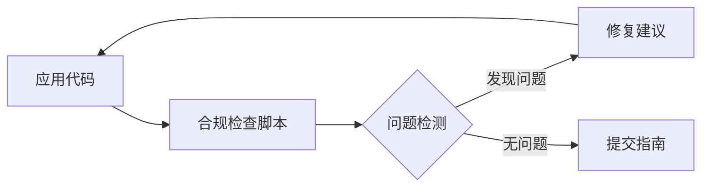
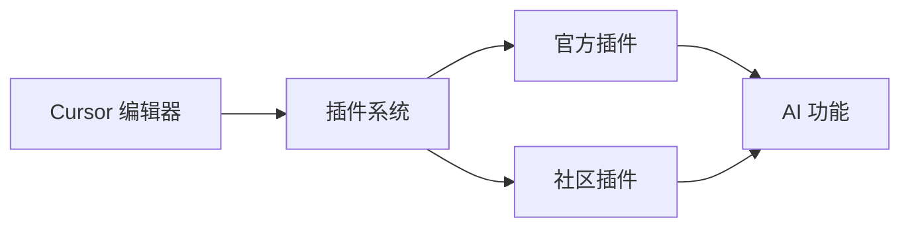
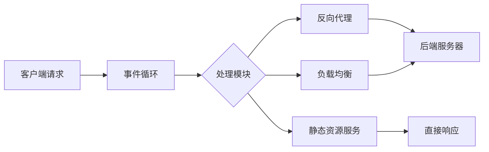

## 今日热点

AI智能体开发工具爆发式增长，从漏洞挖掘到软件开发全方位覆盖，同时大模型训练优化和多媒体AI处理工具持续火热。

---

## 热门项目一览

| 排名 | 项目 | 语言 | 今日 | 总计 | 简介 |
|:---:|------|:----:|------:|-----:|------|
| 1 | [elementalsouls/Claude-BugHunter](https://github.com/elementalsouls/Claude-BugHunter) | Python | +1,597 | 24,935 | A Claude Code skill bundle ... |
| 2 | [firecrawl/firecrawl](https://github.com/firecrawl/firecrawl) | TypeScript | +1,046 | 211,122 | Knowledge infrastructure to... |
| 3 | [cathrynlavery/diagram-design](https://github.com/cathrynlavery/diagram-design) | HTML | +955 | 74,024 | Editorial diagram design fo... |
| 4 | [XiaoYouChR/Ghost-Downloader-3](https://github.com/XiaoYouChR/Ghost-Downloader-3) | Python | +889 | 19,343 | The only downloader you nee... |
| 5 | [obra/superpowers](https://github.com/obra/superpowers) | Shell | +854 | 327,662 | An agentic skills framework... |
| 6 | [zhouxiaoka/autoclip](https://github.com/zhouxiaoka/autoclip) | Python | +774 | 17,137 | AutoClip｜The open-source Op... |
| 7 | [mvanhorn/last30days-skill](https://github.com/mvanhorn/last30days-skill) | Python | +759 | 75,917 | AI agent skill that researc... |
| 8 | [HKUDS/CLI-Anything](https://github.com/HKUDS/CLI-Anything) | Python | +746 | 66,520 | "CLI-Anything: Making ALL S... |
| 9 | [jingyaogong/minimind](https://github.com/jingyaogong/minimind) | Python | +702 | 71,826 | 🧠 两小时从 0 训出你的 64M 大模型。Train... |
| 10 | [mjmirza/app-store-compliance](https://github.com/mjmirza/app-store-compliance) | Shell | +562 | 7,145 | Avoid common App Store and ... |
| 11 | [toeverything/AFFiNE](https://github.com/toeverything/AFFiNE) | TypeScript | +525 | 79,080 | There can be more than Noti... |
| 12 | [Tracer-Cloud/opensre](https://github.com/Tracer-Cloud/opensre) | Python | +327 | 15,898 | The open-source agent for C... |

---

## 趋势洞察

```
┌─────────────────────────────────────────────────────────────────┐
│  AI/ML 工具         ████████████████████████  13 个项目        │
│  其他               █████                     3 个项目        │
└─────────────────────────────────────────────────────────────────┘
```

---

## 项目深度解读

### 1. elementalsouls/Claude-BugHunter — AI安全工具包

> **一句话总结**：Claude AI漏洞挖掘专用技能包，集成85项安全技能与攻击矩阵，提升红队工作效率。

#### 价值主张

| 维度 | 说明 |
|------|------|
| **解决痛点** | 简化AI辅助安全测试流程，标准化漏洞报告格式 |
| **目标用户** | 安全研究员、渗透测试人员、红队成员 |
| **核心亮点** | 85项专业技能 + 681种报告模式 + 24类漏洞覆盖 + 企业级攻击矩阵 |

#### 技术架构


**技术特色**：
- 基于Claude Code的专业安全技能集成
- 跨平台漏洞检测能力
- 自动化报告生成与漏洞分类
- 企业级身份与基础设施攻击矩阵
- 标准化的漏洞披露模式库

#### 热度分析

- 项目近期获得大量关注，单日增长1597星，表明安全AI工具需求旺盛
- 高Star/Fork比例(24,935/2,525≈9.9)表明项目具有高实用性和社区认可度
- 零Open Issues反映项目维护良好，用户反馈问题少

#### 快速上手

```bash
# 克隆项目
git clone https://github.com/elementalsouls/Claude-BugHunter.git

# 安装依赖
pip install -r requirements.txt
```

#### 注意事项

- 需要熟悉Claude AI助手的使用方法
- 项目仅适用于授权的安全测试环境
- 部分高级功能可能需要API访问权限
- 定期更新以获取最新的漏洞检测模式


### 2. firecrawl/firecrawl — 智能数据平台

> **一句话总结**：统一API接入550+数据源，为AI智能体提供全面知识基础设施

#### 价值主张

| 维度 | 说明 |
|------|------|
| **解决痛点** | 简化多数据源接入，解决AI智能体数据获取碎片化难题 |
| **目标用户** | AI开发者、智能体构建者、数据密集型应用团队 |
| **核心亮点** | 统一API接口 + 550+数据源支持 + 智能数据处理 + 可扩展架构 |

#### 技术架构


**技术特色**：
- 统一API抽象层，简化多数据源访问
- 智能数据提取和结构化处理
- 分布式爬取架构，支持大规模数据获取

#### 热度分析

- 项目星数超21万，近期日增超千，显示快速增长态势
- 作为AI基础设施项目，在当前AI热潮中占据重要生态位置

#### 快速上手

```bash
# 安装Firecrawl CLI
npm install -g firecrawl

# 初始化项目
firecrawl init

# 启动服务
firecrawl start
```

#### 注意事项

- 需注意遵守各数据源的使用条款和限制
- 大规模数据请求可能需要考虑API速率限制和成本因素


### 3. cathrynlavery/diagram-design — 代码图表设计库

> **一句话总结**：纯HTML+SVG实现的52种专业图表库，专为AI代码助手提供编辑器级图表解决方案。

#### 价值主张

| 维度 | 说明 |
|------|------|
| **解决痛点** | 解决AI代码助手中专业、简洁图表设计需求，避免Mermaid等工具的局限性 |
| **目标用户** | 使用Claude Code、GitHub Copilot、Cursor等AI代码助手的开发者 |
| **核心亮点** | 52种图表类型 + 自包含HTML+SVG实现 + 编辑器级设计质量 + 无依赖 |

#### 技术架构

**技术特色**：
- 纯HTML+SVG实现，无需外部依赖
- 针对代码编辑器环境优化，简洁清晰
- 无阴影设计，保持专业极简风格

#### 热度分析

- 项目获74,024星标，单日增长955，呈高速增长态势，显示开发者高度认可
- �开放问题与高fork数(4,945)表明社区活跃，维护良好且用户积极参与定制

#### 快速上手

```bash
# 克隆项目到本地
git clone https://github.com/cathrynlavery/diagram-design.git

# 在浏览器中查看所有图表示例
open diagram-design/index.html
```

#### 注意事项

- 项目未明确开源许可证，使用时需注意版权问题
- 作为纯前端实现，不适用于需要后端集成的复杂场景
- 专注编辑器环境，可能不适用于所有Web应用场景


### 4. XiaoYouChR/Ghost-Downloader-3 — 全能下载工具

> **一句话总结**：集成多种下载功能于一体，支持多种协议和平台的一站式下载解决方案。

#### 价值主张

| 维度 | 说明 |
|------|------|
| **解决痛点** | 整合多种下载功能，解决多工具切换和兼容性问题 |
| **目标用户** | 需要频繁下载各类资源的互联网用户 |
| **核心亮点** | 多协议支持 + 跨平台兼容 + 界面友好 + 高效稳定 + 功能全面 |

#### 技术架构


**技术特色**：
- 基于Python开发，跨平台兼容性强
- 模块化设计，易于扩展新功能
- 支持多种下载协议，处理复杂下载任务

#### 热度分析

- 19k+高星表明项目获得广泛认可，近期增长迅速，日增近900星
- 社区活跃度高，Fork数达1.166k，表明开发者积极参与改进

#### 快速上手

```bash
# 克隆项目
git clone https://github.com/XiaoYouChR/Ghost-Downloader-3.git
# 安装依赖
pip install -r requirements.txt
# 运行程序
python ghost_downloader.py
```

#### 注意事项

- 请确保遵守目标网站的使用条款，避免违反版权
- 下载大文件时建议检查系统资源，确保稳定运行


### 5. obra/superpowers — 智能开发框架

> **一句话总结**：一套实用的代理技能框架与软件开发方法论，帮助开发者高效构建智能系统。

#### 价值主张

| 维度 | 说明 |
|------|------|
| **解决痛点** | 提供系统化方法构建智能代理，解决复杂软件开发难题 |
| **目标用户** | 软件开发者、AI系统构建者、技术团队 |
| **核心亮点** | 代理技能框架 + 软件开发方法论 + 实用性 + 可扩展性 + 高效性 |

#### 技术架构


**技术特色**：
- 基于Shell的轻量级实现方案
- 模块化技能框架设计理念
- 实用主义开发方法论指导

#### 热度分析

- 项目获32万+星标，日增800+，表明开发者高度认可其价值
- 无公开issue但社区活跃，可能通过其他渠道交流维护

#### 快速上手

```bash
# 克隆项目
git clone https://github.com/obra/superpowers.git
# 进入目录
cd superpowers
# 初始化框架
./superpowers init
```

#### 注意事项

- 需要基本的Shell编程知识和系统理解
- 建议先阅读项目文档，理解核心方法论后再实践


### 6. zhouxiaoka/autoclip — AI视频剪辑工具

> **一句话总结**：开源本地AI视频剪辑工具，一键将长视频自动剪辑为多平台适配的短视频。

#### 价值主张

| 维度 | 说明 |
|------|------|
| **解决痛点** | 简化视频剪辑流程，无需专业技能即可快速生成高质量短视频内容 |
| **目标用户** | 内容创作者、自媒体人、教育工作者、营销人员 |
| **核心亮点** | 本地优先处理 + AI智能剪辑 + 多平台适配 + 零订阅费用 |

#### 技术架构


**技术特色**：
- 基于本地模型的AI视频内容分析技术
- 自动识别关键对话和精彩片段的智能算法
- 多平台格式适配与优化的输出机制

#### 热度分析

- 项目获得17,137个Star，单日增长774，表明项目正处于快速增长期，市场反响热烈
- 作为AI视频剪辑领域的开源替代方案，正在挑战商业工具OpusClip的市场地位

#### 快速上手

```bash
# 克隆项目
git clone https://github.com/zhouxiaoka/autoclip.git
# 安装依赖
pip install -r requirements.txt
# 运行应用
python autoclip.py --input video.mp4
```

#### 注意事项

- 项目依赖本地AI模型，可能需要较强的硬件配置
- 作为开源项目，用户可能需要自行解决部署和维护问题
- 项目描述提到"zero subscriptions"，但可能仍需要用户自行提供API密钥或模型


### 7. mvanhorn/last30days-skill — AI研究助手

> **一句话总结**：AI代理技能从Reddit、X、YouTube等多平台研究话题并生成基于事实的总结。

#### 价值主张

| 维度 | 说明 |
|------|------|
| **解决痛点** | 解决信息过载和分散问题，提供跨平台统一研究体验 |
| **目标用户** | 研究人员、内容创作者、决策者和信息收集者 |
| **核心亮点** | 多平台整合 + AI总结 + 基于事实的合成信息 |

#### 技术架构


**技术特色**：
- 多平台API集成技术
- 大型语言模型处理与总结能力
- 信息验证与来源标记系统

#### 热度分析

- 项目获得近7.6万星，单日新增759星，表明近期热度持续高涨
- 作为AI研究工具，处于当前AI应用热点领域，社区参与度高

#### 快速上手

```bash
# 安装依赖
pip install -r requirements.txt

# 运行研究
python last30days-skill.py "研究话题"

# 获取摘要
python summarize.py
```

#### 注意事项

- 需要各平台的API访问权限
- 可能需要OpenAI API密钥用于AI总结功能
- 数据收集受各平台使用条款限制


### 8. HKUDS/CLI-Anything — 命令行增强工具

> **一句话总结**：为各类软件提供统一的命令行接口，实现跨平台高效操作与自动化

#### 价值主张

| 维度 | 说明 |
|------|------|
| **解决痛点** | 为无命令行界面的软件提供CLI支持，简化操作流程 |
| **目标用户** | 开发者、系统管理员、自动化脚本编写者 |
| **核心亮点** | 无需修改原软件 + 统一CLI接口 + 跨平台支持 + 高度自动化 + 操作简化 |

#### 技术架构


**技术特色**：
- 基于Python实现的跨平台CLI适配层
- 通过代理模式为无CLI软件提供命令行支持
- 提供统一的命令行接口规范，降低学习成本

#### 热度分析

- Star数超6.5万且日增700+，表明项目热度极高且增长迅猛
- 0个Open Issues反映项目维护良好，问题通过其他渠道高效解决

#### 快速上手

```bash
# 安装CLI-Anything
pip install cli-anything

# 使用CLI-Anything操作目标软件
cli-anything <software-name> <command>
```

#### 注意事项

- 部分复杂软件可能需要额外配置才能完全支持
- 兼容性问题可能因软件版本不同而有所差异
- 首次使用可能需要为目标软件创建适配配置文件


### 9. jingyaogong/minimind — 大模型训练框架

> **一句话总结**：简化大模型训练流程，两小时完成64M参数模型从零到部署的全过程。

#### 价值主张

| 维度 | 说明 |
|------|------|
| **解决痛点** | 降低大模型训练门槛，解决训练周期长、资源需求高的问题 |
| **目标用户** | 研究人员、开发者、AI爱好者，希望快速训练自己LLM的用户 |
| **核心亮点** | 高效训练流程 + 低资源需求 + 完整端到端方案 + 快速部署能力 |

#### 技术架构


**技术特色**：
- 分布式训练优化，大幅缩短训练时间
- 资源友好型设计，降低硬件门槛
- 完整的端到端训练流水线，简化流程

#### 热度分析

- 项目获得7万+星标，日增700+，表明在AI社区引起高度关注
- 9千+次Fork显示用户积极参与二次开发和定制

#### 快速上手

```bash
# 克隆项目
git clone https://github.com/jingyaogong/minimind.git
cd minimind

# 运行训练脚本
python train.py --model_size 64M --dataset your_dataset
```

#### 注意事项

- 训练效果可能受限于硬件资源，建议使用GPU加速
- 模型性能取决于数据质量和训练时长，64M规模适合入门级应用
- 需要一定的Python和深度学习基础知识才能充分利用项目价值


### 10. mjmirza/app-store-compliance — 应用合规指南

> **一句话总结**：提供125种应用商店拒绝模式及解决方案，帮助开发者避免App Store和Google Play应用被拒。

#### 价值主张

| 维度 | 说明 |
|------|------|
| **解决痛点** | 解决应用因合规问题被应用商店拒绝，减少重复提交成本 |
| **目标用户** | 移动应用开发者、产品经理、应用发布专员 |
| **核心亮点** | 125种拒绝模式及修复方案 + 隐私清单检查 + 合规截止日追踪 + AI代理集成 |

#### 技术架构



**技术特色**：
- 基于Shell脚本构建的轻量级检查工具
- 模块化设计支持不同平台合规要求
- 集成隐私清单和数据安全自动验证

#### 热度分析

- 项目Star数快速增长，单日新增562星，反映开发者对合规工具的迫切需求
- 在移动开发社区具有重要影响力，成为应用发布前的必备参考资源

#### 快速上手

```bash
# 克隆项目
git clone https://github.com/mjmirza/app-store-compliance.git

# 运行合规检查
cd app-store-compliance && ./check-compliance.sh
```

#### 注意事项

- 项目许可证未知，使用前需确认授权条款
- 应用商店政策频繁更新，需定期同步项目最新内容
- 对于大型企业应用，建议结合专业法律意见使用


### 11. toeverything/AFFiNE — 全功能知识工作台

> **一句话总结**：隐私优先的开源知识管理平台，整合规划、排序与创作功能，提供 Notion 和 Miro 的替代方案。

#### 价值主张

| 维度 | 说明 |
|------|------|
| **解决痛点** | 知识工具闭源、隐私风险及功能单一问题，提供可定制的全功能解决方案 |
| **目标用户** | 注重隐私的知识工作者、团队及需要灵活知识管理的开发者 |
| **核心亮点** | 开源可定制 + 隐私优先 + 跨平台支持 + 模块化架构 + 离线可用 |

#### 技术架构


**技术特色**：
- 基于 TypeScript 和 React 的现代化前端架构
- 模块化设计支持功能扩展和定制
- 支持本地存储和云端同步的双重模式

#### 热度分析

- Star 数达79,080且持续增长，表明项目获得广泛认可和活跃社区支持
- 作为开源知识管理工具，正在挑战商业工具市场地位，生态建设初具规模

#### 快速上手

```bash
# 克隆仓库
git clone https://github.com/toeverything/AFFiNE.git

# 安装依赖并启动
cd AFFiNE
npm install && npm run dev
```

#### 注意事项

- 项目仍处于活跃开发阶段，API 和功能可能会有变化
- 需要一定的技术背景才能充分利用其定制化功能
- 部分高级功能可能需要额外的配置或开发


### 12. Tracer-Cloud/opensre — CI/CD可靠性代理

> **一句话总结**：开源的CI/CD代理工具，提供可靠性监控和问题检测能力。

#### 价值主张

| 维度 | 说明 |
|------|------|
| **解决痛点** | CI/CD流程中的可靠性问题和故障检测 |
| **目标用户** | DevOps工程师、SRE团队、CI/CD流程负责人 |
| **核心亮点** | 开源代理 + 实时监控 + 问题检测 + 可靠性保障 |

#### 技术架构


**技术特色**：
- 轻量级代理设计，易于集成
- 实时监控CI/CD流程健康状态
- 智能检测异常和性能瓶颈

#### 热度分析

- 项目增长迅猛，单日新增Star数达327，关注度持续攀升
- 社区活跃度高，已形成成熟的可靠性工程实践生态

#### 快速上手

```bash
# 安装opensre代理
pip install opensre

# 初始化配置
opensre init

# 启动监控
opensre start --pipeline your-pipeline-name
```

#### 注意事项

- 需要配合CI/CD工具链使用，确保API访问权限
- 监控数据可能涉及敏感信息，建议配置适当的访问控制
- 定期更新代理版本以获取最新的功能和安全修复


### 13. google-labs-code/stitch-skills — 智能编程技能库

> **一句话总结**：提供标准化Agent技能库，使多种AI编码助手能够协同工作并扩展功能。

#### 价值主张

| 维度 | 说明 |
|------|------|
| **解决痛点** | 打破AI编码助手间的壁垒，实现技能共享与功能互补 |
| **目标用户** | AI辅助开发者、多工具使用者、MCP服务器用户 |
| **核心亮点** | 遵循Agent开放标准 + 多平台兼容 + 技能模块化 + 与Stitch深度集成 |

#### 技术架构


**技术特色**：
- 基于TypeScript构建，确保类型安全与代码质量
- 采用标准化接口设计，实现跨平台无缝集成
- 模块化技能架构，便于扩展与维护

#### 热度分析

- 项目Star数超13,000且单日增长300+，显示极高的社区关注度和采用率
- 作为Google Labs项目，在AI辅助开发领域具有重要生态地位，可能成为行业标准

#### 快速上手

```bash
# 安装Stitch MCP服务器
npm install -g @stitch-mcp/server

# 加载stitch-skills
stitch-server --skills @google-labs/stitch-skills
```

#### 注意事项
- 项目许可证信息不明确，商业使用前需确认授权条款
- 依赖Stitch MCP服务器运行，单独使用可能受限
- 作为新兴项目，API和功能可能随发展而变化


### 14. cursor/plugins — AI插件生态

> **一句话总结**：Cursor 编辑器的官方插件规范与核心插件库，提供 AI 增强功能的代码编辑体验。

#### 价值主张

| 维度 | 说明 |
|------|------|
| **解决痛点** | 为 Cursor 编辑器提供扩展能力，增强 AI 辅助编程体验 |
| **目标用户** | 使用 Cursor 编辑器的开发者，需要 AI 增强编程功能的用户 |
| **核心亮点** | 统一的插件规范 + AI 功能集成 + 官方插件支持 + 社区驱动 + 可扩展性 |

#### 技术架构



**技术特色**：
- 基于 TypeScript 的类型安全插件开发
- 集成 AI 能力的插件架构设计
- 统一的插件接口规范

#### 热度分析

- 项目获得近2万星，日增270星，显示AI编程工具市场热度高涨
- 作为 Cursor 编辑器的官方插件生态，处于AI编程工具前沿位置

#### 快速上手

```bash
# 克隆官方插件仓库
git clone https://github.com/cursor/plugins.git

# 安装依赖
npm install

# 构建插件
npm run build
```

#### 注意事项

- 插件主要针对 Cursor 编辑器设计，不兼容其他编辑器
- 需要了解 Cursor 的 AI 功能才能充分利用插件价值
- 插件开发需遵循官方规范，确保与核心编辑器的兼容性


### 15. openvinotoolkit/openvino — AI推理加速工具包

> **一句话总结**：OpenVINO是Intel开发的开源AI推理工具包，优化深度学习模型性能并加速部署。

#### 价值主张

| 维度 | 说明 |
|------|------|
| **解决痛点** | 解决AI模型在边缘设备和服务器上高效部署问题，提升推理性能降低延迟 |
| **目标用户** | AI开发者、深度学习工程师、计算机视觉研究人员及系统架构师 |
| **核心亮点** | 硬件加速优化 + 跨平台支持 + 模型压缩优化 + 推理性能优化 |

#### 技术架构


**技术特色**：
- 支持多种硬件加速器(CPU/GPU/VPU/FPGA)的统一优化
- 提供模型压缩和量化技术提升推理效率
- 支持主流深度学习框架的模型转换和优化

#### 热度分析

- 项目持续稳定增长，Star数超过12k，近期每日增长约176，社区活跃度高
- 作为Intel推出的AI推理工具包，在工业界和学术界均有广泛应用，是AI部署领域的重要工具

#### 快速上手

```bash
# 克隆仓库
git clone https://github.com/openvinotoolkit/openvino.git
# 安装依赖
cd openvino && scripts/install_build_dependencies.sh
# 构建项目
mkdir build && cd build && cmake .. && make -j8
```

#### 注意事项

- OpenVINO主要针对推理优化，不支持模型训练
- 不同硬件平台的优化效果可能存在差异，需要根据实际硬件进行测试
- 某些特殊模型可能需要额外适配或优化才能获得最佳性能


### 16. nginx/nginx — 高性能Web服务器

> **一句话总结**：轻量级、高并发的Web服务器和反向代理，以事件驱动架构实现卓越性能。

#### 价值主张

| 维度 | 说明 |
|------|------|
| **解决痛点** | 解决高并发场景下的Web服务性能瓶颈问题 |
| **目标用户** | 需要高性能Web服务的企业和开发者 |
| **核心亮点** | 事件驱动架构+高并发处理+低内存占用+模块化设计+反向代理功能 |

#### 技术架构



**技术特色**：
- 基于事件驱动的异步架构，实现高并发处理能力
- 模块化设计，支持丰富的功能扩展和第三方模块
- 主进程+工作进程的架构模式，提高系统稳定性
- 高效的I/O多路复用机制，减少资源消耗
- 支持多种协议(HTTP/HTTPS/SMTP/POP3/IMAP)

#### 热度分析

- 作为Web服务器领域的领导者，nginx保持稳定的高增长态势，Star数超过33,000
- 在Web服务器市场占有率高，拥有活跃的社区和丰富的生态系统

#### 快速上手

```bash
# 安装nginx
sudo apt-get install nginx  # Ubuntu/Debian
sudo yum install nginx      # CentOS/RHEL

# 启动nginx服务
sudo systemctl start nginx

# 检查nginx状态
sudo systemctl status nginx
```

#### 注意事项

- nginx配置文件语法较为严格，需要仔细检查语法错误
- 对于复杂的反向代理配置，建议先在测试环境验证
- 定期更新nginx以获取安全补丁和新功能


## 今日推荐

| 主题 | 推荐项目 | 亮点 |
|------|----------|------|
| 今日最热 | [elementalsouls/Claude-BugHunter](https://github.com/elementalsouls/Claude-BugHunter) | A Claude Code ski... |
| 值得关注 | [firecrawl/firecrawl](https://github.com/firecrawl/firecrawl) | Knowledge infrast... |
| 快速上手 | [cathrynlavery/diagram-design](https://github.com/cathrynlavery/diagram-design) | Editorial diagram... |
| 长期潜力 | [XiaoYouChR/Ghost-Downloader-3](https://github.com/XiaoYouChR/Ghost-Downloader-3) | The only download... |

---

<div align="center">

*Generated on 2026-11-27 | Powered by GitHub Trending Reporter*

</div>