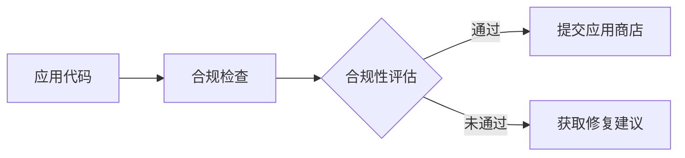
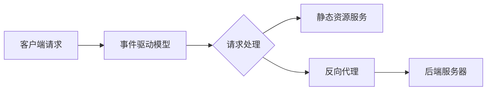

## 今日热点

AI代理技能生态爆发式增长，专业化工具链加速构建，同时AI原生应用开发工具兴起，推动大模型技术快速落地与普及。

---

## 热门项目一览

| 排名 | 项目 | 语言 | 今日 | 总计 | 简介 |
|:---:|------|:----:|------:|-----:|------|
| 1 | [elementalsouls/Claude-BugHunter](https://github.com/elementalsouls/Claude-BugHunter) | Python | +1,608 | 26,338 | A Claude Code skill bundle ... |
| 2 | [obra/superpowers](https://github.com/obra/superpowers) | Shell | +922 | 328,464 | An agentic skills framework... |
| 3 | [XiaoYouChR/Ghost-Downloader-3](https://github.com/XiaoYouChR/Ghost-Downloader-3) | Python | +836 | 20,014 | The only downloader you nee... |
| 4 | [firecrawl/firecrawl](https://github.com/firecrawl/firecrawl) | TypeScript | +822 | 211,810 | Knowledge infrastructure to... |
| 5 | [cathrynlavery/diagram-design](https://github.com/cathrynlavery/diagram-design) | HTML | +725 | 74,543 | Editorial diagram design fo... |
| 6 | [zhouxiaoka/autoclip](https://github.com/zhouxiaoka/autoclip) | Python | +718 | 17,696 | AutoClip｜The open-source Op... |
| 7 | [mvanhorn/last30days-skill](https://github.com/mvanhorn/last30days-skill) | Python | +675 | 76,455 | AI agent skill that researc... |
| 8 | [HKUDS/CLI-Anything](https://github.com/HKUDS/CLI-Anything) | Python | +666 | 67,102 | "CLI-Anything: Making ALL S... |
| 9 | [jingyaogong/minimind](https://github.com/jingyaogong/minimind) | Python | +660 | 72,297 | 🧠 两小时从 0 训出你的 64M 大模型。Train... |
| 10 | [mjmirza/app-store-compliance](https://github.com/mjmirza/app-store-compliance) | Shell | +530 | 8,018 | Avoid common App Store and ... |
| 11 | [toeverything/AFFiNE](https://github.com/toeverything/AFFiNE) | TypeScript | +474 | 79,545 | There can be more than Noti... |
| 12 | [Tracer-Cloud/opensre](https://github.com/Tracer-Cloud/opensre) | Python | +328 | 16,191 | The open-source agent for C... |

---

## 趋势洞察

```
┌─────────────────────────────────────────────────────────────────┐
│  AI/ML 工具         ████████████████████████  13 个项目        │
│  其他               █████                     3 个项目        │
└─────────────────────────────────────────────────────────────────┘
```

---

## 项目深度解读

### 1. elementalsouls/Claude-BugHunter — AI安全工具包

> **一句话总结**：Claude AI漏洞挖掘与红队工作专业工具集，集成85项安全技能与681种报告模式。

#### 价值主张

| 维度 | 说明 |
|------|------|
| **解决痛点** | 提供系统化漏洞挖掘与红队测试方法，提升安全评估效率与质量 |
| **目标用户** | 安全研究员、渗透测试人员、红队队员、企业安全团队 |
| **核心亮点** | 85项技能集成 + 681种报告模式 + 24类漏洞覆盖 + 企业级攻击矩阵 |

#### 技术架构


**技术特色**：
- 集成到Claude AI工作流中的技能系统
- 结构化漏洞分析与报告生成框架
- 预定义的漏洞模式与攻击向量库

#### 热度分析

- 项目Star数超2.6万，近期激增(+1,608 today)，显示安全社区高度认可
- 零Open Issues反映项目维护质量高，社区问题响应及时

#### 快速上手

```bash
# 安装相关依赖
pip install anthropic

# 配置API密钥
export ANTHROPIC_API_KEY=your_api_key_here
```

#### 注意事项

- 需要Anthropic API访问权限才能使用
- 应在合法授权范围内使用，避免违反法律法规
- 建议定期更新以获取最新的漏洞模式和攻击技术


### 2. obra/superpowers — 智能技能框架

> **一句话总结**：一套实用的智能代理技能框架与软件开发方法论，强调实际有效性。

#### 价值主张

| 维度 | 说明 |
|------|------|
| **解决痛点** | 解决开发者如何构建高效、可扩展的智能代理系统的挑战 |
| **目标用户** | 软件开发者、AI系统架构师和智能代理开发者 |
| **核心亮点** | 实用主义方法论 + 模块化技能设计 + 代理能力框架 + 开发最佳实践 + 可扩展架构 |

#### 技术架构


**技术特色**：
- 基于Shell实现的轻量级代理框架
- 模块化技能组合与执行机制
- 实践导向的软件开发方法论

#### 热度分析

- 项目获得32万+星标，近期日增922星，表明社区对其方法论高度认可
- 作为方法论项目，在AI与软件开发交叉领域具有显著影响力

#### 快速上手

```bash
# 克隆项目
git clone https://github.com/obra/superpowers.git
cd superpowers
# 初始化环境
./setup.sh
```

#### 注意事项

- 项目许可证未知，使用前需确认开源许可条款
- 作为方法论框架，可能需要根据具体项目进行调整和定制
- 建议先阅读项目文档以理解核心理念，再开始实践


### 3. XiaoYouChR/Ghost-Downloader-3 — 全能下载器

> **一句话总结**：集成多平台资源下载功能的一站式工具，支持视频、音频、图片等多种格式。

#### 价值主张

| 维度 | 说明 |
|------|------|
| **解决痛点** | 统一解决多平台资源下载需求，无需安装多个专用下载工具 |
| **目标用户** | 需要从不同网站批量下载资源的用户、内容收藏者 |
| **核心亮点** | 多平台支持 + 批量下载 + 命令行界面 + 高度可定制 |

#### 技术架构


**技术特色**：
- 模块化设计，支持扩展新的网站下载规则
- 异步下载技术，提高下载效率
- 智能重试机制，应对网络波动

#### 热度分析

- 项目Star数超过2万，且日增800+，表明用户认可度高，功能实用性强
- Fork数相对较低(1275)，说明项目更多作为直接使用工具而非二次开发平台

#### 快速上手

```bash
# 安装依赖
pip install -r requirements.txt

# 基本使用
python ghost_downloader.py [URL]
```

#### 注意事项

- 使用前需确认目标网站的使用条款，遵守相关法律法规
- 部分网站可能有反爬虫机制，需合理设置下载间隔避免被封禁
- 项目未明确许可证，使用时需注意版权问题


### 4. firecrawl/firecrawl — 智能知识API平台

> **一句话总结**：通过统一API连接550+数据源，为AI代理提供全方位知识基础设施支持。

#### 价值主张

| 维度 | 说明 |
|------|------|
| **解决痛点** | 解决AI代理获取多源异构数据的困难，简化知识获取流程 |
| **目标用户** | AI应用开发者、智能系统构建者、企业知识管理团队 |
| **核心亮点** | 统一API接口 + 550+数据源支持 + 智能数据提取 + 多格式输出 + 高可扩展性 |

#### 技术架构


**技术特色**：
- 采用TypeScript开发，确保类型安全和代码质量
- 分布式架构设计，支持大规模并发数据请求
- 智能数据提取算法，提高信息获取准确性

#### 热度分析

- 项目获得21万+星标，日增800+，显示其在AI基础设施领域的强劲吸引力
- 作为AI代理知识基础设施的重要组件，处于AI工具生态的关键位置

#### 快速上手

```bash
# 安装Firecrawl CLI
npm install -g firecrawl

# 初始化项目
firecrawl init

# 启动服务
firecrawl start
```

#### 注意事项

- 使用前需注册API密钥并选择合适的套餐
- 大规模数据请求可能需要额外配置和优化
- 部分数据源可能有访问频率限制，需合理规划请求策略


### 5. cathrynlavery/diagram-design — 专业图表设计库

> **一句话总结**：为AI编程助手提供52种纯HTML/SVG专业图表，简洁高效，避免Mermaid限制。

#### 价值主张

| 维度 | 说明 |
|------|------|
| **解决痛点** | 解决AI编程助手图表设计不专业、样式不统一的问题 |
| **目标用户** | AI编程工具开发者、技术文档编写者 |
| **核心亮点** | 52种图表类型 + 纯HTML/SVG实现 + 无阴影设计 + 避免Mermaid限制 |

#### 技术架构

**技术特色**：
- 纯HTML/SVG实现，无需额外依赖
- 52种专业图表类型，覆盖广泛需求
- 简洁设计风格，无多余阴影效果

#### 热度分析

- 项目获得74,543个星标，近期增长迅速(+725 today)，表明社区高度认可
- Fork数5,031，显示用户不仅关注而且积极参与项目贡献

#### 快速上手

```bash
# 克隆项目
git clone https://github.com/cathrynlavery/diagram-design.git

# 直接在浏览器中打开index.html即可使用
```

#### 注意事项

- 项目许可证未知，商业使用前需确认授权
- 不支持Mermaid语法，需要适应新的图表设计方式
- 需要基本的HTML和SVG知识才能进行自定义


### 6. zhouxiaoka/autoclip — AI视频剪辑工具

> **一句话总结**：开源AI视频剪辑工具，自动将长视频剪成短视频，生成字幕和文案，零订阅费用。

#### 价值主张

| 维度 | 说明 |
|------|------|
| **解决痛点** | 无需手动剪辑，一键将长视频自动剪成适合社交媒体的短视频 |
| **目标用户** | 内容创作者、播客主、视频博主和教育工作者 |
| **核心亮点** | AI自动剪辑 + 本地处理 + 零订阅费用 + 多平台适配 + 字幕文案生成 |

#### 技术架构


**技术特色**：
- 本地AI处理，保护用户隐私
- 多平台适配算法，支持主流短视频平台
- 自动字幕生成与内容识别技术

#### 热度分析

- 项目热度迅速增长，单日新增718星，表明用户需求强烈
- 高星低issue比例显示项目稳定性好，社区活跃度高

#### 快速上手

```bash
# 克隆项目
git clone https://github.com/zhouxiaoka/autoclip.git

# 安装依赖
pip install -r requirements.txt

# 运行程序
python autoclip.py --input video.mp4
```

#### 注意事项

- 项目可能需要较高的计算资源，尤其是AI处理部分
- 需要确保视频格式兼容性，可能需要安装额外的编解码器
- 建议在配置文件中设置输出格式和平台参数以获得最佳效果


### 7. mvanhorn/last30days-skill — AI研究助手

> **一句话总结**：跨平台AI研究助手，聚合多源信息生成主题深度摘要

#### 价值主张

| 维度 | 说明 |
|------|------|
| **解决痛点** | 信息过载下难以快速获取多平台对特定主题的综合见解 |
| **目标用户** | 研究人员、分析师、内容创作者和需要快速了解任何主题的人 |
| **核心亮点** | 多平台数据整合 + AI智能摘要 + 实时信息获取 + 结构化输出 + 无偏见分析 |

#### 技术架构


**技术特色**：
- 跨平台API集成技术，无缝连接多个社交媒体和信息源
- 大规模文本数据处理与智能分析算法
- 高效的信息过滤与去重机制，确保内容质量

#### 热度分析

- 项目获得76,455个Star，近期增长迅速，显示AI研究工具市场需求旺盛
- 社区活跃度高，Fork数达6,800，表明开发者社区积极参与扩展和改进

#### 快速上手

```bash
# 安装依赖
pip install -r requirements.txt

# 运行研究助手
python last30days-skill.py "研究主题"
```

#### 注意事项

- 需要关注各平台的API使用限制和合规要求
- AI生成内容可能存在偏见或不完整，建议交叉验证重要信息
- 需要定期更新API密钥和依赖库以确保功能正常运行


### 8. HKUDS/CLI-Anything — 全软件CLI化工具

> **一句话总结**：CLI-Anything是将任何软件转换为命令行工具的框架，实现软件的智能体原生化。

#### 价值主张

| 维度 | 说明 |
|------|------|
| **解决痛点** | 将非命令行软件无缝转换为CLI工具，简化自动化流程 |
| **目标用户** | 开发者、系统管理员、DevOps工程师、自动化爱好者 |
| **核心亮点** | 统一接口 + 无侵入式集成 + 智能代理处理 + 多软件支持 + 命令行增强 |

#### 技术架构


**技术特色**：
- 基于Python的轻量级CLI包装技术
- 智能识别并转换各类软件接口
- 无需修改原始软件即可实现CLI集成

#### 热度分析

- 项目获得67k+星且单日激增666星，表明其创新性和实用性获得广泛认可
- Fork数6k+，社区活跃度高，用户积极尝试和二次开发

#### 快速上手

```bash
# 安装CLI-Anything
pip install cli-anything

# 包装任意软件
cli-anything --wrap "software-name"

# 通过命令行调用被包装的软件
software-name --command --options
```

#### 注意事项

- 某些闭源软件可能存在集成限制
- 包装过程需要目标软件的执行权限
- 建议在使用前阅读软件的使用许可协议
- 复杂图形界面软件可能功能有限制


### 9. jingyaogong/minimind — 快速LLM训练

> **一句话总结**：低资源环境下快速训练64M参数大模型的开源工具，大幅降低LLM入门门槛。

#### 价值主张

| 维度 | 说明 |
|------|------|
| **解决痛点** | 大模型训练资源要求高、流程复杂，提供端到端简化方案 |
| **目标用户** | AI研究者、开发者、学生及LLM初学者 |
| **核心亮点** | 低资源需求 + 完整训练流程 + 快速迭代 + 易于理解 + 开源可定制 |

#### 技术架构


**技术特色**：
- 高效并行训练算法，显著缩短训练时间
- 模块化设计，支持不同规模模型快速切换
- 优化内存使用，可在消费级GPU上运行

#### 热度分析

- 项目星数持续快速增长，日均新增600+，社区活跃度高
- 作为LLM入门项目，在教育和研究领域具有重要生态价值

#### 快速上手

```bash
# 克隆项目
git clone https://github.com/jingyaogong/minimind.git
cd minimind

# 安装依赖并运行训练
pip install -r requirements.txt
python train.py --model_size 64M
```

#### 注意事项

- 64M参数模型能力有限，适合学习和实验而非生产环境
- 训练时间受硬件性能影响，2小时为理想情况
- 需要一定的Python和深度学习基础才能进行定制化开发


### 10. mjmirza/app-store-compliance — 应用合规指南

> **一句话总结**：帮助开发者避免应用商店被拒的开源指南，覆盖125种拒绝模式及修复方案。

#### 价值主张

| 维度 | 说明 |
|------|------|
| **解决痛点** | 解决应用商店审核被拒问题，提供明确修复方案 |
| **目标用户** | 移动应用开发者、发布负责人、合规官 |
| **核心亮点** | + 125种拒绝模式及修复 + 隐私合规检查 + 法律截止日期跟踪 + AI代理支持 |

#### 技术架构



**技术特色**：
- Shell脚本实现的自动化合规检查
- 覆盖多平台(App Store和Google Play)的审核标准
- 结构化的拒绝模式数据库和解决方案库

#### 热度分析

- 项目近期增长迅速，单日新增530个star，表明开发者对合规问题高度关注
- 高star与低fork比例表明项目以内容消费为主，社区贡献相对有限

#### 快速上手

```bash
# 克隆项目
git clone https://github.com/mjmirza/app-store-compliance.git

# 查看应用商店拒绝模式
cat app-store-rejections.md

# 运行合规检查脚本
./check-compliance.sh
```

#### 注意事项

- 项目使用Shell脚本，需在Unix-like系统上运行
- 需要定期更新以适应应用商店政策变化
- 法律合规建议仅供参考，具体实施需咨询专业法律顾问


### 11. toeverything/AFFiNE — 全能知识平台

> **一句话总结**：AFFiNE是一款集规划、整理与创作于一体的下一代开源知识库，注重隐私保护与高度可定制。

#### 价值主张

| 维度 | 说明 |
|------|------|
| **解决痛点** | 打破传统知识工具界限，整合规划、创作与协作功能 |
| **目标用户** | 知识工作者、创意团队、项目管理专业人士 |
| **核心亮点** | 隐私优先 + 开源可定制 + 跨平台支持 + 类Notion体验 + 全能知识管理 |

#### 技术架构


**技术特色**：
- 基于TypeScript构建，提供类型安全的开发体验
- 采用模块化架构，支持高度可定制化
- 支持本地存储与云端同步，保障数据安全

#### 热度分析

- 项目Star数近8万，日增474，呈现快速增长趋势，表明市场认可度高
- Fork数近6千，社区参与度活跃，开源生态正在形成中

#### 快速上手

```bash
# 克隆项目
git clone https://github.com/toeverything/AFFiNE.git

# 安装依赖
npm install

# 启动开发服务器
npm run dev
```

#### 注意事项

- 项目License未知，商业使用前需确认授权条款
- 作为新兴项目，生态系统和插件生态仍在发展中
- 数据隐私方面虽强调隐私优先，但仍需自行评估安全性


### 12. Tracer-Cloud/opensre — CI/CD可靠性代理

> **一句话总结**：开源的CI/CD全链路监控代理，提供实时故障检测与可靠性分析能力。

#### 价值主张

| 维度 | 说明 |
|------|------|
| **解决痛点** | 解决CI/CD管道中的隐性故障与可靠性问题，降低部署风险 |
| **目标用户** | DevOps工程师、SRE团队、CI/CD平台运维人员 |
| **核心亮点** | 全链路追踪 + 实时监控 + 智能告警 + 故障预测 + 可视化分析 |

#### 技术架构


**技术特色**：
- 轻量级Python架构，低侵入式集成CI/CD管道
- 分布式追踪技术，覆盖从代码提交到生产部署全链路
- 基于机器学习的异常检测算法，提前预警潜在问题

#### 热度分析

- Star数持续高增长，近期单日新增328，表明项目活跃度与认可度双高
- 高star低issues比例，反映项目成熟度高且问题解决效率良好

#### 快速上手

```bash
# 安装OpenSRE Agent
pip install opensre-agent

# 初始化配置
opensre-agent init

# 在CI/CD流程中集成
opensre-agent --track your-cicd-command
```

#### 注意事项

- 需确保CI/CD环境有足够权限收集相关运行数据
- 对于大型项目，建议调整采样率以平衡监控粒度与系统性能
- 初次使用应在非生产环境测试，确保与现有CI/CD工具兼容性


### 13. google-labs-code/stitch-skills — AI代理技能库

> **一句话总结**：Stitch技能库提供标准化AI代理技能，支持多种编码助手工具的无缝集成。

#### 价值主张

| 维度 | 说明 |
|------|------|
| **解决痛点** | 解决AI代理间技能不兼容问题，提供统一的技能标准 |
| **目标用户** | 开发者、AI工具使用者、MCP服务器实现者 |
| **核心亮点** | 开放标准兼容性 + 多工具支持 + 可扩展技能库 + TypeScript实现 |

#### 技术架构


**技术特色**：
- 基于TypeScript实现，提供类型安全
- 遵循Agent Skills开放标准，确保互操作性
- 设计为可扩展架构，支持添加新技能

#### 热度分析

- 项目获得13,644颗星且持续增长(+311/天)，表明开发者社区高度认可
- Fork数1,631显示项目具有良好可扩展性和定制潜力，在AI开发工具领域占据重要位置

#### 快速上手

```bash
# 安装Stitch MCP服务器
npm install -g @stitch-mcp/server

# 安装技能库
npm install @stitch-skills/core

# 初始化配置
stitch init --skills-dir ./skills
```

#### 注意事项

- 需要了解MCP (Model Context Protocol) 基础概念才能有效使用
- 部分技能可能需要特定的API密钥或服务账户配置
- 随着AI工具生态的快速发展，可能需要定期更新以保持兼容性


### 14. cursor/plugins — AI编辑器插件

> **一句话总结**：Cursor编辑器的官方插件规范与实现，为AI增强代码编辑提供扩展能力。

#### 价值主张

| 维度 | 说明 |
|------|------|
| **解决痛点** | 统一Cursor编辑器插件开发标准，扩展AI辅助编程能力 |
| **目标用户** | Cursor编辑器用户与插件开发者，AI编程工具爱好者 |
| **核心亮点** | TypeScript类型安全 + 官方插件示例 + 标准化API设计 |

#### 技术架构


**技术特色**：
- 基于TypeScript的强类型插件系统
- 模块化设计支持功能解耦
- 提供完整的插件生命周期管理

#### 热度分析

- 项目Star数超2万且持续增长，表明社区高度关注AI编辑器插件生态
- Fork数与Star数比例合理，反映项目有良好的二次开发基础

#### 快速上手

```bash
# 克隆仓库
git clone https://github.com/cursor/plugins.git

# 安装依赖
npm install

# 构建插件
npm run build
```

#### 注意事项

- 项目License未知，使用前需确认授权条款
- 插件可能仅适用于Cursor编辑器，与其他编辑器不兼容
- 项目可能处于快速发展阶段，API存在变更可能


### 15. openvinotoolkit/openvino — AI推理优化

> **一句话总结**：OpenVINO是用于优化和部署AI推理的开源工具包，提升深度学习模型在Intel硬件上的推理性能。

#### 价值主张

| 维度 | 说明 |
|------|------|
| **解决痛点** | 解决AI模型部署效率低、硬件兼容性差的问题 |
| **目标用户** | AI开发者、部署工程师、嵌入式系统开发者 |
| **核心亮点** | 硬件加速优化 + 模型格式转换 + 跨平台部署支持 |

#### 技术架构


**技术特色**：
- 支持多种深度学习框架模型转换
- 提供针对Intel硬件的底层优化
- 支持CPU、GPU、VPU等多种硬件加速

#### 热度分析

- Star数近13k且持续增长，表明项目在AI部署领域受到广泛关注
- 作为Intel官方项目，在AI推理优化领域具有重要生态地位

#### 快速上手

```bash
# 安装OpenVINO工具包
pip install openvino-dev

# 优化模型
mo --input_model model.onnx --output_dir optimized_model

# 运行推理
benchmark_app -m optimized_model/model.xml -d CPU
```

#### 注意事项
- 针对Intel硬件优化效果最佳，其他硬件支持有限
- 模型转换可能需要根据具体应用场景进行调整
- 文档较为全面但初学者可能需要一定时间适应


### 16. nginx/nginx — 高性能Web服务器

> **一句话总结**：nginx是一款轻量级、高性能的Web服务器和反向代理，以其事件驱动架构和高并发处理能力著称。

#### 价值主张

| 维度 | 说明 |
|------|------|
| **解决痛点** | 解决高并发场景下的Web服务性能瓶颈，提供高效的反向代理和负载均衡 |
| **目标用户** | 需要处理高流量网站、API服务的企业和开发者，系统架构师 |
| **核心亮点** | 事件驱动架构 + 高并发处理能力 + 模块化设计 + 低资源消耗 + 丰富的负载均衡策略 |

#### 技术架构



**技术特色**：
- 基于异步非阻塞事件驱动模型，实现高并发连接处理
- 采用多进程/多线程架构，主进程管理worker进程，提高系统稳定性
- 模块化设计，支持动态加载模块，功能可扩展性强

#### 热度分析

- 作为Web服务器领域的领导者之一，nginx拥有超过3.3万星标，持续稳定增长，表明其在业界的重要地位
- 拥有庞大的用户社区和丰富的生态系统，是构建现代Web基础设施的关键组件

#### 快速上手

```bash
# 安装nginx
sudo apt-get install nginx  # Ubuntu/Debian
sudo systemctl start nginx
sudo systemctl status nginx
```

#### 注意事项

- 配置语法严格，错误配置可能导致服务异常，建议使用nginx -t测试配置文件
- 对于动态内容处理能力不如专门的应用服务器，通常作为反向代理与后端应用服务器配合使用
- 在高流量场景下，需要适当调整worker进程数和连接数等参数以获得最佳性能


## 今日推荐

| 主题 | 推荐项目 | 亮点 |
|------|----------|------|
| 今日最热 | [elementalsouls/Claude-BugHunter](https://github.com/elementalsouls/Claude-BugHunter) | A Claude Code ski... |
| 值得关注 | [obra/superpowers](https://github.com/obra/superpowers) | An agentic skills... |
| 快速上手 | [XiaoYouChR/Ghost-Downloader-3](https://github.com/XiaoYouChR/Ghost-Downloader-3) | The only download... |
| 长期潜力 | [firecrawl/firecrawl](https://github.com/firecrawl/firecrawl) | Knowledge infrast... |

---

<div align="center">

*Generated on 2026-11-28 | Powered by GitHub Trending Reporter*

</div>